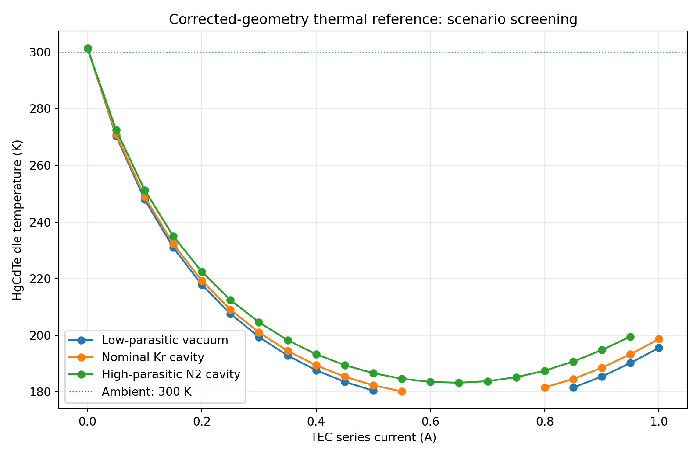

# TE_Cooled_MCT

**[Master Engineering Report — Revision 3](reports/generated/HgCdTe_Engineering_Assessment_Rev3_REVIEW_DRAFT.pdf)**

This single, continuously maintained standalone report is the current externally
facing scientific assessment. It distinguishes genuine corrected-geometry 3D
solid fields from the nonlinear reduced package and preliminary cavity proxy.
The legacy download filename is retained for compatibility; the document itself
is the Revision 3 engineering master. Historical PDF bytes remain sealed evidence.

A reproducible engineering model of a **plausible synthetic** three-stage
TEC-cooled HgCdTe detector in a nine-pin, two-ear TO-66 package. The objective
is useful thermal budgets and sensitivity, not reconstruction of a proprietary
assembly. [Modeling policy](docs/PLAUSIBLE_REFERENCE_MODEL_POLICY_20261030.md).

## Internal implementation and reproduction notes

| Question | Read / run |
| --- | --- |
| How is the single master built and its historical evidence preserved? | [Internal report build/integrity guide](docs/MASTER_REPORT_REPRODUCIBILITY.md) |
| What does the current package model solve? | [Integrated model guide](docs/INTEGRATED_REFERENCE_THERMAL_20261030.md) |
| Which P/N laws and transport approximations are available? | [Transport and enclosure guide](docs/GRADED_TEC_AND_CORRECTED_ENCLOSURE_20261030.md) |
| What is documented, inferred or assumed? | Source matrices in those guides; [materials](docs/materials_and_provenance.md) |
| What is the corrected physical construction? | [Geometry specification](GEOMETRY_SOURCE_OF_TRUTH_SPEC.md), protected geometry manifest and wire routes |
| What is actually solved in 3D? | [Corrected solid-only thermal work](CORRECTED_GEOMETRY_COUPLED_THERMAL_WORK_ORDER.md), archived Elmer evidence |
| What must future development preserve? | [AGENTS.md](AGENTS.md), sealed archive verifiers and approved reports |

## Current capabilities and their scope

| Implementation | Space / physics | Qualification limits |
| --- | --- | --- |
| `integrated_reference` + `g1_constant` | Five temperatures; three conservative TEC stages, attach, Cu/Au wires, sink, die heating and reservoir exchange | Constant verification properties; 63-point historical baseline |
| `zhang2025_analog` | Piecewise-integrated affine-temperature P/N legs | Opt-in research analog; high-current curvature omitted; historical 49 accepted / 14 rejected |
| **`zhang2025_nonlinear`** | Direct bounded nonlinear 1D P/N profiles, analytic banded Newton solve and exact-key cache; same five-node package | New opt-in option; 50 accepted / 13 rejected in the old reservoir scenarios |
| **`corrected_exchange`** | Gray radiosity and pressure-dependent gas chord network; corrected cap/window dimensions with an explicitly filled stepped core | Preliminary proxy visibility, not every native 88-leg/pin/wire surface; 52 accepted / 11 rejected when coupled to the nonlinear package |
| Archived corrected Elmer | Genuine coupled 3D solid Peltier/Joule/Fourier fields, 88 legs, header, explicit joints and die | No current corrected enclosed-package 3D field; historical raw bath/interface failures remain unresolved |

A result that conserves heat is not automatically an accurate device prediction.
The 300–390 K P/N continuation, contacts, emissivities, gas accommodation, core
closure and thermal reservoir conditions are engineering assumptions. The VIGO
housing drawing and TEC Microsystems reference do not identify a verified OEM
assembly. No optical transmission or detector carrier/noise model is solved.

## Run the current model

Use the existing pinned Docker environment; no installation or new session is
needed. It stays within four CPUs and the 12 GiB maximum. Use **new output
locations**, never sealed archives or previous versioned result folders.

```bash
# Existing baseline, or replace material with zhang2025_analog
./fem/run.sh python -m tecooledmct.integrated_reference   --material g1_constant --out outputs/reference-replay/baseline

# Direct nonlinear transport with the old effective reservoir exchange
./fem/run.sh python -m tecooledmct.integrated_reference   --material zhang2025_nonlinear --out outputs/reference-replay/nonlinear

# Build three bounded ray levels and independently audit native source faces
./fem/run.sh python -m tecooledmct.corrected_exchange   --out outputs/reference-replay/exchange

# Couple the preliminary closed proxy operator to the five-node package
./fem/run.sh python -m tecooledmct.integrated_reference   --material zhang2025_nonlinear   --exchange outputs/reference-replay/exchange/operator_65536.json   --out outputs/reference-replay/enclosed
./fem/run.sh python -m tecooledmct.integrated_reference_figures   --from-dir outputs/reference-replay/enclosed
```

`summary.json` records temperatures, stage/path budgets, electrical power,
provenance and full rejected-candidate diagnostics. `sweep.csv` contains accepted
points only; plots preserve failed intervals as gaps. Discrete grid minima are
not qualified continuous optima. The operator also records native face audits,
raw view factors, reciprocal closure corrections and mean geometric chords.

## Current evidence

New versioned results: [nonlinear transport and exchange](data/nonlinear_exchange_20261030).
At the measured-domain 0.7 A leg test, nonlinear32 vs independent BVP64 voltage
error is 0.00570%, compared with about 6.48% for the affine approximation.
At nominal 300 K, 0.15 A and 2 mW die heating, the coupled **proxy** predicts
232.209 K die temperature and 1.15193 V terminal voltage. These are reduced
synthetic-device predictions, not measured or 3D enclosed-package temperatures.



At fixed test temperatures, increasing rays per surface from 16,384 to 65,536
changes die gas heat by 0.88% and radiation by 0.14%. The largest view-factor
balancing correction is still 0.0404 absolute at the last level. This is a
preliminary operator, without a native-cavity accuracy or statistical error claim.

## Verify

```bash
./fem/run.sh python -m tecooledmct.nonlinear_tec_study   --out outputs/reference-replay/transport-checks
./fem/run.sh python -m pytest -q tests/test_nonlinear_tec.py   tests/test_corrected_exchange.py tests/test_graded_tec.py   tests/test_corrected_enclosure.py tests/test_integrated_reference.py
./fem/run.sh env TE_FEM_SMOKE=1 pytest -q --ignore=outputs
./fem/run.sh python fem/archive_bath_spatial_device.py --verify
./fem/run.sh python -m tecooledmct.cli --quick --out outputs/reference-replay/legacy-cli
./fem/run.sh python -m tecooledmct.geometry_demo --out outputs/reference-replay/legacy-geometry
```

Host-only development can use `python -m pip install -e '.[dev]'` and `pytest -q`;
native Gmsh and actual Elmer smoke require the existing FEM image. No new large
FEM production solve is needed for these reduced-model commands.

## Historical implementations and preserved reports

The original four-node `model.py`/`cli.py`, geometry sensitivity and pellet-FVM
work remain compatible demonstrations; they use different assumptions and some
OEM-anchored effective coefficients. They are not the current corrected package.
See [original physics](docs/physics_and_sources.md), [geometry study](docs/geometry_sensitivity.md),
[G1](docs/PHASE1_G1_RESULT.md), [G2a](docs/PHASE1_G2A_RESULT.md),
[G2b](docs/PHASE1_G2B_TWO_TERMINAL_RESULT.md), [G2c](docs/PHASE1_G2C_RESULT.md),
[G2d](docs/PHASE1_G2D_RESULT.md), [G3a](docs/PHASE1_G3A_RESULT.md) and
[G3b](docs/PHASE1_G3B_RESULT.md) for their original scope. Older G3b enclosure
geometry is not a source for the corrected operator.

The single master linked first is updated in place. Its original 15-page bytes
and Rev2 remain immutable historical evidence; they are not parallel current
scientific reports. See the internal [master build/integrity guide](docs/MASTER_REPORT_REPRODUCIBILITY.md). Raw bath <1% and cold interface <5% are
still requirements for a future numerical-release claim. Neither conservative
reduced budgets nor stable temperatures replace those criteria. See
[the preserved spatial-bath result](docs/BATH_SPATIAL_FLUX_AND_COMBINED_QUALIFICATION.md).

Next bounded work: expose actual interleg/pin surfaces in the exchange model,
quantify contact/bypass/grade and cap-reservoir assumptions, and test mechanism
pairs before considering another expensive 3D refinement. Keep current docs
coherent as code evolves. All development stays in this repository and the
existing sim Codex session; LSDDTS is outside scope.
