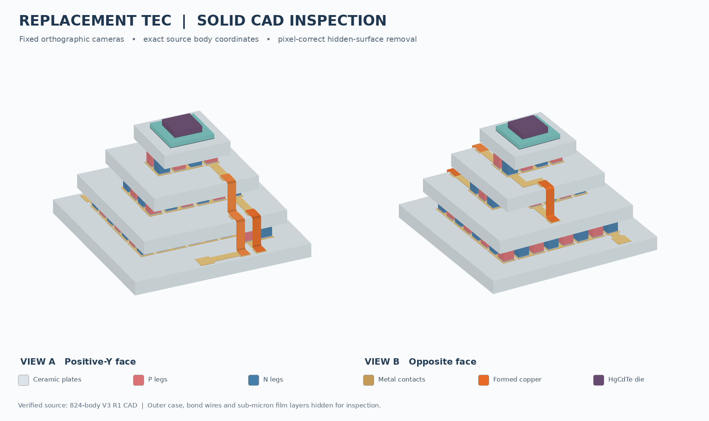
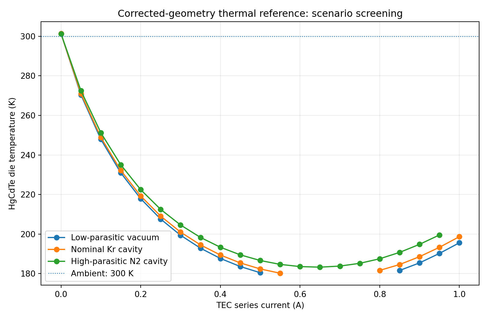

# TE_Cooled_MCT

**Current physical architecture and model assessment: [19-page standalone engineering report](reports/current/TEC_HgCdTe_Current_Architecture_20261108.pdf)**

**[View the actual shaded replacement TEC geometry](reports/current/figures/tec_solid_inspection.png)** | **[Inspect the three formed copper foil connections](reports/current/figures/tec_formed_tab_sections.png)**



**Historical methodological reference: [original 38-page Revision 3 assessment](reports/generated/HgCdTe_Engineering_Assessment_Rev3_REVIEW_DRAFT.pdf)**

These documents intentionally describe different objects. Original Rev3 records earlier 216-domain / 28/12/4 coupled solid geometry, numerical methodology and preserved raw numerical failures. It is restored unchanged and no longer overwritten with current model material. The 43-page interim integration is independently archived under reports/historical/rev3_v33_interim_43pp_20261108/.

The **replacement physical TEC** is an 824-solid formed-tab assembly with a derived 430-domain / 2,440-face geometry. Its working **V3.3 hybrid** couples 88 individually nonlinear axial legs and four original 3D ceramic fields (11,791 TET4) plus assumed joints, leads, detector, sink, krypton and radiation. At 0.4 A, 300 K, 2 mW detector load and 100 Pa krypton it predicts 210.625214 K die temperature, 1.522462 V and 0.608985 W input. This is not a fully coupled 430-domain PDE. In particular, the formed interstage tabs 58/80 and stepped return 88 still lack resolved nonlocal metal electric/thermal/Joule field coupling to the working model.

**Start here:** [Current model and historical-document identity map](docs/CURRENT_MODEL_DOCUMENTATION_MAP_20261108.md). Read the [project contract](AGENTS.md) for active development rules and priorities. Geometry pass, numerical pass, material hypothesis and actual device validation must remain distinct.

## Internal implementation and reproduction notes

Development starts with the authoritative [CURRENT PROJECT CONTRACT](AGENTS.md).
The guides below support implementation and reproduction; they are internal
methods documents, not alternative standalone scientific reports. Earlier
milestone instructions have been relocated to historical context.

| Question | Read / run |
| --- | --- |
| Which local meshing bottlenecks and faster methods are actually measured? | [R3.1 local benchmark](docs/V3_R31_LOCAL_MESH_BENCHMARK_20261103.md):54 native faces;8 accepted and4 failed/censored workers. Callback bond fixture STOP180s; native variants finish but FAIL elbow area. One exact-source-boundary directional correction passes with27,080 triangles/1.463s. Source geometry/Rev3 unchanged; global hybrid plan is prospective NOT RUN. |
| What did the bounded R3 global-mesh attempt establish? | [R3 source-conservative geometry/mesh record](docs/V3_ANALYSIS_R3_GLOBAL_MESH_20261103.md):430 domains/2440 faces,824 source/378 contact identities, exact6 full/4 partial jacket regions and0.077162028mm³ gas displacement independently audited. Meridian optimization STOPPED on source-face lineage; one adaptive surface attempt STOPPED at600s without a completed mesh. No3–5x reduction, new surface accuracy or global3D qualification claimed; PDE NOT RUN, all laws UNSET. Accepted R2/physical STEP/Rev3 unchanged. |
| Has the V3 global-meshing obstruction improved? | [R2 analysis-only thin-feature reduction](docs/V3_ANALYSIS_R2_GEOMETRY_AND_MESHABILITY_20261103.md):428 conformal domains/2422 faces, original824 sources/378 contacts preserved, connected gas, one fully CAD-area-accurate 2D global surface mesh (1.417M triangles,0 face fails at1%), and real local lead/pin 3D mesh38,496 tets. Whole-device 3D tetra mesh and physical shell/film laws still NOT QUALIFIED; physical V3 R1 unchanged. |
| Why did the earlier (pre-R2) global V3 mesh fail? | [Historical bounded full-model meshability gate](docs/V3_GLOBAL_MESHABILITY_AND_LAW_GATE_20261103.md): all438 volume/2456 boundary labels mapped, but2D candidate FAILS174 face-area gates and two3D attempts STOP on TEC lead/insulation face2395 overlapping facets. No global3D mesh or PDE qualified; all domain/interface law values remain UNSET. |
| How was the pre-R2 analysis geometry first derived? | [Historical derived V3 analysis geometry](docs/V3_DERIVED_MULTIPHYSICS_GEOMETRY_20261103.md): immutable original824-solid physical STEP →437 condensed analysis solids+connected native gas;438 conformal volumes/2,456 owned faces,378/378 original contact witnesses, local 12,113/341-tet mesh fixtures. Geometry-only acceptance; composite constitutive laws, global mesh and all physics NOT QUALIFIED. |
| Did conservative electrical discretization qualify V3? | [Separate registered RT0 study](docs/V3_CONSERVATIVE_FLUX_20261102.md): all16 analytic controls PASS; one207,396-tet mesh meets volume gates. [Independent review](data/v3_conservative_flux_20261102/independent_review.md) confirms **STOP**: raw P1 cuts81.24%, recovered IV/loss0.769% and surviving mixed potential bound FAIL; output-label defect lost direct-mixed flux export. No L2, C/D or physical qualification; old fields/STEP/Rev3 unchanged |
| What did the local V3 conductor characterization establish? | [Registered interconnect experiment](docs/V3_INTERCONNECT_ELECTROTHERMAL_20261102.md) and [independent STOP review](docs/V3_INTERCONNECT_INDEPENDENT_REVIEW_20261102.md): source/port definitions and layered controls pass their numerical scope; two actual electrical meshes **FAIL** the raw-cut gate (85.6255% vs 0.1%). Stable resistance and weak power closure do not qualify current distribution. Passive thermal C and coupled D **NOT RUN**; no full TEC resistance, heat partition, current rating or new device temperature. Original STEP/38-page Rev3 unchanged |
| Why did the earlier source-only V3 attempt stop? | [Registered V3 source/process gate](docs/V3_ASSEMBLY_SOURCE_GATE_20261102.md) and [independent review](docs/V3_ASSEMBLY_INDEPENDENT_REVIEW_20261102.md): **STOP the present assembly specification**, two architectures remain CONDITIONAL. Process-family sources and21 interface requirements expose missing joint, underside mount, die contacts and tolerances; no V3 STEP or physics existed at that historical checkpoint; the later V3 is below. IA-08 metadata independently passes; original V2/Rev3 stay frozen and issue#2 OPEN |
| What is the frozen V3 physical design? | [Synthetic V3 manufacturing/CAD](docs/SYNTHETIC_V3_ASSEMBLY_CAD_20261102.md):824 solids,real mount/formed joints,pin1/9 leads and7/8 photoconductor bonds; independent [R1 verdict](docs/SYNTHETIC_V3_CORRECTIVE_INDEPENDENT_REVIEW_20261102.md) grants **CONDITIONAL physical-design acceptance of core/header/detector** under measured-land forming/inspection requirements. Manufacturing capability,cap/window sealing,1A andperformance remain unqualified;issue#2 OPEN. The later local electrical experiment above stopped at its numerical gate |
| Which historical V2 physical audit must be preserved? | [Physical-source audit](docs/PHYSICAL_GEOMETRY_QUALIFICATION_20261102.md) and [separate independent review](docs/PHYSICAL_PLAUSIBILITY_INDEPENDENT_REVIEW_20261102.md): **V2 STOP**, despite nominal circuit/STEP PASS. At that checkpoint missing package leads, foil joint/process, mounting/tolerances, current rating and thermal allocation remain unqualified. Four manufacturer figure families,96 parameter records; versioned metadata correction preserves original23-source packet and adds an internal hypothesis source. [Issue#2 remains OPEN](https://github.com/Kajin-0/TE_Cooled_MCT/issues/2); safe and packet checkpoints have exact CI PASS |
| How is historical Rev3 reproduced without replacing the current architecture report? | [Historical Rev3 builder guide](docs/MASTER_REPORT_REPRODUCIBILITY.md) and [current model map](docs/CURRENT_MODEL_DOCUMENTATION_MAP_20261108.md) |
| What does the current package model solve? | [Integrated model guide](docs/INTEGRATED_REFERENCE_THERMAL_20261030.md) |
| Which P/N laws and transport approximations are available? | [Transport and enclosure guide](docs/GRADED_TEC_AND_CORRECTED_ENCLOSURE_20261030.md) |
| Can admitted material assumptions reach 200 K, and resemble published module curves? | [Material-hypothesis study](docs/TEC_MATERIAL_PLAUSIBILITY_20261101.md): 141/181 admitted; nominal idealized 300 K/2 mW/wires-ON sample 186.484 K at 0.4 A; substantial joint datasheet mismatch and no full-device qualification |
| Can steady cooling/voltage identify leg dimensions rather than material changes? | [Registered identifiability diagnostic](docs/TEC_GEOMETRY_MATERIAL_IDENTIFIABILITY_20261101.md): 260/269 admitted; exact A/L–rho–k ambiguity, raw SVD caveat and failed unchanged native-pad realization; no OEM fitting |
| How much does finite hot-side resistance cost at a matched die target? | [Finite-sink study](docs/FINITE_SINK_MATCHED_TARGET_20261101.md): 203/288 grid states admitted; six actual nominal 200 K crossings; 10 K/W raises target input 13.4478%, with assumed >300 K transport and explicit wire/sink heat accounting |
| Which physical evidence would most improve temperature/power credibility? | [Input/path qualification program](docs/PHYSICAL_INPUT_QUALIFICATION_20261101.md): primary-source domains, matched-target local derivatives, independent measurement requests and explicit failed/NOT RUN paths |
| Does fresh source-constrained geometry yield a feasible datasheet-aligned candidate? | [Separate29/11/4 candidate](docs/SOURCE_CONSTRAINED_TEC_CANDIDATE_20261101.md): geometric361-solid STEP gates PASS; no-fit and explicitly authorized two-factor calibration FAIL full alignment. Loaded25.11K error and omitted Cu physics prevent a qualified candidate; original reference untouched |
| Is the candidate connector/Cu/calibration/sink sequence qualified? | [Separate compact v2 prototype](docs/COMPACT_TEC_V2_20261102.md): patterned face/edge metal plus short foil gaps; nominal source circuit/clearance and359-solid STEP/SI gates PASS, physical promotion STOP. Runtime recipe restored/verified; Cu FEM/calibration/sink NOT RUN. [Earlier long-post draft](docs/GATED_CANDIDATE_CU_20261102.md) is preserved in safe checkpoint e1c431c and must not resume |
| What is documented, inferred or assumed? | Source matrices in those guides; [materials](docs/materials_and_provenance.md) |
| What is the corrected physical construction? | [Geometry specification](GEOMETRY_SOURCE_OF_TRUTH_SPEC.md), protected geometry manifest and wire routes |
| What is actually solved in 3D? | [Corrected solid-only thermal work](CORRECTED_GEOMETRY_COUPLED_THERMAL_WORK_ORDER.md), archived Elmer evidence |
| Why do reduced and corrected 3D temperatures differ? | [Matched audit](docs/MATCHED_SOLID_MODEL_DIAGNOSTIC_20261031.md) and [geometry-only nonlocal diagnostic](docs/NONLOCAL_PORT_NETWORK_20261031.md): 8.413 K predicted warming, 0.782 K residual; unresolved side-port sensitivity and ceramic spreading |
| Can the seven-port plate fixture isolate spreading? | [Native interface/admissibility audit](docs/PASSIVE_PLATE_PORT_AUDIT_20261031.md): stopped before solves; missing cut conditions and incompatible side/hot-foot traces; no causal heat attribution |
| Is there an independent native gas PDE baseline? | [Isolated cap/native gas control](docs/ISOLATED_CAP_AND_NATIVE_GAS_20261101.md): accepted SI derivative, audited connected native void, one 228,710-tet Elmer gas-only solve; **32.6274% raw balance fails 1%**. Analytic walls; no new device temperature or qualified gas budget |
| Why do raw gas flux and conservative reactions differ? | [Frozen-field forensic audit](docs/NATIVE_GAS_FLUX_FORENSICS_20261101.md): exact interior normal-flux jumps explain the net imbalance; shared-node splitting only redistributes local budgets. No new solve or cleared raw gate |
| What happened to the earlier bad STEP files? | [Original source-unit audit](docs/NATIVE_GAS_DOMAIN_AUDIT_20261101.md) and [quarantined first correction](docs/UNIT_CORRECT_CAP_AND_NATIVE_GAS_20261101.md) preserve both errors exactly; neither is used as current gas geometry |
| What must future development preserve? | [Current contract](AGENTS.md), sealed numerical evidence and original historical Rev3; improve the separate current-model report |

## Current capabilities and their scope

| Implementation | Space / physics | Qualification limits |
| --- | --- | --- |
| `integrated_reference` + `g1_constant` | Five temperatures; three conservative TEC stages, attach, Cu/Au wires, sink, die heating and reservoir exchange | Constant verification properties; 63-point historical baseline |
| `zhang2025_analog` | Piecewise-integrated affine-temperature P/N legs | Opt-in research analog; high-current curvature omitted; historical 49 accepted / 14 rejected |
| **`zhang2025_nonlinear`** | Direct bounded nonlinear 1D P/N profiles, analytic banded Newton solve and exact-key cache; same five-node package | New opt-in option; 50 accepted / 13 rejected in the old reservoir scenarios |
| **`corrected_exchange`** | Gray radiosity and pressure-dependent gas chord network; corrected cap/window dimensions with an explicitly filled stepped core | Preliminary proxy visibility, not every native 88-leg/pin/wire surface; 52 accepted / 11 rejected when coupled to the nonlinear package |
| Archived corrected Elmer | Genuine coupled 3D solid Peltier/Joule/Fourier fields, 88 legs, header, explicit joints and die | No coupled solids/gas/radiation package field; historical raw bath/interface failures remain unresolved; separate gas-only control above is unqualified |

A result that conserves heat is not automatically an accurate device prediction.
The 300–390 K P/N continuation, contacts, emissivities, gas accommodation, core
closure and thermal reservoir conditions are engineering assumptions. The VIGO
housing drawing and TEC Microsystems reference do not identify a verified OEM
assembly. No optical transmission or detector carrier/noise model is solved.

## Run the current model

Use the existing pinned Docker environment; no installation or new session is
needed. It stays within four CPUs and the 12 GiB maximum. Use **new output
locations**, never sealed archives or previous versioned result folders.

```bash
# Existing baseline, or replace material with zhang2025_analog
./fem/run.sh python -m tecooledmct.integrated_reference   --material g1_constant --out outputs/reference-replay/baseline

# Direct nonlinear transport with the old effective reservoir exchange
./fem/run.sh python -m tecooledmct.integrated_reference   --material zhang2025_nonlinear --out outputs/reference-replay/nonlinear

# Build three bounded ray levels and independently audit native source faces
./fem/run.sh python -m tecooledmct.corrected_exchange   --out outputs/reference-replay/exchange

# Couple the preliminary closed proxy operator to the five-node package
./fem/run.sh python -m tecooledmct.integrated_reference   --material zhang2025_nonlinear   --exchange outputs/reference-replay/exchange/operator_65536.json   --out outputs/reference-replay/enclosed
./fem/run.sh python -m tecooledmct.integrated_reference_figures   --from-dir outputs/reference-replay/enclosed
```

`summary.json` records temperatures, stage/path budgets, electrical power,
provenance and full rejected-candidate diagnostics. `sweep.csv` contains accepted
points only; plots preserve failed intervals as gaps. Discrete grid minima are
not qualified continuous optima. The operator also records native face audits,
raw view factors, reciprocal closure corrections and mean geometric chords.

## Current evidence

New versioned results: [nonlinear transport and exchange](data/nonlinear_exchange_20261030).
At the measured-domain 0.7 A leg test, nonlinear32 vs independent BVP64 voltage
error is 0.00570%, compared with about 6.48% for the affine approximation.
At nominal 300 K, 0.15 A and 2 mW die heating, the coupled **proxy** predicts
232.209 K die temperature and 1.15193 V terminal voltage. These are reduced
synthetic-device predictions, not measured or 3D enclosed-package temperatures.



At fixed test temperatures, increasing rays per surface from 16,384 to 65,536
changes die gas heat by 0.88% and radiation by 0.14%. The largest view-factor
balancing correction is still 0.0404 absolute at the last level. This is a
preliminary operator, without a native-cavity accuracy or statistical error claim.

## Verify

```bash
./fem/run.sh python -m tecooledmct.nonlinear_tec_study   --out outputs/reference-replay/transport-checks
./fem/run.sh python -m pytest -q tests/test_nonlinear_tec.py   tests/test_corrected_exchange.py tests/test_graded_tec.py   tests/test_corrected_enclosure.py tests/test_integrated_reference.py
./fem/run.sh env TE_FEM_SMOKE=1 pytest -q --ignore=outputs
./fem/run.sh python fem/archive_bath_spatial_device.py --verify
./fem/run.sh python -m tecooledmct.cli --quick --out outputs/reference-replay/legacy-cli
./fem/run.sh python -m tecooledmct.geometry_demo --out outputs/reference-replay/legacy-geometry
```

Host-only development can use `python -m pip install -e '.[dev]'` and `pytest -q`;
native Gmsh and actual Elmer smoke require the existing FEM image. No new large
FEM production solve is needed for these reduced-model commands.

## Historical implementations and preserved reports

The original four-node `model.py`/`cli.py`, geometry sensitivity and pellet-FVM
work remain compatible demonstrations; they use different assumptions and some
OEM-anchored effective coefficients. They are not the current corrected package.
See [original physics](docs/physics_and_sources.md), [geometry study](docs/geometry_sensitivity.md),
[G1](docs/PHASE1_G1_RESULT.md), [G2a](docs/PHASE1_G2A_RESULT.md),
[G2b](docs/PHASE1_G2B_TWO_TERMINAL_RESULT.md), [G2c](docs/PHASE1_G2C_RESULT.md),
[G2d](docs/PHASE1_G2D_RESULT.md), [G3a](docs/PHASE1_G3A_RESULT.md) and
[G3b](docs/PHASE1_G3B_RESULT.md) for their original scope. Older G3b enclosure
geometry is not a source for the corrected operator.

The single master linked first is updated in place. Its original 15-page bytes
and Rev2 remain immutable historical evidence; they are not parallel current
scientific reports. See the internal [master build/integrity guide](docs/MASTER_REPORT_REPRODUCIBILITY.md). Raw bath <1% and cold interface <5% are
still requirements for a future numerical-release claim. Neither conservative
reduced budgets nor stable temperatures replace those criteria. See
[the preserved spatial-bath result](docs/BATH_SPATIAL_FLUX_AND_COMBINED_QUALIFICATION.md).

The [contract's ordered science milestones](AGENTS.md#ordered-next-science-milestones)
govern continuation. The bounded identifiability study is complete: geometry
and reciprocal material changes are transport-equivalent, with no identified
commercial dimensions or grade. The subsequently authorized finite-sink study is
also complete, preserving all old baseline outcomes and predecessor report bytes.
The [physical-input qualification program](docs/PHYSICAL_INPUT_QUALIFICATION_20261101.md)
now ranks independent dimensions/same-grade transport and matched calorimetry
requests, with a source/domain matrix and 102 bounded local reduced calls.
At a matched 200 K target / 2 K/W sink, equal-fraction power leverage is S, k,
then rho; this is conditional sensitivity, not empirical uncertainty or grade
identification. Native gas/nonlocal/contact impacts remain unqualified or NOT RUN.
At that historical checkpoint, the then-current 38-page Rev3 was unchanged; later work is governed by the current contract above.
The subsequently authorized separate source-inspired candidate now reaches its
[registered STOP](docs/SOURCE_CONSTRAINED_TEC_CANDIDATE_20261101.md): a geometrically
consistent29/11/4,.5mm prototype substantially improves the intrinsic comparison,
but bounded calibration fails full loaded agreement. No fitted property enters
the original reference; Cu/contact/ceramic electrothermal behavior is unqualified.
Its proposed Cu electrical fixture is NOT RUN; no follow-on campaign is authorized.
The geometry-derived route/support comparison remains
conditional and its one plate-fixture follow-up stopped at the seven-port
admissibility gate. The later isolated writer/SI reader qualified a separate
cap derivative and actual native gas void, preserving both earlier unit failures.
The [gas-only control](docs/ISOLATED_CAP_AND_NATIVE_GAS_20261101.md) remains
**STOPPED: 32.6274% raw flux mismatch fails 1%**; its
[frozen-field forensics](docs/NATIVE_GAS_FLUX_FORENSICS_20261101.md) identify the
P1 normal-flux jumps without qualifying a gas budget. The proposed affine control
is neither authorized nor run. Further solid fitting/refinement is outside its stops.
Then native-surface visibility/exchange with actual
interleg/pin/wire geometry and paired mechanisms/contact/bypass/grade/
reservoir scenarios in the bounded nonlinear package. A later 3D qualification
experiment needs an engineering justification and all original gates; no OEM
calibration or large remesh is the next required milestone. Keep this README and
existing technical guides coherent with each increment; promote verified,
substantive scientific results into the same Rev3 master when warranted.
All development stays in the existing VPS sim:0.0 Codex session; LSDDTS is outside scope.
