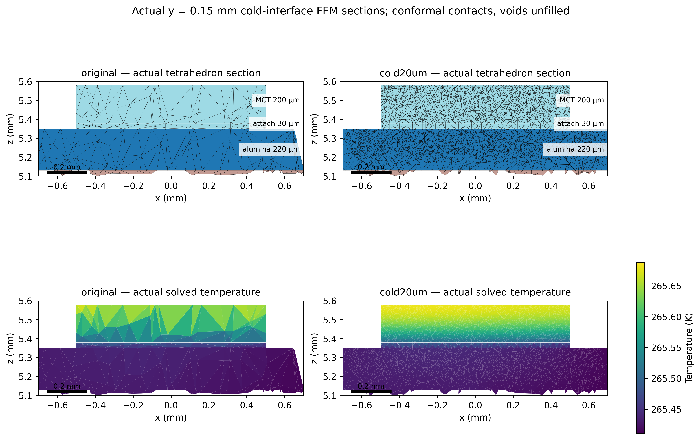
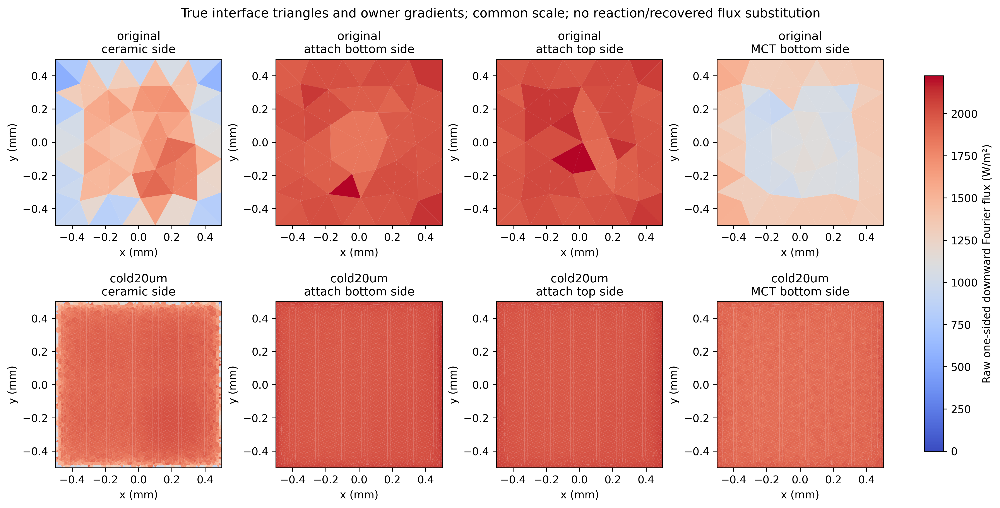
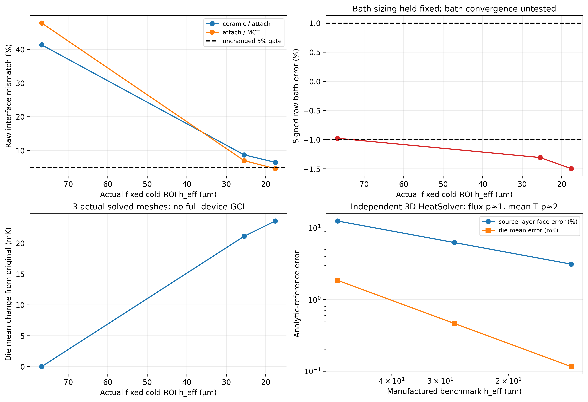
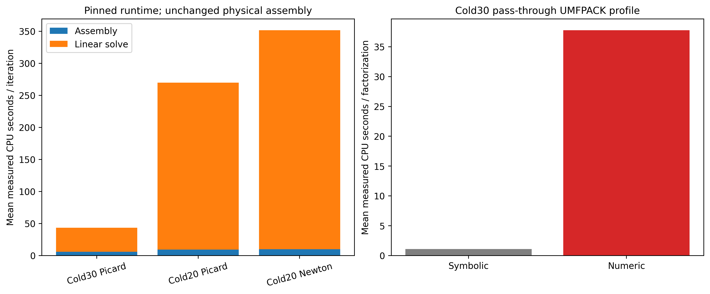
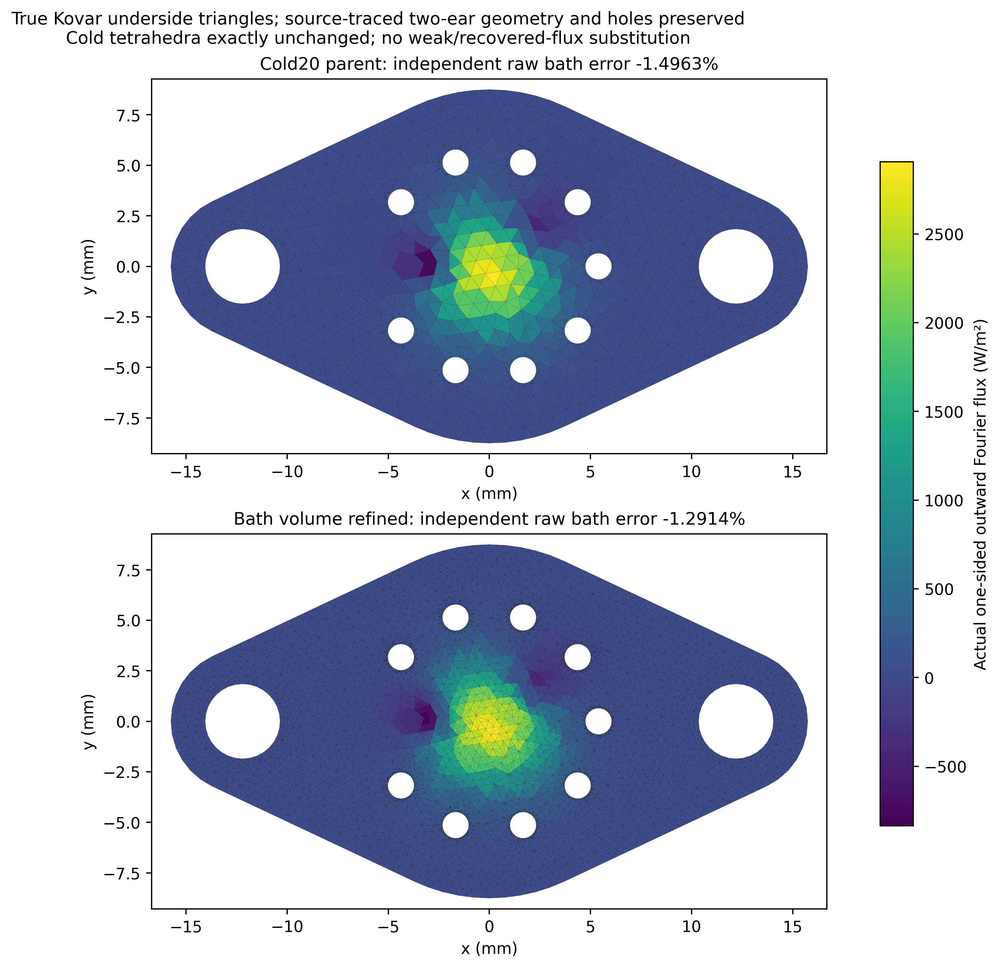

# Cold20 solver completion and independent bath diagnosis

The original647,657-tetrahedron corrected mesh now has an actual completed
coupled Elmer solution. A body-aware P1 starting state and a separately declared
1800 s bound let64-bit UMFPACK finish in1292.425 s, four nonlinear iterations,
last relative change7.6574×10⁻¹⁰. This is the same216-domain,88-leg physical
problem:0.1 A,2 mW volumetric MCT heat,300 K Kovar underside, Cu/Au hybrid
links OFF. No geometry, material law, equation, load, boundary condition,
nonlinear1e-9 tolerance or original acceptance gate was weakened.

**Solver completion is not full thermal qualification.** All177 current cuts,
free thermal/current residuals, stage/global heat and electrical work checks
pass for the native completed case. Its raw bath error is−1.496257%, still
failing1%; cold ceramic/attach+6.476539% fails5%, attach/MCT−4.608512% passes.
Earlier raw failures and the historical15-page PDF remain unchanged. The
source-traced housing plus separate TEC candidate remains a synthetic reference,
not an identified or validated OEM assembly. No enclosure/gas/radiation,
optical-transmission or carrier-transport physics was added.

## What limited performance and accuracy

CPU timers wrap the pinned upstream solver's existing assembly and
`DefaultSolve`; an inverse text transformation and byte comparison verify that
bulk/boundary mathematical assembly is unchanged. A pass-through C observer
times the original64-bit UMFPACK symbolic/numeric calls without changing them.

On the Cold30 same-mesh direct replay, symbolic analysis takes about1.1 s and
numeric factorization about38 s per iteration. L/U contain about32.9 million
entries each, with reported factorization peak about1.03 GB. On the fine refined
replay, numeric factorization takes256–265 s, symbolic analysis about1.8 s,
L/U about93.6 million entries each, reported peak about3.16 GB. Actual process
peak RSS also includes mesh/assembly and solver working arrays and stays within
the unchanged12 GiB container bound. Fine native Picard linear systems cost
257–264 s; Newton systems cost340–343 s. Assembly costs roughly8–10 s.
Numeric sparse LU dominates; solving the fine cold region introduces much more
fill than the modest increase in total node count suggests. This last attribution
is an inference from measured factor sizes and timings, not a separate proof
of an optimal ordering. The32-bit allocation failure is retained; its exact
allocation/index-limit cause is not established by peak RSS alone.

Warm Cold30 GMRES/ILU1 replays reproduce the direct solution within0.31 nK,
28 fV and1.17 nA on cuts. This near-solution test does **not** establish robust
cold-start or fine-mesh performance: GMRES/ILU1, ILU2, ILUT and robust GCR
cold-start trials exhaust their400 s bounds. On fine P1 initialization,
GMRES/ILU1 solves the first two Picard systems in61/37 s, then stalls after
Newton activation. That private trial was terminated and retained as failed.
The existing Picard branch completes at unchanged nonlinear1e-9, but its
1e-13 inner tolerance leaves10.28 µA free-current L1 residual and1.641 µW
global energy error. Those fail the original1 µA/1 µW checks. That field is
excluded from the accepted mesh sequence even though its nonlinear log converges.
A tighter1e-15 inner-residual Cold30 test also times out; its bound is retained.

Private exact-zero matrix compaction removes roughly47% of stored entries in
Picard systems. A full original matrix is retained for subsequent assembly:
Newton systems correctly regain additional nonzero entries. This trial still
exhausts400 s and is **not a qualified backend**. No coefficient threshold was
used to drop physical small-conductivity terms.

The pinned
[UMFPACK Fortran wrapper](https://github.com/ElmerCSC/elmerfem/blob/a19504ac53ec222e3355e182b08f2ff280c2203a/fem/src/umf4_f77wrapper.c)
explicitly disables iterative refinement in its ordinary solve entry. A local
interceptor retains an exact copy of each current linear matrix and calls the
existing refinement-capable entry with the **same current numeric LU**, maximum
four refinement steps. It never reuses a stale LU across nonlinear iterations.
One refinement step is taken per measured solve, about0.5 s on Cold30 and1.2 s
on Cold20, with reported sparse backward-error estimates near4×10⁻¹⁶.
Cold30 agreement passes the preregistered2 µK/20 nV/2 µA bounds. On the exact
Cold20 mesh, the refined replay differs from native by0.225 µK,3.70 nV and
1.51 nA on the worst cut; independent physical checks and gate labels agree.
This establishes numerical agreement at those bounds, not hardware accuracy.

## Starting-field transfer and independent checks

`cold20_projection` maps actual source tetrahedral P1 fields only through a
body incident to each target node. Conductors have priority at interfaces;
weights are nonnegative and sum to one. Exact-node matches bypass search.
All159,991 fine nodes map,84,975 exactly; maximum coordinate reconstruction
error is1.205 pm. No bounded curved-skin projection of meaningful size is needed.
The module-hot return gauge remains zero. Affine/constant-field tests and a
same-mesh actual PDE replay pass. A projected starting field is explicitly
labeled `initial_guess.result`; it is never accepted as a solved VTU.

The first passive-source transfer failed a preregistered1 pV absolute-zero
check: the protected source already contains27.8 pV numerical potential and the
transfer preserves it. The bound was not relaxed and that failure is archived.
A new actual zero-drive/zero-load Cold30 solve and its P1 transfer pass the
original bound; the subsequent actual Cold20 passive solve is uniform300 K
and passes all original checks. This distinguishes source roundoff from
interpolation error and preserves the rejected attempt.

Execution metadata/SIF and the archived starting file identify the actual
initialization. Default historical strings in the frozen writer/postprocessor
are supplemented by the new execution and configuration registry; they are
not reinterpreted as proof of convergence. All final fields originate from
actual Elmer executions with the original nonlinear stopping criterion.

## Three solved mesh levels

| Solved mesh | Nodes / tetrahedra | Cold ROI h_eff (µm) | Die mean (K) | Voltage (V) | Raw bath error | Cold interface jumps |
|---|---:|---:|---:|---:|---:|---:|
| original | 106767 / 366156 | 76.7241 | 265.592523602 | 0.551939871 | -0.976691% | +41.348101% / -47.827846% |
| cold30um | 124782 / 458061 | 25.4839 | 265.613621647 | 0.551945058 | -1.306057% | +8.694593% / -6.975844% |
| cold20um | 159991 / 647657 | 17.6084 | 265.616093085 | 0.551926633 | -1.496257% | +6.476539% / -4.608512% |

The conditional cold-ROI power fit gives observed order1.324415, fitted limit265.620005701 K and fine-to-limit difference3.912616 mK. These are diagnostics, not a qualified extrapolated temperature or GCI.

The third level reduces the remaining die-mean mesh change to roughly2.47 mK,
versus21.10 mK previously. Voltage is nonmonotonic, so no voltage Richardson
limit or GCI is reported. Cold-region effective h ratios are3.0107 and1.4473;
the new study reports a conditional temperature power fit only. Three samples
with mixed local refinement do not independently prove an asymptotic range.
No qualified full-device GCI is claimed. All-TEC voltage h ratios remain near1,
attach's final body-specific ratio is1.2784 and the original bath sequence is
essentially unrefined. The earlier independent manufactured-benchmark p≈1 flux/
p≈2 mean-temperature evidence is preserved, not promoted to device accuracy.

The original approximately30 µK Cu ON–OFF difference is still much smaller
than demonstrated spatial sensitivity. No resolved physical benefit, refined
Cu ON comparison, Au ON, enclosure prediction or new standalone report follows.

## Independent bath-volume refinement

One new conformal mesh bisects complete edge stars of actual Kovar bath-face
owner tetrahedra, including their normal edges. It introduces free interior
temperature nodes, not merely more triangles on a300 K Dirichlet face. Every
incident tetrahedron and declared material/exterior face is split consistently.
Volumes, contact areas, connectivity and ElmerGrid node/tet/body mapping pass.
Geometry is the exact parent polyhedron subdivided; no source dimension or
curved-skin envelope changes. Cold-region points and tetrahedra are byte-identical.

The mesh has166,516 nodes/675,496 tetrahedra; only Kovar and the nine glass
feedthrough domains change. Minimum SICN stays0.0531195. Cold ROI retains
274,317 tetrahedra and17.6084 µm effective h. Kovar changes from26,524 to53,787
tetrahedra,266.306 to210.395 µm effective h (ratio1.266). This is one
independent bath sensitivity level, **not standard bath GCI**. Both parent and
bath replay use the same LU/refinement policy and original physical equations.
An independent extractor uses coordinate-difference gradients, actual one-owner
underside triangles/normals and Kovar k=17.3 W/(m K), referencing known I·V+2 mW.
Its raw integral reproduces the frozen postprocessor; reactions remain separate.

| Case | Die mean (K) | Raw bath (mW) | Bath reaction (mW) | Raw bath error | Owner normal-height median (µm) |
|---|---:|---:|---:|---:|---:|
| Matched parent | 265.616093085 | 56.336914197 | 57.192663479 | -1.496257% | 591.922819 |
| Bath refined | 265.616513916 | 56.454378359 | 57.192957870 | -1.291382% | 295.961410 |

Raw bath error improves by0.204875 percentage points, but remains **FAIL1%**. The die shifts+0.420831 mK and voltage+2.945643 µV with identical cold cells. Cold jumps remain+6.476541% / -4.608512%; the ceramic/attach gate still **FAILS5%**. This independently demonstrates partial bath discretization sensitivity, not qualification or a threshold waiver.

## Verification status and retained limits

| Verification item | Result |
|---|---|
| Actual Cold20 nonlinear completion | PASS, original647657 tets,1292.425 s,4 steps,7.6574e-10 |
| Body-aware P1 / same-mesh replay / true zero-drive transfer | PASS; original strict passive-source rejection retained |
| Same-mesh native vs refined LU on Cold30 and Cold20 | PASS preregistered2 µK/20 nV/2 µA bounds |
|177 cut areas/current, free current/thermal, global/stage heat/work | PASS for primary fine and bath cases |
| Original Cold20 raw bath1% | FAIL,−1.496257% |
| Independently refined bath raw1% | FAIL,−1.291382% |
| Cold ceramic/attach5% / attach/MCT5% | FAIL,+6.47654% / PASS,−4.60851% |
| Three actual mesh QoI comparison | COMPLETED; conditional cold fit only |
| Voltage/standard full-device/bath/attach GCI | NOT QUALIFIED; nonmonotonicity and refinement-ratio limits |
| Completed loose fine Picard candidate | REJECTED: current/energy verification fails |
| Other iterative/compaction/tight trials | FAILED bounds, retained, not default qualified backends |
| Independent bath cold-cell invariance | PASS, exact points/tetrahedra in bodies4/302/303/304/305 |
| Tests / CLI / geometry demo | PASS,125 opt-in tests and existing demos |
| Prior archives / raw failures /15-page PDF | PRESERVED, old guards verify; no old criterion changed |
| Full thermal/OEM validation / Cu/Au ON / enclosure physics | FALSE / NOT RUN |

All sources, failed trials, actual SIF/logs/fields, projection weights, geometry
proofs and plotting arrays are archived under
`fem/results/cold20_completion_20261030`. Failed iterative solves, the completed
but physically rejected fine Picard result, strict passive-source failure and
setup/compiler development failure are retained with separate status. No
unconverged or failed-balance field enters the accepted convergence sequence.
The prior archive guard runs first and last; source/report/evidence checksums
remain protected. Local opt-in tests total125; existing CLI and geometry demo
pass. GitHub CI is checked separately for the published commit.

Digits in tables support numerical reproduction; they do not specify physical
temperature uncertainty. Unidentified material grades, attach/joint properties,
geometry/OEM construction and bath boundary assumptions remain separate from
algebraic and spatial error. Further cold ceramic/attach normal resolution is
required before thermal qualification; no original failed criterion is waived.
Commands and archival-input restoration are in
[COLD20_REPRODUCIBILITY.md](COLD20_REPRODUCIBILITY.md).
