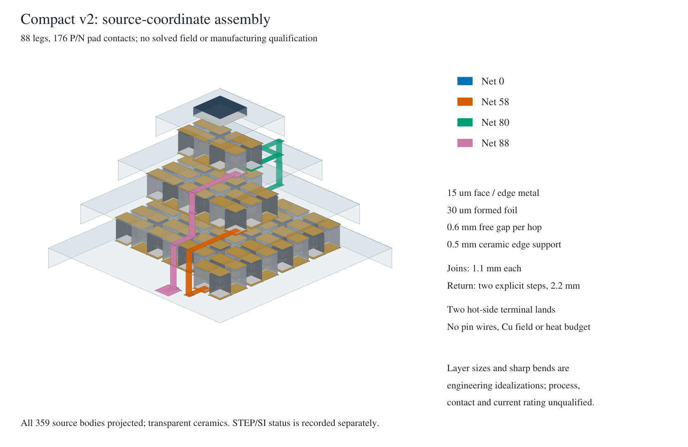

# Compact 29/11/4 v2 — registered source/CAD prototype

Baseline `7d7e9be162a334ee252c4214e7751f903c99b562`, new user authorization
observed 2026-11-02T02:09:55Z. This prospectively supersedes the documentation-only
stop in [connector review](TEC_CONNECTOR_DESIGN_PROPOSAL_20261102.md); its source
inspection and all prior drafts/results remain evidence. No candidate Cu FEM,
transport fit, sink study or public-report revision is authorized here.

## Preregistered construction and gates — before v2 generation

Create a **separate** standard-library source module and new versioned data;
never alter v1 source/STEP, earlier fixture/registration or original reference.
Retain 29/11/4 couples,88 legs of0.4×0.4×0.5mm,176 full axial P/N contacts,
four insulating ceramics and3.8mm module height; bottom/top6.4/2.4mm. Patterned
Cu15µm and SnSb35µm per leg face preserve the previous50µm metal+solder budget;
these are explicit engineering layer hypotheses, not manufacturer dimensions.
No bulk conducting ceramic, plated via or extra P/N element.

Retain the lower stage serpentine; rotate the middle layout180° and reflect the
cold layout in x, without changing leg polarity or series order. Place end pads
near their adjacent connector edges. Ordinary connections are isolated patterned
face metal. Short0.2mm-wide,30µm-thick formed foil spans only each0.6mm leg-layer
gap between ceramic-supported lands;15µm edge film covers the adjacent0.5mm
ceramic sidewall. Each full stage join is still1.1mm; the2.2mm return uses two
explicit gap/edge steps, with an isolated landing on the middle ceramic terrace.
No free-standing square post or long perimeter loop. Two exposed Cu hot-side
terminal lands, with external pin wires **not modeled**, suffice for this module
prototype; retain the known header/pin/cap context as an envelope check only.

Prototype assembly: prepare face/edge patterns on separate ceramics; populate
P/N and solder, join registered ceramic terraces, then attach the short foil
bridges to accessible edge lands. Foil compliance/bend radius, metal adhesion,
barriers, solder fillets, tolerances/fatigue and1A reliability remain unqualified;
an exact rectangular CAD corner is an idealization, not a fabrication drawing.
This is source-informed credible construction to test, not established OEM detail.

Before any CAD export require independent source tests for: positive finite
dimensions;176 exact unique full-pad owners and material/face contacts; actual
connected metal components with finite-area joins; one unbranched88-leg series
chain and cooling polarity, two hot terminals; no solid overlap or Cu short;
every vertical edge-film segment supported by its named ceramic, every free
foil gap<=0.6mm with two supported landings; source geometry envelope/clearance
and header/pin/cap screening. Negative controls remove/displace a bridge, short
nets, shrink a pad or alter a polarity/dimension/support: reject, never waive.
Report actual min gaps and support/return spans. Cross sections and J=I/A at1A
are conditional averages, not allowable current ratings or qualified Cu resistance.
No heat leak/Joule partition/performance is predicted.

Budgets: source checks<=120s per invocation, no scientific solves/meshes. After
source gates, at most **one network-enabled build** of unchanged fem/Dockerfile,
tag exactly tecooledmct-fem:26.2.1, max1200s,4CPU/8GiB when supported; stop if
disk free<30GiB or growth>15GiB. Record exact base digest, Dockerfile identity,
imageID/package versions and Elmer source commit/module provenance; no substitute
or host installation. Offline wrappers only after restoration. If blocked, retain
v2 as source-only **PENDING CAD**, not complete or qualified.

Only on verified runtime: one fresh mm author process, export STEP before any
import, exact rectilinear union volumes/bboxes and per-body names; independent
fresh metre-target reader, unit declaration1e-3, exact body count/unique signature,
volume relative error<=1e-7 and bbox absolute<=2.1e-7m. Export<=180s/import<=120s,
4CPU/8GiB, no mesh or PDE. Record every failure and protect output from overwrite.
Run source/targeted tests, master and frozen-input integrity; full applicable
regression/legacy only if recovered runtime permits and no CAD/Elmer solve tests.
No commit/push unless entire required scope verifies. Rev3 unchanged for a
geometric prototype without qualified transport or improved scientific results.

## Results and recovery

**PASS: source/CAD prototype gates and applicable software/integrity checks.**
**STOP before electrical/thermal qualification or further science.** This is a
new geometry prototype, not a manufactured device, a qualified1A interconnect,
an aligned commercial cooler or a solved new thermoelectric candidate.

Implementation: [separate v2 module](../tecooledmct/tec_candidate_v2.py),
[registered inputs](../data/tec_candidate_29114_v2_20261102/registration.json),
[actual source design](../data/tec_candidate_29114_v2_20261102/source_final/design.json)
and [source audit](../data/tec_candidate_29114_v2_20261102/source_final/source_audit.json).
The v1 author/361-solid STEP, calibration results and unexecuted old-post fixture
are unchanged. Initial source-only readouts are retained; final source geometry
replays exactly. Producer snapshots distinguish the source pass and subsequent
CAD-only cube-cleanup change, with no changed design geometry.



The source projection was rendered with the existing MuPDF tool and visually
inspected: short adjacent-terrace bridges/edge tracks replace perimeter loops;
four gap steps and both intermediate ceramic levels are explicit. Ceramics are
transparent for explanation; no field, fabricated source image or mesh is drawn.

| Quantity / gate | Actual result | Scope |
| --- | --- | --- |
| P/N and physical circuit |88 legs,176 full axial contacts,89 connected mutually isolated Cu nets;352 actual Cu–solder–leg contact edges | Unbranched series chain, correct N/P direction, no positive solid overlap or unregistered electrical face contact |
| Core / full prototype solids |357 TEC solids;359 including separate assumed detector/attach | Four ceramic plates; no extra thermoelectric leg, conducting ceramic or external pin-wire solid |
| Layer stack |2.0mm ceramic +1.5mm legs +0.3mm total metal/solder =3.8mm |15µm Cu film /35µm SnSb,30µm foil are new engineering hypotheses |
| Interstage and return |1.1mm joins;2.2mm return resolved as two steps | Each step has0.6mm foil gap between supported lands and0.5mm film on an actual ceramic edge; no1.1/2.2mm free-standing Cu pillar |
| Minimum Cu separation / P/N pad pullback |0.14 /0.11mm | Geometric bounds, not certified fabrication tolerances |
| Header / cap clearance |0.05mm underside /2.574517mm radial /4.07mm roof | Existing package sources; inner cap radius independently recovered as7.1mm from its qualified annular volume |
| Conservative projected pin / glass clearance |0.788692 /0.518692mm | All nine actual source pin centers; glass OD1.3mm is the registered hypothesis, not manufacturer dimension |
| Two exposed hot lands |net0 at(−2.03,−2.8)mm; net88 at(0.87,2.8)mm |Opposite base terraces,0.5mm-square lands; no implied pin1/9 wire installation |
| Actual STEP / SI reader |359 solids, maximum relative volume error2.043e−14 |One13.945s export, fresh separate SI reader;1mm cube volume1e−9m³; unit/error controls reject1e−3 and1e3 scale mistakes |

Download the **new prototype**, not a replacement for v1:
[candidate_v2_mm.step](../data/tec_candidate_29114_v2_20261102/cad/candidate_v2_mm.step).
[Writer](../data/tec_candidate_29114_v2_20261102/cad/writer.json),
[independent SI import](../data/tec_candidate_29114_v2_20261102/cad/si_reader.json)
and CAD producer snapshot preserve exact identities. STEP SHA-256:
`eb565ec96c57d6d13fc1b203a694a773b042a181a0965b95c950767499e15db0`.

The Cu foil/film lap is an ideal joined-metal union. Finite solder fillets,
adhesion/barrier layers, bend radii and interface resistances are not resolved.
There is actual substrate under the face lands and alongside each0.5mm wrap;
the short foil is anchored at both ends, **not continuously backed across its
0.6mm gap**. Assembly access is exposed at the terraces; joint process, strain,
fatigue and tolerances still need independent fabrication evidence. No current
rating follows from a valid nonintersecting solid model.

Face-neck area0.003mm² and foil area0.006mm² give **conditional1A averages**
3.333e8 and1.667e8A/m². No hotspot, allowable J, film resistivity, Cu R or Joule
partition has been qualified. Shorter/thicker conductors can increase thermal
shunting (`R G=rho k` only for a simple uniform constant-property branch);
the explicit return contacts multiple ceramic levels. Do not reuse either v1
centerline resistance, invent a half-split or claim improved cooling/power.

## Runtime, verification and exact reproduction

One network-enabled unchanged-recipe build completed in488.056s,4CPU/8GiB,
within disk guards; no substitute or host scientific installation. Prescribed
Ubuntu digest, all eight direct package versions, Elmer commit and thermoelectric
module hash pass. [Runtime qualification](../data/tec_candidate_29114_v2_20261102/runtime/qualification.json)
and package inventories record new image `sha256:a0b22cf70bbecaea2cbc8e1cf40aaef1bd620c187b73e251aee37a4fb9d28688`.
APT/transitive versions are recorded, **not claimed bit-identical to the missing
old image**. All runtime tests/CAD were offline through the existing wrapper.
The earlier cache-only failure and missing-image STOP are retained unchanged.

[Verification commands/results](../data/tec_candidate_29114_v2_20261102/verification/checks.json):
29 focused tests PASS (13 v2 controls),485 applicable opt-in tests PASS with the
same12 production CAD/mesh/Elmer tests deselected, original full archive/master
guards and both legacy demos PASS. No new Cu FEM, Elmer run, mesh, parameter fit
or sink campaign. [Independent byte guard](../data/tec_candidate_29114_v2_20261102/verification/preservation.json)
checks4,941 baseline files/2,896,428,811bytes,64 registered inputs and24 prior
pending/protected files unchanged; chronology prefix intact. Canonical38-page
Rev3 and all old bath/cold/gas/side-port failures remain unchanged.

Source checks and diagram (use a **new** output directory):

```bash
python3 -B -m unittest discover -s tests -p test_tec_candidate_v2.py -v
python3 -B tecooledmct/tec_candidate_v2.py source --out outputs/new-v2-source
python3 -B tecooledmct/tec_candidate_v2.py diagram --out outputs/new-v2-source
```

After independently checking the already-restored exact recipe/version record,
CAD reproduction uses fresh output and **separate processes**; do not overwrite
accepted evidence or repeat the now-finished build/export in this milestone:

```bash
./fem/run.sh timeout 180 python -B tecooledmct/tec_candidate_v2.py writer --out outputs/new-v2-cad
./fem/run.sh timeout 120 python -B tecooledmct/tec_candidate_v2.py reader --out outputs/new-v2-cad
```

Do not run the old v1 fixture. Before any further Stage A, obtain acceptance of
this architecture and fabrication/contact bounds, then register a new electrical/
thermal operator with v2-specific ports and cuts. Calibration and sink work stay
NOT RUN. All pending changes remain uncommitted: old fixture implementation is
still unexecuted/unverified; no combined publication or new CI is claimed. Rev3
stays byte-identical because prototype geometry alone does not qualify transport.
