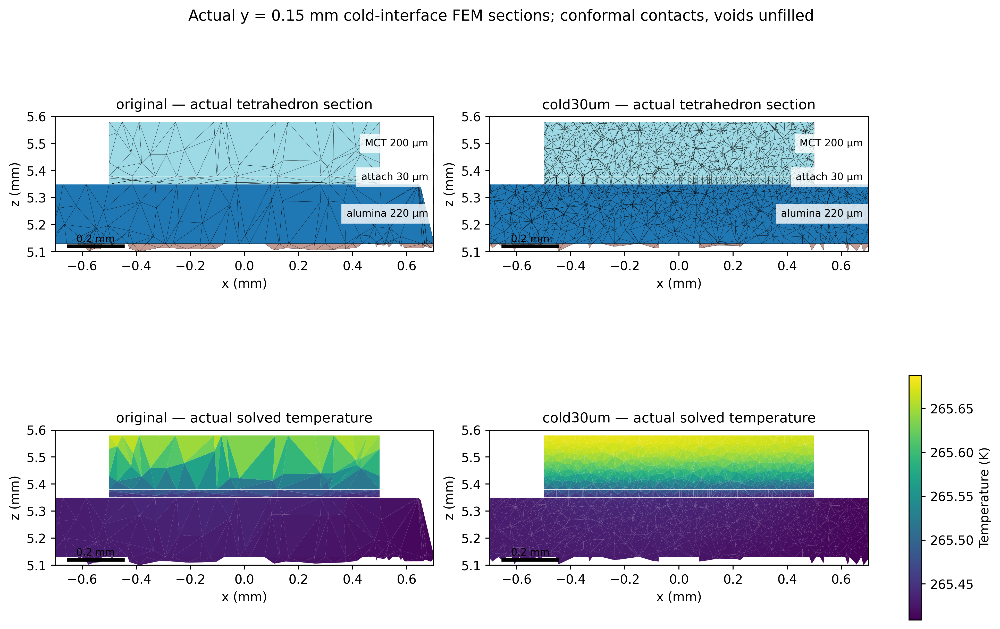
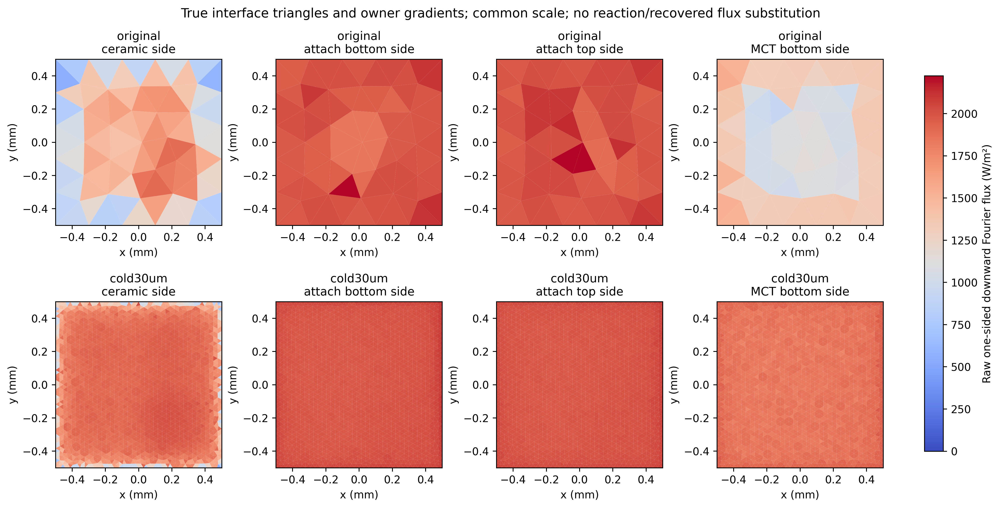
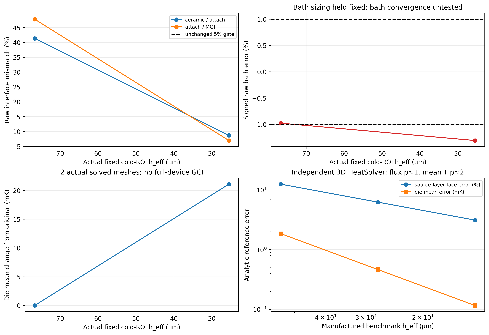

# Corrected thermal cold-interface mesh investigation

**Verified partial checkpoint: two actual solved device mesh levels, three
audited geometric meshes. Cold20 execution failed; full device convergence is
not established.**

This checkpoint independently reproduces the original41–48% one-sided flux
mismatch, qualifies a separate three-dimensional layered HeatSolver benchmark,
and refines the actual216-domain/88-leg coupled solid model. It is a numerical
investigation of a synthetic VIGO-housing/independent-TEC reference. It does not
establish an OEM assembly, material accuracy or qualified detector temperature.
All original failed raw bath criteria remain failed. The historical15-page PDF
and earlier evidence are unchanged.

## Fixed physical model and preregistered bounds

The canonical corrected registry has a1 mm², **200 µm** MCT die above a30 µm
attach with k=1 W/(m K), on220 µm cold alumina. The work-order's120 µm die
description refers to the older package; this investigation preserves the actual
corrected geometry. All three meshes use byte-identical geometry manifests,
216 physical domains,88 legs, four primary ceramic plates, source contacts and
resolved module-hot pads. No old ellipse/pin geometry is used.

Device conditions stay0.1 A, uniform2 mW MCT volumetric heat (1.5 mW bias plus
0.5 mW parametric absorption),300 K Kovar underside, Cu and Au hybrid links OFF.
All other exterior surfaces are adiabatic. Peltier, Joule, Seebeck and Fourier
terms are solved together by Elmer26.2.1. The original material laws are unchanged:
constant P/N/Cu verification proxies, sourced local MCT k(T), unqualified attach
and presolder assumptions. Physical signal/TEC pin-shaft electric transport is
still absent; tiny passive conductivity is a numerical potential extension.
There is no cap/window, gas, radiation, optical-transmission or carrier PDE.

The pre-execution plan retains raw bath1%,177 interior current cuts0.5%,
one-sided interface mismatch5%, and global/stage energy1 µW. No recovered flux
or reaction replaces a raw-gradient gate. The independent benchmark's finest
targets are constant-flux error1%, source-case error5%, interface jump5%, MCT
mean error0.2 mK, free weak residual10 nW and exact volume source. Coarser
failures are retained rather than used to reset those bounds.

## Independent diagnosis of the original field

The new extractor uses coordinate-difference3×3 gradients, actual triangle
owners/material IDs and true outward normals. It evaluates the coefficient as
the mean of the three actual face-node k values; no weak residual/reaction is
an input. It reproduces the archived mismatches to roundoff:

| Interface, lower/upper bodies | Lower outward power (mW) | Upper outward power (mW) | Signed mismatch |
|---|---:|---:|---:|
| Cold alumina / attach | −1.304893821 | +1.985060681 | +41.348101% |
| Attach / MCT | −2.014099300 | +1.236704566 | −47.827846% |

Mismatch is the signed sum of the two outward integrated powers divided by
their mean absolute power (with the unchanged0.1 mW denominator floor).
Integration is area weighted. Replacing the integral with an arithmetic mean
of triangle density changes the original ceramic side by about22.2 µW and
MCT side by−6.0 µW; it does not explain the roughly0.68/0.78 mW jumps.

The original owner heights normal to the face are median220 µm in alumina,
15 µm in attach and103.1 µm in MCT; the MCT maximum is200 µm. Attach owner
SICN ranges approximately0.169–0.350. There are only68 triangles per cold
interface and3–6 actual tetrahedron ray segments through the200 µm MCT.
The refined30 µm target mesh has2638 triangles per cold interface, median
normal heights26.4 µm alumina/30 µm attach/26.8 µm MCT, and much better
attach SICN (median0.866). Segment counts are unstructured tetrahedron
intersections, not a claim of structured layer counts.

The original corner-centroid partition has no samples within100 µm of a
corner. Beyond250 µm,78.3% of interface area contributes66.9% of the
ceramic/attach absolute jump and82.6% of the attach/MCT jump. This is not
evidence that a four-corner singularity alone causes the failure: the original
mesh cannot resolve the smallest corner bin and the error extends into the face.
All triangle values, corner distances, areas, adjacent heights/aspects and SICN
are archived. Nonzero raw estimates on adiabatic surfaces indicate derivative
error; they are not physical, prescribed side losses.

For the original MCT body, raw bottom/top/sides outward powers are
+1.236705/−0.749178/+0.079560 mW, summing to0.567087 mW against the
known2 mW source. The attach raw total is−24.297 µW against zero source.
Weak control-volume balances and the attach through-layer mean identity
remain separately conservative. A valid weak solution therefore does not
demonstrate accurate one-sided derivative recovery.

## Actual independent layered 3D HeatSolver benchmark

A separate three-layer1 mm² block uses thicknesses220/30/200 µm and
conductivities30/1/1.1 W/(m K). Its independent analytic solution is a
piecewise normal profile plus the harmonic transverse field
`0.04(x²−y²)/L² + 0.03xy/L²`, L=1 mm. The bottom and lateral temperatures
are prescribed from that analytic field; the top has an explicit Neumann
condition. These manufactured lateral Dirichlet conditions are a verification
device, not the device's adiabatic side boundary condition.

One case carries2 mW from the top with no volume source. The other deposits
2 mW only in MCT with an adiabatic top. In the source case the exact downward
normal power falls from2 mW at the attach/MCT interface to zero at the top;
it is not constant through the generating layer. Equal-and-opposite integrated
transverse flows cancel on the centered square. The analytic interface powers
are derived from this profile independently of finite-element reactions.

| Tetrahedra | MCT axial intervals | Source MCT-side flux error | Source interface mismatch | Source mean T error (mK) |
|---:|---:|---:|---:|---:|
| 2688 | 4 | 12.5000% | −13.3333% | −1.854877 |
| 21504 | 8 | 6.2500% | −6.4516% | −0.463719 |
| 172032 | 16 | 3.1250% | −3.1746% | −0.115930 |

All six cases actually ran Elmer HeatSolver. Both finest cases pass every
preregistered target. The two coarser source cases fail the5% flux/jump and
0.2 mK mean-temperature criteria; these failures are preserved. Constant-flux
integrated errors are below3×10⁻⁸ relative across all three levels, while the
finest mean error is+0.002441 mK.

For the quadratic source profile, a P1 first-layer gradient represents the
layer-average slope: its bottom power deficit is exactly `P/(2 n_z)`. The actual
solver results reproduce that first-order flux error and second-order mean T
error. This verifies signs, units, source placement and integration and supports
insufficient adjacent-cell resolution as the principal numerical explanation.
It does not prove all package-interface errors share the benchmark's coefficient
or that the remaining three-dimensional spreading error is negligible.

The uniformly refined benchmark has r=2 and confirmed analytic asymptotic
orders. With safety factor1.25, its finest flux GCI is78.125 µW (about4.03%
of the computed1.9375 mW), and mean-T GCI approximately0.144912 mK. These
are **benchmark-only** discretization estimates. Richardson/GCI require an
appropriate refinement sequence and asymptotic evidence; see the primary
[NASA NPARC spatial-convergence guidance](https://www.grc.nasa.gov/www/wind/valid/tutorial/spatconv.html).

## Controlled full-device meshes and actual coupled runs

Only cold-region sizing controls were added to the same source-driven CAD.
Global, original bridge, hot-route, pin and bath sizing controls are retained.
New target sizes are30/20 µm in the inner cold patch and100/67 µm in the
surrounding cold region. All contacts are conformal, geometry/contact/volume/
body connectivity and ElmerGrid tetrahedron mapping pass. New meshes have
minimum SICN0.05353/0.05312, with no cells below0.01. Gmsh optimization
warnings remain in the logs; they did not invalidate the positive-quality mesh
and geometry audits.

| Level | Nodes | Tetrahedra | Fixed cold ROI h_eff (µm) | Attach h_eff (µm) | Bath h_eff (µm) |
|---|---:|---:|---:|---:|---:|
| Original | 106767 | 366156 | 76.7241 | 44.5192 | 266.7328 |
| Cold30 | 124782 | 458061 | 25.4839 | 14.7033 | 266.5209 |
| Cold20 | 159991 | 647657 | 17.6084 | 11.5016 | 266.3064 |

`h_eff=(V/N)^(1/3)` uses the same physical body union4/302/303/304/305,
not the global tetrahedron count. Its ratios are3.0107 and1.4473. Attach's
final body-specific ratio is only1.2784; bath ratios are about1.0008. Local
refinement therefore cannot supply a standard attach or bath GCI. Changing
surface triangulation changes the actual bath cell count slightly even though
its sizing controls stay fixed.

The union of actual TEC conductors changes h_eff only49.618/49.059/48.340 µm.
That region also lacks a meaningful three-level refinement ratio for voltage
GCI. A cold-ROI power fit is therefore reported only as a conditional diagnostic,
never as a full-device voltage or bath error bound. The physical manifests are
identical; the unstructured grids outside the patch are not pointwise identical.

| Actual solved level | Die mean (K) | Die min / max (K) | Cold / hot ceramic mean (K) | Terminal voltage (V) |
|---|---:|---:|---:|---:|
| original | 265.592523602 | 265.478835 / 265.696032 | 265.424046 / 300.114898 | 0.551939871 |
| cold30um | 265.613621647 | 265.483078 / 265.679233 | 265.422941 / 300.114886 | 0.551945058 |

| Actual solved level | Raw ceramic/attach mismatch | Raw attach/MCT mismatch | Raw bath error | Worst177 current-cut error |
|---|---:|---:|---:|---:|
| original | +41.348101% | -47.827846% | -0.976691% | 0.401824% |
| cold30um | +8.694593% | -6.975844% | -1.306057% | 0.415013% |

| Actual solved level | Bath reaction (mW) | Independent raw bath (mW) | Global energy residual (nW) |
|---|---:|---:|---:|
| original | 57.193987874 | 56.635378583 | +0.781779 |
| cold30um | 57.194506060 | 56.447513157 | +0.232944 |

**2 actual solved mesh levels; three geometric meshes.** Die-mean change from original to the finest completed level is21.098045 mK. All177 cuts, free/current residuals, global/stage energy and electrical work checks pass on the completed cases. The middle cold-interface5% gates and bath1% gate fail. No gate is waived.

**Cold20 coupled result: FAILED execution, no accepted final field or QoI.** The projected-start run exits124 after1200.553 s, with3 completed nonlinear steps and last change0.00158800084, above1e-9. The fresh-start64-bit retry also expires at1200 s after three steps (last change0.005277926). Neither attempt supplies a temperature or flux convergence sample. Only two actual solved levels are available, so three-level observed device order, Richardson limit and GCI are **NOT RUN / NOT QUALIFIED**. The nearest-node initial-guess method is experimental; only its same-mesh file format/reproduction test is verified. A body-respecting P1 initial projection or a separately preregistered longer sparse solve remains future work.

The32-bit UMFPACK attempt on Cold20 stops in factorization with `umf4num=-1`,
before a nonlinear iteration or output field. It is retained as a failed solver
attempt. A separate64-bit UMFPACK index-mode retry uses the identical PDE
and tolerances, after normalizing only case paths in input comparisons.
Elmer's pinned
[direct-solver source](https://github.com/ElmerCSC/elmerfem/blob/a19504ac53ec222e3355e182b08f2ff280c2203a/fem/src/DirectSolve.F90)
implements that mode. No physical input was adjusted to obtain an accepted result.

The old postprocessor's historical one-mesh status string is left untouched in
each raw metrics file. `roi_scope.json` and the new study explicitly distinguish
a completed coupled execution from this multi-mesh comparison; neither string
alone is interpreted as qualification.

## Figures, verification and decision

The figures use actual plane/tetrahedron intersections and actual solved nodal
fields, or true interface triangles/owner gradients. They preserve unmeshed voids,
show units and common flux/temperature scales, and archive plotting arrays,
source hashes and field provenance. PNG350 dpi and vector PDF companions are
new scientific figures, not replacements for the historical scientific report.

| Verification item | Status and evidence |
|---|---|
| Independent analytic3D HeatSolver, finest preregistered bounds | PASS, both finest cases; six actual executions |
| Original cold jump reproduction / correct face signs | PASS, independent extraction matches protected fields |
| Three source-identical216-domain conformal meshes | PASS, geometry/contact/connectivity and Elmer mapping |
| Completed coupled mesh levels | 2/3; other executions explicitly failed, no final-field substitution |
| All177 currents, free residuals, global/stage heat and electrical work | PASS on completed cases; unchanged tolerances |
| Bath raw1% | Original PASS; Cold30 FAIL |
| Cold raw interface5% | FAIL on original and Cold30 |
| Hot presolder raw interface5% | PASS on completed cases |
| Device three-level QoI order / standard GCI | NOT QUALIFIED; insufficient completed levels and mixed refinement |
| Matched refined Cu ON | NOT RUN, conditional OFF raw gates fail |
| Same-mesh initialization-format check | PASS, two actual coupled iterations;0.340 µK /4.77 nV reproduction |
| Regression / CLI / geometry demo | PASS,121 opt-in tests and both existing demos |
| Earlier archive guards / old15-page PDF | PASS, historical evidence protected; PDF SHA256 unchanged |
| Historical failed raw bath criteria | FAILED UNCHANGED,1.65587/1.51412/1.58383%; no recovered-flux substitution |
| Full thermal/OEM qualification; gas/radiation/Au ON | FALSE / NOT RUN |

Numerical discretization error is distinct from uncertain material grades,
attach conductivity, package/bath boundary conditions and unidentified OEM
construction. The original approximately30 µK Cu ON–OFF output is far smaller
than the cold-mesh temperature sensitivity; no physical cooling advantage is
resolved. The conditional refined Cu ON comparison is **NOT RUN** while OFF
raw gates fail. No gas/radiation, Au ON or new report is justified by this result.
The next numerical step is to finish a genuine Cold20 coupled solution using
a better verified initial projection or separately bounded solver plan, then
assess additional cold-side normal refinement and separate bath-boundary
refinement. Keep the original criteria and preserve this failed/partial evidence.

Reproduction and archive layout are in
[COLD_INTERFACE_CONVERGENCE_REPRODUCIBILITY.md](COLD_INTERFACE_CONVERGENCE_REPRODUCIBILITY.md).
