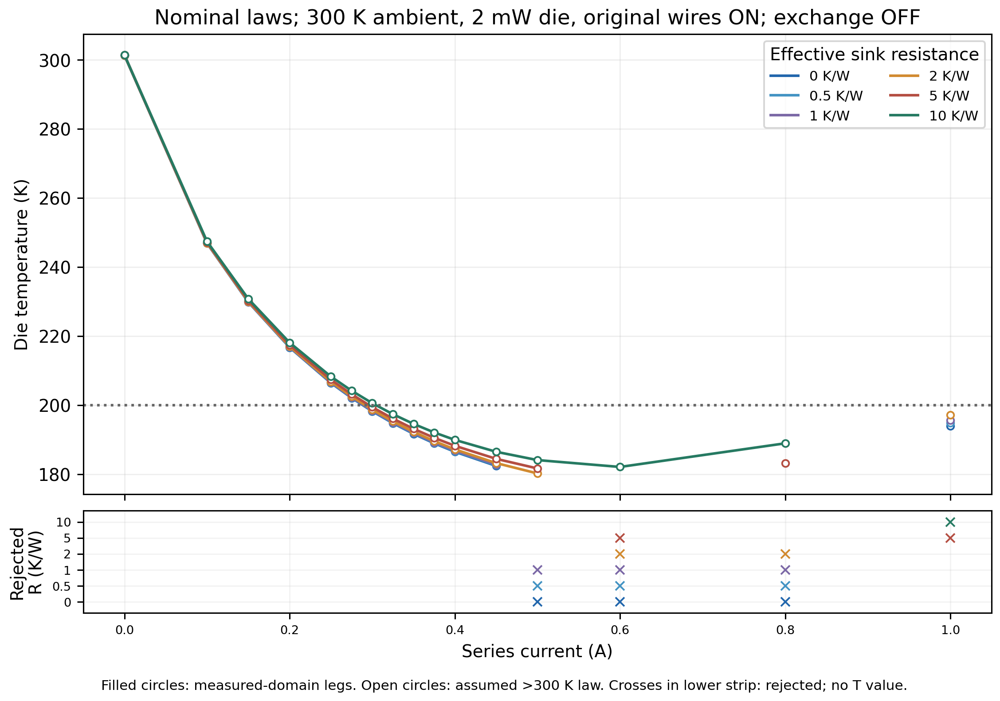
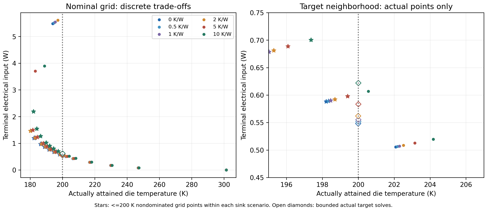
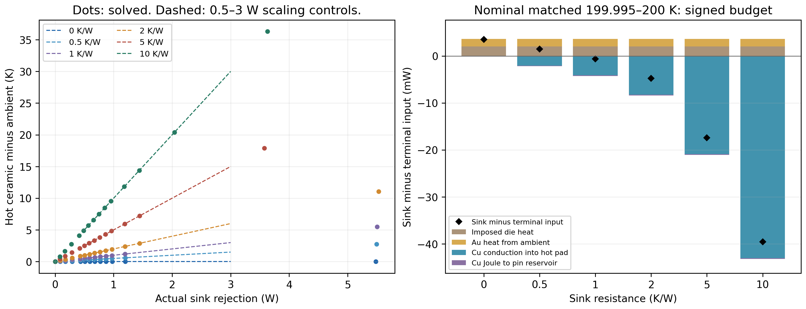

# Finite hot-side sink: bounded matched-target power study

Internal technical record; the single public scientific assessment remains Rev3.

## Preregistration before new reduced solves

Baseline: clean main `641bf5df70d5c585cb9027efd5d1420e604c2e59`. The user now
authorizes this finite-sink question prospectively; earlier proposals/stops and
their original evidence are not rewritten. Preserve existing nonlinear/affine/G1
algorithms, source laws, native CAD/mesh, all prior studies and failed gates.
No OEM fitting, new CAD/mesh/Elmer/gas/radiation, hardware or changed geometry.

### Fixed physics, hypotheses and outputs

Use unchanged `integrated_reference.solve`, `zhang2025_nonlinear`, 32 axial
intervals, original 28/12/4 couples, area 0.16 mm² and lengths 1.07/0.82/0.64 mm.
Ambient/pin reservoir is **300 K**, imposed die heat **0.002 W**, original Cu/Au
wires **ON**, ideal stage contacts and zero bypass. Die attach remains unchanged.
Gas pressure and cap/window emissivities are zero; no exchange operator is used.
The sink is the existing effective hot-ceramic-to-ambient resistance, not resolved
header/contact spreading. The Cu wire paths separately connect hot pads to the
prescribed pin reservoir and must not be folded into the sink a second time.

| Input | Registered values | Status / provenance |
| --- | --- | --- |
| Rθ, K/W | 0, 0.5, 1, 2, 5, 10 | Engineering hypotheses: ideal control, prior 0.5–5 range plus explicit 10 K/W stress; not measured hardware |
| Current, A | 0, .1, .15, .2, .25, .275, .3, .325, .35, .375, .4, .45, .5, .6, .8, 1 | Fixed grid, no current optimization |
| Nominal (S,rho,k) factors | (1,1,1) | Corrected Zhang2025 distinct P/N research specimens |
| Lower hypothesis | (.9,1.2,1.2) | Previously registered coherent engineering triple, covariance/manufacturability unknown |
| Higher hypothesis | (1.1,.8,.8) | Same caveat; higher hypothetical ZT is neither a characterized grade nor proof of impossibility |

All three hypotheses use the whole current/sink grid: **288 primary cases**.
The 40–300 K source laws remain intact; active solver domain is 180–390 K.
Above 300 K the quarter terminal-tangent is **ASSUMED**, not measured. Record
each stage's full local extrema, not just junctions; fail outside active domain.
Preserve sigma=1/rho, Thomson=T*dS/dT and one-sided knot semantics. No fitted
(.892,.603,1.731) triple, g=1.7 scenario or OEM comparison is run; the latter
geometry hypothesis fails all 176 original full-pad footprint checks.

Retain Tdie, all five temperatures, stage lifts/local extrema, cold-stage Qc,
module/terminal voltage and input, sink rejection, signed wire/ambient paths,
global/node/stage residuals and source coverage. Die COP is Qdie/Pterminal;
cooler COP is Qc,cold/Pmodule, undefined at zero input. Accepted/rejected/NOT RUN
are separate, with complete available failure diagnostics and visible gaps.
Minimum-power and nondominated <=200 K **grid samples** are not global optima.
No admitted sample does not prove physical infeasibility; Qmax/DeltaTmax NOT RUN.

### Independent balances and controls

Signs are positive into the hot pad/die for Cu/Au conduction, positive out to
the sink for Qsink. Let Gcu/Gau and Rcu be sums from original wire routes,
Jcu=I²Rcu, Qau=Gau*(Ta-Tdie), Qcu=Gcu*(Ta-Th), Qdet=0.002 W:

```text
Qsink = Qh,hot-stage + Qcu + Jcu/2                 [W]
Th = Ta + Rθ*Qsink                                [K]
Pterminal = I*Vmodule + Jcu                        [W]
Qsink = Pterminal + Qdet + Qau + Qcu - Jcu/2       [W]
Qc,cold = Qdet + Qau                              [W]
```

These are independently recomputed from temperatures, route coefficients and
stage endpoints, never by overwriting a reported power. The other half of Cu
Joule heat goes to the pin reservoir; Au thermal loading is not detector bias.
With exchange OFF there are no hidden enclosure/warm-surface loads. Total
rejection to ambient, including signed direct lead paths, equals Pterminal+Qdet.
Do not assume Qsink=IV or add failed gas/nonlocal fluxes as new loads.

Before primary cases: solve **nine G1 constant-property controls**, I=0/.3/.8 A
at Rθ=0/2/10 K/W, against an independently assembled exact 5x5 linear system.
At I=0 also check the independent series/parallel resistance formula, including
Au and the parallel Cu/sink path. Gates: temperatures 1e-6 K, V 1e-7 V and
heat 1e-8 W. Negative/nonfinite Rθ, invalid current/material scales and 179.999 /
390.001 K property queries must reject without being physical scenario outputs.

For every admitted primary point independently audit node/global energy <1e-8 W,
stage energy <1e-9 W and hot-sink residual <2e-8 K (unchanged optimizer K/2
scaling). Replay all matching Rθ=0/wires-ON points from the frozen material
study within 1e-6 K / 1e-7 V; retain matching rejection classifications.
Assess signed temperature/power response only on accepted pairs with identical
current/grade/load; monotonicity is an observation, not a universal imposed gate.

After the grid, independently reconstruct the nonlinear five balances and solve
at nominal I=.3 A, Rθ=2/10 using **two fixed seeds** each:
(301,270,240,210,210.1) K and (310,260,220,195,195.1) K in hot-to-die order.
Use bounded least-squares and unchanged nonlinear stage transport, at most 120
evaluations, without the production solver's G1 initialization. Compare accepted
roots with the primary point within 1e-5 K / 1e-7 V / 1e-8 W. Four checks test
selected initialization dependence, not all possible branches or stability.
If a reference point rejects, comparison is NOT RUN; any failed independent
balance/control or differing admitted root stops comparative conclusions.

### Bounded matched-target rule and cost

For **nominal only**, inspect all adjacent original current-grid pairs at each
Rθ after the grid. Register every admitted falling 200 K bracket; execute only
the first such pair in ascending current. Both endpoints must be accepted,
with Tdie(left)>200 and Tdie(right)<=200. Rejected gaps are never bridged.
Use actual midpoint-current solves, at most **10 per Rθ / 60 total**, until
the accepted cold endpoint satisfies 0<=200-Tdie<=**0.005 K**. No interpolated
temperature or root is reported. Stop that bracket on a rejection or midpoint
temperature outside the endpoint range by >1e-5 K; do not try a different
interval, retune parameters or claim uniqueness. Exhaustion gives an unresolved
bounded bracket, not an exact target. Saved brackets/attempts remain visible.
This is a conditional crossing on one sampled branch, not minimum global power.

Maximum **361 top-level** package/root calls: 288 grid + 9 analytic controls + 4 branch
checks + 60 target midpoints; <=**600 s total reduced execution**, <=**8 s**
per call, including the unchanged production solver's internal G1 initial guess.
Those initial guesses are not additional admitted nonlinear observations.
No retries; all remaining registered slots become NOT RUN on budget
exhaustion. Existing offline pinned wrapper <=4 CPUs/8 GiB; no install/rebuild.
Known invalid-input checks do not solve a model. Frozen sources, previous raw
results and source geometry hashes are registered before controls. Previous
live PDF hashes are baseline identities, with exact bytes preserved separately
if this study later merits an authorized in-place master update.

Plots from saved actual data only: (1) nominal Tdie/current by sink, source
coverage and explicit rejection markers with gaps; (2) input/Tdie and <=200 K
nondominated samples, with conditional solved target points distinguished;
(3) hot rise versus actual Qsink and an auditable signed target heat budget.
The 0.5/1/2/3 W sink-load scaling table is deltaT=Rθ*Q, **not new die loads**.
Overlay actual solved Qsink; never replace it by IV. Nonlocal paths, real contacts,
spreading and qualified gas/radiation remain omitted limitations.

Focused and applicable opt-in regression exclude the 12 CAD/mesh/Elmer runtime
cases. Run archive/master and both legacy gates. Assess same-Rev3 integration
only after science checks; any update requires exact predecessor preservation,
independent deterministic builds and every-page visual QA. Append true UTC
PASS/FAIL/STOP events; commit/push verified scope and exact CI, then stop.

## Results

**Conditional 200 K crossings remain admitted for every registered nominal sink
resistance, with higher electrical cost; real-device feasibility is unresolved.**
All six nominal crossings were solved, without interpolated outputs, at
199.995–200 K on the first registered admitted falling bracket. At Rθ=10 K/W,
terminal input is **0.622176 W**, versus **0.548425 W** at Rθ=0: **+13.4478%**
for this bounded matched-target comparison. Hot ceramic temperature is
**305.826317 K**, requiring the assumed above-300 K law. No sink, geometry or
material scale was fitted to an external curve.

### Execution, coverage and what failed

The one registered run took **193.560 s**, below 600 s. All **288 grid cases**
were attempted: **203 admitted / 85 rejected / 0 NOT RUN**. Of the admitted
grid, **25** stay inside measured material coverage and **178** use the assumed
continuation; every admitted Rθ>0 case uses it. Nine analytic constant controls
and four independent branch checks passed. The six target procedures used
**54 actual midpoint solves**, all admitted; six of 60 reserved target slots
were **NOT RUN because the stopping tolerance was met**, not missing grid data.
Thus 355 top-level calls were attempted, with 270 admitted and 85 rejected;
361 is the registered maximum including unused slots. Internal unchanged G1
initial guesses are included in measured runtime, not counted as observations.

The 85 failed grid cases comprise **77 active-bound residual failures** and
**eight leg residual/domain failures**, retaining last available candidates,
optimizer messages, residuals, bounds and transport diagnostics. No timeout or
budget omission occurred. Rejection does not prove that a physical equilibrium
is impossible; the 180 K floor, chosen nonlinear initialization and bounded
solver constrain coverage. Accepted islands at higher current are not joined
through rejected intervals. The three hypotheses admit 82/96, 90/96 and 31/96
cases for nominal/lower/higher, respectively.



### Fixed-current response versus matched-target cost

At **the same 0.3 A**, ambient/load/wires/law are identical across each row:

| Rθ (K/W) | Hot (K) | Die (K) | Terminal V | Terminal input (W) | Sink rejection (W) |
| ---: | ---: | ---: | ---: | ---: | ---: |
| 0 | 300.000000 | 198.215733 | 1.960984 | 0.588295 | 0.591805 |
| 0.5 | 300.295310 | 198.336383 | 1.964307 | 0.589292 | 0.590620 |
| 1 | 300.589439 | 198.456571 | 1.967616 | 0.590285 | 0.589439 |
| 2 | 301.174139 | 198.696646 | 1.974123 | 0.592237 | 0.587070 |
| 5 | 302.900158 | 199.406659 | 1.993184 | 0.597955 | 0.580032 |
| 10 | 305.684760 | 200.559517 | 2.023266 | 0.606980 | 0.568476 |

Increasing Rθ raises hot/die temperature and terminal power in all **166 admitted
adjacent-sink pairs** at matched current/hypothesis, within numerical precision.
This is an observation on those samples, not a universal monotonicity theorem,
branch-stability result or permission to fill gaps. Sink rejection can **decrease
at fixed current** while terminal power rises: more heat leaves directly through
Cu to its 300 K pin reservoir. At a fixed die target, current must instead rise.

Actual cold-side target endpoints (all Tdie in 199.995–200 K):

| Rθ (K/W) | I (A) | Hot (K) | Terminal V | Input (W) | Sink (W) | Input increase vs Rθ=0 |
| ---: | ---: | ---: | ---: | ---: | ---: | ---: |
| 0 | 0.288134766 | 300.000000 | 1.903363 | 0.548425 | 0.551919 | 0.0000% |
| 0.5 | 0.288867188 | 300.276590 | 1.909978 | 0.551730 | 0.553181 | 0.6026% |
| 1 | 0.289624023 | 300.554530 | 1.916736 | 0.555133 | 0.554530 | 1.2231% |
| 2 | 0.291162109 | 301.114622 | 1.930370 | 0.562051 | 0.557311 | 2.4845% |
| 5 | 0.295849609 | 302.830106 | 1.972059 | 0.583433 | 0.566021 | 6.3833% |
| 10 | 0.304174805 | 305.826317 | 2.045456 | 0.622176 | 0.582632 | 13.4478% |

Cold-ceramic Qc is approximately **3.6485 mW**, including 2 mW imposed die heat
and approximately **1.6485 mW Au heat from ambient**. Die/TEC cooler COP changes
from **0.00364681 / 0.00665654** at ideal sink to **0.00321452 / 0.00586741** at
10 K/W; different heat and electrical boundaries define those two COPs.
The nominal minimum-power <=200 K **grid sample** is 0.3 A/0.588295 W at ideal
sink, versus 0.325 A/0.700595 W at 10 K/W. Neither that coarse-sample difference
nor the refined crossing is a proven global power optimum. All 54 target states
are actual solves, using 7–10 steps per sink and preserving every final bracket.



The lower hypothesis never admits <=200 K on the registered grid; its lowest
sample is 208.803662 K at ideal sink, versus 216.041278 K at 10 K/W (currents
0.5/0.45 A differ). The higher hypothesis admits <=200 K at every sink; these
are hypothetical transport triples, not characterized manufactured grades.
A poorer sink sometimes moves an otherwise rejected cold state above the active
180 K floor, changing admitted coverage. Comparing minima at different currents
must not be mistaken for a beneficial fixed-current sink effect.

### Signed heat budget and sink-load scaling

At the solved nominal 10 K/W target, powers in mW are:

| Signed contribution into sink balance | mW |
| --- | ---: |
| Terminal electrical input | +622.176139 |
| Imposed die heat | +2.000000 |
| Au heat from 300 K reservoir | +1.648538 |
| Cu conduction into hot pad | -43.020560 |
| Cu Joule heat sent directly to pin reservoir | -0.172418 |
| Sum: actual sink rejection | +582.631698 |

The negative Cu contribution is **outward** heat, not negative conductivity.
Total net rejection to ambient, after accounting for signed direct wire paths,
is **0.624176 W = terminal input + 0.002 W**. The sink itself rejects only
0.582632 W. Substituting IV for Qsink would overstate its inferred rise by
approximately **0.395444 K** at this point. At ideal sink the sign differs:
Qsink exceeds terminal input by 3.493841 mW. No heat is silently added twice.

The independent scaling controls use **total sink loads**, not detector loads:

| Rθ (K/W) | Rise at 0.5 W (K) | 1 W | 2 W | 3 W |
| ---: | ---: | ---: | ---: | ---: |
| 0 | 0 | 0 | 0 | 0 |
| 0.5 | 0.25 | 0.5 | 1 | 1.5 |
| 1 | 0.5 | 1 | 2 | 3 |
| 2 | 1 | 2 | 4 | 6 |
| 5 | 2.5 | 5 | 10 | 15 |
| 10 | 5 | 10 | 20 | 30 |

These lines define the assumed linear sink law; actual solved points use their
own Qsink and are overlaid separately. They are not new 0.5–3 W die simulations
or measured heat-sink specifications. The resistance is effective hot-ceramic to
ambient, with fixed ideal ambient reservoirs; realistic header spreading,
external convection, contacts and temperature-dependent wire properties are not
identified by this study.



### Verification, evidence and continuation boundary

Nine constant-property solves agree with the independently assembled linear
system to 1e-6 K/1e-7 V/1e-8 W; zero-current series/parallel limits and invalid-input
controls pass. All **33** matching frozen ideal-sink cases replay: **23 admitted
states reproduce die T and terminal V exactly**, and ten rejection classifications
are unchanged. The four independent nonlinear roots from two fixed seeds agree
within **2.63e-10 K**, **5.32e-13 V**, and **6.91e-13 W** in stage heat; this tests
selected initializations only, not global uniqueness or dynamical stability.
Across all admitted new states, maximum independent global/node/stage errors are
**2.08e-11 / 8.96e-12 / 2.19e-12 W**, and the hot-sink residual is below
**1.53e-13 K**. Original stage 1e-9 W/package 1e-8 W gates remain unchanged.

Focused verification: **84 tests PASS**; final applicable regression:
**443 PASS / 12 runtime CAD/mesh/Elmer cases excluded**, with **39 report tests**.
Archive/master identity and both legacy demonstrations pass. Exact commands,
source identities and logs are in
[verification.json](../data/finite_sink_20261101/verification.json); the initial
pre-report applicable suite passed 441 tests.
The first figure layout was rejected for clipped positive budget bars and an
ambiguous temperature-axis rejection strip; preserved presentation attempts and
final saved-data-only fixes change no numerical result or source law.

```bash
./fem/run.sh timeout --kill-after=5s 620s python -m tecooledmct.finite_sink_study --out outputs/finite-sink-replay
./fem/run.sh python -m tecooledmct.finite_sink_figures --data outputs/finite-sink-replay
./fem/run.sh pytest -q tests/test_finite_sink_study.py tests/test_nonlinear_tec.py tests/test_graded_tec.py tests/test_integrated_reference.py
```

Use absent replay directories. Registration, complete raw cases, exact executed
producer, analytic/branch controls, actual target attempts/brackets, accepted CSV,
input identities and figure checksums are under `data/finite_sink_20261101`.
No new OEM readings, fit, g=1.7 geometry, FEM/gas/radiation or Qmax/DeltaTmax result
exists. Unknown nonlocal shunts/spreading and contacts remain omitted, not tuned
corrections; the native-gas 32.6274%, side-port 7.277%, raw bath/cold and combined
release failures remain unchanged. Conditional source-traceable sink sensitivity
and the independently checked heat budget are integrated into the **same
38-page Rev3** after full report QA. Every page was rendered and visually
inspected; PDF, 50 figure files and 38 page renders reproduce exactly across
independent builds, with all 46 predecessor figures unchanged. Exact prior
36-page PDF/provenance, earlier snapshots and original numerical archives remain
sealed. No next scientific experiment is authorized.
