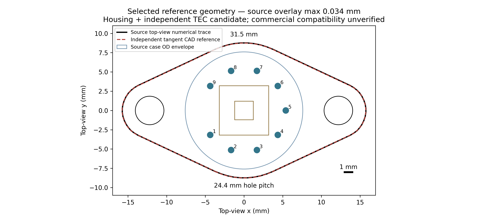
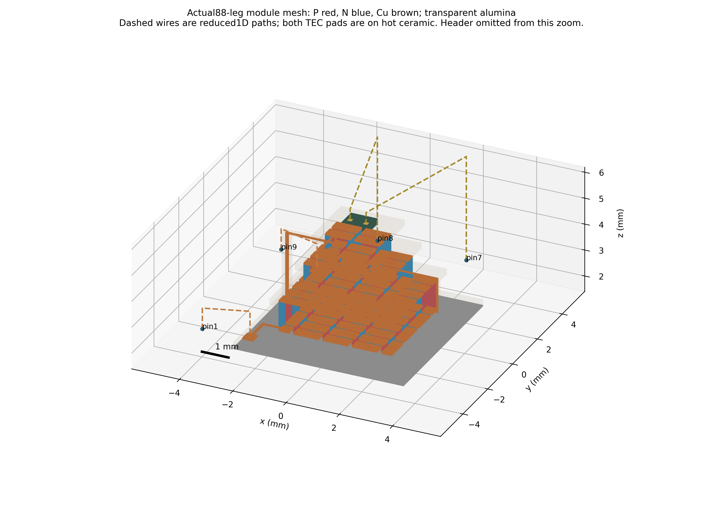
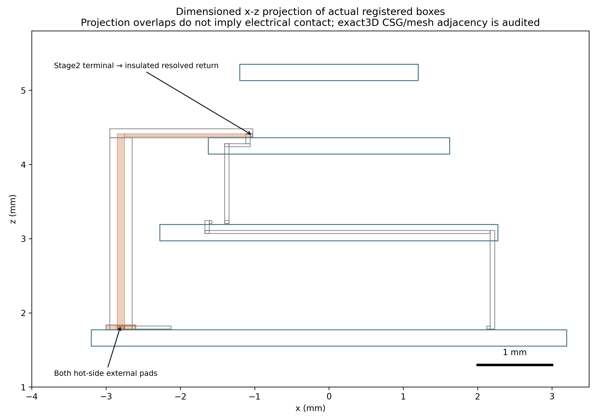

# Corrected source geometry: complete TEC topology checkpoint

**Milestone A passes for the resolved solids plus explicitly reduced1D wires.**
The new mesh contains the full88-leg TEC and a resolved insulated return to the
module hot ceramic, inside the independently source-traced two-ear/nine-pin
header. The pin1/9 supply routes now have real hot-side endpoint faces. A genuine
Elmer DC-conduction test passes all175 original interior cuts and the two new
route cuts. **Milestone B coupled thermal performance has not been run.**

This remains a synthetic reference assembly: VIGO ZTM-TO66-Z030 Rev9 housing
dimensions plus independent TEC Microsystems3MC04-044-05 external dimensions.
Their commercial compatibility, internal TEC artwork/material grade and as-built
device accuracy are not established. The28/12/4 stage allocation, middle plates,
internal routes, glass dimensions, die/attach and wire shapes remain hypotheses.
No previous archived source, field, failed gate or historical15-page report changes.

## Source and geometry authority

The additive canonical registry is
[`reference_v2.json`](../data/geometry_complete/reference_v2.json). It retains
the prior source/datum/tolerance/certainty registry and its digest, adds every
internal box and all exact leg placements, and explicitly marks inferred internals.
The old G2b *internal* construction supplies the nominal verification template
with its source digests; no old package generator, ellipse,0.44 mm pin registry,
mid-stage supply link or cavity operator is imported or reused.

The selected sources are the [VIGO drawing](https://vigophotonics.com/app/uploads/2024/07/3TE-TO669p-wW-PVI_PCI-detector-technical-drawing.pdf)
and [independent TEC datasheet](https://www.tec-microsystems.com/Download/Datasheets/Thermoelectric%20Coolers/MC04%20Series/3MC04-044-05_Datasheet_2019.pdf).
Their bytes, inspected section datums and selected numerical silhouette were
already recorded in the protected source checkpoint. New geometry uses the
31.5×17.5 mm two-ear flange,24.4 mm hole pitch,Ø3.7 holes,1.5 mm header and
nineØ0.76 mm metal shafts onØ10.8 mm PCD. Circular/tangent flange radii remain
inferred; source tooling contour tolerance is unknown. Bottom-view pin identities
are mirrored explicitly into the top global frame.

| Solid / connection | New implementation |
|---|---|
|TEC|88 separate P/N legs,85 local bridges, two buried interstage links, six original pads, four6.4/4.55/3.25/2.4 mm ceramic plates|
|Hot input|New Cu pad/trace190 on base ceramic, connected to original first pad116|
|Hot return|New Cu body191 from original stage2 pad183 down to the other base pad; electrically insulated by resolved alumina support192|
|Header/joint|Source two-ear Kovar header300; separate50 µm presolder301 under hot ceramic; alloy unknown|
|Feedthroughs|Nine glass annuli401–409; nine correctly located metal pins501–509, retaining actual functional labels|
|Die|Parametric attach302, MCT thermal domain303, separate Au pads304/305|
|Cu supply wires|Reduced1D axial electrical/thermal elements601/609, pin1/9 to hot faces103/104; no meshed3D wire arcs|
|Detector bonds|Reduced1D Au routes607/608, pin7/8 to Au faces6107/6108; separate from TEC|
|Thermistor|Pins5/6 isolated; internal thermistor and its bonds absent|
|Enclosure|Cap/window/carriers omitted pending dimensions; no complete enclosure or gas/radiation model claimed|

Both supply pad face centroids are **z=1.835 mm**, on the base ceramic (bottom
z=1.55 mm, top1.77 mm), rather than the old stage2 external endpoint. The
original stage2 pad is now internal and is connected through the explicit
return conductor. This conductor and its alumina support remain thermal solids
for subsequent physics; their internal shunt cannot be discarded.

The module graph grows from181/180 to **183 vertices/182 edges** by adding
the two hot-pad route bodies. It is a single simple path containing every leg
once, with only190/191 degree-one endpoints. Adding two1D Cu wires and the real
TEC pin bodies gives the hybrid **187-vertex/186-edge** path from pin1 to pin9.
All other pin functions remain outside that TEC graph. Structural zero TEC
current into detector/thermistor/unused pins assumes ideal glass/ceramic insulation;
dielectric leakage and a detector bias PDE are not part of this checkpoint.

## Independent CAD-to-FEM gates

CAD uses circular arcs/common tangents in millimetres; the independent SI header
construction unions three disks/tangent trapezoids. A separate55440-cell
orthogonal CSG audit computes stack material volumes and all contacts, including
dielectric subtraction around buried conductors. It rejects missing returns,
interstage bypasses, volumetric penetrations and unintended point/edge shorts.
OCC fragmentation checks every material volume and mating area before meshing.

The actual conformal mesh has **106767 nodes,366156 tetrahedra,216 material
domains and320 material contact pairs**. Every material domain is face-connected;
the thermal solid assembly and183-body TEC conductor are each face-connected.
All actual exterior facets have declared boundaries; material contact pairs,
areas and volumes agree with independent expectations. No unintended conductor
point/edge connection is accepted. Minimum tetrahedron SICN is0.053429, with
zero elements below0.01. Planar volume/contact tolerance remains1e−7 relative;
curved-volume/contact target remains1%, without relaxing it to accept a failure.

An independent actual-tetrahedron boundary audit recovers12 underside loops,
fits both mounting holes and all metal pin circles, measures all source pin
centres and ceramic footprints, and area-averages the actual wire endpoint faces.
The measured mounting pitch is24.4 mm; hot pad areas are0.16 mm² each. The
actual mesh-to-source silhouette maximum bidirectional distance is **0.031101 mm**
against the unchanged0.08 mm drawing-comparison target. This is source agreement,
not a manufacturing tolerance or an as-built measurement.







Solid regions in the stack view are actual tetrahedron skins. Dashed wires are
explicitly1D; the return projection is labelled as a projection rather than a
section. Views use millimetres, orthographic/equal scales, axes and1 mm bars.

## Reduced-wire geometry audit

Piecewise straight centreline routes are declared hypotheses, not measured wire
arcs. Their Cu/Au diameters are0.2/0.018 mm. Finite cylindrical end faces avoid
the false collision that spherical endpoint capsules would create below a thin
bond pad. Other segments use conservative swept-capsule clearance bounds with
20 µm-or-smaller sampling and an explicit sampling-distance allowance. Boxes
before dielectric cut-out are conservative obstacle supersets. Cylindrical pins,
header, other solids and other wires are checked separately.

| Wire | Pin → target | Length mm | Lower clearance bound mm | G W/K | R Ω |
|---|---|---:|---:|---:|---:|
|Cu+|1→190|3.403752|0.065|0.003691917|0.001863530|
|Cu−|9→191|3.403752|0.065|0.003691917|0.001863530|
|Au|7→304|9.724959|0.010|8.24248e−6|0.932487|
|Au|8→305|9.724959|0.010|8.24248e−6|0.932487|

The minimum wire-to-wire conservative clearance is0.562 mm. These are geometric
nonintersection checks for the declared routes, not process capability or bond
reliability margins. G=kA/L and R=rhoL/A use constant verification proxies, not
OEM wire transport data. Sharp bends, contacts, distributed gas/radiation exchange
and three-dimensional wire fields remain unresolved. Uniform endpoint face
averages/injection are an explicit hybrid approximation.

## Genuine electrical verification

Elmer's actual StatCurrentSolver solves div(sigma grad(phi))=0 on the **new
resolved183-body module subset** of the full mesh, with ideal insulating exterior,
0.1 A injected on actual hot pad103 and phi=0 on hot return104. It uses the
preserved constant verification P/N/Cu conductivities, with no Seebeck or thermal
solve. This is an electrical topology test, not a manufacturer voltage prediction.

| Check / quantity | Actual result |
|---|---:|
|Original175 interior current cuts|All present, areas correct, all within0.5%|
|New input and return cuts|Both present, areas correct, within0.5%|
|Worst177-cut raw-current relative error|**0.401282%**|
|Return current|0.100000000248 A|
|Free-node current residual L1|4.00332e−8 A, below1 µA|
|Module voltage|0.361453728 V|
|Module resistance|3.614537283 Ω, verification constants only|
|Integrated Joule work|0.0361453729 W, agrees with I×V within1%|
|Analytic Cu-wire series addition|0.003727061 Ω; module+wire drop0.361826434 V|

Actual pin potential fields are not solved in this module-only DC test; the
extra series-wire voltage excludes pin resistance. Signal-pin isolation is
proved by material adjacency, the disconnected signal topology and the wire
clearance audit, rather than by inventing potential/current fields outside the
electrical solve. Archived VTUs retain the genuine module phi and derived3D J.

## Reproduction and status

Use existing pinned Elmer/Gmsh, four CPU/12 GiB wrapper, same repository/session:

```bash
./fem/run_g2b.sh python -m tecooledmct.geometry_complete --out outputs/geometry-complete-repro
./fem/run.sh python -m tecooledmct.geometry_complete_measure --out outputs/geometry-complete-repro
./fem/run.sh python -m tecooledmct.geometry_complete_views --out outputs/geometry-complete-repro
./fem/run_g2b.sh python -m tecooledmct.geometry_complete_electrical \
 --mesh outputs/geometry-complete-repro --out outputs/geometry-complete-dc-repro
./fem/run.sh env TE_FEM_SMOKE=1 pytest -q
./fem/run.sh python -m tecooledmct.cli --quick --out outputs/geometry-complete-cli-repro
./fem/run.sh python -m tecooledmct.geometry_demo --out outputs/geometry-complete-pellet-repro
./fem/run.sh python fem/archive_geometry_complete.py --verify
```

The accepted mesh used controlled local sizing and curvature28, Gmsh Delaunay
plus Netgen optimization, with a900000-tet publication cap. Execution took
120.1 s for CAD/mesh/audit before ElmerGrid; the genuine accepted DC solve took
1.67 s. Mesh ordering may vary; recheck geometry/electrical tolerances instead
of requiring a fresh mesh to have identical node IDs.

Rejected development is retained separately: an overconservative spherical
wire-end collision; HXT volume-recovery failure; curvature-disabled mesh with
glass/pin area errors up to6.73%; an Elmer input-body-index failure; and a genuine
DC solve whose initial postprocessor searched the wrong output directory. The
accepted DC execution uses explicit Target Bodies and the actual field location.
None of the rejected attempts substitutes for the final audited execution.

Milestone B remains **NOT RUN**: no new coupled Peltier/Joule thermal case,
lead-off/on detector-temperature comparison, raw bath1% acceptance or spatial
thermal convergence is claimed. A new source-consistent enclosure/cavity and
fresh gas/radiation operators are needed for an enclosed-device study; no old
operator is reused. The original raw bath1% failures, unqualified flux recovery,
all previous accepted/rejected studies and the historical15-page PDF remain
unchanged. No OEM validation, unrelated-repository work or LSDDTS work is included.
