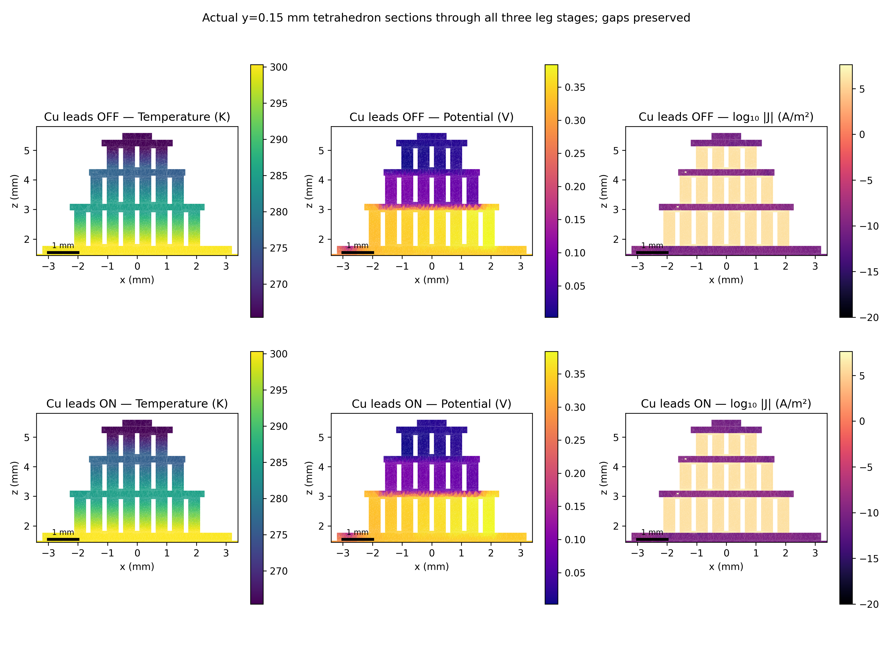
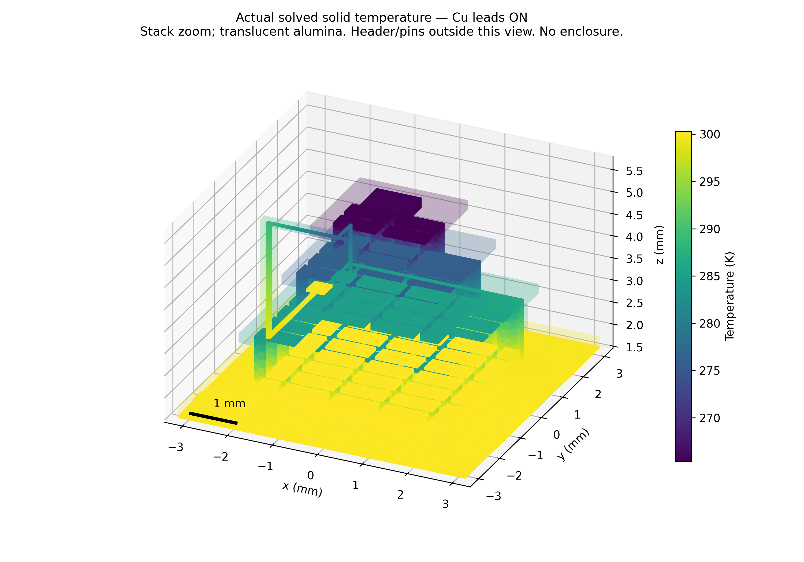

# Corrected-geometry coupled solid-only thermal checkpoint

**Four genuine coupled Elmer executions are verified. Full thermal qualification
remains incomplete:** the primary per-case checks pass on this one mesh, while
additional raw die/attach interface diagnostics fail and spatial convergence
has not been tested. These are exploratory synthetic-reference results, not
an enclosed-device or OEM prediction.

The exact corrected216-domain mesh contains106767 nodes/366156 tetrahedra,
all88 P/N legs, four ceramics, resolved insulated hot-side return, source-based
two-ear header/nine0.76 mm pins, explicit50 µm presolder and MCT/attach/Au pads.
No old ellipse,0.44 mm pins, mid-stack supply endpoint or enclosure operator is
used. The [geometry checkpoint](GEOMETRY_COMPLETE_TEC_CHECKPOINT.md) remains
immutable. VIGO-family housing plus the independent TEC Microsystems candidate
is not a manufacturer-proven assembly.

## Actual executions and matched comparison

Elmer ThermoElectricSolver solves T and phi together, including Peltier heat
transport, Joule heating, Seebeck coupling and Fourier conduction. The bath is
only actual Kovar underside tag101 at300 K. Other exposed faces, including the
pin ends, are adiabatic except enabled wire endpoint sources. Pin temperatures
are solved through the real3D pin/glass/header thermal path, with no pin clamps.
The detector receives2 mW uniformly in its actual volume:1.5 mW prescribed bias
heat plus0.5 mW parametric absorbed heat. There is no optical transmission model.
Au bonds are **OFF in both Cu comparison cases**. No radiation or gas is present.

| Execution | I A | Die volume mean K | Cold ceramic mean K | Hot ceramic mean K | Module V | Raw bath error |
|---|---:|---:|---:|---:|---:|---:|
|Zero current/load, all wires OFF|0|299.999999996|299.999999996|300.000000000|≈0|−4.82e−11 W absolute|
|Cu OFF, Au OFF,2 mW|0.1|265.592523602|265.424046394|300.114897788|0.551939871|**−0.976691%**|
|Cu ON, Au OFF,2 mW|0.1|265.592493295|265.424016098|300.114819165|0.551939812|**−0.993773%**|
|Cu ON, passive sigma100× lower|0.1|265.592493869|265.424016672|300.114819136|0.551939805|**−0.993778%**|

The loaded control changes only the Cu hybrid closure: OFF removes its thermal
conduction and wire Joule heat; ON enables G(Tpin−Tpad), I²R/2 at each endpoint
and the corresponding lumped series voltage. Module I, mesh, other material
laws, bath, heat deposition and Au OFF state are identical. Both Cu wires use
their real pin1/9 and hot-pad face103/104 area weights, not point deposition.
Both pad centroids are z=1.835 mm; the original stage2 return is an internal
resolved conductor, not an external supply attachment.

The computed ON−OFF die change is **−30.307 µK**, cold ceramic−30.296 µK,
hot ceramic−78.624 µK and module voltage−58.731 nV. These small differences are
reported as matched numerical outputs; their physical sign/magnitude is **not
resolved without mesh/iteration sensitivity**. They are not evidence of a useful
cooling improvement. Lowering every passive sigma from1e−12 to1e−14 S/m changes
die mean by0.574 µK and voltage by7.47 nV; finite stopping error contributes to
this comparison.

The zero-source analytical solution is T=300 K and constant phi. The genuine
solve matches it within4 nK, with raw bath output−4.82e−11 W. At zero power no
relative error against zero is asserted: the implementation's1e−4 W normalization
floor corresponds to a1 µW absolute raw-flux tolerance. Powered cases retain
the unchanged1% criterion against electrical+detector+wire input.

## Lead temperatures, power and conservation

The explicit1D Cu wires have diameter0.2 mm, length3.403752 mm,
G=0.003691917 W/K and R=0.001863530 Ω each. Uniform wire Joule heating gives
18.6353 µW per wire, split equally between its endpoint faces. Axial conduction
is internal equal/opposite transfer; it is not added to external power.

| Cu wire | Pin tip K | Hot pad K | Conduction into pad mW | Pin source mW | Pad source mW |
|---|---:|---:|---:|---:|---:|
|Pin1→pad190|300.021981812|300.045312267|−0.0861341|+0.0954518|−0.0768165|
|Pin9→pad191|300.004382115|300.006419350|−0.0075213|+0.0168390|+0.0017963|

Net conduction is **0.0936554 mW out of the hot pads**, with0.0372706 mW total
wire Joule heat. The source voltage includes I×sum(Rwire), giving0.552312518 V
for the nominal ON point. Pin electrical potentials are a passive numerical
extension; physical pin-shaft current, resistance and shaft Joule heating are
not modelled. Au electrical/bias transport is absent; imposed detector power is
its sole bias-heating representation. These limitations preclude full source
terminal or detector-electronics predictions.

| Powered quantity | Cu OFF | Cu ON |
|---|---:|---:|
|External electrical+detector+wire input W|0.0571939871|0.0572312518|
|Conservative bath reaction W|0.0571939879|0.0572312524|
|Independent raw bath-gradient output W|0.0566353786|0.0566625033|
|Global reaction energy residual W|7.82e−10|5.75e−10|
|Free thermal residual L1 W|7.98e−8|2.12e−7|
|Worst177-cut current relative error|0.401824%|0.401824%|

The raw bath integration uses only actual external Kovar underside triangles
(333.919817 mm² in this mesh),
their outward normals and raw element gradients. It is not a weak reaction,
equilibrated recovery or enforced total. Both errors pass1% narrowly; the ON
point is only0.00623 percentage points inside the limit. Passing this one-mesh
check does not establish flux convergence. All original historical fine failures
at1.65587%,1.51412%,1.58383% remain failed and unchanged.

## Local conduction, stage physics and failed diagnostics

Actual Kovar→presolder→hot-alumina contact areas are4.096e−5 m² each. In the OFF
case their area-mean interface temperatures are300.107788344/300.109783112 K.
The presolder's through-layer Fourier volume average is0.0571939879 W, agreeing
with kAΔT/t. The actual die-attach average is0.0020000000 W and its temperature
drop0.0600000000 K. ON averages are0.0571190663 W for presolder and0.002 W for
attach. These layer identities verify the physical path and deposition; **they
do not recover or replace raw boundary fluxes**.

Independent face-centroid evaluation uses actual one-sided P1 gradients and
nodal k(T) at each interface. The additional5% diagnostic results are:

| Interface | OFF mismatch | ON mismatch | Status |
|---|---:|---:|---|
|Kovar/presolder|+2.1761%|+2.1241%|PASS|
|Presolder/hot alumina|−1.6454%|−1.6569%|PASS|
|Cold alumina/attach|+41.3481%|+41.3481%|**FAIL**|
|Attach/MCT|−47.8278%|−47.8278%|**FAIL**|

The failed local face-gradient checks are retained. Conservative reaction,
source and layer averages do not waive them. The next mesh should refine the
MCT/attach/cold-ceramic region and independently revisit the bath gradient.

For illustration, actual OFF leg-midplane transport is:

| Stage | Fourier downward W | Peltier downward W | Total downward W | Stage-group Joule W | Reversible Seebeck work W |
|---|---:|---:|---:|---:|---:|
|0|−0.191490980|+0.270589544|+0.079098564|0.024842825|0.014084049|
|1|−0.063126727|+0.111143783|+0.048017056|0.008174464|0.003560203|
|2|−0.031970049|+0.035753530|+0.003783481|0.002131536|0.001403945|

These are real field decompositions, not isolated ideal-stage Qc formulae.
Stage groups contain original stage-local P/N/Cu; buried links and new hot return
remain in global work and whole-assembly control-volume budgets. P1 indicator
control volumes include every return/support/pin and nonlocal source. Maximum
band energy residual is below1.7e−10 W in these points. Group Seebeck work is
integrated J·E minus Joule; constant S gives no bulk Thomson term.

## Materials, fields and verification matrix

[`material_assumptions.json`](../data/corrected_thermal/material_assumptions.json)
records all laws and numerical domains. P/N/Cu retain the original mixed constant
verification k,sigma,S; they are not measured OEM-grade temperature curves.
Kovar/pin17.3, glass1, alumina30, attach1, Au315 and unidentified presolder35
W/(m K) are thermal proxies. Presolder fails outside its declared numerical
290..320 K interval. MCT x=.29 uses the previously sourced Table2 k(T) at
90/148/298/400 K and fails outside that coverage. No composition interpolation
or transient calculation is claimed; SIF density/capacity placeholders are
steady-only and the explicit volumetric source avoids density multiplication.

All non-TEC solids have S=0 and computational sigma1e−12 S/m. Nominal passive
Joule totals3.43e−15 W and the largest measured pin cut current is2.37e−19 A;
at100× lower sigma those fall to3.43e−17 W/2.37e−21 A. Signal-pin isolation is
therefore bounded numerically as well as structurally. These passive potential
and current fields are not physical metal, photodetector or pin transport.

| Verification | Status |
|---|---|
|Exact protected corrected mesh and actual Elmer body mapping|PASS|
|Actual coupled T/phi solver exit and nonlinear tolerance1e−9|PASS: all4 executions|
|Zero drive/load300 K analytical control|PASS|
|177 raw current-cut areas/current0.5%, terminal and free current|PASS|
|Global/stage energy and unaccelerated endpoint source checks|PASS|
|Independent powered raw bath1%|PASS, narrowly on this mesh|
|Extra presolder face5% diagnostics|PASS|
|Extra die/attach face5% diagnostics|**FAIL**|
|100× passive-sigma sensitivity and spurious-current/Joule bounds|PASS as numerical checks|
|Second mesh / three-level spatial convergence|**NOT RUN**|
|Separate Au-ON sensitivity|**NOT RUN**, Au OFF in both matched cases|
|Complete enclosure/new radiation/gas operators|**NOT RUN**|
|OEM/product/experimental validation|**NOT ESTABLISHED**|

Figures use actual P1 tetrahedron intersections through all three leg stages,
actual solved body skins, millimetre axes and1 mm scales. Gaps remain gaps;
section arrays/barycentric weights are archived. Non-TEC potential colours
represent the computational extension. No field is invented in unmeshed wires,
gas or omitted enclosure. No personal identifier or repository hash appears in
these reader-facing figures. The historical15-page PDF remains byte-identical.

Full117 opt-in tests, CLI quick and geometry demo pass. Actual solver wall times
are49.1/100.5/635.9/41.1 s (passive/OFF/ON/lower sigma), with peak RSS≈1.36–1.38
GiB under the unchanged4CPU/12GiB pinned runtime. ON needs30 nonlinear iterations
for the explicit nonlocal closure; its full history and final independent
unaccelerated residuals are retained. No earlier package temperature is used as
an initial guess or as a validation comparator. See
[reproduction instructions](CORRECTED_COUPLED_THERMAL_REPRODUCIBILITY.md).
