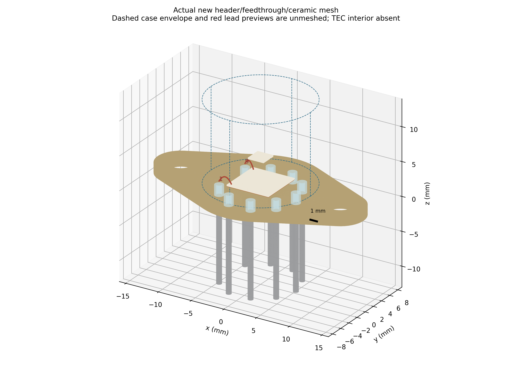
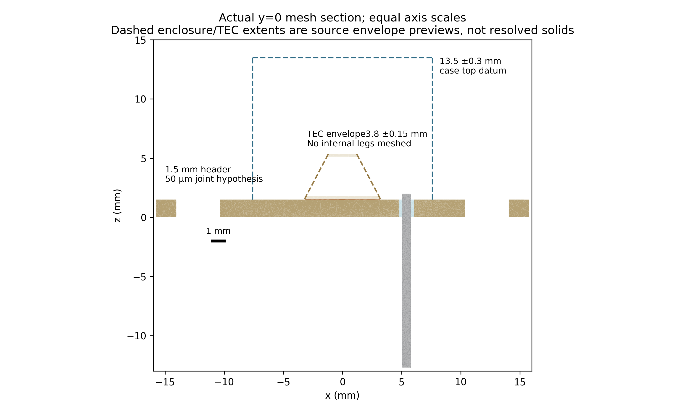
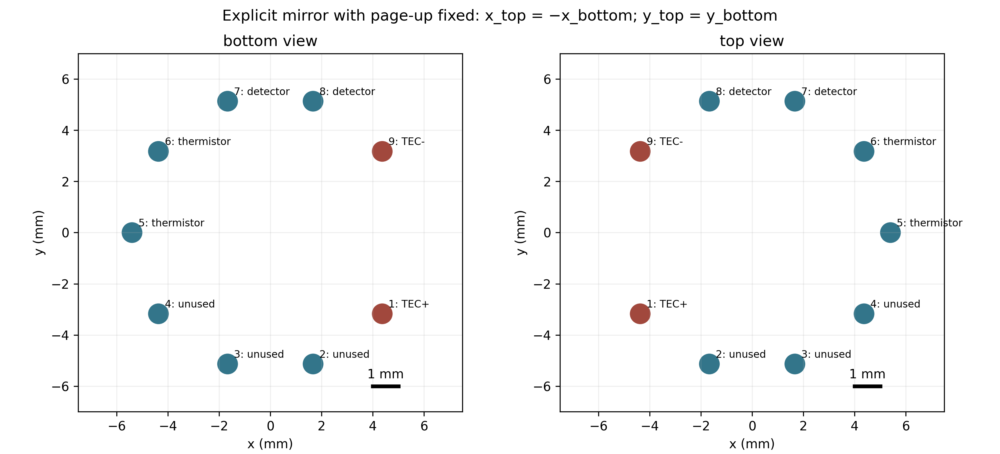

# Source geometry checkpoint, 30 October 2026

The selected **reference test article** combines a VIGO-family housing drawing
with an independent TEC Microsystems candidate. Neither manufacturer identifies
this combination as a commercial assembly. Compatibility, internal construction
and device performance remain unqualified. All earlier package studies and the
unchanged 15-page Revision 2 report describe assumed geometry.

The machine-readable authority is
[`reference_v1.json`](../data/geometry_rebaseline/reference_v1.json).
Every implemented length includes definition, frame, source, evidence location,
nominal value, explicit tolerance (or null), simulated value, absolute deviation,
certainty and hypothesis interval. A missing explicit tolerance does not mean
zero manufacturing tolerance. No ISO tolerance has been invented.

| Feature | Selected reference | Status |
|---|---|---|
| Housing | VIGO ZTM-TO66-Z030 Rev9, 1 March 2024 | Family drawing; no matched detector part |
| Flange | 31.5 ±0.2 ×17.5 ±0.2 mm; two ears | Source dimensions; circular/tangent tooling profile inferred |
| Mounting holes | 24.4 ±0.2 mm pitch; 2×Ø3.7 mm | Source dimensions |
| Pins | 9×Ø0.76 mm; Ø10.8 mm PCD | Source dimensions; shaft and glass are distinct |
| Header | 1.5 mm thickness | A-A dimension endpoints inspected; replaces old 1.1 mm hypothesis |
| Case | Ø15.2 ±0.2 mm; top13.5 ±0.3 mm from header underside | External envelope only in this checkpoint |
| External pins | 12.7 ±0.3 mm below header underside | Source A-A dimension |
| Candidate TEC | 3MC04-044-05, 6.4 ±0.1 /2.4 ±0.1 mm, height3.8 ±0.15 mm | Independent supplier dimensions; not proof of VIGO installation |
| Internal glass, ceramic thickness, joint, pad locations | Registry hypothesis intervals | Test-only assumptions |

Sources: [VIGO original drawing](https://vigophotonics.com/app/uploads/2024/07/3TE-TO669p-wW-PVI_PCI-detector-technical-drawing.pdf)
and [TEC Microsystems original datasheet](https://www.tec-microsystems.com/Download/Datasheets/Thermoelectric%20Coolers/MC04%20Series/3MC04-044-05_Datasheet_2019.pdf).
Both page images were inspected, as well as numerical text. Source byte digests
remain in the registry. Only selected numerical outline coordinates and original
derived figures are published, not copies of manufacturer pages.

The 8.25 ±0.35 mm A-A dimension ends on an internal plane; it must not be
substituted for overall enclosure height. Its carrier datum remains unresolved.
The Ø6 section feature does not supply a complete window/seat/optical model.
Focal-plane A depends on optical area (5.85 or6.75 ±0.35 mm from header underside).
The case/cap, window, POM carrier, sapphire/silicon carrier and humidity absorber
need separate resolved dimensions before a complete package can be claimed.
The historical user illustration (14.7 mm flange width, Ø12.44 mm cap,6.05 mm TEC)
is retained as a separate alternative and supplies no dimensions to this build.

## Independent construction and actual mesh

The CAD path constructs four circular arcs and four common tangents in
millimetres. The Gmsh path independently unions three disks and two tangent
trapezoids in SI, extrudes them, cuts holes and fragments all touching solids.
Both consume the canonical registry, with no imports from old CAD/FEM geometry.
Independent Green's-theorem area/perimeter expressions check CAD mass properties.

The first actual mesh has **299,576 nodes,1,479,540 tetrahedra and22 domains**:
header, nine glasses, nine metal pins, a50 µm explicit joint and the two external
candidate ceramics. The detached cold ceramic deliberately remains an envelope;
there are no internal TEC legs in this geometry checkpoint. The header volume
is500.941045 mm³ in CAD and500.893950 mm³ in the actual mesh (−0.009402%).
Worst body volume difference is0.311012%. Actual shared tetrahedron faces match
the declared material graph; metal pins share no vertex with header or each other.
These are partial geometry gates, **not** the full88-leg electrical gate.

An additional independent audit recovers12 closed loops from the actual header
underside triangulation (outer contour, two mounting holes, nine glass bores).
Circle fits measure hole pitch/diameters and all metal pin centers/diameters;
actual ceramic bounding boxes measure the6.4/2.4 mm footprints. The glass radial
insulation is0.27 mm under its stated hypothesis. The hot-ceramic corner has
3.0745 mm space to the case **outer envelope**; inner wall/carrier clearance is
not established. These measurements and their checks are archived separately.

The manufacturer top-view contour is independently extracted from the identified
PDF vector segments, with one uniform scale from hole pitch. The maximum
bidirectional distance to the parametric tangent contour is **0.033910 mm**,
inside the predeclared0.08 mm drawing-comparison target. Source reading allowance
is0.04 mm; the manufacturer tooling contour tolerance is unknown. This checks
source silhouette agreement, not as-built accuracy. The old ellipse is rejected
for the new source geometry.






Views use millimetres, labelled axes, orthographic projection/equal section
scales and1 mm bars. The 3D and section solid regions come from actual mesh
tetrahedra. Dashed case/TEC envelopes and red preview wires are explicitly
unmeshed. No temperature or current fields are invented.

## Pin identities and the next physics gate

The drawing pinout is a **bottom view**. Keeping page-up fixed, the chosen top
projection is x_top=−x_bottom,y_top=y_bottom, with the viewing normal reversed.
A rotation cannot substitute for this mirror. Independent coordinate-table and
winding tests check the transform.

| Pins | Function |
|---|---|
|1,9|TEC+,TEC−|
|7,8|Detector|
|5,6|Thermistor|
|2,3,4|Unused|



The old Cu links use generic instances2/3, not validated OEM pin numbers. Their
second TEC endpoint is stage2's hot pad at z=2.6225 mm in the old stack, rather
than the module hot-side ceramic. Merely moving its thermal endpoint would leave
an unmodelled electrical return/shunt. A new insulated internal series return
and hot-side pads must be constructed and audited before lead-on physics.
The new pin1/9-to-hot-ceramic routes are **coordinate previews only**, with
attachment hypotheses and sampled arc lengths recorded. They are not attached
to a revised88-leg conductor circuit. Detector bonds must separately use7/8.

No new Elmer run is labelled corrected-device physics. All175 series cuts,
detector/TEC current separation, three mesh levels, matched lead-off/on physics,
ear/bottom sink-contact hypotheses, recalculated cavity visibility/radiation/gas
operators and independent OEM holdouts remain required. Old cavity operators
must not be reused after geometry changes. The original fine raw bath1% failures
(1.65587%,1.51412%,1.58383%) remain failed; neither this geometry checkpoint nor
an equilibrated flux constraint changes them. Optical heating remains a
parametric absorbed heat source until spectral window/absorption is modelled.

## Reproduce and verify

Use the existing pinned runtime/session; no installation or other repository:

```bash
mutool draw -q -F svg -o outputs/source-vigo.svg outputs/full-presolder-source-review/vigo.pdf 1
./fem/run.sh python -m tecooledmct.geometry_source_trace \
  --svg outputs/source-vigo1.svg --pdf outputs/full-presolder-source-review/vigo.pdf \
  --out outputs/reproduced-vigo-trace.json
./fem/run.sh python -m tecooledmct.geometry_rebaseline --out outputs/geometry-reproduced
./fem/run.sh python -m tecooledmct.geometry_rebaseline_views --directory outputs/geometry-reproduced
./fem/run.sh python -m tecooledmct.geometry_measurements --directory outputs/geometry-reproduced
./fem/run.sh env TE_FEM_SMOKE=1 pytest -q
./fem/run.sh python -m tecooledmct.cli --quick --out outputs/geometry-cli
./fem/run.sh python -m tecooledmct.geometry_demo --out outputs/geometry-pellet
python3 fem/archive_geometry_rebaseline.py --verify
```

Download the official source into the ignored output directory if absent; its
SHA256 must match. Mesh ordering and runtime values may differ between runs;
recheck dimensions, contacts, volume errors and source-overlay distance instead
of requiring a different Gmsh execution to have identical node IDs. Publication
checks the actual execution sources and a byte ledger of preserved evidence.
