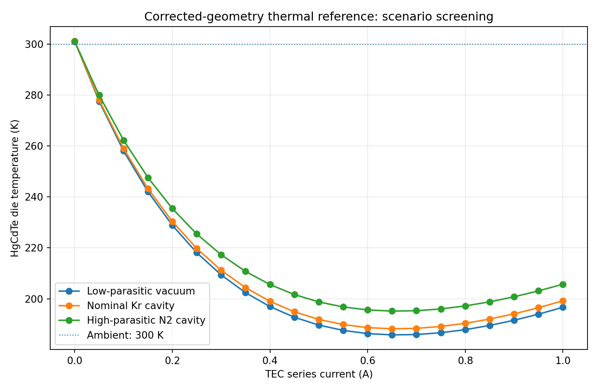
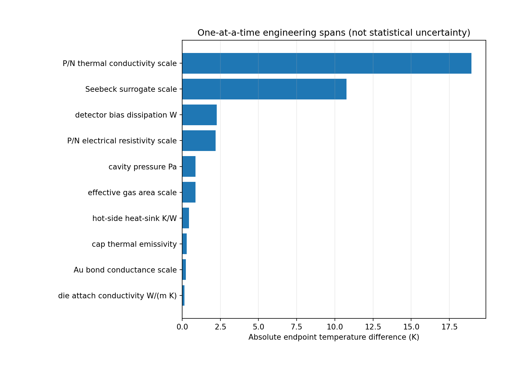

# Integrated plausible-reference thermal scenario model — 2026-10-30

## Scope and independent code audit

This phase responds to the user requirement for a **plausible, practical synthetic
engineering model**. It does not attempt OEM identification. The review examined:

- `tecooledmct/geometry_complete.py`, the protected
  `fem/results/geometry_complete_checkpoint_20261030` geometry manifest and
  `wire_routes.json`, the corrected 88-leg/216-material-body three-stage geometry;
- `tecooledmct/corrected_thermal.py` and the actual solid-only Elmer results,
  where 300 K Dirichlet Kovar underside, constant P/N verification properties,
  2 mW volumetric detector heating and OFF/ON hybrid wire diagnostics are used;
- `tecooledmct/fem_g3b_exchange.py`, historical gas/radiation operators that
  **cannot be copied as mesh geometry** because their original G3b enclosure,
  header thickness and pinout differ from the corrected package;
- `tecooledmct/g2d_network.py`, `oem_phase_a.py`, `model.py` and the
  source-backed material registries; the earlier four-node network is anchored
  to two OEM limit values and the bounded transport screen uses a research grade
  not identified to a commercial TEC.

**Key engineering finding:** The first missing capability is not another
million-element thermal-gradient refinement, but an explicit and conserved
package parasitic-load budget tied to the corrected geometry. However, the
genuine coupled 3D FEM is still needed for spatial heat paths and field
qualification.

## What was implemented

`tecooledmct/integrated_reference.py` is a **five-temperature-node** model,
not a new 3D FEM result. It reads immutable corrected-source geometry directly
from the sealed 2026-10-30 archive and records SHA256 provenance.

Unknown temperatures: bottom/hot TEC ceramic; first, second, and top/cold
TEC ceramic; effective HgCdTe die temperature. The corrected geometric inputs
include 28/12/4 thermocouple counts, 88 physical 0.4mm square P/N legs,
stage leg lengths 1.07/0.82/0.64 mm, four ceramic footprints, actual 30um-thick
1×1 mm die attach, and four audited hybrid metal wire paths on pins 1/9/7/8.

- **TEC:** fundamental constant-P/N-law cascade equations
  `Qc = alpha I Tc - 0.5 I²R - K(Th-Tc)`,
  `Qh = alpha I Th + 0.5 I²R - K(Th-Tc)`,
  `V = IR+alpha(Th-Tc)`. The baseline material constants are the verified G1
  synthetic P/N properties, NOT commercial-grade transport. Independent
  conductivity, resistivity, and thermopower multipliers permit engineering
  analog ranges, but do not change protected G1 source data. Bulk Thomson
  terms vanish for this constant Seebeck approximation.
- **Die:** 30um die attach, nominal `k=1 W/(m K)`, producing
  `R_attach=30 K/W`, die bias and hypothesized optical-like absorbed load
  applied as independent power sources. The die is lumped/isothermal, with no
  detector bias-current PDE, photo-carrier transport or spectral transmission.
- **Package:** effective surface areas from exact 6.4/4.55/3.25/2.4mm
  ceramic footprints. Gas conduction with kinetic temperature/pressure
  jump correction and surface gray-body radiation connect an *assumed
  isothermal cap/window reservoir* to stage/die nodes. They do not represent
  actual cap/window 3D volume, a ray-traced corrected cavity, gas CFD or
  spectral infrared throughput. The warm cap/window and pin reservoirs are
  assumed at ambient temperature.
- **Gas:** tabulated NIST values already registered for N2/Ar/Kr from
  `fem_g3b_exchange.GASES` (200–400 K). For predicted gas mean
  temperatures 180–200 K an **explicit flagged** `k(T)∝T^0.75` engineering
  extension is used; outside the model's 180–400 K range it rejects the
  point. The free-molecular transition uses the Eucken approximation and a
  stated accommodation factor. No Xe is claimed without an independently
  registered source.
- **Wires:** two Cu supply wires to the hot ceramic and two Au detector
  bonds to the die retain corrected archive values for `G=kA/L` and
  `R=rhoL/A`, not old G3b routes. Cu `I²R` splits equally between the
  warm pin and hot pad. The source terminal voltage includes Cu series
  resistance; detector electrical power is externally imposed rather than
  modeled through actual Au current/pad potentials.
- **Heat sink:** a configurable effective `R_ha` between hot TEC ceramic
  and the 300 K ambient isothermal sink. It is not an independently meshed
  Kovar/presolder/spreader/thermal-grease resistance calculation.

The optimizer enforces stage-cascade, die-attach and hot-side conservation,
bounds physical temperatures, and verifies the exact identity
`Qh-Qc = I V_TEC`. Whole-device energy accounting includes warm-reservoir
gas/radiation/Au fluxes, the Cu wire's two half-Joule sources, and external
electrical/bias heating. Invalid or nonconverged cases fail closed rather than
silently returning a nearest bound.

## Reproduce

From `/home/User/TE_Cooled_MCT`:

```bash
./fem/run.sh python -m tecooledmct.integrated_reference \
  --out data/integrated_reference_20261030
./fem/run.sh python -m pytest -q tests/test_integrated_reference.py
./fem/run.sh env TE_FEM_SMOKE=1 pytest -q
./fem/run.sh python fem/archive_bath_spatial_device.py --verify
```

No new Elmer executions are required to calculate this reduced model.
`data/integrated_reference_20261030/summary.json` contains all node
temperatures, heat-flow path contributions, residuals, provenance hashes,
raw scenario settings, and explicitly labeled failed cases.
`sweep.csv` and `sensitivity.csv` are directly machine-readable.
All archived FEM evidence remains immutable.

### Reproducible engineering figures





Generate figures without any additional physics solve:

```bash
./fem/run.sh python -m tecooledmct.integrated_reference_figures --from-dir data/integrated_reference_20261030
```

## Preliminary 0.15 A results (zero external optical measurement)

| Scenario | MCT die K | Hot ceramic K | TEC terminal V | Terminal power W | Total bath rejected W |
| --- | ---: | ---: | ---: | ---: | ---: |
| Low-parasitic vacuum | 242.055 | 300.065 | 0.8484 | 0.1273 | 0.1297 |
| Nominal 30 kPa Kr | 243.280 | 300.263 | 0.8444 | 0.1267 | 0.1315 |
| High-parasitic N2 | 247.615 | 300.706 | 0.8283 | 0.1242 | 0.1413 |

The three rows vary **multiple input assumptions simultaneously** and are
intended as bounding examples, not confidence intervals. In all scenarios the
TEC has 0.15 A prescribed series current; the total die internal heating is
2mW (1.5mW electrical + 0.5mW assumed absorbed load), without any optical
transmission calculation. The table is a reduced-model prediction, **not
a confirmed 3D temperature field or an OEM accuracy claim**.

The generated current sweep spans **0–1.0 A in 0.05 A increments (63
operating points)**. All 63 converge within the stated reduced-model
temperature domain. The lowest computed die temperature **on this discrete
grid** occurs at 0.65 A for all three scenarios: vacuum **185.817 K**,
nominal Kr **188.206 K**, high-parasitic N2 **195.158 K**. This is *not*
a continuous optimum or an empirically validated current recommendation.
The nominal Kr configuration at this grid point predicts **2.83869 V terminal,
1.84515 W electrical input, 303.655 K hot ceramic, and 1.82745 W rejected
at the modeled heat-sink boundary**. Temperature-dependent grade behavior,
mounting resistance, and load physics can change both the optimum and the
achievable temperature.

## One-factor sensitivity around nominal 300 K, 0.15 A

| Parameter and trial interval | Endpoint difference in die K |
| --- | ---: |
| TEC P/N thermal conductivity ×0.80 to ×1.20 | 18.936 |
| TEC P/N Seebeck coefficient ×0.90 to ×1.10 | 10.759 |
| Die electrical dissipation 0.5 to 5 mW | 2.263 |
| TEC P/N resistivity ×0.80 to ×1.20 | 2.199 |
| Gas pressure 0 to 101,325 Pa, Kr | 0.877 |
| Effective gas area ×0.50 to ×1.50 | 0.866 |
| Hot-side sink resistance 0.5 to 5 K/W | 0.440 |
| Cap gray emissivity 0.08 to 0.65 | 0.307 |
| Au bond conductance ×0.75 to ×1.25 | 0.235 |
| Die attach conductivity 0.5 to 3 W/(m K) | 0.154 |

These are **one-factor engineering scenario spans**, not propagated
probability intervals. Their ranking depends on the chosen trial widths,
operating point, assumed geometry and simplified physics. Never equate the
gas sensitivity with proof that cavity convection or cap exchanges are
negligible in the actual manufactured device.

## Remaining limitations and next decision gates

1. **No spatially resolved enclosed-package field.** Next build a corrected-
   geometry cap/window and independently audited cavity-contact/surface
   registry, then reuse the G3b heat-exchange algorithms only after
   geometry-specific visibility/reciprocity/energy audits. Do not copy old
   geometry or fake FEM execution.
2. **Temperature-dependent thermoelectric materials are not yet used in the
   3D solver.** Introduce an explicitly named analog grade, with source
   domain, bounded nonlinear behavior and grade variants. The existing
   bounded 1D material solver is a numerical-screening tool; do not force it
   to fit an unidentified OEM stack.
3. **Missing package physics:** realistic heat-sink spatial spreading,
   contact resistance, nonisothermal cap/window, die intravolume gradients,
   corrected-gas convection screening, optical window throughput, MCT
   electro-optical/photo-current/noise transport, thermistor circuit.
4. **Numerical release blocked:** historical raw bath 1% failures, cold
   interface 5% failures and approved Rev3 are unaltered. This phase is
   a reduced-order reference scenario, not release qualification.
5. **High-value next step:** compare the source-backed 1D P/N curves and
   credible analog-grade ranges; then implement a corrected 3D surface
   operator and test paired true Elmer cases with/without each heat-load
   mechanism, using conserved, bounded source terms.

The recommended allocation is to improve uncertainty in P/N transport
before large-scale gas-ray refinement, while maintaining package physics
development to reach the target comprehensive simulator.

### Cross-model diagnostic against archived genuine 3D Elmer

At 0.1 A with a nominal 2 mW die source, the screening model was also run
with effective hot-sink resistance set to zero, no gas/radiation, and both
hybrid wire conductances zero. It yields **MCT 257.756276 K, TEC voltage
0.585608855 V**. The historical corrected 88-leg solid-only Elmer reference
(Cu OFF, Au OFF) reports **MCT 265.592524 K and 0.551939871 V**.
The differences are **−7.836248 K and +0.033669 V**, respectively.

This comparison is *not* a matched boundary-value verification: the reduced
model clamps the hot TEC ceramic to 300 K, whereas the true 3D model clamps
only the Kovar underside and resolves hot-joint/header spreading. The
reduced model also omits explicit current-spreading, local ceramic/Cu bypass,
and many 3D interfaces. These structural differences may each contribute.
Neither model is manufacturer-validated. The discrepancy must be preserved
as evidence of missing reduced-model physics, **not fitted away** or described
as an OEM error.
