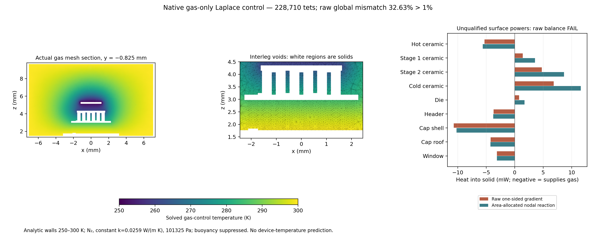

# Isolated cap writer/reader and conditional native gas baseline

## Registration before the new attempt

This is the separately authorized follow-up to the quarantined failed export.
Preserve both historical bad files, native meshes/fields, laws, stopped solids
and Rev3. One new cap export attempt; no fallback, rescaling of a failed file,
healing, speculative redesign or retry. Work within 4 CPUs / 8 GiB.

**A:** a fresh writer process authors numerical millimetres from the exact SI
registry, exports a 1 mm cube and all three cap solids, then exits. It forbids
all import/open/merge APIs. A different fresh process parses STEP units and
imports in metres. Require cube volume 1e-9 m³, radii 7.6/7.1/2.95 mm, datums
1.5/9.65/10.1 mm, unique roles and per-solid volume errors <=1e-8, bbox errors
<=2.1e-7 m including kernel padding, matching cap interfaces and complete
annular mating to the source header. Check no positive-volume header intrusion.
Record separate PIDs, source/candidate hashes and rejection of both 1e-3 and
1e3 length errors. Each child has a 120 s hard deadline. Do not import or reuse
the historical rejected cap as geometry. Qualified derivative has a new path.

**B only after A:** select external hybrid Cu/Au wires OFF. Import and uniquely
identify all 216 source solids by actual volume/bbox, plus the three new cap
solids. One Boolean partition with the exact inner cavity cylinder defines gas
as cylinder fragments not owned by any solid. Require preserved source volumes,
no overlapping solid owners, one positive bounded connected gas region, correct
original contacts and cap/window/header seals, and every gas face owned by one
solid. Check oriented manifold closure and outward normals. Stop on ambiguity,
leak, sliver/unexplained region, unsupported check or 180 s CAD limit; no patches.

**C only after B:** retain the exact registered smooth analytic wall control in
`UNIT_CORRECT_CAP_AND_NATIVE_GAS_20261101.md`: reservoir surfaces 300 K, stack
surfaces `300-50 u²(3-2u)`, u from header top to highest stack top. No archived
temperatures are needed; these are prescribed controls, not new device T.
Constant N2 k=0.0259 W/(m K), 101325 Pa, T inside sourced 200–400 K. Kn~0.000452
at 150 µm; 100 Pa fails. Ra~2501 means buoyancy may matter: flow is deliberately
suppressed, so this is only a conduction limiting baseline.

Use one gas-only P1 mesh: core 180 µm, outer 600 µm, min 30 µm, curvature 16;
300k tet target / 500k hard stop; mesh <=180 s, PDE <=120 s. Verify analytic
slab/uniform controls, positive elements, actual face owners/normals, independent
raw global flux discrepancy <1% and conservative reaction balance <1 nW.
Report raw body/stage surface flux separately from face-area allocated nodal
reactions. No refinement, TE production solve, gas sweep, CFD or fitted result.
Any failed phase retains its numerical evidence and stops later phases.

Deliver one internal result and an actual geometry/field figure if computed;
null means NOT RUN. Run focused/opt-in regression, archive/master integrity and
legacy checks, then commit/push verified scope and check exact CI. No new PDF.

## Results

**A PASS; B PASS; C STOP at failed raw flux gate.** One fresh export, one native
partition, one gas mesh and one actual Elmer HeatSolver run. No retries, geometry
changes, fitted coefficients, archived temperature comparisons or device rerun.
The registered prefix above is preserved in `registration.json` before export.

### Physical units and cavity construction

The writer exported both files before any import, then exited. A separate
metre-target reader finds the cube volume **1e-9 m³**, cap radii **7.6/7.1/2.95 mm**
and datums **1.5/9.65/10.1 mm**. Shell/roof/window volumes are respectively
188.189254, 69.353407 and 12.302870 mm³, within 1e-8 relative of the registry.
The independent parser also resolves the STEP mm length contexts to these SI
dimensions. Tests reject both thousandfold length errors automatically.

The accepted derivative is
`data/isolated_cap_native_gas_20261101/phase_A/cap_window_mm_derivative.step`,
SHA-256 `ff94fcc158796a41b289b9c505765f2edb719a34c80e04e8f1c61aa194af8a4f`.
Original bad and historical rejected STEP identities remain in
`phase_A/qualification.json`; neither was used as new gas geometry or overwritten.
The first reader passed physical checks but failed writing relative-path
metadata. Its source/log/status are retained under `reader_metadata_failure`.
Resolving its input path fixed only reporting; the same unchanged exports were
revalidated, with **no second author invocation**. `phase_A_final_status.json`
and `reader_metadata_repair.json` distinguish that repair from the initial status.

All **216 original package + 3 cap solids**, including 88 P/N legs and nine
pins/glass seals, map uniquely by actual SI volume/bbox. External hybrid wires
are OFF. One Boolean partition splits these into 228 owned solid pieces and
**one connected gas region**, volume **1.253174211e-6 m³ = 1253.174211 mm³**.
No positive-volume solid overlap or extra disconnected gas fragment is accepted.
The maximum source-volume change is 1.074e-13 relative; maximum original/contact
area change is 6.617e-14. All 320 original contacts and three cap mating pairs
remain, including cap/header annulus 23.090706 mm² and window rim 8.340928 mm².

The gas has **927 faces**, each shared with exactly one identified source solid,
and **2238 boundary curves** with incidence two and zero oriented winding sum.
Trimmed-face interior witnesses and ±1 µm probes verify every gas-outward normal
enters its assigned solid. No unassigned artificial cylinder face remains. A
separate gas-only SI BREP round trip preserves volume/bbox and uniquely maps all
faces. This qualifies the **nominal CAD construction**, with ideal impermeable
cap/header, window-rim and feedthrough contacts; it does not establish real seals,
unmodeled internal hardware, fabrication tolerances or OEM assembly identity.
CAD plus checks took 51.77 s within the 180 s bound.

### Actual conduction-only field and failed qualification

The common analytic stack trace has top z=5.59 mm; cap/window/header/pins/seals
are 300 K. All shared boundary nodes have compatible prescribed values. No
archived solid temperature was used. Constant k=0.0259 W/(m K) is the registered
300 K N2 value, **not** a temperature-varying law across this 250–300 K control.
Its source table covers 200–400 K (source/closure references in
`fem_g3b_exchange.py` and the original source-unit audit). Geometry and operator
come exclusively from the corrected native solids, not old G3b ray chords.

N2 at 101325 Pa has nominal Kn=0.000452 at 150 µm and Ra=2501.47 on the 8.15 mm
cavity-height/50 K scale; 100 Pa Kn=0.458 is inadmissible for this bulk-continuum
test. This screens the registered interleg gap, not every microscopic clearance
or real seal. Orientation is +z up/header below cap. The slab Ra threshold is a flag,
not a universal cavity criterion. Flow is deliberately suppressed, so no
natural convection, rarefaction correction or full steady gas prediction is claimed.

The one mesh contains **46,989 nodes / 228,710 positive P1 tetrahedra / 42,062
boundary triangles**, all owned once. Its volume differs from CAD by −0.08710%
through curved-wall tessellation. Mesh/check time 16.11 s; Elmer solve 5.99 s.
Gmsh reports minimum element quality about 0.0198; positive volume alone is not
a gradient-accuracy guarantee. No refinement or second PDE followed the failure.

| Independent numerical observable | Actual result | Registered decision |
| --- | ---: | --- |
| Gas temperature range | 250–300 K | PASS bounds |
| Maximum Dirichlet trace discrepancy | 5.24e-10 K | PASS 1e-6 K |
| Interior nodal residual L1 | 4.54e-11 W | PASS 1 nW |
| Global area-allocated boundary reaction sum | −1.68e-12 W | PASS 1 nW |
| Raw outward gradient sum | **−11.347300 mW** | FAIL |
| Raw positive / negative powers | +23.431149 / −34.778449 mW | Unequal |
| Raw discrepancy / max positive, negative magnitude | **32.6274%** | **FAIL <1%** |
| Passive work = k integral(grad T)² dV | 1.212575 W K | PASS identity |

An independent six-tet 1 mm slab gives exact 1.295 mW for 50 K; a uniform field
gives zero. A unit-temperature tetrahedral port control verifies symmetry,
positivity, conservation and uniform nullspace. These check the independent P1
audit operator; they are not additional Elmer gas runs or mesh convergence.

Surface heat below is **unqualified diagnostic output**, positive from gas into
solid. Nodal reactions are split by incident boundary-triangle area at common
edges; that conservative allocation is not a physical raw face flux or a bypass
of the failed gate. Stage rows include only exposed P/N and original Cu pads,
not ceramic plates or all-Cu body heat integrals.

| Actual native gas surfaces | Raw gradient (mW) | Area-allocated reaction (mW) |
| --- | ---: | ---: |
| Hot ceramic | −5.316066 | −5.603922 |
| Stage 1 ceramic | 1.400861 | 3.573586 |
| Stage 2 ceramic | 4.765060 | 8.673949 |
| Cold ceramic | 6.858201 | 11.595912 |
| Stage 1 P/N + pads | 0.181624 | −2.098783 |
| Stage 2 P/N + pads | 0.747459 | 1.077518 |
| Stage 3 P/N + pads | 0.384960 | 0.740948 |
| MCT die | 0.771026 | 1.727974 |
| Cap/window/header/pins/glass | −22.463870 | −22.565691 |
| Other joints/pads/routes/supports | 1.323445 | 2.878510 |

The two coldest ceramics account arithmetically for 8.647 mW of raw/reaction
disagreement. This locates disagreement; it does **not** isolate a physical
transport error, establish near-field accuracy or justify a detector-temperature
shift. Shared-edge allocation, curved-surface discretization and one-sided P1
gradients remain distinct limitations without a convergence study.



The figure uses exact intersections of actual gas tetrahedra, with solids left
blank. It was visually reviewed for axes, legends and margins. `phase_C/result.json`
retains body-resolved values; `budget_groups.json` forms the disjoint table.
Original solid-side stops, raw bath/cold failures, Rev2 and the 28-page Rev3
master are unchanged. No gas ranking, device temperature or physical validation
is established; this unqualified control does not warrant a master PDF change.

### Reproduction and continuation boundary

Use absent output directories and the pinned offline wrapper. A failed
qualification stops subsequent commands; inspect JSON flags, not exit code alone.
The one-attempt authorization is exhausted; these are future reproduction
methods, not instructions for another run in this checkpoint.

```bash
./fem/run.sh python -m tecooledmct.isolated_cap_pipeline --out outputs/isolated-replay
# Require phase_A_status qualified before B.
./fem/run.sh timeout --kill-after=5s 180s python -m tecooledmct.native_gas_csg --phase-a outputs/isolated-replay/phase_A --out outputs/isolated-replay/phase_B
# Require B status qualified before C; mesh has its own 180 s watchdog.
./fem/run.sh python -m tecooledmct.native_gas_conduction mesh --geometry outputs/isolated-replay/phase_B --out outputs/isolated-replay/phase_C
# Require mesh_status qualified; solve enforces grid 60 s / PDE 120 s.
./fem/run.sh python -m tecooledmct.native_gas_conduction solve --out outputs/isolated-replay/phase_C
./fem/run.sh python -m tecooledmct.native_gas_conduction audit --out outputs/isolated-replay/phase_C
./fem/run.sh python -m tecooledmct.native_gas_figures --data outputs/isolated-replay
./fem/run.sh pytest -q tests/test_isolated_cap_native_gas.py tests/test_cap_export_validation.py tests/test_native_gas_audit.py tests/test_corrected_enclosure.py
```

`checksums.json` freezes scientific artifacts; `verification.json` and its logs
record software/archive/master checks separately: **87 focused / 384 full opt-in
tests pass**, including existing Elmer smoke, as do the full archive verifier,
unchanged master integrity and both legacy demos. These software gates preserve
the failed physical/numerical qualifications. **STOP here.** The minimum
next decision is a source/field audit of this frozen raw-versus-reaction
localization and wall-control discretization before registering any additional
numerical experiment. Do not tune geometry, use reactions as raw qualification,
couple these budgets into a device model, reopen stopped solid fixtures or infer
convection/rarefaction behavior from this control.
