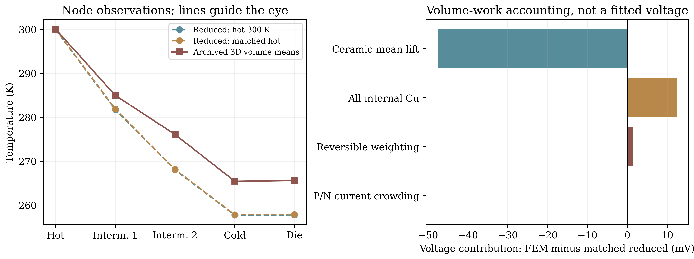
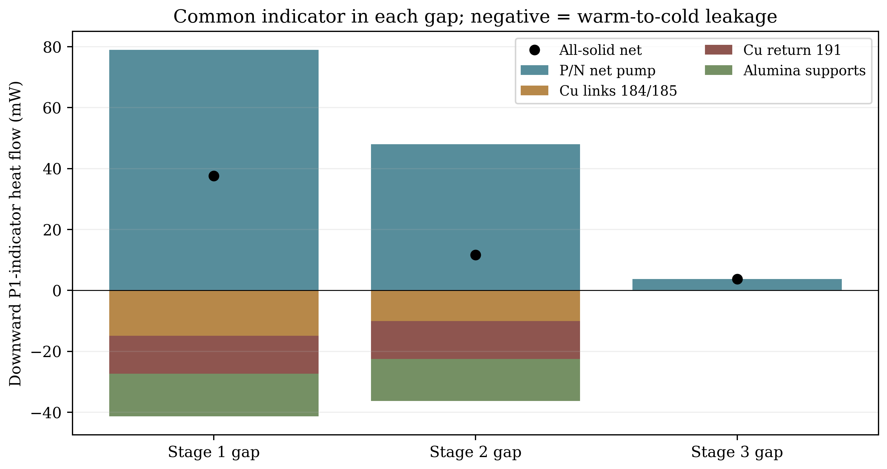

# Internal diagnostic: corrected solid FEM versus constant reduced model

This is an internal comparative audit, not a standalone scientific report or
numerical-release claim. The single Rev3 master remains canonical. This work
order temporarily prioritizes this bounded comparison before native exchange.

## Registered plan — before targeted model runs

Audit target: corrected `cu_off` archive, 0.1 A, 2 mW, both external wire types
OFF, no enclosure. Compare the original constant-law five-node implementation;
do not alter its code, old outputs, material law or archived FEM fields.

Observables: all four ceramic volume means, die volume mean, module versus
external-terminal voltage, stage alpha/R/K, endpoint/work/Joule budgets,
same-surface body heat contributions and remaining temperature/voltage residuals.

Controls (maximum eight small reduced solves; no new FEM):

1. Reproduce the stated fixed-hot-ceramic 300 K, 2 mW, constant-law case. Remove
   the wire list entirely: setting Cu thermal scale to zero alone retains Cu
   series resistance/Joule in the legacy implementation. Set gas/radiation OFF.
2. Change ONLY that fixed hot ceramic to archived 300.1148977883 K. Compute
   local hot-boundary sensitivity and the residual against the archived die/V.
3. Independently solve the constant-law linear node equations and check all
   stage/node energy balances. Include zero-current/zero-load and finite-load
   analytic controls. Do not infer accepted physical states from failed solves.
4. Evaluate ideal stage equations at archived ceramic means; report their
   nonzero node residuals as an incompatibility diagnostic, not fitted heat loads.

Field-only accounting: verify compressed/uncompressed hashes and exact native/
derived node, tetrahedron and body correspondence. Reconstruct electrical work
and Joule by material; separate Cu dissipation, P/N nonuniform-current loss and
current-weighted reversible voltage from the ceramic-mean approximation.
Separate die-attach face means, ceramic/die volume means and finite-die heating.
Compare heat channels only on identical P1 indicator surfaces (and reconstruct
registered band budgets). Archived leg-midpoint raw fluxes are a different
surface/operator and must not be substituted for whole-band transfer.

Stop/fail if evidence identities differ, leg/material correspondence fails,
original reduced output differs by >2 microK / 20 nV, original-solver versus
independent-linear result differs by >2 microK / 20 nV, any reduced balance
exceeds 1 nW, field work differs from archived values by >2 nW or reconstructed
whole-band energy exceeds 1 microW. These audit tolerances do not replace any
historical 1% bath / 5% cold-interface or other release gates. No fitted bypass,
new CFD, production FEM, optimizer sweep or empirical device-validation claim.
If causal temperature attribution remains nonunique, preserve the residual and
specify one small discriminating next experiment rather than expand this mission.

Legacy review: entire Rev2 PDF, G3b result/reproduction notes, OpenFOAM feasibility,
actual rays/exchange/runner and execution snapshots. Reuse algorithms and
conservative interfaces only; corrected source geometry requires new mappings.

## Results

**The hot bath placement does not explain the discrepancy.** Matching the hot
ceramic removes only 0.097305 K (1.24%) of the initial 7.836248 K die difference.
Different die readouts account for another observed 0.108477 K; **7.630466 K of
cold-ceramic difference remains**. Actual field accounting identifies omitted
Cu/alumina thermal shunts in the lower two stages and closes the voltage
difference. It does not uniquely assign kelvins to each shunt versus spreading.
No FEM, CFD, material calibration or fitted bypass was run. Four original-solver
controls were reproduced twice during implementation; final records retain the
used source hashes. Analytic unit checks do not constitute additional FEM runs.

### Geometry, properties and ports

`geometry_complete_checkpoint_20261030/manifest.json` and its actual `mesh.npz`
are identical to the archived corrected execution's mesh identity. All 88 actual
leg volumes agree with their registered boxes. Stage numbers below run hot to cold.

| Stage | Couples | Leg L / area (mm / mm²) | alpha (V/K) | Ideal R (ohm) | Ideal K (W/K) | FEM apparent P/N K (W/K) |
| --- | ---: | --- | ---: | ---: | ---: | ---: |
| 1 | 28 | 1.07 / 0.16 | .00924 | 2.468919940 | .012560748 | .012667524 |
| 2 | 12 | .82 / .16 | .00396 | .810886923 | .007024390 | .007084180 |
| 3 | 4 | .64 / .16 | .00132 | .210962451 | .003000000 | .002998160 |

Both models use P/N k=1.5 W/(m K), sigma=140000/165500 S/m,
S=+160/-170 microV/K; Cu k=400 W/(m K), rho=1.72e-8 ohm m, S=0.
These constants are checked against the actual SIF, not inferred from matching
outputs. Ideal K=N*A*(kP+kN)/L; R=N*L/A*(rhoP+rhoN); alpha=N*(SP-SN).
The last column is archived raw leg-midpoint Fourier power divided by adjacent
ceramic-mean drop: an observed ratio, **not a fitted passive conductance law**.

Both have a 1 mm², 30 micrometre, k=1 attach (30 K/W). The 3D model additionally
resolves the 200 micrometre MCT with local k(T), 220 micrometre alumina plates
(k=30), finite Cu pads/bridges, buried links 184/185, routing ribs 186/188,
return Cu 191/support 192 and a 50 micrometre, k=35 hot joint over 40.96 mm².
The reduced stages omit these finite spreading, nonlocal conduction and internal
Cu electrical losses. Shared-node interfaces are ideal in 3D; no identified
extra contact impedance is hidden in either model. Neither model uses OEM grades.

### Matched controls and unresolved temperature

| Observation | Reduced, hot 300 K | Reduced, hot 300.114898 K | Actual archived 3D |
| --- | ---: | ---: | ---: |
| Hot ceramic K | 300.000000 | 300.114898 | 300.114898 |
| Intermediate 1 K | 281.769898 | 281.877130 | 284.998212 |
| Intermediate 2 K | 268.016641 | 268.118227 | 276.087269 |
| Cold ceramic K | 257.696276 | 257.793580 | 265.424046 |
| Die K | 257.756276 | 257.853580 | 265.592524 |
| Module V | .585608855 | .585707694 | .551939871 |

The hot-boundary derivative is 0.84688 K/K at this fixed-current linear-law
point; it is obtained from the explicit node matrix, not a fitted response.
Independent matrix versus original optimizer temperatures agree within
4.55e-13 K. Zero-current/zero-load is uniform 300 K; a passive 2 mW control
matches the independent series thermal-resistance solution. Wires are removed
from the geometry copy, eliminating their electrical resistance/Joule as well
as conduction; pressures and emissivities are zero. The production model is unchanged.

Only a **scalar volume mean** is matched, not the spatial ceramic condition:
actual hot-ceramic temperatures span 299.120597–300.315526 K, while the two
intermediate ceramics span 3.123488/2.479278 K. Nonisothermal contacts and
spreading remain in the residual and reversible-voltage weighting.

The actual die/ceramic difference 0.168477 K splits into ceramic volume mean
to attach-bottom face mean 0.010437 K, attach face drop exactly 0.060000 K,
and die-bottom face to die volume mean 0.098040 K. The reduced model retains
only the 0.060000 K attach drop. A uniform-source, adiabatic-top 1D MCT slab
would give Q*t/(3*k*A)=0.120053 K at the archived mean k; this is an analytic
scale check, not a replacement for the unresolved 3D interface gradients.
Original cold raw mismatches of +41.35%/-47.84% on this mesh remain failures.

At matched hot temperature, stage lift losses (reduced minus FEM) are
**+3.121082, +4.847960, -0.338576 K**. They sum to the remaining 7.630466 K
cold-ceramic gap. Thus the coldest stage gains slightly more lift in FEM;
the lost lift accumulates in the lower two stages. Evaluating the ideal
equations at archived ceramic means gives intermediate-node imbalances
6.797093 and 37.173517 mW, and cold imbalance -0.008506 mW. These are
incompatibility residuals, not inferred external loads or calibrated corrections.



### Compatible heat accounting

For w=1 below a registered height and 0 above it at actual mesh nodes,
Fdown=sum(Vcell * grad(w) dot q), with q=-k*grad(T)+S*T*J.
All body contributions in a row use **the same P1 indicator**. This is a
conservative weak diagnostic with a finite mesh transition, not a sharp cut
or recovered raw bath flux. Positive is toward the hot bath; negative is leakage
toward colder stages. Heights are 2.37001391, 3.66501066 and 4.74500832 mm.

| Stage gap | P/N net down mW | Cu link 184/185 | Cu return 191 | Alumina supports | All-solid net down mW |
| --- | ---: | ---: | ---: | ---: | ---: |
| 1 | +78.980271 | -14.927408 | -12.426509 | -14.037847 | +37.588507 |
| 2 | +47.934540 | -10.071659 | -12.444975 | -13.775912 | +11.641994 |
| 3 | +3.755765 | ~0 | ~0 | ~0 | +3.755765 |

The warm-to-cold parallel flows total **41.391764 / 36.292546 mW** at the first
two gaps, compared with 2 mW detector loading. Alumina is not negligible:
186/192 carry 7.280540/6.757307 mW upward at the first gap; 188/192 carry
7.009113/6.766799 mW at the second. The return spans more than one stage,
so these powers cannot be inserted as three independent local K values.
These measured discrete paths explain a concrete structural omission; no
counterfactual temperature contribution per material is identified from one field.

Registered whole-band checks replay independently (mW):

| Band | Hot out | Cold out | Electrical work | Imposed source |
| --- | ---: | ---: | ---: | ---: |
| 1 | 57.193988 | 18.014099 | 39.179889 | 0 |
| 2 | 18.014099 | 5.753932 | 12.260167 | 0 |
| 3, including detector | 5.753932 | 0 | 3.753932 | 2 |

Hot out minus cold out equals work plus source. The detector is **inside band 3**;
its zero outer cold transfer is not zero TEC cooling. Reduced matched endpoint
Qc/Qh are 19.029873/60.570769, 5.472478/19.029873 and 2/5.472478 mW,
respectively, with each Qh-Qc=I*V. These endpoint budgets are not the above
whole-band surfaces. Archived `stage_thermoelectric_decomposition` instead sums
raw leg-midpoint cuts and work over original P/N/Cu groups, excluding added routes.
Never subtract those quantities from whole-band transfers to fabricate a bypass.
Common-indicator energy closure is at most 1.294 nW; original band transfer
replay agrees within the preregistered 2 nW. Neither check waives raw-flux gates.



### Voltage accounting (FEM minus matched reduced)

Joule=integral(J²/sigma); work=integral(J dot E). Reconstruction from native
T/phi agrees with derived J/q and reproduces 55.193987641 mW work and
36.145790656 mW Joule. Divide each work contribution by imposed 0.1 A:

| Contribution | Change mV |
| --- | ---: |
| Ceramic-mean Seebeck lift redistribution | -47.589799 |
| All finite internal Cu dissipation | +12.369902 |
| Reversible current/temperature weighting beyond ceramic means | +1.441007 |
| P/N dissipation excess over uniform-current ideal | +0.011073 |
| Terminal versus integrated-work numerical residual | -0.0000055 |
| Total | **-33.767823** |

Passive-solid dissipation is negligible (3.43e-14 V). P/N excess includes
nonuniform current and any remaining numerical-current error; it is not a
separately isolated physical mechanism. The dominant voltage change is reduced
lower-stage thermopower lift, partially offset by Cu resistance. Finite pad
temperatures/current weighting contribute another 1.441 mV; temperature/voltage
precision is not material or mesh accuracy. This is accounting at two states,
not an independent validated device-prediction model.

### Rev2/G3b reuse assessment

Read all 15 Rev2 pages and inspected the actual geometry/physics/budget figures.
The historical genuine 3D-solid + hybrid-wire + exchange cases are retained:
263.404041 K solid+Au; 266.468861 K +Cu; 267.301094 K vacuum+radiation;
N2/Ar/Kr at 100 Pa: 268.878638/268.347858/267.901465 K. Fine G3b remains
unqualified at 1.51–1.66% bath error. No OpenFOAM execution existed.

| Method | Reuse / adapt / avoid |
| --- | --- |
| `fem_g3b_exchange.py` | Reuse pure radiosity, symmetric conductance/pair-power, bounded gas-property and negative/zero controls; current corrected proxy already imports these. Do not duplicate them. |
| `fem_g3b_rays.py` | Adapt first opaque hit, same-owner/orientation mapping, closed-skin/volume tests, nodal surface weights and raw/corrected matrices. Rebuild corrected native cavity faces/visibility; old analytic union and nearest-face-centre hit assignment are not a corrected native-surface solution. |
| `fem_g3b_physics.py` | Adapt conservative nodal-temperature-to-patch and patch-power-to-node interface, equal/opposite links, and final unmixed residual checks. Rebuild tags, endpoints and compiled payload for corrected geometry; do not invoke the old runner on the new package. |
| `fem_g3b_run.py` / snapshots | Retain same-mesh restart/source/SIF/operator checks and temperature-only cross-mesh initialization safeguards. Nitrogen's older startup snapshot differs by exactly the known three edits; exchange snapshots match. Existing validator verifies this, rather than misattributing old runs to current sources. |
| Old geometry and numerical increments | Avoid transferring 215-body, .44 mm generic-pin geometry, endpoint tags, view factors, film gaps or the +3.064820 K Cu-lead increment. Current C pins are .76 mm and both supply leads reach hot pads; buried return/support paths also differ. |
| Gas film / OpenFOAM | The Fij/harmonic-projected-chord film is not continuum gas-domain Laplace or CFD. Require watertight corrected gas void and conduction-only baseline first; then assess Kn, Ra, orientation and impact before conditional buoyant CFD. Existing proposed 2% Nu / 0.2 K impact screens are goals, not demonstrated accuracy; 1708 is not universal. |

### Ranked bounded follow-up and report decision

1. Construct a geometry-derived **nonlocal** reciprocal port network for Cu
   184/185/191 and supports 186/188/192, preserving explicit ceramic/port drops
   and route I²R. Verify passive unit-temperature port balances; compare only
   OFF/ON at 0.1 A, 2 mW, hot 300.114898 K. No fitted conductance, no gas/CFD,
   no sweep. Test whether this predicts observed stage loads and lost lifts.
2. If distributed contact/spreading leaves that reduction nonunique, register
   one bounded same-coarse-mesh mechanism control separately before considering
   FEM. This milestone authorizes no new run or relaxation of historical gates.

Exact causal kelvins per path, finite-ceramic spreading versus nonlocal conduction,
and continuum-limit error remain unidentifiable from one operating field. The
remaining **7.630466 K** is retained, not removed with fitted bypass parameters.
Rev3 changes are deferred until a substantiated predictive matched comparison
is available; its current 28-page master and all historical PDFs stay byte-identical.

Reproduce in a NEW output directory, then inspect the two actual-data figures:

```bash
./fem/run.sh python -m tecooledmct.solid_model_diagnostic --out outputs/new-solid-diagnostic
./fem/run.sh python -m pytest -q tests/test_solid_model_diagnostic.py tests/test_integrated_reference.py
python3 -B -m reports.master.validate --current
./fem/run.sh python fem/archive_bath_spatial_device.py --verify
```

Versioned `data/solid_model_diagnostic_20261031/diagnostic.json` records native/
derived identities, source/input hashes, registration, all controls, body integrals,
stage coefficients, same-surface channels and legacy observations. Original evidence:
`fem/results/corrected_coupled_thermal_20261030/cases/cu_off/{metrics.json,case.sif,fields_t0001.vtu.gz,derived.vtu.gz}`;
geometry under `fem/results/geometry_complete_checkpoint_20261030`; historical
exchange under `fem/results/g3b_checkpoint_20261029`. Nothing there is rewritten.

Verification completed after the authorized bounded runtime restoration:
**71 focused tests and 312 full opt-in tests pass**, including the existing
Elmer smoke regressions (14 third-party deprecation warnings). Full archive
verification, master integrity and both legacy demos pass. No new diagnostic or
production FEM case was added; scientific data, figures and every PDF are unchanged.
The unchanged Dockerfile rebuilt in 534.07 s within 4 CPU / 10 GiB and disk guards;
its base layers, all 24 Python and 252 system-package versions, Elmer commit and
solver-source hash match archived provenance. The rebuilt image has a separate
identity. Prior interruption/preflight failures and current logs are retained in
`verification.json`/`runtime_restore.json`; CI is checked for the exact pushed commit.
