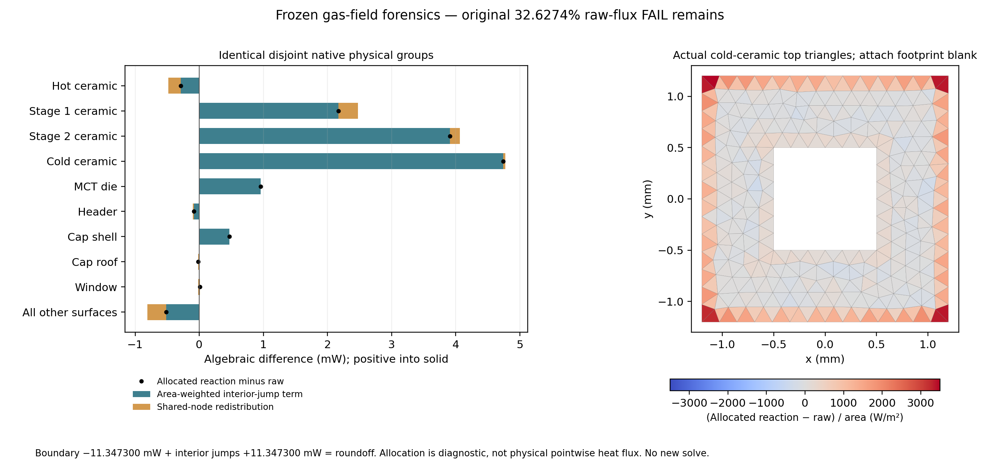

# Frozen native-gas flux forensic audit

## Registered read-only scope

Audit the accepted native void and the failed gas-only field at checkpoint
350d773. Preserve every original input/source/field/result byte, raw 1% gate,
32.6274% failure, stopped solid studies and the single Rev3 master. No CAD,
meshing, Elmer execution, linear-system solution, fit or new physical experiment.
Use the pinned offline environment, <=4 CPUs/8 GiB, one bounded calculation.

Independently compute SI tetrahedral gradients using vector cross products,
full oriented face incidence, boundary power, all interior normal-flux jumps,
sparse P1 stiffness/reactions and energy. Cross-check original MSH, Elmer mesh,
VTU GeometryIds and saved arrays without calling the original extractor.
Test local vector closure, shape-function identities, per-tet divergence and
the identity `r_i = -(boundary_power_i + interior_jump_i)` with exact P1 face
weights 1/3. Require reconstruction discrepancies <1e-10 W, geometric node
matches <1e-11 m and no missing/duplicated boundary triangle. These are audit
consistency limits, not replacement release criteria.

Use identical disjoint physical body groups. Decompose allocated reaction minus
raw power into area-weighted interior-jump contribution and zero-global-sum
shared-node redistribution. Inspect boundary trace compatibility, planar/curved
faces, fixed-node tetrahedra and element quality without inferring convergence
from one mesh. Only an exact algebraic cause supported by these identities may
be declared; no physical accuracy or device-temperature claim follows.

Verify affine/slab, uniform, continuous piecewise-linear jump controls and
negative topology controls. Regression must respect the explicit no-solver/
no-new-mesh instruction: exclude the existing runtime solver/mesh smoke tests,
run remaining opt-in tests, archive/master integrity and legacy demos. Record
the exclusions honestly. No follow-up experiment is authorized by this audit.

## Results

**The imbalance is exactly the normal-flux jump defect of the continuous P1
temperature field.** No extraction, owner/orientation, unit or incompatible
Dirichlet-trace error was found in the tested pipeline. This identifies the
discrete algebraic cause, not continuum heat-flux accuracy or a convergence rate.
The original **32.6274% FAIL against <1% remains**. No new device T or gas budget
is qualified, and Rev3 is unchanged.

### Independent reconstruction and source identity

`native_gas_flux_forensics.py` reads the frozen VTU temperature and reconstructs
gradients by edge cross products, all oriented tetrahedral faces, and the
unconstrained sparse P1 stiffness. It does not import/call the original
extractor or any solver. All 48 original scientific artifact hashes verify
before and after the 7.30 s calculation. Original source, SIF, fields, mesh,
registry, cap qualification and histories remain unchanged.

MSH physical/geometrical tags, saved NPZ, Elmer parent elements and VTU triangle
connectivity agree on **42,062 boundary triangles / 927 native faces / 217 exposed
body groups**. The two buried Cu bodies 184/185 have no exposed gas surface;
all 219 construction solids remain accounted for. Each boundary face has one
gas owner; all signed tetrahedral volumes are positive and the node graph has
one component. Native CAD faces match prior qualified area/centroid/bbox
signatures without importing or changing CAD.

The VTU contains **temperature only**, so no original Elmer gradient is available.
In this archive, tetrahedral GeometryIds are SIF body index 1; triangle IDs are
100 plus the SIF boundary-condition index, **not physical tags**. All 217 targets
were independently reconciled. The new auditor initially assumed physical IDs
and stopped before derivative calculations; its rejected reader assumption/log
is retained under `implementation_check`. The original extractor did not use
those labels: this was not a cause of its published flux mismatch.

| Independent reconstruction check | Maximum discrepancy |
| --- | ---: |
| VTU/Elmer node coordinates versus source mesh | 8.49e-15 m |
| Saved raw boundary power, triangle by triangle | 3.09e-19 W |
| Saved gradient versus cofactor reconstruction | 1.32e-9 K/m |
| Saved owner tet | 0 mismatches |
| Saved area vector | 5.29e-23 m² |
| Local tet sum of outward area vectors | 1.23e-22 m² |
| Per-tet sum of raw face power | 2.04e-20 W |

### Why strong raw flux and weak reactions differ

For each tet e, `q_e=-k grad(T_e)` is constant, k=0.0259 W/(m K). Let
`F_f=q_e dot A_e,f` be outward boundary power (W) and
`J_f=q_e dot A_e,f + q_d dot A_d,f` the signed interior-face jump (W).
Every tet has zero strong divergence internally, but adjacent normal fluxes
need not agree. Summing **all** tet faces gives the exact discrete identity

`sum_boundary F + sum_interior J = 0`.

The P1 reaction vector is `r=K(T-300 K)` (W). At node i define
`b_i=sum_incident_boundary F/3` and `j_i=sum_incident_interior J/3`.
Exact face integration of linear shape functions gives

`r_i = -(b_i+j_i)`.

| Observable | Independent value |
| --- | ---: |
| Positive / negative raw outward boundary power | +23.431149 / −34.778449 mW |
| Raw boundary sum | **−11.347300 mW** |
| Signed sum on 436,389 interior faces | **+11.347300 mW** |
| Boundary plus interior-jump closure | 5.20e-18 W |
| Largest nodal integration-by-parts discrepancy | 1.02e-18 W |
| Interior-face jump L1 (cancelling local terms, not heat leakage) | 432.388938 mW |
| Jump sum assigned to boundary-node patches | +11.347299910 mW |
| Jump sum assigned to free nodes | 1.68e-12 W |
| Free-node reaction L1 | 4.54e-11 W |
| Allocated boundary reaction sum | −1.68e-12 W |
| `(T-300)^T K(T-300)` = k integral(grad T)² dV | 1.212574979 W K |

The 26,136 free-node tests enforce local weak equilibrium. The 20,853 Dirichlet
nodes do not supply zero-boundary test functions that enforce their boundary
patch jumps. Thus their jump contribution remains in the difference between
raw facet flux and variational reaction. The raw gradient is **not a normal-flux
continuous field**. Sparse K is symmetric to 1.36e-20 W/K and annihilates uniform
temperature to 8.01e-20 W/K. Global reaction closure also follows from partition
of unity; it is not an independent proof of accurate boundary derivatives.
On the same closed polyhedral domain, any exact source-free Laplace solution
has zero net boundary power. Thus the raw field's integrated absolute boundary
normal-flux error is at least **11.347300 mW**. This lower bound neither locates
the true local flux error nor supplies a temperature-error bound.

### Same-group attribution and spatial checks

Use the original area weights `w_ig=A_ig/A_i` at boundary nodes; positive power
is from gas into solid. For each disjoint physical body g, let `b_ig` be its raw
nodal face contribution. The **exact accounting**, not a flux correction, is

`R_g-F_g = sum_i w_ig*j_i + sum_i(w_ig*b_i-b_ig)`.

The second term is shared-node redistribution; it sums to zero over all groups.
Changing that allocation can move local budgets but cannot remove the global
raw imbalance.

| Native solid group | Reaction − raw (mW) | Interior-jump term (mW) | Redistribution (mW) |
| --- | ---: | ---: | ---: |
| Hot ceramic | −0.287856 | −0.480345 | +0.192488 |
| Stage 1 ceramic | +2.172724 | +2.475438 | −0.302714 |
| Stage 2 ceramic | +3.908889 | +4.065135 | −0.156246 |
| Cold ceramic | +4.737711 | +4.772244 | −0.034534 |
| MCT die | +0.956948 | +0.959388 | −0.002439 |
| Header | −0.085049 | −0.098033 | +0.012985 |
| Cap shell | +0.472463 | +0.472106 | +0.000357 |
| Cap roof | −0.018634 | +0.004893 | −0.023527 |
| Window | +0.008496 | −0.015009 | +0.023505 |
| All other exposed surfaces | −0.518392 | −0.808517 | +0.290125 |

The two coldest ceramics' **8.646599 mW** difference is **8.837379 mW** of
weighted jumps minus **0.190780 mW** redistribution. Shared-edge splitting is
therefore not the main explanation of that difference either. Every body
identity closes within 3.47e-18 W; global redistribution is 3.63e-18 W.

All shared-node and shared-edge midpoint analytic wall-law conflicts are zero;
maximum prescribed-node error is 5.24e-10 K. Cubic analytic versus P1 centroid
trace interpolation differs by at most 0.046652 K, a discretization effect
distinct from a boundary jump. No trace-conflict explanation is supported.

Of the assigned reaction/raw difference, 11.200476 mW (98.706%) is on 917 planar
CAD faces, versus 0.146823 mW on 10 curved faces. Curved-wall faceting alone is
not an accounting explanation; its influence on the solved field cannot be
isolated from one mesh. Circle-facet area error reaches 2.55%, including planar
pin disks. Independent tet mean-ratio quality ranges from 0.1303 to 0.8313
median; this differs from Gmsh's reported metric and establishes no convergence.
There are 21,210 boundary tets with four fixed nodes and 18,177 with three.
Their boundary-face differences are respectively −1.500395 and +12.847695 mW;
fully fixed tets are not the sole explanation of the net discrepancy.



On the actual cold-ceramic **top** (gas-outward normal points down into solid),
424 triangles give 1.633938 mW allocation/raw difference. Its outer 150 µm strip
has 26.990% of top area and 95.466% of that signed difference. This locates a
boundary/corner concentration, not pointwise physical heat or an error bound.
The figure leaves the attach footprint blank and uses full diagnostic ranges.
Local normal-gradient magnitudes reach 71,663 K/m. `localization.json` separates
top/bottom/side accounting rather than attributing the entire cold-body error
to the plotted top alone.

### Reproduction, verification and stop

Frozen inputs: `data/isolated_cap_native_gas_20261101/phase_C` (SIF, MSH,
NPZ, Elmer mesh/VTU and original failed result), with prior cap/void qualifications
in adjacent phase A/B directories. New evidence, native face matching, diagnostic
arrays and hashes: `data/native_gas_flux_forensics_20261101`.

```bash
./fem/run.sh timeout --kill-after=5s 180s python -m tecooledmct.native_gas_flux_forensics --out outputs/gas-forensic-replay
./fem/run.sh python -m tecooledmct.native_gas_flux_forensic_figures --data outputs/gas-forensic-replay
./fem/run.sh pytest -q tests/test_native_gas_flux_forensics.py tests/test_isolated_cap_native_gas.py
python3 -B -m reports.master.validate --current
./fem/run.sh python fem/archive_bath_spatial_device.py --verify
```

The full applicable opt-in test selection/exclusions and exact execution results
are in `verification.json`: **32 focused / 385 applicable opt-in tests pass**,
with **12 runtime cases excluded**. Archive/master integrity and both requested
legacy demos pass. Runtime solver/CAD/mesh smokes are excluded to obey
the user's no-Elmer/no-new-mesh instruction; analytic arrays and requested legacy
regression demonstrations are separate from the gas audit. Neither successful
software checks nor exact algebraic explanation clear the original raw gate.
Rev3 and original histories remain byte-identical; this unqualified derivative
diagnostic does not warrant changing the professional master.

**ONE proposed future experiment, not executed:** reuse the exact same frozen
mesh/k with a globally affine Dirichlet wall control such as
`T=300-50*(z-1.5 mm)/8.15 mm`, on every wall. One bounded HeatSolver run, no CAD,
remesh or fit. This is a manufactured conduction control, not a device scenario:
the exact P1 field is affine on every tet and every facet power is analytically
known. Pre-register 1e-6 K nodal error and 1e-10 W absolute facet-power error;
expect raw closure and jump sum at roundoff. It tests the complete solver/output
pipeline under an exactly representable field, **not** convergence or qualification
of the original cubic-wall control. **STOP: no follow-on experiment is authorized.**
