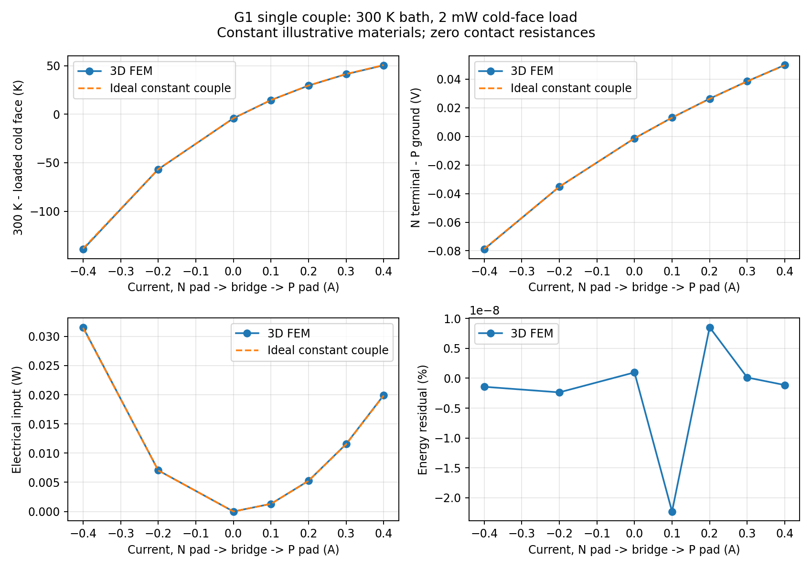
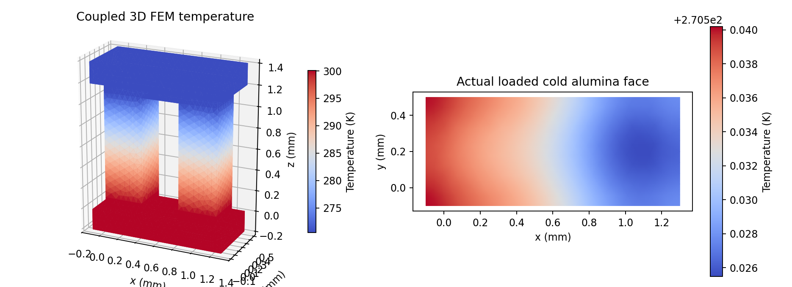
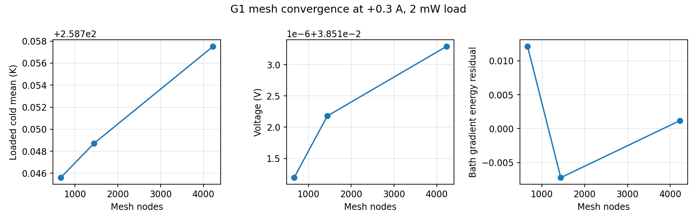

# Phase 1 G1: verified coupled 3D P/N thermocouple

**PASS — numerical G1 benchmark, executed on srv1323456 on 2026-10-28.**
Elmer's actual ThermoElectricSolver solved temperature and electric potential
together in seven conformal 3D solids. All **22 acceptance checks** and **21 pytest
tests** passed, including the real FEM smoke test. This verifies the mathematical
single-couple model; it does not validate a manufactured TEC or the full TO-66
package. No other repository was modified or invoked.

Source baseline: `4ed0c1b4989db2c772c4f1dc666b94fbd79f50d3`. This report, source
and tracked evidence form the G1 implementation commit. Exact source/artifact
SHA256 values are in `fem/results/g1_20261028/manifest.json`. Independent solver:
Elmer release 26.2.1, commit `a19504ac53ec222e3355e182b08f2ff280c2203a`.

## Model and physical boundary conditions

Two separately tagged 0.4 × 0.4 × 1.0 mm Bi-Te legs, a 0.1 mm continuous copper
bridge, two separate hot copper pads and two 0.2 mm alumina supports. Gmsh
OpenCascade BooleanFragments creates shared interface nodes. Audits passed exact
material volumes, all seven contact areas, manifold face incidence and the
continuous N → Cu → P path. Removing the bridge disconnects the terminals. All
contacts have **zero electrical and thermal resistance**; no solder layers or
artificial contact gaps are included.

Positive current enters the N hot pad, travels up N, across the cold bridge and
down P to ground. The bottom alumina face is a fixed **300 K bath**. The loaded
sweep applies a uniform **2 mW inward heat flux** to the top alumina face and
solves its temperature. Remaining exposed faces have zero total heat/electric
flux. Terminal current is prescribed as inward flux; voltage is area-mean
N-terminal potential relative to grounded P terminal.

P/N constants at 300 K: Sp = +160 and Sn = −170 microV/K, sigma = 1.4e5 and
1.655e5 S/m (Goldsmid Table 1). Both leg k = 1.5 W/(m K) is a separate generic
Ferrotec value. Cu k = 400 W/(m K), resistivity 1.72e-8 ohm m and S = 0 are
representative assumptions. Alumina k = 30 W/(m K) is an AD-995 proxy. These
mixed literature/assumed inputs are **not OEM material calibration**. Constants
are held fixed over the computed 249.6–439.2 K mathematical benchmark; their
physical validity over that span is not claimed.

The actual PDE includes Seebeck, Peltier and Joule coupling:
J = sigma(−grad(phi) − S grad(T)), q = −k grad(T) + TSJ,
div(J) = 0 and div(q) = J·E. Peltier junction conversion follows from the shared
weak form and discontinuous S. No empirical junction heater or externally
prescribed reduced-order temperature replaces the coupled FEM.

## Actual loaded sweep

Fine mesh: 17,046 linear tetrahedra, 4,223 nodes, 8,446 coupled nodal unknowns.
Every row holds the bath at 300 K and applies 2 mW cold-face load.

| Current (A) | Cold mean (K) | DeltaT (K) | Voltage (mV) | Input (mW) |
|---:|---:|---:|---:|---:|
| −0.4 | 439.168864 | −139.168864 | −78.919596 | 31.567839 |
| −0.2 | 356.806458 | −56.806458 | −35.268977 | 7.053795 |
| 0.0 | 304.209540 | −4.209540 | −1.375002 | 0.000000 |
| +0.1 | 285.464670 | 14.535330 | 13.097576 | 1.309758 |
| +0.2 | 270.532265 | 29.467735 | 26.322035 | 5.264407 |
| +0.3 | 258.757514 | 41.242486 | 38.513292 | 11.553988 |
| +0.4 | 249.627444 | 50.372556 | 49.839712 | 19.935885 |

DeltaT = 300 K − cold-face mean. Zero current passively warms the loaded face
and produces thermovoltage at zero electrical input. Reversing current reverses
cooling into heating. These are **not DeltaTmax/Qmax** or a 44-couple cooler test.





## Independent verification

- **Upstream solver:** the unmodified Elmer ThermoElectric reference-norm test
  passed: 221.287384 versus 221.287380, relative difference 1.90e-8. The installed
  binary reports v26.2 and unknown git revision for the tarball build; the
  separately recorded source commit identifies it exactly.
- **Heat-pumping sign:** with both outer thermal faces clamped to 300 K,
  +0.2 A absorbs **17.925912 mW** at the cold face; −0.2 A rejects
  **21.273586 mW** there. These reactions are independently reconstructed from
  actual T/phi fields, not assumed signs in a plot.
- **Open circuit:** 300/280 K outer faces, zero injected current, V =
  **6.532888 mV**. The Seebeck integral using actual mean leg-end temperatures
  gives 6.532881 mV (0.0001063% difference). A perfect 20 K leg drop would give
  6.600 mV; ceramic/spreading drops explain the distinction.
- **Ideal analytical couple:** alpha = 330 microV/K, R = 0.0824072076 ohm,
  K = 0.00048 W/K; it omits finite Cu and ceramic resistance/spreading. Across
  loaded points, max relative cold-temperature difference is **0.1561%** and max
  voltage difference **0.3266%**. At +0.3 A ideal Tc = 258.563600 K; 3D FEM
  differs by 0.193914 K, or 0.468% of ideal lift. Absolute DeltaT errors are also
  retained; relative absolute-temperature agreement alone is not lift validation.
- **Energy:** field-based reconstruction of the original nonlinear weak form
  gives worst normalized global energy error **2.24e-10** and volume J·E versus
  terminal IV error <4.1e-11 across cases/meshes. These are equation residuals,
  not experimental error bars. Direct constitutive hot-bath flux gives worst
  finest-mesh energy mismatch **0.1696%**, independent of conservative reactions.
  The coarse gradient mismatch is 1.2114% and remains reported.
- **Current:** reconstructed ground reactions balance injected current to much
  better than a microamp. Direct cuts through both legs at z = 0.600013 mm and
  through Cu at x = 0.600017 mm give worst driven fine-mesh current error
  **0.0380%** (coarse convergence point 0.3509%). Zero-current absolute cut error
  is <0.1 microamp against a declared 1 microamp gate; percentage of zero is
  undefined. Cut areas reproduce 1.6e-7 m2 per leg and 4.0e-8 m2 through Cu.
- **Local flux limitation:** raw P1 terminal-gradient integrals at +0.3 A give
  0.27609/0.28381 A versus 0.30000 A (~8.0%/5.4% errors). Corner crowding and
  nonconservative raw gradients converge slowly. Global current is verified by
  weak reactions and independent interior cuts; terminal current-density peaks
  are **not** claimed converged. Refine contacts, use higher order or recover an
  equilibrated flux before interpreting local peaks.
- **Insulation:** alumina sigma = 1e-12 S/m regularizes unconstrained potential
  DOFs and is consistent with vendor resistivity bounds. Leakage bound is
  <6.2e-16 A. Reducing sigma 100-fold changes +0.3 A Tc by <1e-8 K, without a
  relevant conducting short.
- **Temperature dependence:** a separate +0.2 A run evaluates synthetic linear
  k(T), sigma(T), S(T) within Elmer: fractional slopes +0.0005, −0.001, +0.0002
  per K about 300 K, only in P/N. It converges in 13 nonlinear iterations to
  Tc = 270.371391 K, V = 26.116421 mV and passes balance checks. This demonstrates
  software support, not sourced grade-specific curves or independent physical
  validation of Thomson heating.

## Mesh convergence at +0.3 A and 2 mW load

| h (mm) | Nodes | Tetrahedra | Cold mean (K) | Voltage (mV) | Direct bath energy residual (%) |
|---:|---:|---:|---:|---:|---:|
| 0.160 | 666 | 2,029 | 258.745601 | 38.511193 | +1.211429 |
| 0.100 | 1,441 | 5,094 | 258.748701 | 38.512180 | −0.721252 |
| 0.065 | 4,223 | 17,046 | 258.757514 | 38.513292 | +0.118359 |

Two finest meshes: Tc change **0.008813 K / 0.003406%**, lift change
**0.021369%**, voltage change **0.002889%**. This is a three-level engineering
study, not an asymptotic-order estimate or a bound on local peaks.



## Execution and retained evidence

The existing `sim` session was used; no additional session or Codex setting
change. The official PPA has no Ubuntu 25.10 questing Release file (404); host
sudo needs authentication. A pinned Ubuntu 24.04 amd64 container instead contains
headless serial ElmerSolver/ElmerGrid and Gmsh 4.13.1. Runtime mounts only this
repository, uses the invoking UID, disables network and caps CPU/memory. No host
packages, OpenFOAM or GUI applications were installed. About **32 GiB disk free**
remains from 35 GiB initially; no unrelated files/images were cleaned.

Executed successfully:

```bash
./fem/bootstrap.sh
./fem/run.sh python -m tecooledmct.fem_g1_run --out outputs/fem-g1
./fem/run.sh env TE_FEM_SMOKE=1 pytest -q
./fem/run.sh python -m tecooledmct.cli --quick --out outputs/check
./fem/run.sh python -m tecooledmct.geometry_demo --out outputs/pellet-study
```

Pytest: **21 passed**, including real FEM smoke, with 14 dependency deprecation
warnings. Existing reduced-model behavior is preserved. Setup initially caught
missing headless Gmsh libraries and mesh-relative Elmer output-path behavior;
both are fixed. The new cut-current diagnostic initially normalized zero current
as a relative percentage; it now uses the explicit absolute gate above. The
final complete solver run and acceptance report both pass.

Full raw data: `outputs/fem-g1/` on this VPS. Tracked evidence:
`fem/results/g1_20261028/` contains actual meshes/audits; every case SIF, BC JSON,
exit status, convergence log and metrics; representative original/derived VTU,
J/q/Joule fields, temperature isosurfaces; CSV/JSON, PNG/SVG, package/image
identity and regression logs. Archived SIFs retain original `/work` paths;
regenerate them for a new checkout. See [reproduction and primary
sources](FEM_G1_REPRODUCIBILITY.md) for implementation, equations and provenance.

## Next gate

G2 requires a verified **88-leg / 44-couple / three-stage series netlist**, every
Cu pad/junction, shared ceramics, contact/solder resistance sensitivity and
sourced material curves over the operating range. The 28/12/4 stage split remains
inferred. Recheck balances/convergence, then compare voltage, lift and heat-load
curves against independently withheld OEM/device measurements. Fitting only
DeltaTmax and Qmax endpoints cannot validate intermediate behavior.

Later G3/G4 add header, die attach, MCT compact thermal load, wires, enclosure,
gas conduction and radiation. CFD needs a separate screening gate. Actual
contact properties and independent physical data remain missing. No full-package,
manufacturer-level predictive accuracy or carrier-transport simulation is claimed.
