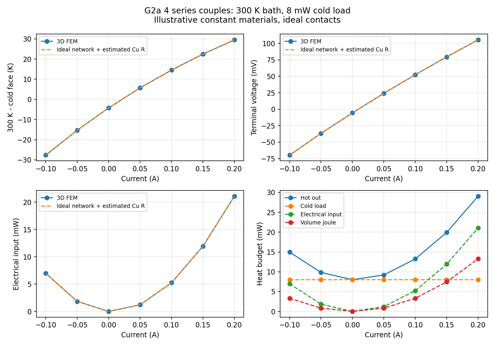
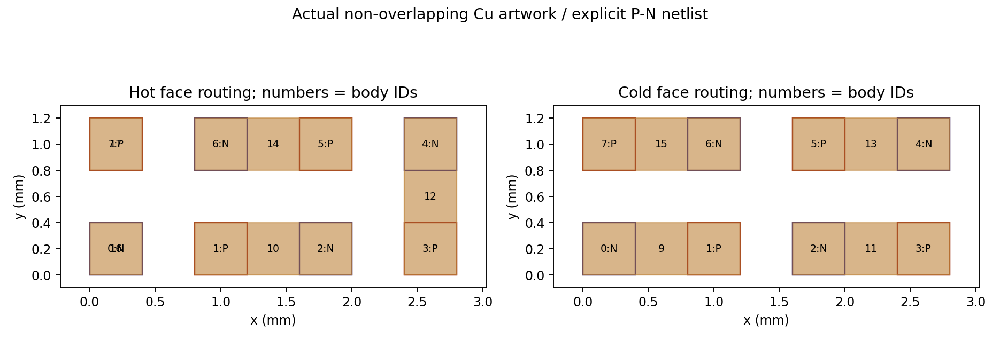
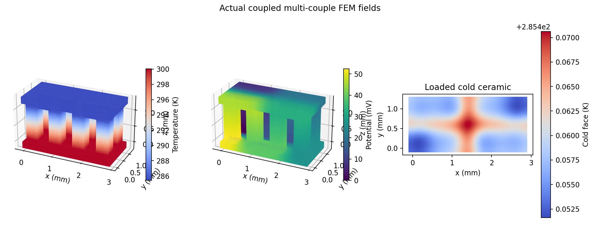
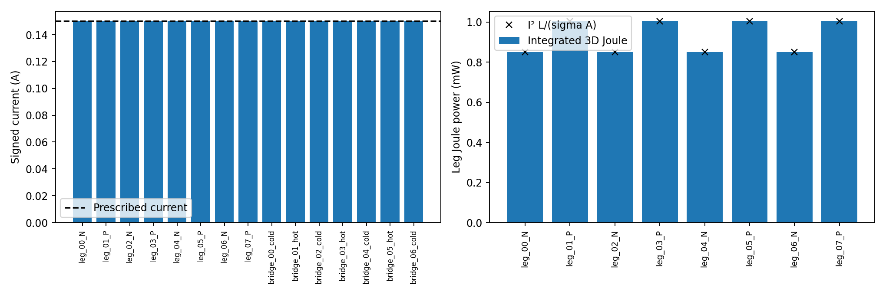
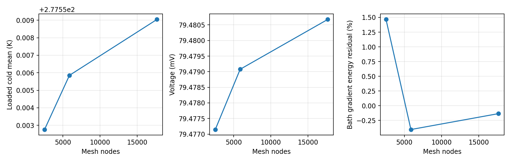

# G2a multi-couple coupled FEM

**PASS, 2026-10-28:** actual four-couple, single-stage, coupled 3D thermoelectric
FEM. All **29 acceptance checks** and **30 pytest tests** passed, including real
G1 and G2a Gmsh/Elmer smoke runs. Baseline:
`6dcef127adc887132ae70d407181c1a1a53b28eb`. All eight G1 source hashes and 128
published artifact hashes remain identical. The existing pinned Elmer/Gmsh image
and `sim` session were reused. No host packages, other projects or settings changed.

This is numerical verification of an illustrative four-couple stage. It is not
a calibrated OEM stage, a full three-stage cooler solve, or package validation.

## Actual connected model

Eight separately tagged 0.4 × 0.4 × 1.0 mm Bi-Te legs form a 2×4 snake on 0.8 mm
pitch. The path alternates N/P and connects through seven distinct Cu bridges
alternating cold and hot faces. Two hot Cu terminal pads are the only external
electrical contacts. Two 3.0 × 1.4 × 0.2 mm alumina supports complete 19 domains.
Cu is 0.1 mm thick. Contact resistances are zero and solder is omitted.

Both independent box-intersection checks and actual conformal-mesh adjacency
checks pass. There are 25 intended material interfaces with exact matching areas
and volumes, no Cu overlap and no unintended face/edge/point conductor shorts.
The conductor graph has 17 vertices and 16 edges: two degree-one terminals and
15 degree-two internal vertices, connected in exactly one path. Every leg and
bridge has an independent interior cut, not merely a terminal-current assertion.

Positive current follows N up → cold Cu → P down → hot Cu → next N. The hot
ceramic bottom is held at 300 K. The loaded cold ceramic top receives an actual
uniform 8 mW inward surface heat flux (2 mW per couple); Tcold is solved.
All other exposed faces have zero total heat/electric flux. Phi is grounded at
the return pad. Voltage is area-mean injection-terminal potential, so Pin = I V.

The unchanged G1 material constants have Sp/Sn = +160/−170 microV/K,
sigmaP/sigmaN = 1.4e5/1.655e5 S/m and k = 1.5 W/(m K). Cu and alumina are the
same representative assumptions/proxies. They are mixed room-temperature
literature inputs, not OEM material curves. Computed temperatures span about
270.5–327.7 K across the loaded cases; constant-property extrapolation over this
range is a verification assumption. See [primary sources and input
details](G2A_REPRODUCIBILITY.md).

## Executed loaded sweep

Fine mesh: **17,651 nodes, 74,552 linear tetrahedra**, coupled T and phi in
Elmer's actual ThermoElectricSolver. The hot bath is 300 K and load 8 mW in every row.

| Current (A) | Cold mean (K) | Voltage (mV) | Input (mW) |
|---:|---:|---:|---:|
| −0.10 | 327.609370 | −69.548654 | 6.954865 |
| −0.05 | 315.263151 | −36.678842 | 1.833942 |
| 0.00 | 304.206029 | −5.500008 | 0.000000 |
| +0.05 | 294.308905 | 24.157469 | 1.207873 |
| +0.10 | 285.459358 | 52.441291 | 5.244129 |
| +0.15 | 277.559043 | 79.480673 | 11.922101 |
| +0.20 | 270.521550 | 105.389146 | 21.077829 |

Zero drive warms the loaded face by passive conduction and gives thermovoltage
at zero electrical input. Current reversal changes cooling to heating. These
points are not Qmax/DeltaTmax, an optimal current, or manufacturer performance.

## Quantitative independent checks

- **Every component:** fine worst leg-current error **0.000888%**, bridge-current
  error **0.088983%**, versus the prescribed current. All eight legs and seven
  bridges pass the 0.5% gate in every driven fine case. Zero-drive cut errors
  are <0.279 microamp against a 1 microamp absolute gate. Every cut area agrees
  with its geometric cross-section. The CSV includes current and heat through
  every leg/bridge; heat integration uses the affine q at the cut, not a guessed
  junction heat source.
- **Joule:** integrate J²/sigma over every body. Each leg agrees with independent
  I²L/(sigma A) to **0.001429%** or better on the fine mesh. Cu losses are also
  integrated, not omitted from the electrical input budget.
- **Energy/current:** reconstruct the original nonlinear weak form from actual
  VTU fields. Worst fine global energy residual is **4.40e-10** normalized;
  integrated J·E versus terminal IV differs by <2.91e-10 normalized. Free-node
  residual checks pass. Separately, the direct bath-gradient energy mismatch is
  **<0.161%** across fine cases. The coarse +0.15 A bath mismatch is 1.465%,
  explicitly retained rather than used as a converged claim. Ceramic leakage
  upper bound is <5.1e-15 A.
- **Heat-pumping sign:** with both outer thermal faces fixed to 300 K,
  +0.2 A absorbs **71.791105 mW** at the cold face; −0.2 A rejects
  **85.169390 mW** there. Signs come from independently reconstructed boundary
  reactions. The 8 mW loaded sweep and these clamped-temperature tests are
  distinct boundary cases.
- **Open circuit:** 300/280 K outer faces, zero applied current gives
  **26.158713 mV**. Summing S dT over all actual leg ends gives 26.158667 mV:
  relative difference **0.0001773%**. G2a/G1 voltage ratio = **4.004158**
  (0.10394% deviation from four). The +0.2 A isothermal-face voltage ratio is
  **4.002666** (0.06664% deviation). Finite Cu/ceramic geometry differences are
  retained, not calibrated away.
- **Independent ideal network:** alpha = 0.00132 V/K,
  Rlegs = 0.3296288304 ohm, estimated Cu R = 0.00258 ohm,
  K = 0.00192 W/K. The Cu estimate uses centre-to-centre trace lengths and does
  not fit FEM resistance. Driven voltage differences are <0.083% across the
  sweep. At +0.15 A ideal Tc = 277.496388 K, FEM = 277.559043 K; lift differs
  by 0.062655 K. Finite thermal spreading and actual Cu heating distribution
  distinguish this spatial problem from the ideal isothermal-junction reference.
- **Local limitation:** raw P1 terminal-gradient currents at +0.15 A are
  0.13910/0.14089 A versus 0.15000 A (~7.3%/6.1% errors). Global conservative
  reactions and independent interior cuts pass; contact-corner current density
  peaks are not claimed converged. Higher-order/local refinement or equilibrated
  flux recovery is needed before interpreting hotspots.

## Mesh convergence at +0.15 A, 8 mW

| h (mm) | Nodes | Tetrahedra | Cold mean (K) | Voltage (mV) | Direct bath energy mismatch (%) |
|---:|---:|---:|---:|---:|---:|
| 0.160 | 2,537 | 8,100 | 277.552758 | 79.477147 | +1.465241 |
| 0.100 | 5,886 | 21,860 | 277.555852 | 79.479078 | −0.405020 |
| 0.065 | 17,651 | 74,552 | 277.559043 | 79.480673 | −0.135130 |

The two finest meshes change mean Tcold by **0.003191 K = 0.014220% of lift**.
The maximum cold-face temperature changes by 0.003611 K, also below 1% of lift.
Voltage changes by about 0.00201%. These are engineering convergence checks on
the reported observables, not an asymptotic error estimate for local singularities.

## Reproduction, evidence and next gate

Executed successfully: full `fem_g2a_run`,
`./fem/run.sh env TE_FEM_SMOKE=1 pytest -q` (**30 passed**, 14 dependency
deprecation warnings), the existing CLI quick check and geometry_demo. The
official pinned Elmer thermoelectric reference-norm test also passed. No G1
source, tests, published results or baseline behavior were changed.

Full raw runs: `outputs/fem-g2a`. Verified tracked evidence:
`fem/results/g2a_20261028` contains all three actual meshes, graph/geometry
manifests/audits, all case SIF/log/status/metrics, current and component heat/Joule
CSVs, representative original/derived VTU with E/J/q/Joule and temperature
isosurfaces, charts, test logs and checksums. Source hashes are checked before
and after a run; each case also hashes its SIF and original VTU. The archiver
refuses modified-source, quick or failed runs. Archived SIFs retain original
execution paths; regenerate them for a new checkout.

G2a is the verified milestone. Only after its commit is G2b assessed as an
88-leg, inferred 28/12/4-stage **geometry/netlist/mesh feasibility proof**. Such a
proof does not establish a converged coupled three-stage solve or the unknown
OEM interstage electrical wiring. G2c needs independent digitized/device curves
and physical material/contact data; fitting only 113 K and 0.5 W is excluded.

Follow-up: G2a was committed/pushed as `f43d07835c5c58a336f661054b42023eeb5a50d5`.
The subsequent [G2b geometry-only proof](PHASE1_G2B_FEASIBILITY.md) passes its
limited gate. The combined suite has 32 passing tests. G2a numerical evidence
and source remain those verified above; G2b has no coupled physics result.
