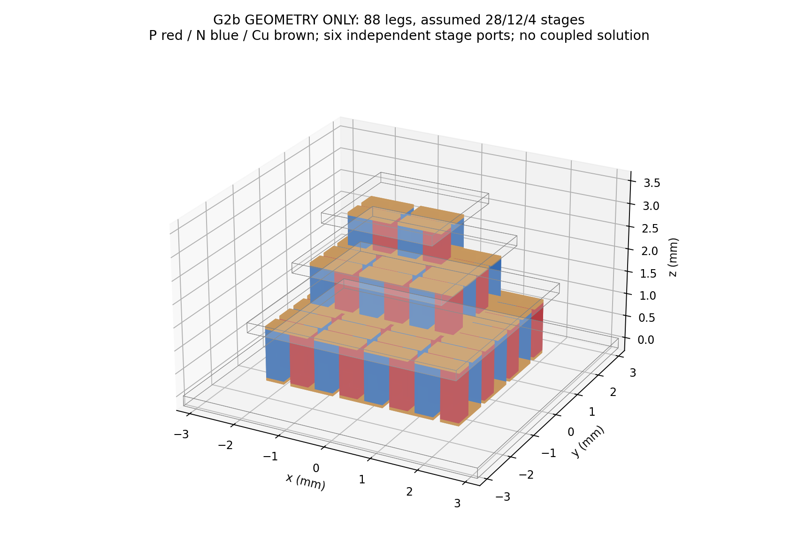

# G2b: 88-leg geometry/netlist/mesh feasibility only

**PASS for the explicitly limited geometry gate, 2026-10-28. No coupled G2b
thermoelectric solution has been run or claimed.** G2a was numerically verified,
committed and pushed first as `f43d07835c5c58a336f661054b42023eeb5a50d5`.
Approximately 32 GiB free disk and the successful bounded G2a runs justified a
small headless geometry/mesh proof with the existing pinned image.

## Actual assembly and tested scope

The constructed, conformal three-stage solid assembly contains **88 separate
Bi-Te legs, 85 Cu bridges, six stage terminal pads and four shared ceramic
plates: 183 physical domains**. Stage couple counts **28/12/4 are assumed**, not
an OEM netlist. Each stage has its own alternating N/P snake and correctly
alternating hot/cold Cu links. No metal overlaps or unintended contact gaps.

| Stage, hot to cold | Couples / legs | Array (columns × rows) | Leg height (mm) | Actual conductor path vertices / edges |
|---|---:|---:|---:|---:|
| 0 | 28 / 56 | 8 × 7 | 1.07 | 113 / 112 |
| 1 | 12 / 24 | 6 × 4 | 0.82 | 49 / 48 |
| 2 | 4 / 8 | 4 × 2 | 0.64 | 17 / 16 |

All legs are 0.4 mm square, spacing is 0.15 mm edge to edge, Cu thickness is
0.065 mm, ceramic thickness is 0.22 mm. Plate sides are 6.4, 4.55, 3.25 and
2.4 mm, total stack height **3.8 mm**. Outer envelope values follow the nominal
reference; intermediate dimensions, leg heights, stage allocation and artwork
remain inferred. The leg arrays fit inside both adjacent plates. Intermediate
ceramics are genuinely shared thermal solids, not duplicated coincident volumes.

There are **six separately tagged stage ports and three isolated electrical
components**. Each component is one connected simple series path with exactly
two degree-one ports and all internal vertices degree two. The module-level
two-terminal interstage connection is **not implemented**. No external jumpers
or fabricated OEM routing are introduced. Six stage ports are an explicit
feasibility interface, not a claim that the physical product has six TEC leads.



## Actual mesh checks

Gmsh 4.13.1 produced **14,666 nodes and 47,667 linear tetrahedra** at nominal
0.20 mm size. Generation and geometric audits took about 3.84 s on this VPS;
this is neither a solver benchmark nor a convergence study.

- Exact per-body volume checks pass for all 183 domains.
- **267 intended material interfaces** have exact matching areas and shared
  mesh faces; actual face adjacency matches the prescribed contact graph.
- All tagged faces have the correct one-/two-sided incidence; no nonmanifold
  tetrahedral face, illegal Cu overlap or unintended face/edge/point conductor
  connection was found.
- The actual mesh reconstructs the three separate path graphs listed above,
  with no interstage electrical short. Their shared ceramics provide intended
  thermal contacts between stages without direct metallic electrical contact.
- **ElmerGrid conversion passed, exit 0.** It retains body and boundary tags.
- The combined suite passed **32 tests**, including real G1/G2a solver smoke
  and this actual 88-leg Gmsh/ElmerGrid feasibility test. The two G2b tests do
  not assert temperatures, current conservation or solved thermoelectric physics.

`geometry_only.vtu` contains actual tetrahedra and body IDs only. There are no
invented temperature, current, Joule or heat-flow fields. No `ElmerSolver` call
is made for G2b. This coarse feasibility mesh is not claimed sufficient for a
full nonlinear solve or local current-crowding prediction.

## Reproduce and next gate

```bash
./fem/run.sh python -m tecooledmct.fem_g2b_geometry --out outputs/fem-g2b-geometry
./fem/run.sh env TE_FEM_SMOKE=1 pytest -q
python3 fem/archive_g2b_geometry.py
```

The generator checks the verified G1 hashes and that G2a sources still match
their actual-run hashes. Source: `tecooledmct/fem_g2b_geometry.py`. Full raw mesh,
manifest, audit, geometry-only VTU and Elmer mesh files remain under
`outputs/fem-g2b-geometry`. Tracked evidence is
`fem/results/g2b_geometry_20261028`, including original mesh, audit, manifest,
conversion/generation logs, geometry image, regression log and checksums.
G1 and G2a source and published evidence remain unchanged in this follow-up.

Before a G2b physics claim, define and physically route the stage-to-stage
electrical connections or explicitly drive each stage independently, set actual
thermal loads and baths, solve coupled T/phi, and verify every leg/bridge current,
stage/global energy and mesh convergence. Characterize contact/solder resistance
and material curves over the intended temperature range. The true OEM stage
allocation/wiring remains undocumented. G2c requires independent withheld
performance data; no fitting of only 113 K and 0.5 W is performed.
