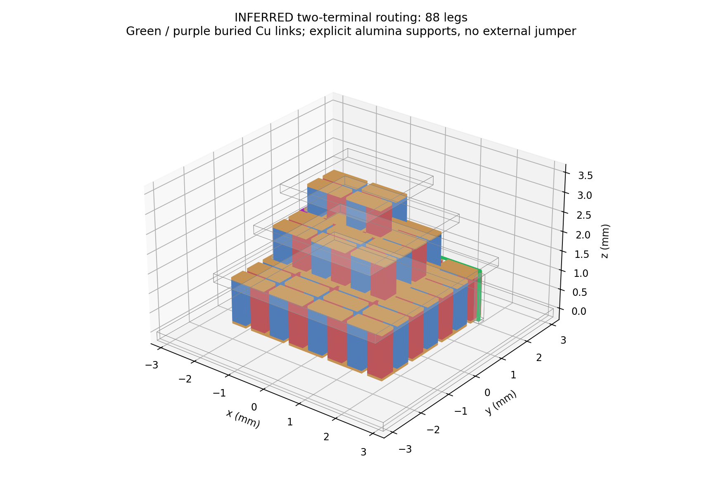
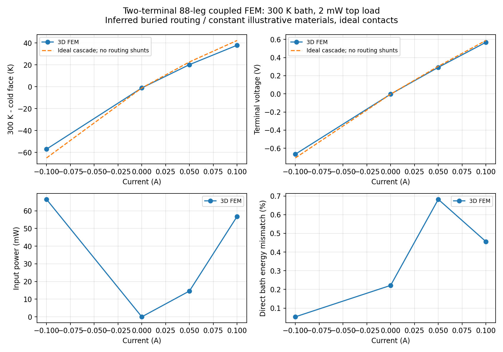
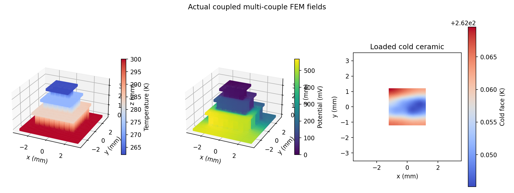
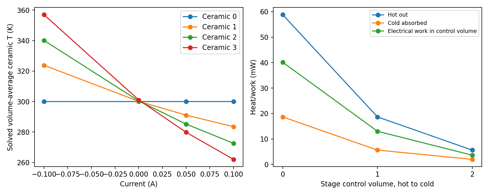
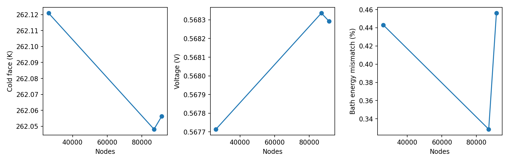

# G2b two-terminal 88-leg coupled FEM: verified numerical checkpoint

**PASS, 2026-10-28:** actual coupled 3D T/phi on an inferred two-terminal
three-stage solid TEC. All **30 full acceptance checks** passed.
The regression suite passed **41 tests**, including actual G1/G2a solvers, original
six-port geometry, new topology and full-stack coupled smoke. Protected G1/G2a
code/evidence and the original six-port proof are unchanged. No unrelated project,
LSDDTS, OpenFOAM, host package or Codex setting was invoked/modified.

This is numerical verification of a **hypothetical routed solid stack**, not
validation of the OEM cooler, measured material curves or the full TO-66 package.
The topology checkpoint is commit `1f5e2a77e4a98588201c4e60a78f0bbedcd762b6`.
The solver is pinned Elmer 26.2.1 source
`a19504ac53ec222e3355e182b08f2ff280c2203a`, Gmsh 4.13.1, using the existing image.
Source, SIF/VTU, mesh and artifact hashes are retained with the accepted evidence.
Code/evidence baseline at report generation: `a7a8991a5b75f5fe98c4771951e364dadd565a09`; exact verified
simulation and supplemental-audit source hashes identify the implementation.

## Physical circuit, geometry and assumptions

The preserved inferred 28/12/4-stage geometry contributes 88 Bi-Te legs,
85 local Cu bridges, six original pad locations and four shared ceramic plates.
Two distinct Cu insert domains join stage 0 out → stage 1 in → stage 2 in through
the respective stage-local paths. Each link has six face-connected rectangular
segments: supported vertical core, buried intermediate-plate traces, exit via
and pad-side tab. Four explicit alumina rib/collar domains insulate/support them.
There are **189 domains**, **181 conductor vertices / 180 edges**, exactly two
degree-one terminals, all other conductor degrees two and each leg occurs once.

Cu is genuinely subtracted from dielectric volumes before Boolean fragmentation.
Independent orthogonal CSG, OCC masses and actual tetrahedra agree on all body
volumes and **287 contact areas**. Actual mesh adjacency/shared-node checks find one
conductor component, no illegal face/edge/point short or overlapping material,
and no nonmanifold interface. The two links are spatially separate. There are no
disconnected same-tag fragments: a supplemental actual tetra-face audit proves
each of the 189 domains is face-connected, and both the conductor and complete
thermal assemblies have one face-connected component on all three meshes. No
external interstage jumper wires. The 0.06 mm square vertical Cu cores and
0.06×0.04 mm buried traces are **assumed fabrication**, requiring mechanical,
process and contact validation. Ceramic supports and Cu routes create real
thermal shunts included in the PDE; they are not just decorative netlist lines.

Positive I enters the bottom-stage N pad and follows every N up/P down pair,
the two buried links and the top-stage return pad. Only the external return is
grounded. The bottom ceramic outer face is 300 K; the top receives a real uniform
0 or 2 mW inward heat load. All other exposed faces are adiabatic and electrically
insulated. **No intermediate plate temperature is fixed.** Initial/restart values
are initial guesses only. Shared ceramics, inserts and supports conduct heat.

Contacts are ideal; solder, gas, radiation, device die and real lead/package heat
paths are absent. G1/G2a mixed literature room-temperature Bi-Te constants and
Cu/alumina proxies are held fixed. Their validity over the computed range is
not claimed. No OEM 113 K/0.5 W fitting or G2c calibration is performed.

## Actual fine loaded results

Final mesh: **91,538 nodes, 384,121 tetrahedra,
183,076 coupled nodal DOFs**. Every row holds the bath at 300 K and applies
2 mW at the actual top face. All results come from Elmer ThermoElectricSolver,
including Seebeck, Peltier and Joule terms; no reduced-order temperatures are
substituted into the field.

| Current (A) | Top load (mW) | Cold mean (K) | Voltage (V) | Electrical input (mW) |
|---:|---:|---:|---:|---:|
| -0.10 | 2.0 | 356.989385 | -0.66503709 | 66.503709 |
| +0.00 | 2.0 | 301.059175 | -0.00309095 | -0.000000 |
| +0.05 | 2.0 | 279.799360 | 0.29224980 | 14.612490 |
| +0.10 | 2.0 | 262.056237 | 0.56829253 | 56.829253 |

At +0.1 A, zero top load gives **261.083802 K**,
versus **262.056237 K** at 2 mW. Zero drive gives passive warming;
negative drive heats the top and has negative voltage with positive input work,
not an unexplained generating state. These are modest-current numerical points,
not DeltaTmax, Qmax, an efficiency optimum or manufacturer predictions.

At +0.1 A / 2 mW, solved original ceramic-domain statistics are:

| Domain, hot to cold | Volume mean (K) | Minimum (K) | Maximum (K) |
|---|---:|---:|---:|
| ceramic_0 | 300.005272 | 299.228854 | 300.040989 |
| ceramic_1 | 283.551824 | 282.293268 | 286.344504 |
| ceramic_2 | 272.601928 | 272.317180 | 274.514970 |
| ceramic_3 | 262.054970 | 262.040535 | 262.069558 |

Routing supports are excluded from those plate averages. Intermediate spatial
nonuniformity is genuine in this assumed model; local extrema are not certified
manufacturing hotspots or independently validated physical temperatures.

## Current, energy and stage budgets

- Every leg and both inserted links have independent interior polygon current
  cuts. The 85 local bridges are checked too, for **175 component cuts** per case.
  Across all driven final-grid cases, worst leg error is
  **0.010194%**, bridge error
  **0.052067%**, and link error
  **0.00001006%**, each below 0.5%.
  Cut areas match geometry. At zero drive the largest absolute cut error is
  2.71e-07 A
  against the declared 1 microamp gate; a relative error to zero is undefined.
- Independently reconstructed nonlinear weak residuals, ground/bath reactions
  and volume J·E versus terminal IV pass. Worst final-grid normalized global
  weak energy error is **1.23e-08**, and electrical
  work mismatch **1.31e-08**.
- Direct constitutive bath heat flux is a separate check, not a reassigned
  conservative reaction: worst final-grid energy mismatch is
  **0.682206%**, below 1%.
  Every body's integrated J²/sigma and electrical work are retained.
- Alumina sigma is 1e-12 S/m, with estimated worst leakage bound
  **7.07e-13 A**. Reducing it 100-fold changes
  the loaded +0.1 A cold mean by **6.17e-07 K**. It does not establish a
  relevant alternative electric path through the ceramic.
- Raw P1 terminal-gradient currents at +0.1 A are
  **0.093168/0.090030 A** versus
  0.100000 A. They are reported separately; contact-corner gradients/current-density
  peaks are not claimed converged. Conservative terminal reactions and interior
  cuts meet the gates. An accepted global balance does not validate local peaks.

Stage control volumes are separated through the lower portions of intermediate
plates. P1 nodal indicators independently integrate heat transfer and weighted
electrical work; regions include their ceramic/routing portions. The sharper
geometric plane fluxes are also recorded. The following are conservative
control-volume budgets, not a fitted textbook split or fixed-temperature faces:

| Region | Hot heat out (mW) | Cold absorbed (mW) | Electrical work (mW) | Qhot−Qcold−work (W) |
|---:|---:|---:|---:|---:|
| 0 | 58.829254 | 18.684755 | 40.144500 | 1.64e-11 |
| 1 | 18.684755 | 5.643271 | 13.041483 | 1.69e-11 |
| 2 | 5.643271 | 2.000000 | 3.643271 | 1.17e-11 |

The routed Cu's upward mid-column heat transport is explicit, not removed from
the heat budget. Positive heat here means toward the cold direction; it is a
local cross-section value, not the net heat delivered at the link endpoint:

| Insert | Signed current (A) | Mid-column upward heat (mW) | Whole-insert Joule (mW) |
|---|---:|---:|---:|
| buried_interstage_link_0 | 0.10000000 | 15.930167 | 0.516852 |
| buried_interstage_link_1 | 0.09999999 | 12.302255 | 0.176009 |

## Mesh study and computational limits

Three meshes were actually solved at +0.1 A / 2 mW. The coarse global target is
0.18 mm; the next uses 0.12 mm global / 0.04 mm Cu-gap targets. Nine short-bridge
cuts on that intermediate mesh exceeded 0.5%, worst 0.5773%, so it was not
accepted as the final grid. Targeting 0.025 mm gaps with bounded background-field
propagation resolved the current issue without indiscriminate global refinement.
Netgen emitted BFGS-update warnings, but actual volume, adjacency and quality
audits passed; no element below SICN 0.01 is accepted.

| Nodes | Tetrahedra | Loaded cold mean (K) | Voltage (V) | Direct bath energy mismatch (%) |
|---:|---:|---:|---:|---:|
| 26,120 | 100,463 | 262.120959 | 0.56771418 | +0.443037 |
| 87,094 | 368,403 | 262.048138 | 0.56833601 | +0.328551 |
| 91,538 | 384,121 | 262.056237 | 0.56829253 | +0.456056 |

Coarse-to-final cold mean change is **0.064722 K / 0.170574% of lift**;
the last two grids differ by **0.008099 K**. Cold maximum and voltage
mesh gates also pass. This is engineering convergence of stated observables,
not an asymptotic error bound on singular contact peaks.

The runtime caps each container at four CPUs / 12 GiB and uses serial Elmer.
Measured peak actual solver RSS was **1890.8 MiB**; longest case wall time
**395.07 s**. Per-case CPU/elapsed/RSS, DOFs and nonlinear convergence
are in JSON and `resource_usage.csv`. The loaded-positive label explicitly reuses
its identical accepted fine convergence execution, with real field hashes.
Nearby new cases warm-start from hashed actual solved states and still solve
the full PDE. Completed early cases were independently reverified. One redundant
incomplete duplicate was stopped and retained separately, never counted as success.
The original cold-start source snapshot accompanies that provenance.
The first sigma-reduction attempt plateaued near 1e-10 and was retained as an
incomplete experiment. It was rerun with the final 1e-9 nonlinear stopping setting,
matching the predeclared convergence gate. Current/energy/mesh criteria and
material constants were unchanged. Both earlier source versions and actual SIF
tolerances/restart references remain traceable; no stopped run is labeled success.

## Independent sanity comparison and remaining gates

The independent ideal cascade solves stagewise Qc0=Qh1, Qc1=Qh2, Qc2=load with
constant properties and estimated local Cu R, but no routing/support shunts or
spreading. At +0.1 A / 2 mW it gives cold T =
**257.722800 K** and V =
**0.58852415 V**. The FEM differs for documented
physical reasons including the explicit thermal/electrical routing structure.
This comparison, conservation and mesh convergence do **not** independently
establish absolute manufactured-device accuracy.

Remaining: fabrication/contact/solder validation of the inferred ribs/vias,
grade-matched temperature-dependent material curves, realistic electrical lead
and package heat paths, local contact refinement, and independent withheld OEM/
device performance data. G2c calibration and G3 full package remain out of scope.
No claim of a manufactured two-terminal OEM design or full TO-66 digital twin.

## Reproduce and inspect the actual evidence

See [G2b reproduction](G2B_COUPLED_REPRODUCIBILITY.md). Full raw data remains in
`outputs/fem-g2b-two-terminal` and meshes in `outputs/fem-g2b-connected` on the VPS.
Accepted tracked data is `fem/results/g2b_two_terminal_20261028`: actual mesh
arrays/audits/manifests, final Gmsh mesh, case SIFs/BCs/logs/status/metrics,
representative original/derived VTU and isosurfaces, component/mesh/stage/resource
CSV/JSON, charts, source snapshots and checksums. Archive SIFs retain original
paths/restart references; the runner regenerates them in a fresh checkout.
The existing CLI quick check and geometry_demo also passed; G1/G2a/six-port
checksums remain unchanged. Existing CI is checked after pushing the validated
checkpoint. The same `sim` session was retained, with no unrelated cleanup.
