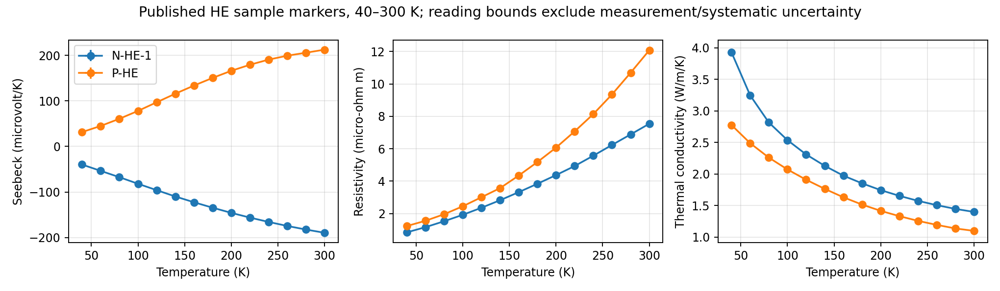
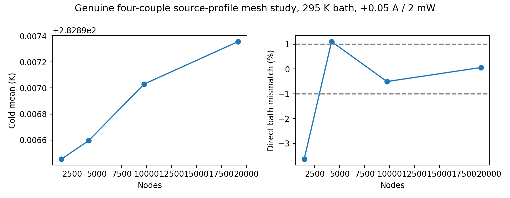
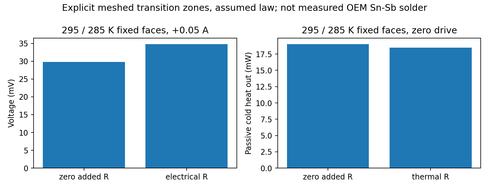
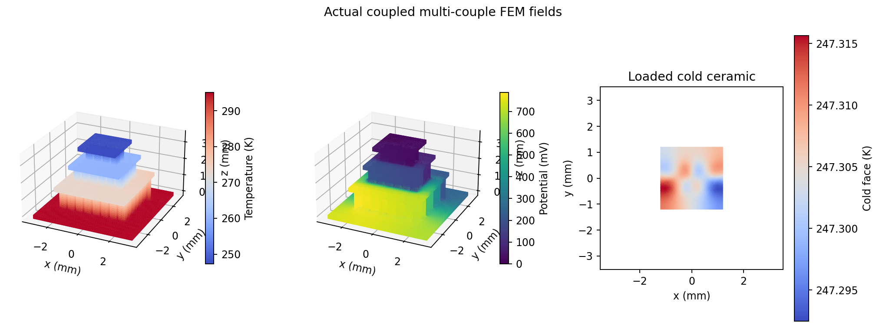
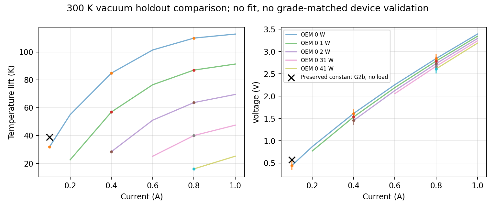
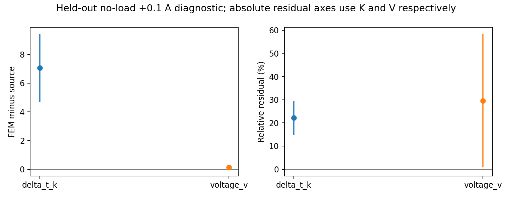

# G2c: bounded material and contact numerical qualification

**Verified numerical checkpoint, 2026-10-28.** 56 tests passed with actual
G1/G2a/G2b and new compiled-material Elmer smoke; all 74 stage, contact and
source-backed stack checks passed. Prior G1/G2a/G2b source/evidence hashes are
unchanged. Existing `sim` session and pinned Elmer 26.2.1 / Gmsh 4.13.1 image
were reused. No host installation, other repository or LSDDTS operation.
Code baseline for evidence generation: `0301020b5e70b675e9b9b79d57c3b322f2e98402`; exact execution source,
SIF/VTU/mesh and generated material-library hashes accompany the evidence.

**Device/OEM qualification remains NOT ESTABLISHED.** The material grade,
stage geometry, transition law, package mounting/environment and complete OEM
family have not been independently identified. Numerical gates are not device
accuracy gates. No fitting to 113 K / 0.51 W or freely tuned material curves.

## Traceable material evidence

See [source qualification](G2C_MATERIAL_PROVENANCE.md) for exact sources, sample
IDs, SI conversions, plot coordinates, reading bounds and coverage limitations.
Fourteen original PDF markers per property at 40/60/.../300 K were digitized
for N-HE-1 and P-HE from Zhang et al. (2025), DOI 10.1088/0256-307X/42/5/056304.
Rho, S and k were measured on the same specimen within each polarity. This pair
is not identified as a matched module pair or as TEC Microsystems' proprietary
grade. Sigma is exactly 1/rho in the library; rho, S and k use piecewise-linear
interpolation. The corrected default v1r1 200–300 K subset used by the stage checks
is unchanged. Additive opt-in v2r1 used by the full-stack and low-temperature checks extends
the source markers to 40–300 K, with
an identical v1 subset. Neither profile silently extrapolates outside its own
interval. These longitudinal sample properties are used as isotropic scalars;
OEM texture/orientation/tensor properties are not qualified.
Reading bounds do not include all measurement/systematic/specimen uncertainty.

Goldsmid's Table 1 remains a partial fixed-thermopower conductivity example, not
a full low-temperature triple-property profile. Cai's table remains quarantined
pending original unit/provenance verification and would not cover 262 K anyway.
No missing S(T)/k(T) was inferred from conductivity.

The opt-in adapter compiles actual Elmer `Variable Temperature / Procedure`
functions, including a runtime range rejection. The pinned solver evaluates
properties at local nodes, then interpolates them at integration points. The
postprocessor follows that actual discretization and reconstructs E/J/q/Joule
and the nonlinear weak form. This is not a stage-average property substitution.
An intentional 301 K runtime test proves fail-closed behavior. Bounded
performance checks use 295 K baths. Final visual source review corrected the
N-panel negative-axis origin before publication; independent Seebeck and
power-factor anchors now verify the extraction. All affected source-profile
PDEs and full regressions were rerun. Original incorrect-input runs remain
quarantined and unaccepted. Constant-profile contact PDE inputs were unchanged
and their actual fields/callback sources independently reverified.

## Genuine four-couple and Thomson checks

All four meshes were solved at +0.05 A, 2 mW top load, 295 K bottom bath with
no prescribed cold temperature. Current/energy and material-interval checks pass.

| Nodes | Tetrahedra | Cold mean (K) | Direct bath energy mismatch |
|---:|---:|---:|---:|
| 1,433 | 4,460 | 282.8964529 | -3.64063% |
| 4,180 | 14,545 | 282.8965958 | +1.10663% |
| 9,748 | 37,469 | 282.8970302 | -0.50560% |
| 19,187 | 82,096 | 282.8973566 | +0.06099% |

The fine source-backed stage gives 282.8973566 K and
0.042345422 V. Its worst component-current error is
0.04373%. Free-node thermal/current residual norms
are 1.56e-09 W / 2.83e-09 A.
Freezing the same source profile at 300 K gives
282.4460406 K, demonstrating that the
local-temperature material law changes the actual PDE result. A constant G1
profile agrees with the preserved independent constant-property postprocessor.
Synthetic curves are explicitly tagged as function tests, never measurements.

A synthetic linear-S rod was genuinely solved in 3D and compared with an
independent nonlinear 1D continuum BVP, k T'' = J T(dS/dT) T' − J²/sigma.
Maximum nodal temperature error: **0.0008768 K**;
voltage error: **6.56e-13 V**. Omitting the Thomson term changes
the reference by **0.151115 K**. Thomson
conversion is implicit in div(T S(T) J); no duplicate heat source was added.
The final rod BC combines thermal and electrical conditions in each boundary
list. An earlier duplicate-target prototype did not converge and is not accepted.

An additional genuine four-couple check exercised the v2 source law below
200 K with **200 K / 190 K imposed ceramic faces**, +0.02 A. Its terminal voltage
is 0.017204981 V; worst interior
current error is 0.21465%;
weak energy/work residuals are
-3.69e-09 /
-1.71e-12.
This tests the source-backed low-temperature PDE adapter. The 190 K face is a
controlled boundary condition, **not a predicted attainable cooler temperature**.
Source coverage has improved; OEM-grade/device qualification has not been inferred.

## Explicit transition resistance model

Sixteen **20 micrometre meshed transition domains** occupy the ends of the eight
legs without overlap. The remaining leg cores shorten accordingly. Each zone
has rho_eff = rho_BiTe + r_e/t and 1/k_eff = 1/k_BiTe + r_th/t; its Seebeck law
is assumed equal to the adjacent leg. This is a phenomenological resistive
transition zone, **not a claimed Sn-Sb solder composition or measured contact**.
These contact checks use the original constant verification profile. The
original Cu/BiTe Peltier interfaces remain in the coupled weak form. Added
irreversible heat is integrated within the explicit transition domains.

At r_e=r_th=0 the complete original continuum is recovered: the same S/rho/k
occupy the same envelope. The separately meshed result differs from the original
baseline cold mean by 0.0004831 K.
At fixed 295/285 K faces, adding r_e=1e-9 ohm m² raises voltage from
0.029789588 to 0.034789691 V.
The additional layer Joule heat is 0.250001 mW,
matching 16 I² r_e/A to the declared 0.5% gate. Independently adding
r_th=1e-5 m² K/W reduces passive heat transfer. Both resistances are also solved
together under a cold heat load: Tc=286.2424369 K and
V=0.033169026 V. Global energy/work, driven <0.5% cuts and
zero-drive <1 microamp cuts pass. Minimum tetrahedron SICN is
0.34749; actual body/contact/face-connectivity
checks pass. The initial 0.04 mm passive cases missed the 1 microamp cut gate (worst
1.032 microamp). They were replaced by genuine 0.03 mm passive solves; the four
completed driven cases were independently reverified from their actual fields,
not rerun or attributed to new executions. Original failed-accuracy fields,
logs/statuses and the initial summary remain retained and unaccepted.

This verifies this assumed law, not real OEM contacts. Thin-metal solder with
its own thermopower, measured interface data, thickness/contact sensitivity and
full-stack contact qualification remain separate gates.

## Source-backed 88-leg full-stack check

Actual G2b meshes were copied, re-audited (including per-body tetra-face
connectivity), re-converted with ElmerGrid and solved with the local-T source
profile. Geometry and published G2b inputs/evidence are unchanged. No intermediate
plate temperature is fixed; interfaces in this stack check remain ideal.
At **295 K bath, +0.1 A, zero top load**, the fine mesh gives
**247.304696 K / 0.78633050 V**,
91,538 nodes / 384,121 tetrahedra. Coarse-to-fine cold
mean change is 0.086197 K;
all 175 fine component cuts meet 0.5%, worst 0.25479%.
Direct bath energy mismatch is +0.420179%;
weak global energy and work errors are 6.02e-09 /
1.35e-08. Every actual BiTe nodal temperature
lies in the source interval. This is a 295 K numerical point, not a 300 K OEM
holdout or an absolute cooler prediction. No above-300 K reverse-drive material
extrapolation was performed.

Original ceramic-domain temperatures, excluding routing supports:

| Domain | Volume mean (K) | Min (K) | Max (K) |
|---|---:|---:|---:|
| ceramic_0 | 295.007047 | 294.004784 | 295.060835 |
| ceramic_1 | 273.564572 | 272.036118 | 277.195171 |
| ceramic_2 | 260.233751 | 259.874015 | 262.568145 |
| ceramic_3 | 247.304683 | 247.288909 | 247.319435 |

## Manufacturer holdouts and remaining identification

The specific 2019 original datasheet page 2 was inspected and 160 numerical
readings digitized from its original colored vector curves. Four panels retain
hot temperature, vacuum/dry-N2 environment, printed loads, source hash and plot
reading bounds. Currents .2/.6/1.0 A are calibration-reserved; .1/.4/.8 A are
withheld. No calibration points were used and no fit was performed.

Only the preserved actual constant-material G2b +0.1 A / zero-load / 300 K result
is compared with a matching 300 K vacuum source point. The 2 mW prior result
cannot be relabelled no load; the 295 K source-backed run is not compared with
a 300 K panel. Dry-N2 curves are not used to validate a vacuum-only solid model.

| Field | OEM reading | Prior constant FEM | Residual | Relative residual | Combined reading bound | Point gate |
|---|---:|---:|---:|---:|---:|---|
| delta_t_k | 31.853739 | 38.916198 | +7.062458 | +22.17% | ±2.3523 | FAIL |
| voltage_v | 0.440869 | 0.571051 | +0.130182 | +29.53% | ±0.1267 | PASS |

The temperature holdout fails the declared nominal error-plus-reading-bound
envelope. A point passing a broad digitization bound does not validate a device
or its full performance family.

The family objective is explicitly separated by split and weights residuals by
plot-reading bounds; it is not a statistical likelihood. The full family has
not been fitted or validated. Unknown leg dimensions/stage counts, property
grades, contacts, routing and environment are not uniquely identifiable from
terminal curves alone: R scales as L/(sigma A), K as k A/L and alpha as couple
count times thermopower. No experimental precision or unique parameter set is
claimed. The discrepancy is evidence of missing qualification, not a reason to
freely tune constants to OEM extrema.

## Evidence and reproduction

See [G2c reproduction](G2C_REPRODUCIBILITY.md). Accepted logs, source/mesh/SIF/VTU
hashes, actual representative fields, generated Fortran sources and compilation
records, resource metrics, source registry, plots and raw reading coordinates
are archived under `fem/results/g2c_20261028`. Complete raw runs and failed
attempts remain under ignored `outputs/`; incomplete/failed experiments are
explicitly separate. Serial containers remain capped at four CPUs / 12 GiB.
G1/G2a/G2b protected hashes pass. G2c OEM/device qualification remains open;
TO-66 package/gas/radiation and LSDDTS integration were not added.
