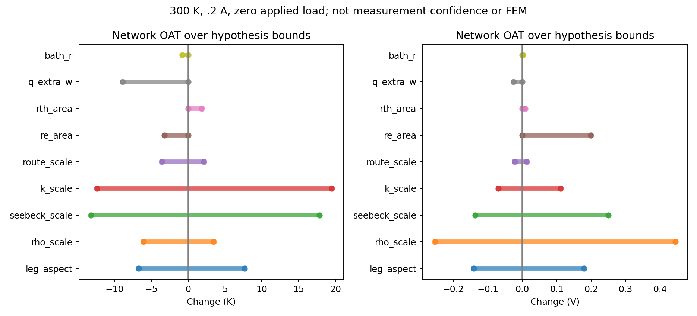
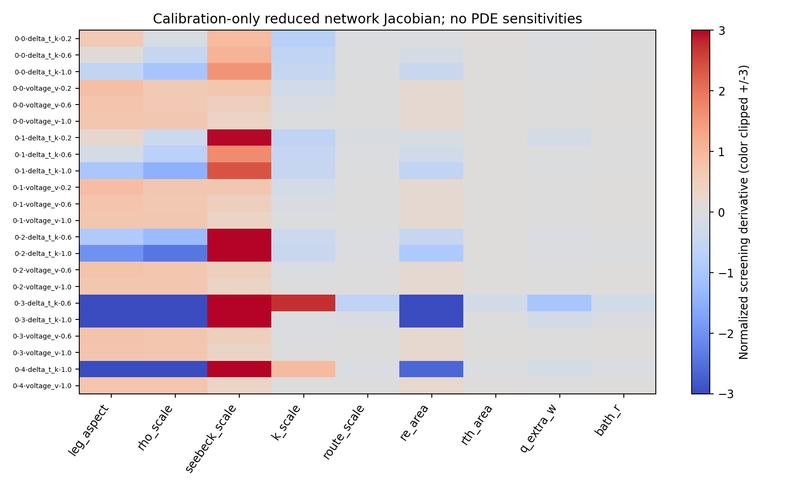
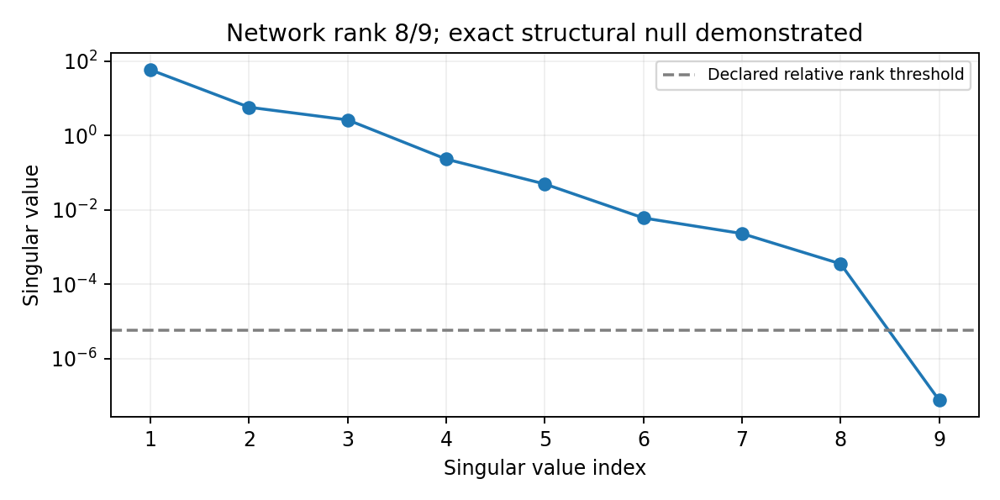
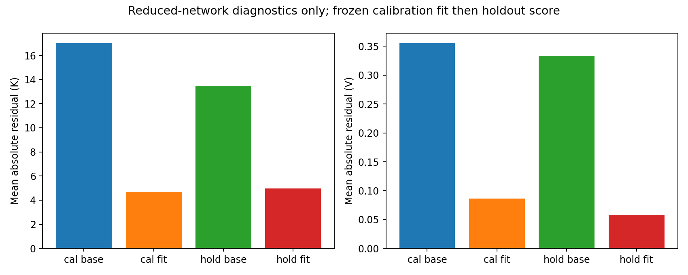
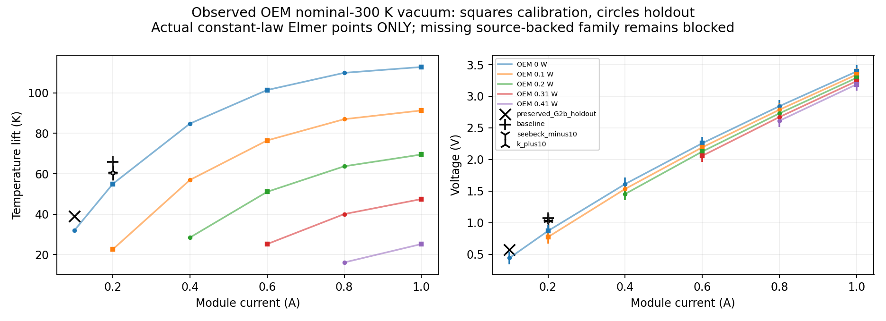
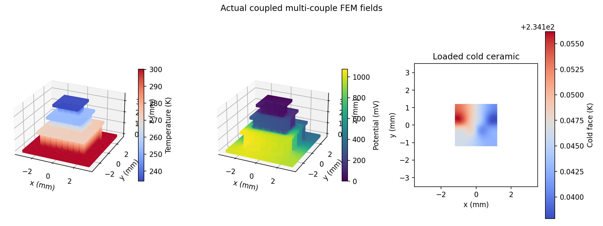

# G2d: OEM discrepancy and identification audit

Verified scoped D1/D2 checkpoint, 2026-10-29. **OEM/device qualification: FAILED / NOT ESTABLISHED.**
69 full tests passed with TE_FEM_SMOKE=1, existing CLI quick and geometry_demo completed.
Three new genuine coupled 3D 88-leg Elmer diagnostic solves passed; one additional actual source-profile
300 K execution failed closed and is not a performance point. Earlier G1/G2a/G2b/G2c accepted source,
tests and evidence are byte-identical. Existing attached sim session, original pinned image and
four-CPU/12-GiB serial wrapper reused; no host install or other repository operations.
Evidence generation code checkpoint: `94ff7eb7b5d28a6236a6037a38b43a01cbf3200b`; exact source/SIF/VTU hashes take precedence.

## Preregistered data and independent comparisons

Original TEC Microsystems 2019 vector curves: 160 scalar readings over four bath/environment panels,
all rechecked against preserved original vector paths and source PDF SHA256. New source audit retains
PDF coordinates, +/-1 PDF-point reading bounds, units, color/load mapping and numerical conversion.
These are existing independently digitized source readings, **not new OEM measurements**.
`data/g2d/preregistration.json` preserves .2/.6/1.0 A calibration versus .1/.4/.8 A holdouts.
Only nominal-300 K vacuum is compared: 22 calibration / 18 withheld scalar values. Dry-N2 data are
excluded because the solid-only model has no gas/environment heat path. No 295 K point is compared.

The literal source panel says **27 C** (300.15 K); the preserved G2c canonical panel is 300 K.
Matching here means that nominal panel. The 0.15 K rounding is an additional unquantified systematic,
not an assertion that the OEM experimentally held exactly 300.000 K. The source footnote stabilizes
the hot side at ambient; vacuum pressure, mounting resistance and precise measurement uncertainty
are not supplied. Module current, inward cold load, terminal V and DeltaT=Th-Tc are used.
Qmax .51 W, DeltaTmax113 K, 44 couples and2.9 ohm ACR are documentation, not simultaneous fit targets.

Fit objective uses **calibration vertical reading bounds only**, not neighboring slopes. A preliminary
attempt used full-curve slope weights and was discarded for leakage risk; it remains explicitly
unaccepted. The model, bounds and PDE directions were not selected from holdout residuals.
A SHA256-frozen calibration-only fit is written before held-out numeric scoring in the replacement
runner. Independence here means algorithmic separation: prior G2c comparisons and the discarded
attempt were already available, so this is not a newly blinded experimental validation. Reported residual
bounds combine horizontal chart-reading error with same-curve slope, strictly for reporting/scoring,
not fit weights. Those bounds are not experimental standard deviations or confidence intervals.
Broad-bound agreement does not establish device accuracy. See source, residual and frozen-fit JSON/CSV.

## Screening and identifiability, separate from FEM

The independent network solves linear constant-law cascades with exact per-stage Qh-Qc=I*V and
external energy closure, dimensional leg/Cu resistances, approximate Cu/rib shunts and optional
area-specific electrical/thermal contact, mounting and added-load nuisance parameters. All nine
parameter bounds are declared hypotheses, not inferred confidence. Width varies with fixed stage
heights: A=A0/aspect; actual changed geometry would require a new audited mesh. Integer allocations
28/12/4,26/12/6,24/12/8,30/10/4 all sum44; none is a continuously fitted or actually remeshed topology.
Measured v2r1 curves are separately evaluated in local-T 1D leg BVPs at295 K,.05/.1 A, using
q'=J.E and k*T'=S*T*J-q with exact signed P/N currents and implicit Thomson conversion.
Those are **network** exercises, not new 3D solves or OEM comparisons.

Normalized calibration Jacobian: **rank 8/9**, threshold1e-7 relative to
largest singular value; full inverse condition is unbounded. Largest/smallest finite-difference
singular values 57.809105/7.5198817e-08; tiny nonzero null value is differencing error.
The rank is stable when the step is halved. Normalization uses declared parameter scales and
max(abs(base observable),1 K/.01 V), not a Fisher likelihood. Weak retained directions are also
poorly conditioned: largest/smallest retained ratio 1.646e+05.

**Exact structural degeneracy:** at zero added contacts, aspect*c,rho/c,k*c preserve every stage
R and K, with S and topology fixed. Two distinct admissible fitted parameter sets, c=1.02,
have maximum calibration difference 2.93e-12
and withheld difference 1.71e-12. Hence grade and width
cannot be separately identified by these steady curves, even with perfect numerical precision.
Routing versus thermal contacts, added loads and bath resistance create further weak directions;
finite-difference rank does not establish unique physical parameters.

Calibration-only three-scale fit selected [28, 12, 4], rho=0.7707492,
S=1.0389903, k=1.2500000 times constant reference.
k reaches its predeclared fit bound1.25. This fit does not identify a measured grade or repair the
3D model. Across all matched loads, network held-out mean absolute residual changes from13.4916 to
4.9683 K and .333223 to .057957 V. These improvements are **screening evidence only**; no fitted
network point is labeled Elmer and no fitted FEM curve family is claimed.

## Bounded genuine Elmer checks

Preregistered directions: original constant reference, both P/N S reduced10%, both P/N k increased10%.
All three execute actual ThermoElectricSolver for T and phi at300 K bottom bath,.2 A total module
series current,zero applied top load, adiabatic sides,ideal contacts and no fixed intermediate T.
These constant laws are mathematical diagnostics, **not measured wide-temperature OEM profiles**.
The generic postprocessor's1..1500 K computational interval is not measured material coverage.

Re-audited preserved fine G2b mesh:91,538 nodes,384,121 tetrahedra,183,076 DOFs,189 material domains,
181 conductor vertices/180 graph edges,exactly two terminals,all88 legs once. Actual tetrahedral
face connectivity, domain volume/contact area, SICN and ElmerGrid node/tetra/body mapping pass.
No topology alternative or full-stack contact mesh is claimed. The existing mesh was reused;
current/energy gates are checked at each new point, but **new direction-specific mesh convergence
and raw terminal-corner flux convergence are not established**.

| Actual case | Cold mean K | Terminal V | Input W | Worst175cut error | Direct bath mismatch |
|---|---:|---:|---:|---:|---:|
| baseline | 234.1456791 | 1.074811711 | 0.21496234 | 0.05210% | +0.34704% |
| seebeck_minus10 | 240.4483520 | 1.006062320 | 0.20121246 | 0.05208% | +0.34334% |
| k_plus10 | 238.6072096 | 1.050385912 | 0.21007718 | 0.05210% | +0.34379% |

- seebeck_minus10: actual cold mean changes +6.302673 K, voltage -0.068749391 V, input -0.01374988 W.
- k_plus10: actual cold mean changes +4.461531 K, voltage -0.024425799 V, input -0.00488516 W.

| Direction | Screening delta Tc K | Actual PDE delta Tc K | Screening delta V | Actual PDE delta V |
|---|---:|---:|---:|---:|
| seebeck_minus10 | +6.445475 | +6.302673 | -0.07137516 | -0.06874939 |
| k_plus10 | +4.692240 | +4.461531 | -0.02639885 | -0.02442580 |

The independent network reproduces the signs and approximate magnitudes, not the exact3D response.
At this calibration point, S minus10% reduces the absolute lift residual by57.9% and voltage
residual by33.4%; k plus10% reduces them by41.0% and11.9%. These are finite diagnostic perturbations,
not fitted OEM coefficients. The fixed-reference dimensional ohmic network estimate is
3.521696 ohm versus documented2.9 ohm ACR; it excludes the finite-DeltaT Seebeck voltage
and is not a direct resistance measurement. Together these checks support material/geometry/routing
ambiguity as a credible explanation, without assigning a unique physical cause.

All accepted exits zero; nonlinear relative change <1e-9,all175 interior cuts <.5%,global/free-node
current and energy gates pass. Direct bath gradient check <1%; conservative heat/work checks are
independent of it. Solver wall/RSS/iterations plus actual SIF/VTU hashes are archived per execution.
Perturbed cases use a hashed actual baseline solution as a warm start and still execute full PDEs.

| Nominal300K vacuum case | Observable | OEM | Actual FEM | Signed residual | Relative | Reading bound +/- |
|---|---|---:|---:|---:|---:|---:|
| preserved_G2b_holdout | delta_t_k | 31.853739 | 38.916198 | +7.062458 | +22.17% | 2.3523 |
| preserved_G2b_holdout | voltage_v | 0.440869 | 0.571051 | +0.130182 | +29.53% | 0.1267 |
| baseline | delta_t_k | 54.967287 | 65.854321 | +10.887033 | +19.81% | 2.3523 |
| baseline | voltage_v | 0.869116 | 1.074812 | +0.205696 | +23.67% | 0.1267 |
| seebeck_minus10 | delta_t_k | 54.967287 | 59.551648 | +4.584361 | +8.34% | 2.3523 |
| seebeck_minus10 | voltage_v | 0.869116 | 1.006062 | +0.136946 | +15.76% | 0.1267 |
| k_plus10 | delta_t_k | 54.967287 | 61.392790 | +6.425503 | +11.69% | 2.3523 |
| k_plus10 | voltage_v | 0.869116 | 1.050386 | +0.181270 | +20.86% | 0.1267 |

The .1 A row is a **preserved G2b actual holdout execution**, reused without claiming another solve.
The .2 A rows are new calibration comparisons. No interpolation creates PDE points. The observed
residual direction can improve under diagnostic material changes; that does not show which OEM
parameter is wrong, uniquely identify it, or validate a family of source-backed predictions.

## Actual heat budgets

| Actual case | Hot out W | Cold out W | I*V W | Irreversible Joule W |
|---|---:|---:|---:|---:|
| baseline | 0.214962344 | -0.000000000 | 0.214962342 | 0.143375905 |
| seebeck_minus10 | 0.201212466 | -0.000000000 | 0.201212464 | 0.143375557 |
| k_plus10 | 0.210077185 | -0.000000000 | 0.210077182 | 0.143375772 |

Hot out+cold out=I*V; Joule and electrical work differ through thermoelectric reversible conversion.
An additional independent P1 reconstruction integrates actual q and J.E through nodal plane control
volumes in the shared plates. These stages include intersected routing/dielectric portions;
they are not leg-only textbook budgets and prescribe no intermediate temperatures.

| Actual case / stage bottom0 | Hot out W | Cold absorbed W | J.E work W | Balance error W |
|---|---:|---:|---:|---:|
| baseline / 0 | 0.214962344 | 0.063930255 | 0.151032089 | -1.2e-10 |
| baseline / 1 | 0.063930255 | 0.014089353 | 0.049840903 | -5.1e-11 |
| baseline / 2 | 0.014089353 | 0.000000000 | 0.014089353 | -1.4e-11 |
| seebeck_minus10 / 0 | 0.201212466 | 0.060278314 | 0.140934152 | -7e-11 |
| seebeck_minus10 / 1 | 0.060278314 | 0.013211977 | 0.047066336 | +2.2e-12 |
| seebeck_minus10 / 2 | 0.013211977 | 0.000000000 | 0.013211977 | +4e-12 |
| k_plus10 / 0 | 0.210077185 | 0.062689131 | 0.147388054 | +1.4e-12 |
| k_plus10 / 1 | 0.062689131 | 0.013723190 | 0.048965941 | +2.9e-11 |
| k_plus10 / 2 | 0.013723190 | 0.000000000 | 0.013723190 | +1.3e-11 |

## Source-domain failure and independent material review

The genuine 88-leg v2r1 probe at300 K,.1 A,zero top load terminated on local BiTe evaluation at
**300.01778867173556 K**, beyond the strict40..300 K source. It is an actual rejected
iterate, not a converged maximum or proof that no mathematical in-range solution exists. No clamp,
extrapolation or performance prediction is accepted. Its real nonzero exit/log/compiled callbacks
and source hashes are retained separately. Earlier295 K result247.304696 K/.78633050 V is unchanged
and remains outside the OEM nominal300 K comparison.

An independent above300 K source exists: [Kumari et al., DOI10.1080/27660400.2025.2586299](https://doi.org/10.1080/27660400.2025.2586299),
primary institutional PDF SHA256a8d37fb8e6b69ccd0665ae24fe0f0a67909f00c8b582e768a897941c9648138a.
Verified HP A-axis P Bi0.46Sb1.54Te3/N Bi2Te2.7Se0.3 tables span298.15..573.15 K.
S/sigma are simultaneous bar measurements; diffusivity uses separate cuts, and total k is calculated
with assumed Dulong-Petit Cp. They are composition/process/direction matched, not all the same
physical specimen. N sign,SI conversion,reciprocal rho and independently tabulated PF/ZT agree within
propagated printed-digit rounding. Original table screenshots and source review JSON are archived.
This source does not cover the cold legs and is not the Zhang HE or OEM grade. It is not stitched
to unrelated low-T data or used in any fit/PDE. Its own module extrapolation policy is not adopted.
The bounded review found no verified single-grade P/N dataset spanning the needed full local range;
this is not a claim that none exists. Cai stays quarantined; no guessed missing properties.

## Engineering verdict and minimum new evidence

D1/D2 and three scoped diagnostic PDE directions are numerically verified. **D3 source-backed
OEM family fit/independent FEM holdout qualification remains FAILED / BLOCKED** by local-T coverage,
unidentified grade/geometry/routing and finite computational scope. Full88-leg contact transitions,
solder chemistry,contact mesh/refinement,grade tensors,alternate topology meshes,loaded/high-current
FEM family,hot-mount calibration and package/radiation/gas are pending. Four-couple G2c contacts
never qualify the full stack. Nothing here establishes production accuracy.

Request the smallest evidence set that breaks the ambiguity:

1. Actual leg width/height by stage,couple counts and buried metallization/contact dimensions;
   at least one measured dimensional ratio is required to break the demonstrated exact null.
2. Directional P/N S(T),rho(T),total k(T) for the actual grade across the entire local range,
   with specimen/process IDs and uncertainty; measure beyond300 K rather than splice other grades.
3. Area-specific electrical and thermal contact data plus solder thickness/thermopower; hot ceramic
   versus controlled-bath temperatures at known heat flux to separate mounting resistance.
4. Independent simultaneous I,V,Th,Tc,Qc points at zero and at least two known loads,with raw uncertainty,
   pressure and parasitic lead/radiation accounting. Freeze calibration,then reserve different currents
   and loads for genuine OEM-matched FEM validation. The existing digitized curves alone cannot
   replace independent geometry/material/thermal-boundary measurements.
