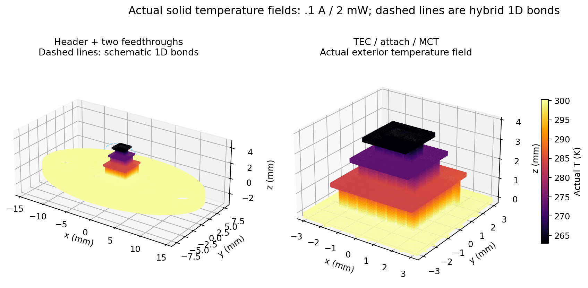
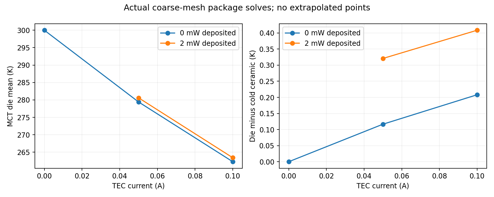
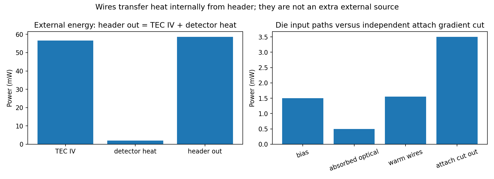
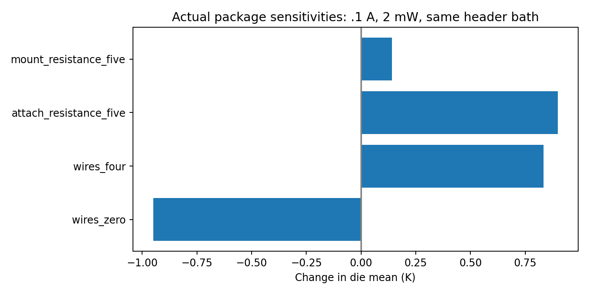

# G3a: coupled TO-66 solid package with hybrid gold bonds

**Numerically qualified scoped G3a checkpoint, 2026-10-29.** 11 genuine integrated
3D solid T/phi package solves and one independent genuine1D Elmer wire solve completed.
All declared mesh/current/energy/interface/refinement/isolation gates pass; 73 full
TE_FEM_SMOKE=1 tests, CLI quick and geometry_demo pass. All accepted G1/G2a/G2b/G2c/G2d
source/data/evidence remain byte-identical. Existing sim session and pinned image/wrappers reused.
Evidence-generation code checkpoint `96f70fad0806c50d343d5b8a01d8e2e332e2ca30`; exact executed source/SIF/mesh/VTU hashes archived.
**This is a hybrid3D-solid/1D-wire model, not an all3D wire model or OEM/device validation.**

## Construction, sources and limits

A new conformal OCC model rebuilds the actual verified G2b189-domain TEC construction without
modifying it:88 legs,85 local Cu bridges,two buried routes and supporting alumina,6.4mm hot /
2.4mm cold envelope,3.8mm total height and inferred28/12/4 couples. The unique181-vertex180-edge
conductor path with exactly two external terminals is preserved. The visual STEP is not imported.
Ten new solids give199 domains:elliptical Kovar header,hot mount,die attach,MCT die,two glass
annuli,two extended Kovar pins and two Au die pads. Only **two feedthroughs are simulated**;
seven of the illustrated nine are omitted, including their holes/seals/thermal effects.

Family envelope31.5x17.5mm,mounting pitch24.4mm and3.7mm mounting holes appear in the
[VIGO primary drawing](https://vigophotonics.com/app/uploads/2024/07/3TE-TO669p-wW-PVI_PCI-detector-technical-drawing.pdf).
The ellipse,1.1mm header,chosen symmetric pin locations,.44mm pin diameter,glass geometry,
1mm-square x.12mm die and1.25mm-square x.08mm attach are assumptions, not OEM tooling.
The drawing's .76mm pins are not silently substituted for our reference's assumed .44mm pins.
No numbered OEM pinout or precise package manufacture is claimed. Source review and machine-readable
registry distinguish those facts. No cap/window,gas,radiation,thermistor,TEC supply-lead leakage,
separate sapphire/silicon carrier,POM carrier or humidity absorber is represented.
Their absence matters for absolute temperatures and complete package loads.

Kovar k=17.3 and Au k=315 W/m/K are frozen proxies, not calibrated low-temperature grade laws.
Glass k=1,die attach k=1 and hot mount k=2 W/m/K are unmeasured assumptions. Header and mount
couple thermally to the bottom TEC alumina with actual conformal interfaces; the **only temperature
Dirichlet face is the external header underside at300 K**. No TEC ceramic or pin top is clamped.
Pin lower ends are insulated; heat reaches their tops through glass/header and their3D lead volume.
Hot mount50um gives R''=25e-6m2K/W; die attach80um gives R''=80e-6m2K/W before sensitivity.
A fivefold resistance change reduces the relevant k by5 without changing mesh geometry.

The compact MCT uses the single sourced composition Hg0.71Cd0.29Te, not carrier transport.
[Heckman/Gonzalez/Guha2008, primary Table2](https://opg.optica.org/ao/abstract.cfm?uri=ao-47-4-578)
reports90/148/298/400 K conductivity2.41/1.61/.973/.790 W/m/K. k is derived from measured
rho,Cp and diffusivity; source relative k uncertainty7–14%. Density6830kg/m3 and Cp130/146/176/194
J/kg/K are retained in the registry. Local nodal k is linearly interpolated and compiled callbacks
fail outside90..400 K; no alloy-x interpolation or extrapolation is implemented. x=.29 is a
source-qualified example, not an identified detector composition. Density/Cp do not determine
these steady solutions; SIF heat-capacity placeholders must not be reused as a transient model.

TEC coefficients are the original mixed room-temperature constant **verification** law. G2d's
300 K local-T BiTe coverage failure is unchanged; source-backed40..300 K BiTe is not used here.
No model temperatures are manufacturer-validated predictions. Detector heat is1.5mW from prescribed
Vdet=.5V times Idet=.003A, plus .5mW absorbed optical thermal power. Only this one bias-power
representation is deposited uniformly over the actual MCT volume; no extra V-squared/R or carrier
PDE current is added. `Volumetric Heat Source`, confirmed in pinned solver source, is W/m3 and
avoids multiplying by density as Elmer's per-mass `Heat Source` would.

## Actual coupled physics and conservative hybrid wires

Elmer ThermoElectricSolver solves common spatial T/phi over the conformal model. TEC Peltier,
Seebeck and Joule terms remain active. Package materials have S=0 and computational
sigma=1e-12S/m, defining a passive potential extension—not physical Au/Kovar electrical
conductivity or detector current. Their actual spurious Joule heat is below1nW (baseline
1.611e-16W). A100-fold lower package sigma changes die mean by
9.102e-08K and voltage by1.853e-09V, below declared
1e-4K/1e-6V gates. Fourier conduction is therefore resolved without a meaningful package
TEC-current path. The original alumina electrical regularization remains unchanged.

Each massless1D Au wire has G=k*pi*d^2/(4L)=2.20893233456e-05W/K,
chosen d=25um,L=7mm. Compiled nonlocal callbacks read area-weighted3D pin/pad temperatures
from the current global nonlinear iterate and apply **equal/opposite powers** to the two patches.
Both warm and cold endpoint temperatures remain solved unknowns; this is not a one-way prescribed
heat load. No 3D wire arc is meshed. Callback nodal maps are checked against actual ElmerGrid
node numbering; endpoint areas/weights are archived. Residual reconstruction uses the final
independent actual-field averages, so a frozen or one-way wire coupling would fail the free-node gate.
An independent11-node1D Elmer rod with a1mW Neumann input and260 K cold end solves the hot end
at305.2707393684K. Its maximum temperature error is2.22e-12K
and its conductance agrees with the analytical wire law. This test is separately counted.

## Actual package cases and mesh convergence

| Mesh | Nodes | Tetrahedra | Minimum SICN |
|---|---:|---:|---:|
| mesh_0 | 63,997 | 256,330 | 0.123219 |
| mesh_1 | 109,866 | 455,732 | 0.123432 |

OCC exact volumes/contact areas,positive tetrahedra,manifold faces,each-body face connectivity,
whole-solid thermal connectivity,TEC conductor graph,all175 current-cut areas and actual ElmerGrid
node/tetra/body mapping pass. Original rectangular TEC volumes/areas use1e-7 relative tolerance;
curved package chordal tetrahedra use a declared1% volume/contact-area tolerance. The initial
coarse-circle mesh failed the pin-volume gate and remains unaccepted; curvature sizing was
increased without lowering that gate. Both final package meshes pass.

| Actual case | TEC A | Die heat mW | Cold ceramic K | Die mean K | Die max K | Die-cold K | Terminal V |
|---|---:|---:|---:|---:|---:|---:|---:|
| passive_0 | 0.00 | 0.0 | 300.000000 | 300.000000 | 300.000000 | 0.000000 | 0.000000000 |
| loaded_0 | 0.10 | 2.0 | 262.998245 | 263.406819 | 264.494639 | 0.408574 | 0.566143160 |
| loaded_1 | 0.10 | 2.0 | 262.965994 | 263.389718 | 264.572800 | 0.423724 | 0.566408804 |
| no_heat_010 | 0.10 | 0.0 | 262.055747 | 262.263848 | 263.327781 | 0.208101 | 0.568823298 |
| loaded_005 | 0.05 | 2.0 | 280.280622 | 280.601440 | 281.238559 | 0.320819 | 0.290978268 |
| no_heat_005 | 0.05 | 0.0 | 279.298322 | 279.414903 | 280.029809 | 0.116581 | 0.293810382 |
| wires_zero | 0.10 | 2.0 | 262.250078 | 262.456541 | 262.530701 | 0.206462 | 0.568272739 |
| wires_four | 0.10 | 2.0 | 263.654794 | 264.241343 | 266.243781 | 0.586550 | 0.564274362 |
| attach_resistance_five | 0.10 | 2.0 | 262.976341 | 264.305474 | 265.559712 | 1.329133 | 0.566206802 |
| mount_resistance_five | 0.10 | 2.0 | 263.140388 | 263.548258 | 264.632588 | 0.407869 | 0.566469889 |
| package_sigma_hundredth | 0.10 | 2.0 | 262.998245 | 263.406819 | 264.494639 | 0.408574 | 0.566143158 |

The zero-drive/no-heat case is uniform300 K to1e-6K. All accepted exits are zero and nonlinear
relative change <1e-9. Every driven interior cut passes .5%;zero-drive uses1uA absolute. Global
current/free-node thermal/current residuals pass1uA/1uW,package spurious Joule <1nW,independent
work <1%,direct bath energy <1%,source-free mount/pin and attach-gradient checks <5%.
No gate was relaxed to accept a case.

At.1 A/2mW, refinement changes die mean by0.0171015K,die max by
0.0781603K and ceramic mean by0.0322517K,each below1%
of lift. Voltage changes0.046900%. Fine worst current cut is
0.059557%. Direct bath mismatch is
+0.29453% coarse and+0.59705%
fine:both pass1%,but this flux error is not monotonically reduced. Local corner flux peaks and
wire-pad endpoint spreading peaks are not claimed converged. Parameter sensitivities use the same
coarse mesh; only the stated loaded case has a two-resolution study.

## Actual temperatures and heat budgets

Fine loaded case,all statistics from actual fields:

| Body | Volume mean K | Min K | Max K |
|---|---:|---:|---:|
| ceramic_0 | 300.125311 | 298.992523 | 300.319057 |
| ceramic_1 | 283.814331 | 282.594489 | 286.400748 |
| ceramic_2 | 273.035639 | 272.759978 | 274.864749 |
| ceramic_3 | 262.965994 | 262.950984 | 263.000023 |
| Kovar_header | 300.004556 | 299.853022 | 300.197297 |
| hot_mount | 300.101534 | 299.572244 | 300.288175 |
| die_attach | 263.071243 | 262.962233 | 263.533494 |
| MCT_x029 | 263.389718 | 263.027956 | 264.572800 |
| glass_0 | 299.960356 | 299.810122 | 300.000000 |
| pin_0 | 299.864894 | 299.543997 | 299.933586 |
| Au_die_pad_0 | 264.563318 | 264.546266 | 264.568500 |
| glass_1 | 299.959200 | 299.808803 | 300.000000 |
| pin_1 | 299.863761 | 299.542675 | 299.932572 |
| Au_die_pad_1 | 264.569171 | 264.551751 | 264.574325 |

Fine attach bottom/top area means:262.9807597/263.2390844K.
Fine die-to-cold mean rise:0.4237241K. Additional domain CSV retains every case.
At the coarse loaded control,wire heat is1.5487254mW,
77.436% of the2mW detector deposition. Its warm pins are cooled by that flow;
no arbitrary pin-top bath supplies it. The cold pads sit above the cold ceramic temperature;
using the ceramic as the wire endpoint would overestimate the wire temperature difference by
about4.075% relative to the warm-pin-to-ceramic difference. The separate die,
attach and pad fields resolve that thermal break.

Fine external balance:header out0.0586408811W = TEC IV
0.0566408804W + detector deposited .002W,with error
+6.5e-10W. Wire heat is an **internal** header-to-die transfer,
not another external source. Independent direct external-bath and interior attach/mount/pin
fluxes are reported separately from conservative weak reactions; they are not replaced by the
identity Qout=Pin+Pdet. Coarse mount/pin interior-gradient cut mismatches are approximately .05%.

The P1 nodal control volumes include shared ceramic/routing portions;bottom includes header/mount
and the negative warm-wire endpoint power. They are not isolated textbook leg stages.

| Fine stage | Hot out W | Cold absorbed W | J.E W | Warm-wire sink W | Balance error W |
|---|---:|---:|---:|---:|---:|
| 0 | 0.058640881 | 0.020098518 | 0.040087557 | -0.001545194 | -1.31e-10 |
| 1 | 0.020098518 | 0.007125479 | 0.012973039 | 0.000000000 | -5.02e-11 |
| 2 | 0.007125479 | 0.003545194 | 0.003580285 | 0.000000000 | +3.1e-11 |

## Controlled sensitivities and comparison limits

Same300 K header bath,.1 A and2mW deposited load,relative to coarse loaded control:

| Actual sensitivity | Delta die K | Delta cold ceramic K | Delta V | Wire heat mW |
|---|---:|---:|---:|---:|
| wires_zero | -0.9502785 | -0.7481671 | +0.002129579 | 0.000000 |
| wires_four | +0.8345243 | +0.6565486 | -0.001868798 | 2.907800 |
| attach_resistance_five | +0.8986549 | -0.0219039 | +0.000063642 | 1.502443 |
| mount_resistance_five | +0.1414387 | +0.1421431 | +0.000326729 | 1.542720 |
| package_sigma_hundredth | +0.0000001 | +0.0000001 | -0.000000002 | 1.548725 |

Four wires mean two parallel1D bonds per existing endpoint pair,not four new3D pads/pins.
Zero wires remove only the1D thermal coupling;all3D package volumes remain. Die-attach and
hot-mount resistance hypotheses are not measured confidence intervals or identified chemistry.
The preserved G2b bath was on the TEC ceramic and its load distributed across the top plate;
G3a moves the bath to the header and heat to the actual die,plus wires. **No comparison between
those different boundary placements is claimed as validation or a uniquely attributed shunt.**
The new same-header-bath wire/attach/mount controls isolate their stated changes instead.

## Verdict

G3a's scoped **genuine thermally coupled hybrid solid-package numerical checkpoint passes**,
including passive test,current/load matrix,refinement,wire law and independent interface/energy
checks. OEM/device absolute accuracy remains unqualified. Full nine-pin layout,real wire geometry,
measured grades/contacts/carriers,package cap/window,radiation/gas,TEC supply-lead heat and
independent device measurements remain pending. There is no transient/carrier-transport/LSDDTS
calculation,no OpenFOAM and no host solver installation. Earlier accepted evidence is unchanged.
