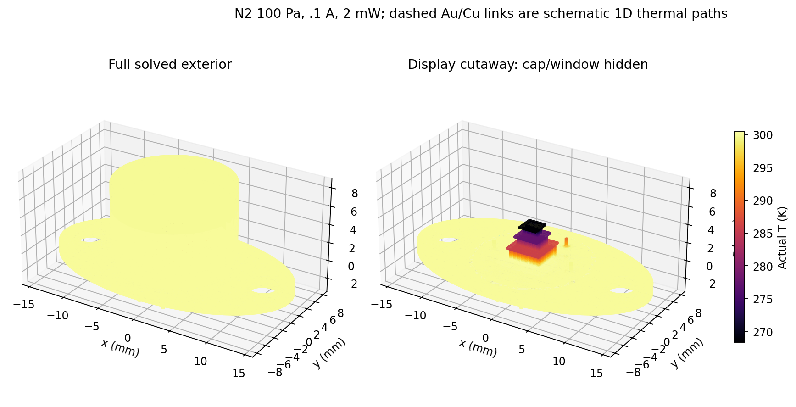
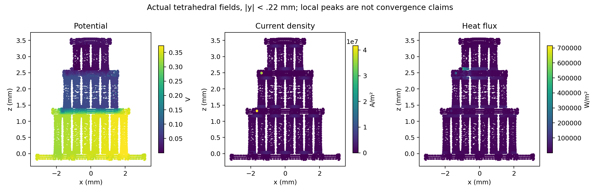
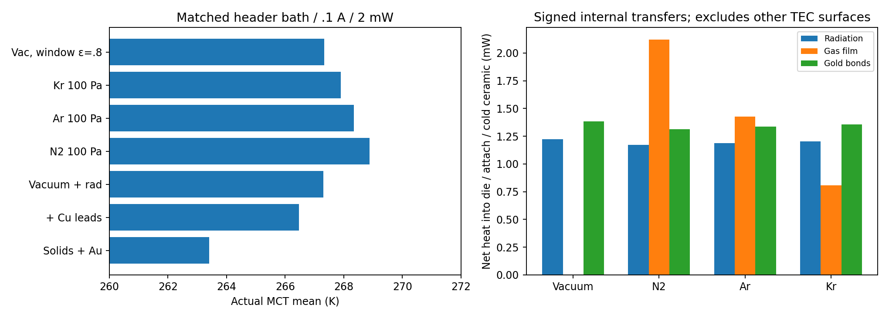
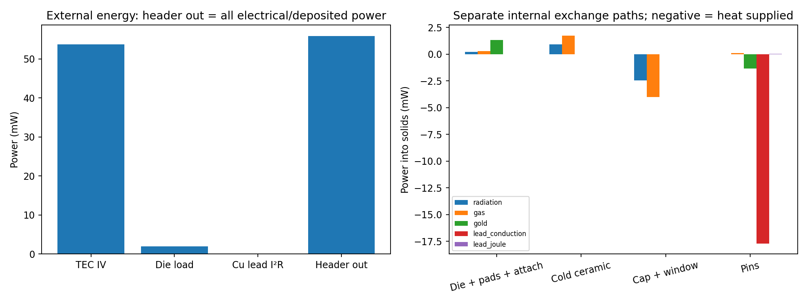
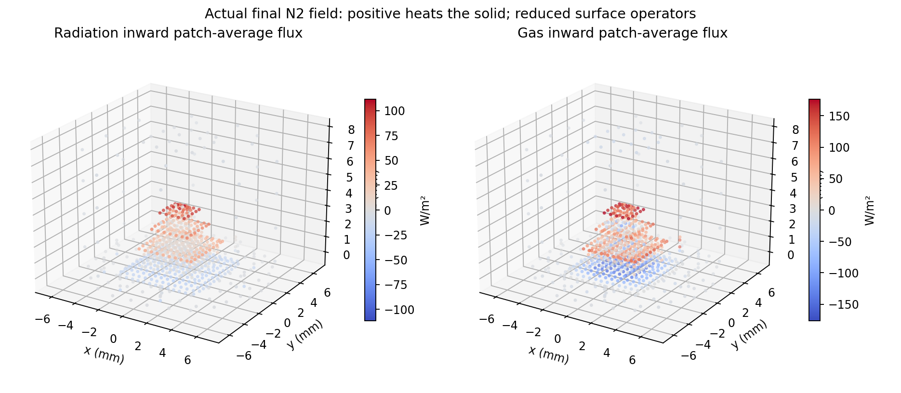
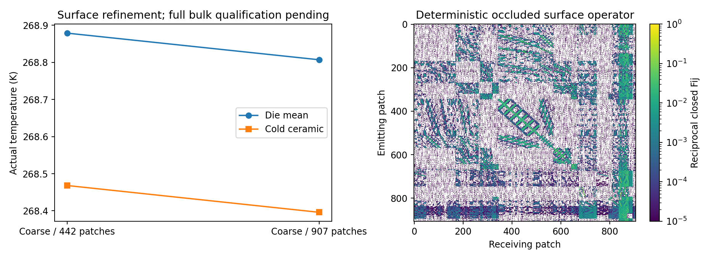
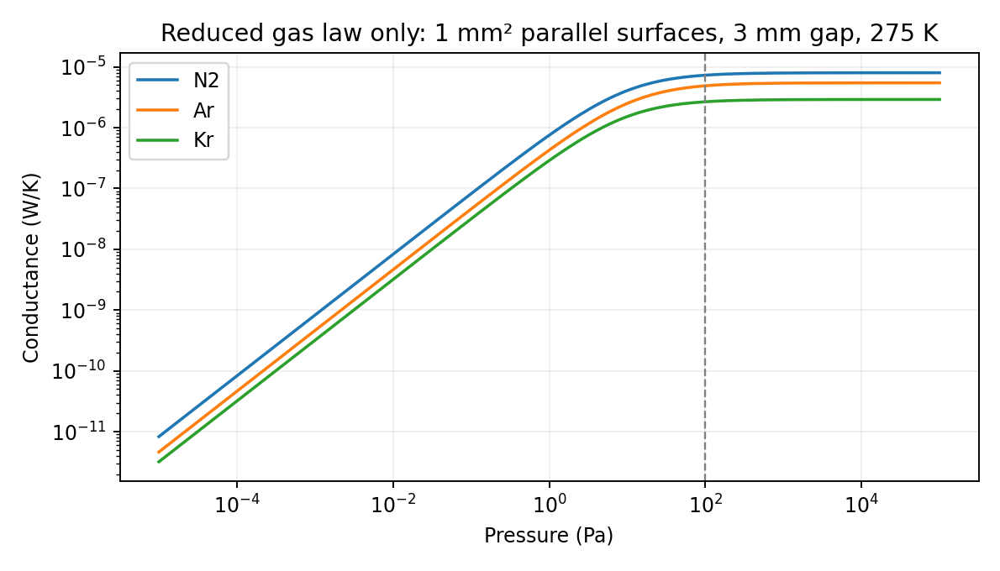

# G3b verified scoped checkpoint — full qualification incomplete

**Full G3b gate D is NOT QUALIFIED.** Three genuine converged fine-mesh executions
fail the independent direct-bath-gradient1% gate. Their fields remain explicitly
unaccepted. This publication uses the work order's narrower-checkpoint provision;
it does not declare G3b complete or lower a failed numerical tolerance.

Ten selected coarse-mesh integrated package executions pass every per-case gate,
along with two independent genuine1D Elmer exchange references and
84 full TE_FEM_SMOKE=1 tests. CLI quick and geometry_demo pass.
Protected G1–G3a source/data/evidence remain byte-identical. Existing sim session,
pinned Docker Elmer26.2.1/Gmsh4.13.1 and unchanged wrappers were reused; no LSDDTS,
host package installation or OpenFOAM. Code checkpoint: `d4ddc81331103de144fa60b60e26521befbe8d74`.

## Qualified scope

The new conformal215-domain enclosure contains the original88-leg TEC, Kovar
header/mount, attach/MCT/Au pads, nine actual glass/pin pairs, attached cap and
ZnSe-candidate window. The conductor remains a unique181-vertex/180-edge path
with two external terminals; all175 cut areas are independently checked.
OCC/mesh volumes, shared contact areas, positive tetrahedra, per-body and global
face connectivity and actual ElmerGrid body/boundary mappings pass.
The **only bath is the external header underside at300 K**. Internal ceramics,
pin tops, cap and window temperatures are solved unknowns. Exterior cap/window
and isolated pin ends are adiabatic. Contacts at cap/header and window/rim are
ideal; unmeasured contact resistances are not identified.

The [VIGO family drawing](https://vigophotonics.com/app/uploads/2024/07/3TE-TO669p-wW-PVI_PCI-detector-technical-drawing.pdf)
supports the TO66 nine-pin family envelope, not the exact construction. Header,
cap, seals and generic unnumbered pin layout are hypotheses. Chosen .44mm pins
differ from the drawing's .76mm pins. No OEM electrical pinout is fabricated.
Thermistor, additional carrier/absorber parts and exact manufactured grades are
omitted. Data registry/source review distinguish sourced, inherited and assumed inputs.

| Geometry audit | Nodes | Tetrahedra | Min SICN |
|---|---:|---:|---:|
| mesh_h0 | 109,771 | 429,100 | 0.121974 |
| mesh_h1 | 204,855 | 821,874 | 0.123432 |
| mesh_bath | 239,394 | 967,731 | 0.054236 |
| mesh_feedthrough | 275,377 | 1,194,385 | 0.083372 |

Geometry audit success does not qualify a failed fine-mesh physics point.

## Real physics and independent exchange tests

Actual Elmer ThermoElectricSolver solves common spatial T/phi on all solids,
retaining TEC Seebeck/Peltier/Joule physics. Detector deposition is exactly
1.5mW prescribed bias heat plus .5mW absorbed optical thermal heat in the MCT
volume. It is one bias-power representation, not added again as detector Joule.
MCT is the inherited x=.29 primary-table local k(T),90..400 K, with fail-closed
callbacks. TEC coefficients remain constant mixed verification proxies, not
identified OEM BiTe. Package S=0 and computational sigma1e-12 S/m give a passive
potential extension, not physical metal electrical transport. Package Joule
is below1nW; lowering sigma100-fold changes die mean by4.67e-07K
and TEC voltage by5.22e-09V. Density/Cp placeholders are steady-only.

Two conservative massless Au bonds retain25um diameter,7mm length,k315 W/m/K.
Two hybrid Cu TEC supply leads use assumed .202mm diameter,8mm length,k400 and
rho1.72e-8 ohm m, coupled to generic pin instances2/3 and the existing actual TEC
terminals. End temperatures update from current3D fields. Conduction powers are
equal/opposite; total lead I²R=8.58728366609e-05W is split equally at endpoints.
Lead electrical resistance/current are lumped. No3D wire arcs, distributed
wire gas/radiation exchange, detector carrier transport or transient solve is claimed.

Deterministic Sobol cosine/area rays trace the first opaque hit in the orthogonal
solid union, cylindrical pins and closed cap/floor/roof/window. Hits map to actual
audited same-owner/orientation facets. The cavity skin has edge incidence two
and volume agrees within1%. Raw directed exchange estimates are symmetrized and
diagonally balanced, retaining blocked-pair zeros. Radiosity solves
J=epsilon*sigma*T^4+(1-epsilon)*F*J and inward power=-A*(I-F)*J.
Surface temperatures update in the global nonlinear iteration; final independent
postprocessing reconstructs the unmixed physical sources and free-node residual.
Depth-four regularized Anderson mixing stabilizes boundary powers without
changing the physical fixed point.

| Operator | Patches | Original rays | Raw reciprocity L1/area | Raw weighted closure error |
|---|---:|---:|---:|---:|
| operator_h0 | 442 | 608,256 | 0.094173 | 0.005674 |
| operator_h0p1 | 907 | 782,336 | 0.213338 | 0.013627 |
| operator_h1 | 908 | 788,480 | 0.215405 | 0.014511 |
| operator_bath | 908 | 788,480 | 0.215405 | 0.014511 |
| operator_feedthrough | 908 | 788,480 | 0.215405 | 0.014511 |

Bath/feedthrough operators inherit exactly the operator_h1 cavity triangles,
F/gaps and patch weights, adding zero surface-weight columns for new interior
nodes; no additional rays are claimed. Balanced closure is below1e-10 and
reciprocity error below1e-15m². Raw errors and balancing scales are retained;
conservation does not prove exact view factors. Hit-mapping distances and finite
patch/ray errors limit accuracy. Coarse442-to907-patch refinement at identical
bulk mesh changes die mean by0.0717509K and maximum temperature
change by0.228335% of lift; voltage changes
0.089424%. This surface-resolution check passes.

Gray emissivities are declared hypotheses: .3 BiTe,.8 alumina/MCT/attach/mount/glass,
.05 Cu/Au,.1 Kovar/pins/window,.2 cap. Window epsilon .8 is a sensitivity.
ZnSe k18 W/m/K at298 K is a [vendor proxy](https://www.crystran.co.uk/optical-materials/zinc-selenide-znse/).
**The thermal window is opaque gray (tau=0); external ambient radiance and spectral
LWIR transmission are absent.** Prescribed .5mW absorbed optical heat is not a
window transmission calculation. No measured spectral coating properties are claimed.

[NIST Huber2019](https://tsapps.nist.gov/publication/get_pdf.cfm?pub_id=926438)
supplies dilute k at200/300/400 K: N2 .0183/.0259/.0326,Ar .0124/.0177/.0224,
Kr .0064/.0095/.0122 W/m/K. Interpolation fails outside200..400 K.
Eucken viscosity, ideal-gas Cp/gamma and accommodation .8 are declared closures.
lambda=mu/p*sqrt(pi*R*T/2); each wall jump is
((2-alpha)/alpha)*(2*gamma/(gamma+1))*lambda/Pr. Symmetric gas conductance is
k(Tmean)*Wij/(harmonic projected flight gap+2*jump), exactly zero at p=0.
The [INL gap theory](https://mooseframework.inl.gov/bison/theory/gap_plenum_models.html)
supports temperature-jump/accommodation modeling; the Kennard free-molecular
limit and continuum kA/L are independently tested. This is a reduced gas-film
network, not a gas-volume Laplace/CFD solution. Actual matrices are nonnegative
and pair powers equal/opposite. At100 Pa the bounding Ra screen remains below1
for1/3/8/14.2mm gaps,250 K and100 K delta. Atmospheric Kr at3mm exceeds1708,
flagging future convection assessment;1708 is not a universal cavity criterion.

Analytic gray plates, epsilon0/uniform-T limits, balance/entropy and occlusion
checks pass. Genuine1D conducting-plate Elmer references use the same compiled
exchange routine: radiation-only maximum temperature error
3.03e-08K; N2 100Pa plus radiation
3.99e-08K. The first zero-flux
startup benchmark failed and remains unaccepted; corrected startup excludes the
arbitrary initial state from Anderson response history. Two Elmer regressions
exercise that fix. Earlier vacuum/N2 executions retain exact old source/Fortran;
only the exact three startup edits are allowed by the byte-comparison validator.
Their unmixed physical residuals have been freshly reverified.

## Accepted coarse integrated cases

All driven cases: .1A,2mW deposition,300 K header bath. Solid control disables
gas/radiation/Cu leads and retains Au bonds; lead-only adds Cu conduction/Joule;
vacuum adds radiation; pure gas cases add100 Pa. High-window case is vacuum.

| Accepted case | Cold ceramic K | Die mean K | Die max K | TEC V | Direct-bath error % |
|---|---:|---:|---:|---:|---:|
| passive_h0 | 300.000000 | 300.000000 | 300.000000 | 0.000000000 | -0.00002 |
| solid_reference_h0 | 262.995146 | 263.404041 | 264.523392 | 0.566165120 | -0.35367 |
| lead_only_0 | 266.075552 | 266.468861 | 267.511598 | 0.547730485 | +0.84352 |
| vacuum_a0 | 266.898609 | 267.301094 | 268.323467 | 0.544432801 | +0.68673 |
| nitrogen_0 | 268.468131 | 268.878638 | 269.866619 | 0.537501409 | +0.41736 |
| argon_0 | 267.939550 | 268.347858 | 269.347680 | 0.539885636 | +0.50418 |
| krypton_0 | 267.496013 | 267.901465 | 268.910755 | 0.541796372 | +0.58561 |
| window_high_0 | 266.927891 | 267.330990 | 268.352737 | 0.544314237 | +0.67075 |
| nitrogen_patch1 | 268.395968 | 268.806887 | 269.795870 | 0.537982496 | +0.42015 |
| package_sigma_100 | 268.468132 | 268.878639 | 269.866620 | 0.537501404 | +0.41736 |

All accepted cases pass175 driven cuts <.5% (zero drive uses1uA), current/free
current1uA, global/free heat1uW, direct bath1%, work1%, attach cut5%, package
Joule1nW and separate internal-mechanism balances1nW. No tolerance was lowered.
Source voltage includes Cu series resistance separately from the TEC voltage.
Coarse same-header control isolates enclosure/nine-pin construction and
spatial discretization relative to preserved G3a; it is not OEM validation.
Fixed-current results do not establish minimum power at a fixed detector target.

The representative accepted907-patch N2 case has header reaction out
0.0558841227843W = TEC IV0.0537982496184W + detector .002W
+ lead Joule8.58728366609e-05W, error+3.29e-10W.
Radiation/gas/Au/Cu conduction are internal transfers, not extra external power.
CSV/JSON retain all175 cuts, domain temperatures, patch/body mechanism powers,
wire/lead endpoints and whole-package horizontal control-volume budgets. Bands
include cap/pins/nonlocal sources and are not isolated textbook TEC stages.
Cap/flange transfer inferred from its signed surface budget is conservative,
not an independent cap-gradient cut. Raw/derived actual fields are compressed
with compressed and uncompressed hashes; no prescribed network field is substituted.

## Failed full-refinement qualification and preserved evidence

| Unaccepted converged case | Nodes | Tetrahedra | Direct-bath error % | Gate <=1% |
|---|---:|---:|---:|---|
| nitrogen_fine_verified | 204,855 | 821,874 | +1.655873 | FAIL |
| nitrogen_bath | 239,394 | 967,731 | +1.514122 | FAIL |
| nitrogen_feedthrough | 275,377 | 1,194,385 | +1.583835 | FAIL |

These genuine spatial Elmer executions have zero solver exits and relative
nonlinear change <1e-9. All other numerical gates pass, but the independent
external-bath raw-gradient gate fails. Temperature/voltage insensitivity alone
is insufficient to qualify them. Full G3b remains incomplete.

Localization found the largest discrepancy near the cold-return feedthrough.
Two bath-edge refinement rounds and a separate glass/pin/header-junction study
were insufficient to resolve it. The cause is not fully established. Future
work must resolve independent bath flux with systematic boundary/interface
resolution or another independently verified discretization; conservative weak
reactions must not be used to override the failed gradient check.

The initial coarse driven bath error1.85079%, divergent unaccelerated lead
iteration, failed plate-startup benchmark, cross-mesh potential interpolation
(81.44W artificial initial Joule),900s fine timeout and over-budget mesh proposal
are also retained explicitly unaccepted. The later converged fine fields serve
only as hashed P1 initial guesses for separately executed refined PDEs. Their
raw fields are quarantined, not included among the ten accepted cases.

This is a **verified scoped engineering checkpoint**, not completed G3b gate D,
OEM/device accuracy, production-gas optimization or full CFD. All prior accepted
evidence remains intact. See [reproduction](G3B_REPRODUCIBILITY.md) and the
machine-readable ledger for exact source, field and failure provenance.
