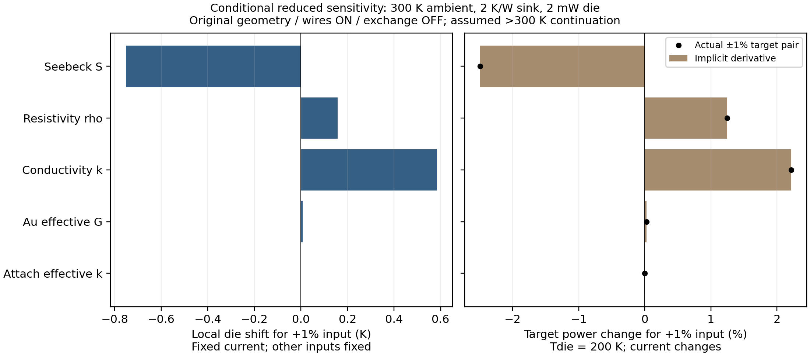

# Physical-input and parasitic-path evidence priorities

Internal qualification record; the ONE public engineering assessment remains Rev3.

## Preregistered scope — before new reduced solves

Baseline: `84e1b4f90e090604739f65c3ba1e2d5c3c4a2a39`, clean main before the
observed UTC chronology entry. This prospectively authorized audit preserves all
previous PASS/FAIL/STOP records. No OEM fitting, changed CAD/laws, new 3D, gas,
contact, radiation or stopped solid fixture. The canonical 38-page PDF is an
input, not an administrative output of this study.

Evidence taxonomy: **DOCUMENTED** (identified source and domain), **ANALOG**
(different specimen/product), **INFERRED** (unexposed construction), **SCENARIO**
(chosen condition), **UNKNOWN** (no independent constraint). Record numerical
verification separately from physical qualification; PASS names its specific
test, FAIL retains its threshold, STOP is a scope boundary, NOT RUN is no result.
Conservation alone identifies neither material grade nor physical heat paths.

### Fixed comparison, metrics and hard budget

Use unchanged `integrated_reference.solve`, `zhang2025_nonlinear`, 32 intervals,
original 28/12/4 couples and native leg A/L. Ambient/pins 300 K, sink **2 K/W**,
die **2 mW**, original Cu/Au wires ON, exchange OFF, no bypass/contact additions.
Baseline current is the archived accepted `target_R2_step8` current. The archived
final falling bracket supplies the only initial target bracket. All new cases
must remain on its nearby falling branch, in **0.25–0.35 A** and **180–390 K**
including internal leg extrema. Above 300 K is assumed quarter-tangent, not data.

One factor at a time: S scale, rho scale, k scale, effective Au-wire conductance,
and attach k. Their existing allowed ranges are respectively .9–1.1, .8–1.2,
.8–1.2, .75–1.25 and .5–3 W/(m K); only **±1% and ±0.5% about nominal** are
sampled here. No quantitative native-gas/nonlocal/contact ranking is invented.

1. One baseline replay, 20 fixed-current factor cases, two current cases at
   Iref ±0.001 A: at most **23** calls. Fractional central derivatives use
   `(f(p(1+h))-f(p(1-h)))/(2h)`, approximating df/dln(p). Require agreement
   between h=.01 and .005 within 2%, using denominator floors .01 K and
   1e-4 W for near-zero derivatives. Unstable factors have unresolved ranking.
   Current derivatives are compared to the saved final-bracket secant at 2%
   with the same output-unit floors; no claim of global monotonicity follows.
2. Refine the archived nominal target bracket with at most **7** midpoint calls.
3. For ten ±1% factor endpoints, predict a current using the implicit derivative
   dI*/dln(p) = −T_p/T_I. Solve two actual endpoints at prediction ±
   `max(5e-6 A, .05*abs(predicted shift))`, then at most **10** midpoints.
   A missing accepted falling bracket, rejected midpoint, nonmonotone temperature
   outside endpoint values by >1e-5 K, or domain failure stops that crossing.
   No expansion, retry, interpolation across gaps or optimized scale is allowed.

Maximum **150 calls / 600 s total / 8 s per call**, 4 CPUs / 8 GiB pinned offline
runtime (within 12 GiB user limit). Stop when budget expires. Each reported
target is an actual cold-side solve at **199.9999–200 K**, not a corrected number
or proven minimum-power optimum. Save all attempts, failure diagnostics, unused
slots and times. Parameter ± endpoints are not statistical confidence limits.

For accepted cases independently reconstruct signed stage/node/global balances,
terminal voltage/work, Au G including its scale, Cu conduction and split Joule,
attach heat, Qsink and hot = 300 + Rθ Qsink. Require stage <1e-9 W,
node/global <1e-8 W, hot residual <2e-8 K, reported path agreement <1e-10.
Replay tolerance is 1e-6 K / 1e-7 V. Preserve source-domain/optimizer diagnostics;
no clamping of accepted results. Old raw bath 1% / cold 5%, native-gas 1% and
nonlocal side-port 5% gates remain unchanged and failed as previously recorded.

Report fixed-current temperature partials and matched-target power elasticities
`E_P=(P_p-P_I*T_p/T_I)/P`. Compare this independent chain rule with actual target
pairs; 2% agreement uses a 1e-4 W/log-factor floor plus actual target tolerance
propagated through |P_I/T_I|. A signal below ten times that propagated error is
resolution-limited, not proof of insignificance. Define planning budgets **1 K**
fixed-current shift and **5%** target-power shift (not release gates or measured
errors). A local fractional measurement TARGET is at most 1%, further reduced
by these derivative budgets; never extrapolate a verified ±1% response into an
empirical uncertainty interval. Audit each factor's physical observability and
the exact A/L–rho–k gauge before requesting separate measurements.

### Primary-source and immutable-input audit

Inspect existing cached Zhang PDF, TEC Microsystems 2019 datasheet, VIGO Rev9
family drawing and Huber/NIST gas table; retain SHA, URL/DOI, inspected locations
and paraphrased scope in a source manifest. No source is silently refreshed.
The older registry's v1 ingestion is historical; active material is corrected
`zhang2025_he_digitized_40_300_v2r1`. A paper's uncertainty is not the uncertainty
of a digitized unmatched synthetic cooler. Manufacturer module and housing are
independent candidates, not a confirmed assembly; ACR is not DC V/I.

Freeze core laws/solvers, native manifests/STEP/mesh/wires, previous study ledgers,
current PDF and preregistration before calculations. Source-law, independent
analytic derivative, balance, failed/gapped bracket and budget controls; focused
and applicable opt-in regression excluding the existing 12 runtime cases;
archive/master guards and both legacy demos are required. No new solver smoke.
Rank evidence by observability, gauge breaking and conditional impact, separating
physical measurement from a software/numerical gate. Cost/effort is unknown or
explicitly hypothetical. Completion authorizes no next experiment.

## Results

**Numerical local study PASS; physical inputs remain unqualified.** One execution
took **44.531 s**, using **102 accepted calls / 0 rejected / 0 timed out**, with
48 unused maximum slots NOT RUN. All eleven crossings are actual solves within
199.9999–200 K; no failed gap or extrapolated target. All 102 use assumed
>300 K continuation (leg range 199.139406–301.143843 K). This is neither a
commercial-grade identification nor a demonstrated physical detector target.

At the refined nominal crossing: **I=0.291139221 A**, die **199.999912 K**,
hot **301.114470 K**, terminal **1.930257 V / 0.561973431 W**, sink
**0.557234910 W**, cold-stage Qc **3.648497 mW**, die COP **0.003558887**.
The previous target had the intentionally looser 0.005 K tolerance; its
0.562050729 W is not silently overwritten. Cu conduction is **−8.229061 mW**
into hot pads, Au **+1.648497 mW** into the die, and Cu Joule **0.315913 mW**,
half at each endpoint. Thus Qsink is not IV:

`Qsink = IV + Qdie + QAu + QCu − (I²Rcu)/2` [W].

Total rejection to all ambient connections is **0.563973431 W = IV+0.002 W**.
The original six sink crossings still give **0.548425 W at 0 K/W** and
**0.622176 W at 10 K/W**, +13.4478%, and 166 admitted paired sink comparisons.
The approximately **43.021 mW outward Cu** at that 10 K/W target remains an
assumed-route reduced result, not measured bypass heat.

### Comparable local temperature and target-power effects

`T_p = partial(Tdie)/partial ln(p)` at fixed archived I=0.291162109 A;
`E_P = partial ln(P*)/partial ln(p)` at Tdie=200 K. Derivatives are evaluated
near the same nominal state; the two currents differ by 22.89 µA. The current
partials are **−150.144008 K/A** and **3.377303 W/A**. The maximum h=.01 versus
.005 derivative change is **0.01086%**; all five independent actual target pairs
agree with the chain rule within the registered tolerance (largest relative
power-derivative difference **0.115%**). Counts and raw rows are retained.

| One common factor, others fixed | T_p, K | Die shift for +1%, K (local) | E_P | Power −1% / +1%, W (actually solved) |
| --- | ---: | ---: | ---: | ---: |
| P/N Seebeck S | −75.125198 | −0.751252 | −2.489920 | 0.576444287 / 0.548426825 |
| P/N resistivity rho | +15.710115 | +0.157101 | +1.244627 | 0.555041807 / 0.569030011 |
| P/N thermal conductivity k | +58.445824 | +0.584458 | +2.213915 | 0.549661805 / 0.574547574 |
| Effective Au-wire G | +0.700945 | +0.007009 | +0.027380 | 0.561819582 / 0.562127298 |
| Attach effective k at fixed A/t | −0.108692 | −0.001087 | −0.004351 | 0.561997883 / 0.561948979 |



For **equal fractional perturbations in this model**, S has greater local
temperature/power leverage than k, then rho; Au and attach are much smaller.
This differs from ordering the previous **23.348849 / 14.172527 / 4.959973 K**
k/S/rho spans: those used different interval widths at fixed 0.25 A, 300 K hot,
2 mW, wires OFF. They were not empirical uncertainties and are not matched to
this finite-sink wire-ON target. A 1% transport constraint would conditionally
limit the corresponding individual power contribution to about 1.24–2.49%;
no actual uncertainty reduction can be promised without an input-error model.

The exact endpoint transport gauge remains
`(g,r,k,s) -> (c*g,c*r,k/c,s)`, g common A/L. Resistive/thermal combinations
are **r/g** and **k*g**; `R*K` and ideal ZT do not resolve their origins. Locally
`d/dln(g)=d/dln(k)−d/dln(rho)` gives **42.735709 K** at fixed current and
target-power elasticity **0.969287**. This is an analytic tangent from the
registered derivatives, **not a new geometry scenario or pad compatibility test**.
Independent dimensional and transport evidence is required together. The old
g=1.7 full-footprint failure on all 176 native contacts remains; no enlarged
pellets or fitted fourth triple were run.

## Traceability and qualification matrix

The [primary-source audit](../data/physical_input_qualification_20261101/source_audit.json)
identifies exact cached bytes, inspected locations and original links. Four
primary PDFs were inspected locally, without network refresh or adding copyrighted
PDFs. Other inherited sources below are explicitly registry evidence, not newly
retrieved/independently remeasured data. Older v1 and old-geometry registries
remain historical; their present-tense wording does not supersede active v2r1
and the corrected geometry.

| Parameter/path and present value | Evidence, identity and domain | Formulation / qualification / ambiguity | Independent constraint and conditional impact |
| --- | --- | --- | --- |
| Exterior housing / pinout | [VIGO Rev9 drawing](https://vigophotonics.com/app/uploads/2024/07/3TE-TO669p-wW-PVI_PCI-detector-technical-drawing.pdf); [native spec](../GEOMETRY_SOURCE_OF_TRUTH_SPEC.md). DOCUMENTED family: 31.5×17.5 mm, 0.76 mm pins, TEC 1/9, detector 7/8 | Exact source dimensions and modeled face topology PASS; wall/seal/inner clearances partly SCENARIO. VIGO housing and TEC Microsystems cooler are independent candidates, **not confirmed composite hardware** | Obtain actual part/revision/as-built stack and seal drawing. Exterior agreement alone cannot constrain internal cooling accuracy; no new T/P sensitivity assigned |
| P/N S(T), rho(T), k(T) | [Zhang et al., DOI 10.1088/0256-307X/42/5/056304](https://doi.org/10.1088/0256-307X/42/5/056304); [corrected v2r1](../data/g2c/zhang2025_he_40_300_v2.json), [provenance](G2C_MATERIAL_PROVENANCE.md). DOCUMENTED individual P-HE and N-HE-1, ingested 40–300 K; ANALOG cooler pair | Scalar nonlinear P/N transport; sigma=1/rho, tau=T dS/dT; numerical source/balance checks PASS. Same specimen per polarity, **not matched grade**, orientation/supplier unknown. Assumed quarter tangent 300–390 K is not measured | Same-batch, identified P/N transport triples and orientation, 180–350 K. Highest quantified local leverage; endpoint data alone cannot separate rho/k from A/L. Digitization/paper uncertainty is not cooler accuracy |
| Pellet geometry / allocation | [216-body manifest](../fem/results/geometry_complete_checkpoint_20261030/manifest.json): INFERRED 28/12/4 couples, 0.4×0.4 mm legs, L=1.07/.82/.64 mm | Native geometry/topology numerically audited, not measured internals. A/L, stage allocation, pad coverage and routing UNKNOWN as hardware; exact transport gauge above | Stage-resolved count, width/depth/length, pad/contact micrographs or supplier metrology. Breaks gauge only jointly with transport. Analytic g tangent above; no new altered CAD |
| Electrical/thermal contacts, joints | Vendor says Sn–Sb internal solder; [G2c provenance](G2C_MATERIAL_PROVENANCE.md), [current spec](../GEOMETRY_SOURCE_OF_TRUTH_SPEC.md). Actual thickness/wetting/area-specific impedance UNKNOWN; TEC stage contacts ideal in this model | Explicit assumed-layer numerical checks ≠ measured Sn–Sb/contact law. Electrical rho_c [ohm m²] and thermal r_th [m² K/W] confounded with bulk, geometry, spreading and effective attach | Independent four-terminal contact coupons / thermal interface tests with area, thickness, pressure and sample identity; target T/P effect **NOT RUN**, cannot assign power ranking or arbitrary tolerance |
| Header / hot sink | Family gold-plated Kovar; [inherited source review](../data/g3a/source_review.json) Kovar grade PDF fetch403, 17.3 W/(m K) proxy. Rtheta=0–10 K/W SCENARIO; this study2 | Five-node effective hot-to-ambient resistance, not resolved Kovar/joint/ear spreading. Actual alloy/contact/sink resistance UNKNOWN. Numerically self-consistent, physically unmeasured | Simultaneous hot ceramic, ambient and sink calorimetry, contact footprint/clamping and orientation. Conditional ideal-to10 power +13.45%; must distinguish direct Cu heat from Qsink |
| Cu hot leads / Au detector bonds | [current wire routes](../fem/results/geometry_complete_checkpoint_20261030/wire_routes.json): INFERRED geometry, bulk proxies kCu400/kAu315 W/(m K), rhoCu1.72e-8 ohm m; summed GCu0.0073838344, GAu1.6484952e-5 W/K, RCu0.00372706 ohm | 1D Fourier + half-split Cu Joule; contacts/purity/temp-dependence unknown; actual bias Joule in Au absent. Native pin endpoints corrected, routes not manufactured evidence | Route diameter/length, warm-end T, effective thermal G and 4-wire R independently. Au effect quantified above; Cu matched-target perturbation **NOT RUN**. 43 mW outward conditional value is not evidence for actual route |
| Die attach | INFERRED 30 µm / 1 mm², ANALOG k=1 W/(m K); declared .5–3. G=0.033333 W/K, R=30 K/W | Fourier link; kA/t and contact/spreading cannot be independently identified. Five-node die is isothermal; bare k not observable from a single die/ceramic drop | Measure effective G plus independent A/t/contact quality at 200–300 K. Small local response above is conditional on current thin attach, not proof all real attaches negligible |
| HgCdTe and heat input | [inherited Table2 registry](../data/g3a/source_review.json), DOI [10.1364/AO.47.000578](https://doi.org/10.1364/AO.47.000578): x=.29 bulk analog90–400 K. Current native die1 mm²×200 µm; 2 mW imposed SCENARIO | Genuine archived3D uses bulk k(T); reduced model imposes isothermal die/no composition/bias/optical/carrier model. Actual alloy, absorption, R(T,V), bias current and optical heat UNKNOWN | Actual area/thickness/composition, bias I/V and calibrated absorbed/dark heat with units W. Matched-target load perturbation **NOT RUN**; old0–5mW span2.219005K is a different-context conditional result |
| Buried Cu/alumina routes | [nonlocal diagnostic](NONLOCAL_PORT_NETWORK_20261031.md), original native bodies184/185/191 and186/188/192 | Geometry-derived positive network, unqualified isothermal-port/spreading closure; **7.277% FAIL vs5%** side-port screen; subsequent seven-port fixture STOP on incompatible traces/cuts | Interface topology/temperatures/contact footprints and independent passive response needed; do not re-fit or reopen stopped fixture. The −0.782 K residual is not validation or an additive correction at200K; new T/P impact **NOT RUN** |
| Native gas | [qualified geometry/control](ISOLATED_CAP_AND_NATIVE_GAS_20261101.md), [forensics](NATIVE_GAS_FLUX_FORENSICS_20261101.md), [Huber/NIST table](https://tsapps.nist.gov/publication/get_pdf.cfm?pub_id=926438). N2 bulk k=.0259 W/(m K)@300K; actual gas/pressure UNKNOWN | Real native void/228710-tet constant-k conduction control; analytic250–300K walls,101325Pa, wiresOFF, buoyancy suppressed. **Raw32.6274% FAIL vs1%**, exact P1 normal jumps explain defect; reactions do not qualify gas heat. 150µm gap: Kn.458@100Pa fails continuum; .000452@101325Pa, Ra~2501 warns buoyancy | Determine pressure/species, actual gaps, accommodation/seals/orientation first; qualify discretization separately. No gas stage power treated as ground truth; no coupled device T or physical gas selection. Native flux impact **NOT RUN** |
| Radiation / proxy exchange | [current methods](GRADED_TEC_AND_CORRECTED_ENCLOSURE_20261030.md), old [G3b record](PHASE1_G3B_RESULT.md); emissivity/coating/optical inputs SCENARIO | Historical G3b uses old geometry and ray-chord gas films; newer corrected exchange uses **filled stepped-core proxy**, neither native interleg PDE nor full native visibility. Diffuse-gray/opaque window excludes optical transmission | Actual spectral/thermal emissivity, view/occlusion and window absorption/transmission separately; native surface operator absent. Quantitative native target-power impact **NOT RUN** |
| Genuine solid3D numerics | [original gates](BATH_SPATIAL_FLUX_AND_COMBINED_QUALIFICATION.md), corrected archived fields | Real Peltier/Joule/Fourier fields but constant verification material; original cold6.48%>5%, best bath1.069%>1%; separate cold4.795% mesh does not combine gates | Numerical release requires original gates on one mesh and refined comparator plus current/heat checks. No new3D or softened gates; accepted reduced calculations do not qualify old fields |

The manufacturer's [2019 datasheet](https://www.tec-microsystems.com/Download/Datasheets/Thermoelectric%20Coolers/MC04%20Series/3MC04-044-05_Datasheet_2019.pdf)
supplies **ACR=2.9 ohm**, not DC resistance or V/I with Seebeck back-emf. Its
literal 27 C =300.15 K vacuum, module-alone zero-load 0.2 A comparison previously
gave **model overcooling +29.991 K and overvoltage +0.583231 V**. No rerun or
fit here; strict measured-only hot coverage fails at300.15 K. Higher-Thot dry-N2,
detector2mW versus module zero-load, and legacy G2d old geometry are not matched
conditions. Previously viewed calibration/holdout readings are not blind.

## Ranked acquisition and qualification program

This is an **evidence-value ordering**, not a statistical uncertainty ranking.
Actual input errors, covariance and access/cost are unknown. The 1 K/5% budgets
are planning choices; the numerical tolerances above are unrelated release gates.

1. **Joint grade identity + geometry first.** Request actual part/batch, separate
   P/N sample IDs, extrusion/current/thermal direction, same-specimen S(T)
   [V/K], rho(T) [ohm m], k(T) [W/(m K)], raw data and correlated uncertainty
   over180–350K, together with per-stage count/width/depth/length/pad map [m].
   This breaks the A/L gauge only when the measurements are independent.
   Conditional **1% relative resolution TARGET** for transport samples gives
   the individual effects in the table, below1K/5% per factor; simultaneous
   worst-case errors can exceed those budgets and require an allocation/covariance
   analysis. This ambitious target is not established measurement capability:
   the paper's generally <5%40–300K property uncertainty and digitization cannot
   guarantee it. Supplier access may be unavailable; no grade inference by fit.
2. **Calorimetry and boundary/path metrology at the actual target.** Record steady
   I [A], terminal V [V], die/cold/hot/pin/ambient T [K], imposed Qdie [W],
   Qsink [W], separate lead heat and contact footprint, at300K ambient/200K die,
   specified vacuum pressure [Pa] and sink Rtheta [K/W]. Repeat a small controlled
   load/current pair only in a separately authorized experiment. Planning sensor
   resolution TARGET **0.05 K** resolves the smallest old finite-sink target rise
   0.27659 K at0.5K/W by about5 samples; **1 mA/1 mV** yields about0.40% terminal
   power resolution at this0.291A/1.93V state (independent first-order worst-case
   propagation), below5%. Systematic calibration must also be reported.
   For Rtheta=2, **1 mW** Qsink resolution and0.05K hot/ambient sensors give
   a worst-case ratio-error planning bound about9.2%; at10K/W about1.9% because
   rise5.826K is larger. This is an instrumentation calculation, not measured
   uncertainty or a certified Rtheta tolerance; separate Cu heat or the wrong
   calorimeter boundary would dominate. Qsink must not be replaced by IV.
3. **Resolve leads/attach/load identity before high precision.** Au ±1% has
   0.007K /0.0274% power leverage here, much smaller than transport, but actual
   routes/contact G may be wrong by far more and Cu is unperturbed. Photograph/
   measure routes, warm endpoints and four-wire R; identify detector bias current
   before adding Au Joule. Candidate geometry resolution TARGET: diameter1µm on
   18µm Au implies~11.1% area resolution, not1% G; it is only an initial geometric
   screen, inadequate for precision G without direct thermal calibration.
   Report attach G [W/K] with area [m²]/thickness[m], not a claimed pure k.
   Imposed-heat metering TARGET **20µW** resolves1% of the2mW input; its matched
   power consequence is NOT RUN, so no performance accuracy is asserted.
4. **Native gas is the most ready bounded numerical path, not the largest known
   physical leak.** It has qualified void/ownership and a proven numerical defect;
   actual pressure/species and regime validity are still missing. The nonlocal
   seven-port experiment has a harder admissibility STOP, while native radiation
   needs an unimplemented visibility operator. There is **no defensible numerical
   gas-versus-nonlocal-versus-radiation power ranking** from these records.
   Pressure/species/temperature/gap/orientation measurements precede a real-device
   gas claim. As a regime-screen TARGET choose Kn<.01, not “vacuum” by name:
   the registered150µm N2 gap scaling needs p>4580Pa near300K; that alone does not
   remove Ra/buoyancy or qualify continuum boundaries. No arbitrary pressure
   measurement accuracy is derived from unqualified flux.

For dimensional gauge breaking, a **1% A/L planning TARGET** can be allocated
in worst-case linear propagation `|δg/g|≤|δw/w|+|δd/d|+|δL/L|`:
width/depth0.25% each and length0.5%. At the *assumed* native dimensions these
are **1µm** per0.4mm width and **5.35/4.10/3.20µm** stage lengths. These are
metrology goals, not as-built tolerances, not evidence of OEM dimensions, and
not a substitute for full pad contact. Independent shape/area evidence matters
more than forcing this exact hypothetical allocation onto a real cooler.

Effort/cost is **not sourced**: desk supplier requests are a hypothetical low-effort
first step; calibrated cryogenic same-specimen transport, internal imaging and
contact/calorimetric experiments are hypothetical specialist work with unknown
availability, price and schedule. No acquisition or message has been executed.

**Minimal first collaborator ask (draft only, not sent):** “Can you provide an
identified cooler/batch with stage-resolved pellet and pad dimensions, P/N grade
and orientation, same-grade S/rho/k data covering180–350K, and raw I,V,Th,Tc,Qc
tests with vacuum pressure, lead configuration and sink calorimeter boundary?
Please include sample IDs, SI units and uncertainty/calibration; indicate which
items are unavailable.” Acceptance means traceable independent records with
conditions and errors, not curve agreement; missing data stay UNKNOWN. Partial
dimensions plus transport availability determines the next feasible request.

**ONE next numerical experiment proposed, NOT authorized or run:** globally affine
Dirichlet temperature on the exact existing native gas mesh, constant k, known
facet fluxes and zero expected P1 jumps. Require original<1% raw balance plus
analytic face/group agreement and reaction/energy checks; retain every failure.
It would discriminate solver/output-pipeline error from curved-field gradient
resolution without new CAD/mesh. Even PASS would **not** qualify the original
nonaffine field, establish mesh convergence or supply actual-device gas powers.
Do not automatically execute this, reopen solid fixtures or add fitting.

## Reproduction, checks and master disposition

New code and frozen data:
[bounded producer](../tecooledmct/physical_input_qualification.py),
[solver-free projection](../tecooledmct/physical_input_evidence.py),
[registration](../data/physical_input_qualification_20261101/registration.json),
[all cases](../data/physical_input_qualification_20261101/cases.json),
[targets](../data/physical_input_qualification_20261101/targets.json),
[derived evidence](../data/physical_input_qualification_20261101/evidence_analysis.json).
Choose a new directory; never overwrite the executed checkpoint:

```bash
./fem/run.sh python -m tecooledmct.physical_input_qualification --out outputs/new-evidence-study
./fem/run.sh python -m tecooledmct.physical_input_evidence --out outputs/new-evidence-study
./fem/run.sh pytest -q tests/test_physical_input_qualification.py
python3 -B -m reports.master.validate --current
./fem/run.sh python fem/archive_bath_spatial_device.py --verify
```

Baseline replay is **exact** in Tdie and V. Max independent stage/node/global
errors **5.79e-13 /2.52e-13 /6.74e-13 W**, sink-temperature residual **4.35e-14 K**.
The independent analytic implicit-function control, invalid-input/gapped/
nonmonotone bracket controls and missing-Au-scale/incorrect-work controls pass.
An initial pre-run toy-test exact decimal comparison failed on binary64
0.29000000000000004 versus0.29; it was corrected to approximate equality.
No simulation, source value or scientific threshold changed to resolve it.
Prepublication portability inspection also found one-ULP voltage differences in
24/102 serial-versus-compensated sums (Python3.11 versus3.12+). Frozen bytes stay
exact; numerical audit readback permits only5e-15 absolute roundoff, far below
the unchanged physical gates. No result is regenerated to hide that distinction.

Verification is recorded in
[the check record](../data/physical_input_qualification_20261101/verification.json):
**137 focused /456 applicable opt-in tests PASS**, with the exact existing
12 runtime CAD/mesh/Elmer cases excluded; master/archive guards and both legacy
demos PASS. The post-portability final regression and exact pushed CI are recorded
there as separate checks. All **29** registered old source/data/geometry/PDF
identities match baseline Git bytes; **85** local links and the append-only
chronology prefix check PASS. The actual conditional figure was visually reviewed;
no fabricated field or report rebuild was used.
The source inspection is not a fresh external literature search, and inherited
MCT/Kovar/contact/emissivity records are not newly verified primary data.

**Rev3 disposition:** preserve the current38-page canonical PDF byte-for-byte.
This principally operational qualification program and local conditional tangent
do not independently establish new device physics or resolve material/geometry
uncertainty; existing Rev3 already reports that ambiguity, material sensitivity
and finite-sink power. Adding acquisition/admin detail would clutter the public
assessment. New local raw results stay in this concise internal record; the ONE
master remains eligible for future substantive verified physical science.
