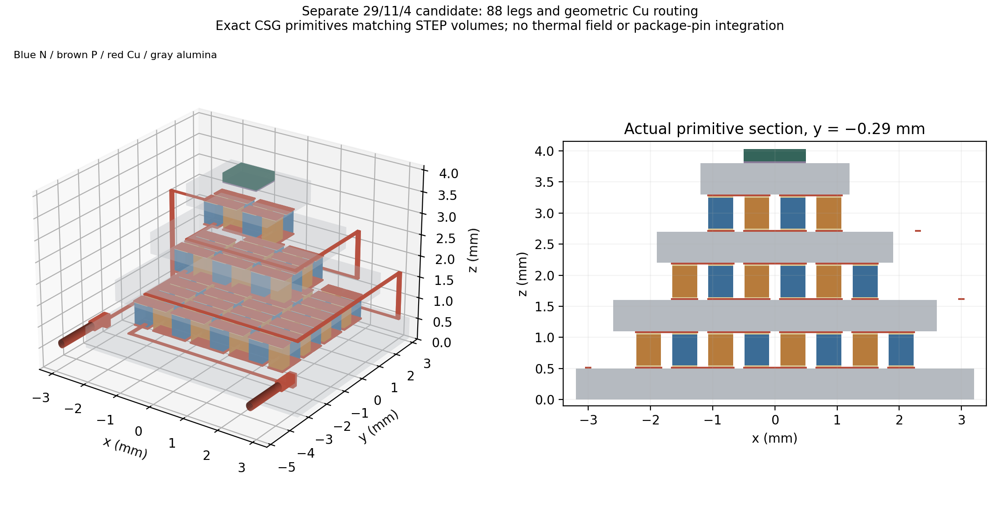
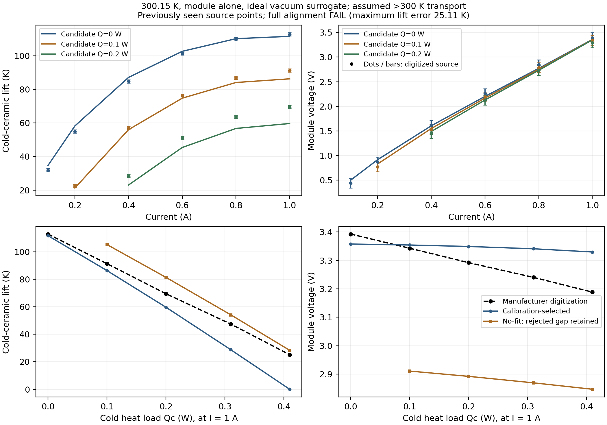

# Separate source-constrained 29/11/4 TEC candidate

Internal design study, not another public report. Baseline main
`332634c5209606d80aade9b01e0db02bb315f486`. The user's new authorization permits
calibration **only for this separate candidate**, prospectively superseding the
old no-fit rule here. Original 28/12/4 geometry, laws, studies, fields and failed
gates remain immutable; no fitted material is substituted into that reference.

## Preregistration before candidate construction or transport solves

### Source identity and geometric design

Freshly fetched/inspected TEC Microsystems2019 PDF has the same protected digest
as the earlier source. It documents 6.4±.1 mm hot /2.4±.1 mm cold /3.8±.15 mm
height, .2 mm terminal wires, Al2O3 and Sn–Sb assembly, high-grade hot-extruded
BiTe, and chart27C vacuum with hot stabilized to ambient. Its series page gives
increasing height/resistance and decreasing current for -05/-08/-10/-12.
Current RMT separately documents .4×.4 mm pellets and 44 couples, but -05
performance117K/.61W/1.14A/3.6V/2.74ohm/H3.75mm differs from TEC2019.
Historical RMT2008 indexed source text gives N=4+11+29, h=.5 mm and H3.8 mm,
112K/.53W/1A/3.5V/ACR2.85ohm. Local historical HTML fetch403; full historical
drawing **NOT locally inspected**. This is remotely web-indexed text evidence,
not proof of TEC2019 internals. Current part-number diagram identifies final
code as pellet height, not a generic assembly height.

Candidate **rmt2008_inspired_29114_h05_v1**: hot-to-cold couples29/11/4, leg
.4×.4×.5 mm. Historical source supports the count multiset, not independently
verified stage order; assigning29 to hot/4 to cold is an explicitly inferred
capacity ordering. Candidate routing/counts must be independently audited.
No old g=1.7 area enlargement or reused native pad pattern.

One fixed layer design in mm: four ceramics of thickness .5, widths
6.4/5.2/3.8/2.4; three .5 leg layers; each leg face has .02 solder plus .03 Cu.
Total **2.0+1.5+.3=3.8 mm**. Intermediate widths, layer partition, support,
contact metallurgy detail and all routing are engineering assumptions. Grid
pitch .58, leg gap .18; .44 square pads provide full footprint plus .02 margin,
and at least .1 ceramic-edge pullback. Manufacturer's “MC400µm trace spacing”
is retained as source wording, **not silently equated to leg gap/pitch**; this
pitch is a new design hypothesis, not verified RMT artwork.

Serpentine58/22/8 alternating N/P legs; opposite-face pair links and dedicated
Cu interstage/return conductors must form one unbranched two-terminal chain.
Both external endpoints are hot-side pads, x±2.8 mm; .2 mm Cu lead tails use
raised hot-pad stubs to avoid ceramic penetration. Internal free bent Cu links
are design hypotheses, not a reused OEM drawing. Audit their actual ownership,
clearance, contacts and individual volumes; mechanical strength/fatigue and
fabrication process capability are NOT RUN. No stage-metal thermal leakage or
spreading is silently declared solved by the reduced transport model.

**Hard geometry gates before transport:** exactly88 legs and176 full solder/Cu
footprints; positive disjoint solid interiors, no shorts, correct89 conductor
nodes with degree1 only at terminals, one chain through every leg; positive
clearance between unrelated conductor bodies; intended contact faces fully
owned; layer sum3.8 within source tolerance, .1 mm patterned edge pullback;
no header penetration and cap-envelope clearance in the existing source frame.
Export a new exact candidate STEP using fresh mm-authoring process, then a
separate fresh SI reader verifies explicit units, all per-body volumes and bbox
(relative1e-7 volume /2.1e-7 m bbox tolerance). No mesh or production Elmer.
One CAD attempt <=180 s, <=600 solids, offline pinned4CPU/8GiB. A failed hard
gate STOPs transport; do not tune geometry from curve residuals.

### Fixed reduced comparisons and optional two-parameter calibration

Use original `integrated_reference.solve` and nonlinear32 transport unchanged,
passing isolated candidate geometry only. Module-only: external wires removed,
vacuum surrogate exchange OFF, ideal hot reservoir300.15K, prescribed cold load.
Compare **cold ceramic lift / module V**, not auxiliary die T. The auxiliary
30µm/1mm² attach must be invariant under k=.5/3 at(.2A,.1W) for cold lift/V.
This intrinsic benchmark omits ceramic spreading, solder/contact impedance,
Cu trace resistance and nonlocal conduction, radiation and actual vacuum losses;
CAD qualification cannot qualify those omissions. All source specimens remain
distinct Zhang P/N research analogs40–300K, not an identified commercial pair;
300–390K quarter-tangent is ASSUMED. Active domain180–390K includes leg extrema.

First no-fit candidate: all20 existing unique vacuum chart conditions, currents
.1/.2/.4/.6/.8/1.0A at the available printed loads0/.1/.2/.31/.41W (not an
invented rectangular grid). Reuse frozen original-model comparisons at identical
conditions; six additional300K/zero-load current controls quantify the .15K
reference offset and actual measured/assumed coverage. No higher-Thot dry-N2
comparison is claimed matched; those panels remain NOT COMPARABLE / NOT RUN.

Approximate alignment gate, declared now: **all20 candidate conditions admitted**,
mean absolute lift error<=8K, RMS relative V error<=15%, maximum lift error<=15K
and maximum relative V error<=25%. Gate uses known digitized reference readings,
not experimental likelihood; retain their reading bounds. Successful approximate
agreement is calibration/plausibility, never independent OEM validation.

If no-fit fails, calibrate only two common factors, **S∈[.9,1.1] and
rho∈[.8,1.2], k=1**, using prior declared engineering ranges as hard design
constraints, not claimed measured grade bounds. No geometry, stage split,
source-law shape or third material/contact knob may change. Calibration subset:
(.2A,0),(.2A,.1W),(.6A,0),(.6A,.1W), eight lift/V readings. Evaluation subset:
remaining16 conditions/32 readings, all previously seen; **not blind holdouts**.
Objective mean squared `(lift residual/5K, V residual/.1V)` with fixed engineering
weights (not measurement error). Start with the nine registered S=.9/1/1.1,
rho=.8/1/1.2 vertices; exact-key reuse only. Optional bounded least-squares from
best admitted vertex, max8 function evaluations with finite-difference Jacobian.
Record every trial/current solve including rejects; any rejected refinement trial
STOPs refinement, never fabricates penalty observations. Retain best *actually
evaluated* calibration point and state optimizer success separately. No widened
bounds/restarts. Apply same approximate gate to all20 and separately evaluate16.
Report signed lift/V residuals, absolute/relative errors, coverage and bound hits.

At most **240 outer reduced solves /600 s total /8 s each**, pinned4CPU/8GiB;
remaining cases NOT RUN, no solver retry. Stage/global/node gates remain
1e-9/1e-8/1e-8 W, source/sign/passivity and exact power conservation unchanged.
Independent analytic geometry/constant-property controls and measured-domain
bounded P/N BVP comparisons on candidate dimensions precede interpretation.
ACR2.9ohm is a frequency/fixture-dependent check, not DC V/I or a fit target.
Qmax and DeltaTmax **NOT RUN** unless their explicit extremum problems are solved;
sampled zero-load max lift is not DeltaTmax. No candidate200K package/sink/gas
prediction is authorized automatically by this intrinsic benchmark.

Freeze preregistration, source audit, candidate input geometry and original
source/data/PDF hashes before comparisons. Full applicable regression excludes
12 existing runtime mesh/Elmer cases; archive/master and both legacy gates run.
Assess Rev3 integration only after results: no unqualified design or supplier
identity is promoted, no alternative public report, full predecessor preservation
and all-page/deterministic QA if the master changes. Stop after this study.

## Results

**Geometry PASS; full datasheet-alignment FAIL / scientific STOP.** This checkpoint
does **not** deliver a qualified datasheet-aligned operating device. It does
deliver a separately versioned exact geometric prototype and a tested negative
comparison, without changing the original reference or relaxing the registered
gate. No further parameter, current grid or geometry change was made after the
comparison. Calibration permission was exercised only on this candidate.

### Source and exact geometry evidence

[Source retrieval/inspection metadata](../data/tec_candidate_29114_20261101/sources.json)
distinguish the three identities:

| Source/generation | ΔTmax K / Qmax W / Imax A / Umax V / ACR ohm | Height / internal evidence |
| --- | --- | --- |
| [TEC Microsystems2019](https://www.tec-microsystems.com/Download/Datasheets/Thermoelectric%20Coolers/MC04%20Series/3MC04-044-05_Datasheet_2019.pdf), nominal27C vacuum | 113 /0.50(front),0.51(chart) /1.0 /3.5 /2.9 | H3.8mm; .2mm wires,6.4/2.4mm plates, Al2O3/SnSb; internal stage counts/heights not exposed |
| [Historical RMT2008 indexed manufacturer sheet](https://www.alldatasheet.com/html-pdf/390492/RMT/3MC04-044-15/59/1/3MC04-044-15.html) | 112 /0.53 /1.0 /3.5 /2.85 | H3.8,h.5mm,N=4+11+29. Local403; indexed text verified by ChatGPT web; full drawing not locally inspected |
| [Current RMT series page](https://www.rmt-tec.com/products/thermoelectric-modules/multistage-modules/three-stage-modules/series-3mc04/) | 117 /0.61 /1.14 /3.6 /2.74 | H3.75mm,.4×.4mm pellets,N44; different generation/performance, not2019 validation |

Fresh local2019 PDF SHA equals the earlier protected source. Fresh manufacturer
HTML and numbering image were inspected locally; cached copyrighted bytes stay
under ignored outputs, while hashes/URLs/statuses are versioned. The current
RMT module image is a family illustration, not an internal count measurement.
The official [TEC series](https://www.tec-microsystems.com/products/thermoelectric-coolers/3mc04-series-thermoelectric-coolers.html)
and [RMT numbering](https://www.rmttec.com/support/part-numbering/) pages are
separate evidence; their model codes do not prove a shared internal assembly.
Its image/numbering hashes are in the separately appended
[source-image metadata](../data/tec_candidate_29114_20261101/source_images_supplement.json);
the originally frozen source audit remains byte-identical.
Hot29/middle11/cold4 remains an **inferred candidate ordering**. None of these
sources identifies a VIGO housing containing this selected TEC.

Exact candidate [STEP](../data/tec_candidate_29114_20261101/geometry/candidate_mm.step),
[design](../data/tec_candidate_29114_20261101/geometry/design.json),
[analytic audit](../data/tec_candidate_29114_20261101/geometry/analytic_audit.json)
and [independent SI import](../data/tec_candidate_29114_20261101/geometry/si_reader.json):

- **361 solids**:4 ceramics,88 P/N legs,176 solder pieces,89 Cu conductor
  bodies,2 hypothetical attach/die solids and2 Cu lead tails; no tetrahedral mesh.
  All axis-aligned solid interiors are independently disjoint; conservative
  cylinder bboxes exclude lead penetration. Each intended conductor union is
  one native solid. All88 legs appear once in one89-node unbranched chain;
  the two lead-tail circular faces meet their own raised hot-side stub faces.
- **176/176 full .16mm² leg/solder/Cu footprints**, positive .18mm leg gaps,
  **.14mm minimum unrelated Cu gap**, **.11mm minimum patterned pullback**.
  Source footprint/height gates pass without enlarging the old native pads.
- Ceramic height **3.8mm**, global hot underside1.55mm over header top1.5mm;
  hypothetical die top5.58mm, roof clearance4.07mm, conservative radial cap
  clearance **1.319862mm**, including shortened .2mm lead tails.
  Inner wall/roof and50µm mount offset are the existing registered **hypotheses**,
  not published manufacturer internal clearances.
  These are envelope checks, **not a full native-header/pin assembly import**;
  actual pins1/9 connection and detector bonds are NOT IMPLEMENTED here.
  Vendor40±5mm free leads were not crammed inside the cap: this prototype uses
  1.5mm tails and raised stubs as explicit package-routing hypotheses.
- One14.0s fresh-mm author export, no CAD imports in writer. The first reader
  stopped before import on an implementation typo (`.SI_UNIT` versus `SI_UNIT`);
  [original source](../data/tec_candidate_29114_20261101/geometry.py.source) and
  [STOP record](../data/tec_candidate_29114_20261101/geometry/initial_reader_STOP.json)
  remain. Only the reader metadata parser was corrected using the established
  all-context checker; **no re-export or geometry alteration**. Separate SI
  import matches all361 body signatures; maximum volume-relative error
  **4.37e-14**,362 millimetre length contexts, actual .1mm wire radii.
  This is not another physical STEP scaling error or a waived unit gate.



Source-supported dimensions do not establish manufacturability: unsupported
free Cu links, assembly process/tolerances, solder reliability, mechanical
strength/fatigue, electrical insulation and full electrothermal operation are
unqualified. New module geometry is not substituted into historical88-leg fields.

### Actual comparison and calibration

One **65.242s** registered reduced execution used **155 calls:150 admitted,
5 rejected,0 unattempted**;85 maximum slots unused. Four accepted nonlinear
cases stay inside measured coverage,143 need assumed continuation, plus3 G1
constant controls. Rejections retain full candidate/residual/optimizer/bound
details: no-fit300.15K zero-load .8/1A, matching300K controls .8/1A, and one
S1.1/rho.8 calibration-grid .6A zero-load trial. These are active-bound residual
failures, not proof of physical infeasibility. No rejected state is clamped or
bridged in the curves. Three independent constant matrix controls, two measured-
domain P/N BVP comparisons and auxiliary-attach invariance pass.

Calibration selected **S=.9427924000,rho=1.2,k=1**; rho hits its hard upper bound.
The bounded optimizer succeeded in7 function evaluations; every trial is stored
in [the trial ledger](../data/tec_candidate_29114_20261101/study/calibration_trials.json).
These are effective intrinsic-model corrections, **not measured material grade**.
The selected point is actually evaluated, not an interpolated curve. The old
Claude triple, g1.7 enlargement and any additional knob were NOT RUN.

| Comparison (literal300.15K, vacuum surrogate, module only) | Admitted conditions | Lift MAE K | V relative RMS | Largest lift error K | Full alignment |
| --- | ---: | ---: | ---: | ---: | --- |
| Original28/12/4 reference, frozen results | 18/20 |19.854872|62.989%|47.264306|FAIL |
| New29/11/4,.5mm, no fit |18/20|6.609953|9.889%|13.901307|FAIL:2 missing states |
| New calibration-selected |20/20|7.193968|4.067%|**25.110984**|**FAIL:15K maximum** |
| Selected previously seen evaluation subset |16/16|8.521972|3.885%|25.110984|FAIL |

The first two admitted subsets differ: original excludes .6/.8A zero-load,
new no-fit excludes .8/1A zero-load. On the **same17 admitted conditions**, old
versus new no-fit lift MAE is20.703357→6.391994K and voltage relative RMS
63.079→9.792%. This post-hoc common-support comparison isolates a much more
coherent geometry hypothesis but **cannot waive the three excluded conditions**
or the full20-point gate. The calibrated all-load mean lift error is **−6.196879K**
(undercooling), V mean **+0.020586V**; signed residuals are retained individually.

| Selected point, zero load | Model lift / source K | Model V / source V | Role |
| --- | ---: | ---: | --- |
| .2A |58.205746 /54.967287|.915249 /.869116|Calibration, previously seen |
| .6A |102.703562 /101.420569|2.201113 /2.257059|Calibration, previously seen |
| 1A |111.637323 /112.824401|3.357358 /3.392429|Evaluation, previously seen |

At **1A,.41W**, selected lift is **.066101K versus25.177086K**, signed error
**−25.110984K**. The source and model fixed-current0→.41W lift/load secants are
**213.773941 and272.124930K/W**, a **27.296% excessive modeled load response**.
These are nonlinear operating secants, **not passive contact resistance or
proof of a particular k correction**. Good zero-load lift and voltage agreement
does not establish loaded performance. Calibration8 readings and evaluation32
readings were already viewed; no independent/blind validation is claimed.



All comparisons retain source reading bounds (including current placement);
they are not manufacturer test uncertainty. Dry-N2 panels323–358K remain NOT
COMPARABLE / NOT RUN;300K controls are not silently used as literal27C matches.
**Qmax, DeltaTmax and a candidate200K detector/package target are NOT RUN**.
The1A zero-load point is a sampled lift, not a continuous optimum.

### Physical-model limitation exposed by the candidate, not a retrofit

After the registered run, a **post-hoc analytic omission audit** used the already
frozen Cu centerlines and original rhoCu=1.72e-8ohm m verification proxy.
It changes no dimensions, fit, temperature or material law. The .1×.03mm route
cross sections and centerline lengths yield approximate resistances:

| Conductor | Length mm | 1D R estimate ohm |
| --- | ---: | ---: |
| Hot inlet0 |5.60|.032107|
| Interstage58 |15.80|.090587|
| Interstage80 |12.70|.072813|
| Cold-stage return88 |9.24|.052976|
|85 ordinary pair links | .58 each |.064239 total|
|Two1.5mm,.2mm-diameter tails |3.00 total|.001642 total|

Sum **.314365ohm**, hence approximately **.314365W at1A**, is **omitted from
the intrinsic reduced curves**. This centerline estimate ignores pad spreading,
corner/overlap corrections and stub/contact resistance; it is neither a solved
3D current field nor measured heat. Route cross-section nominal current density
at1A is3.33e8A/m²; acceptable temperature rise/reliability is **NOT established**.
Geometric PASS alone therefore cannot establish an operable1A device.

Uniform300K source bulk estimate is **2.698285ohm**, versus the selected effective
rho estimate **3.237942ohm** before any separately added Cu. Published ACR2.9ohm
(historical2.85) has unspecified frequency/fixture/lead de-embedding; it is not
DC thermoelectric V/I and was not a calibration target. The nominal bulk-plus-
rough-Cu estimate is3.012649ohm; resemblance to ACR is **not validation**.
Fitted effective rho may absorb omitted losses; adding .314W afterward would
risk double counting and violate conservative coupling. No such heat was inserted.
This identifies a concrete missing input/operator, **not a proven explanation
or correction of the25K loaded residual**. Ceramic spreading, contacts, grade
shape and thermal shunts remain confounded. Original A/L–rho–k gauge still
prevents inferring actual manufacturer dimensions/grade from endpoint curves.

**ONE next proposed experiment, NOT authorized/run:** an independently checked
isothermal300K electrical Cu/contact fixture on this frozen candidate, using
actual leg footprints and external terminals to test resistance/current
distribution and bound Joule allocation. Qualify the .314ohm estimate before
any coupled correction or further bulk calibration. This is a new candidate
fixture proposal, not reopening the stopped seven-port thermal experiment.
Do not execute it automatically, widen fitted bounds or introduce new free k.

## Reproduction and preservation

New output directories only; the checked STEP is not regenerated during tests:

```bash
./fem/run.sh timeout 180 python -m tecooledmct.tec_candidate_geometry writer --out outputs/new-candidate/geometry
./fem/run.sh timeout 180 python -m tecooledmct.tec_candidate_geometry reader --out outputs/new-candidate/geometry
# Study requires a frozen source/preregistration ledger in the candidate folder.
./fem/run.sh python -m tecooledmct.tec_candidate_study --folder outputs/new-candidate
./fem/run.sh python -m tecooledmct.tec_candidate_presentation --out outputs/new-candidate-figures
./fem/run.sh pytest -q tests/test_tec_candidate.py
python3 -B -m reports.master.validate --current
./fem/run.sh python fem/archive_bath_spatial_device.py --verify
```

Copy the versioned registration/sources ledger into a new study folder after
verifying its original input identities; never overwrite this executed checkpoint.
Its historical writer snapshot precedes the parser-only correction; the corrected
reader uses the established all-context checker. Both exact
source versions, CAD hashes and reader STOP are preserved. Reproducing the
STEP byte stream across OCC versions is not claimed; physical dimensions and
signatures, rather than timestamps/serialization order, are the CAD gates.
The copied ledger identifies the original protocol/inputs, not a fresh run time:
new executions must capture their actual UTC and writer/reader source hashes.
Solver-free figure replay reads the sealed checkpoint but requires a fresh output
directory; it cannot overwrite the versioned diagrams after the ledger is sealed.

Maximum independent nonlinear stage/global error **1.36e-12 /6.05e-11W**,
below unchanged1e-9/1e-8W gates. **149 focused /468 applicable tests PASS**, with
12 existing runtime cases excluded; master/archive and both legacy demos PASS.
Both figures and derived comparison JSON reproduce exactly in a fresh output,
and both complete figures were visually reviewed. Source/link/immutable and
publication checks are recorded separately in
[verification](../data/tec_candidate_29114_20261101/verification.json).
Original native gas32.6274%FAIL, nonlocal7.277%FAIL, cold5%/bath1% failed
qualification and their exact fields remain untouched; no failed path supplies
ground-truth power here.

**Rev3 disposition:** retain exact38-page canonical bytes. Full alignment failed,
the historical drawing/order is incompletely sourced, and actual Cu/contact/
ceramic electrothermal behavior remains unresolved. Publishing this as an
aligned physically qualified candidate would be misleading; the internal
tested STOP/prototype is the appropriate checkpoint. No competing public PDF.
