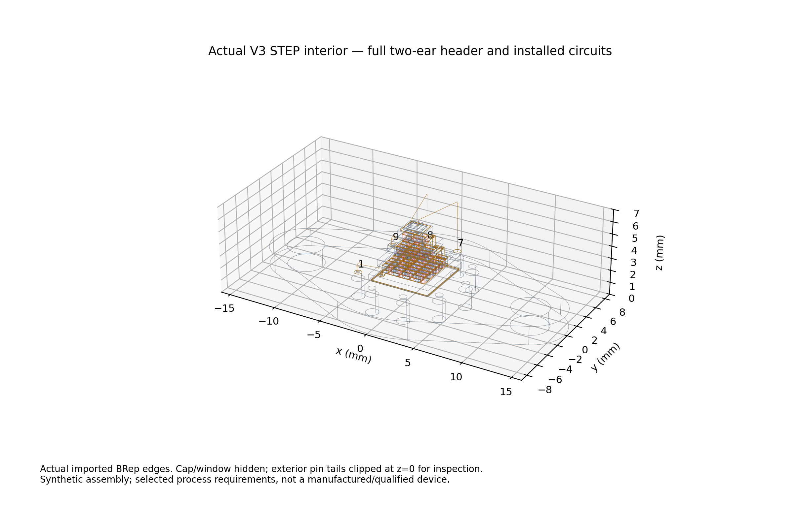
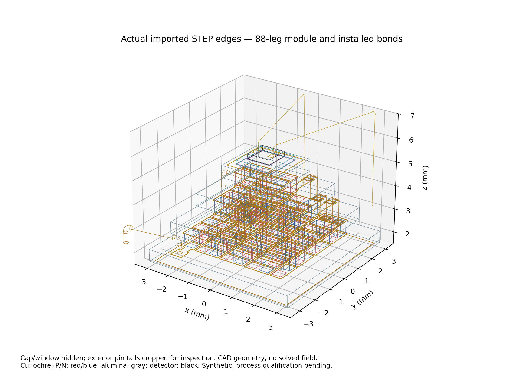
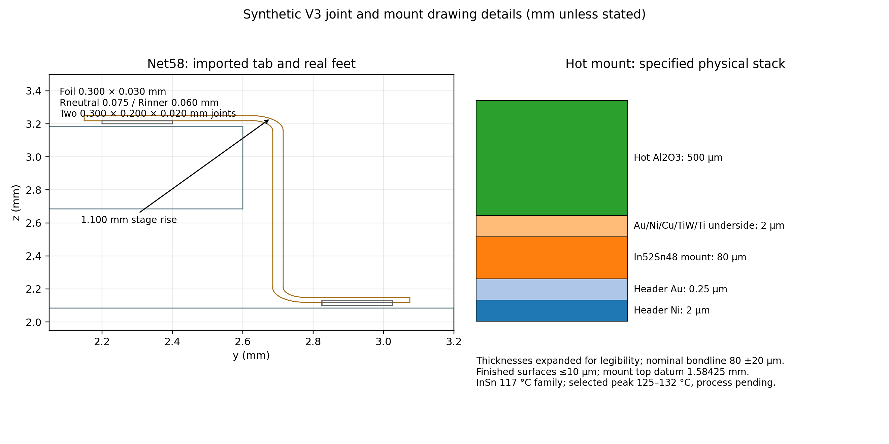

# Synthetic V3 assembly engineering and CAD

Baseline clean main5fcd519; observed authorization2026-11-02T14:12:46Z.
This new user authority permits inspectable **selected synthetic requirements**,
not just externally measured dimensions. Earlier source-gate STOPs remain
historical; their missing interfaces must now be explicitly designed and tested.
No PDE, Cu electrothermal qualification, transport fit, sink or gas study.

## Preregistration — before source/CAD implementation

- Preserve original V1/V2 source/STEP,88 P/N leg dimensions/positions/polarity,
  29/11/4 stage order,89 internal net identities and176 axial P/N contacts.
  V3 may replace internal pads/routing; original code/data/fields and exact38-page
  Rev3 remain byte-identical. VIGO housing and TEC Microsystems are independent
  envelope sources, not a proven composite OEM assembly.
- Select architecture **B**, short formed Cu tabs between face lands; no
  continuous sidewall metal, vias or V1 perimeter posts. C110 annealed Cu-family
  foil0.30±0.01mm wide,0.030±0.003mm thick; neutral bend radius0.075mm
  (inner0.060mm), minimum manufactured inner radius0.050mm. These are selected
  requirements, not a vendor process capability or1A allowance. Actual horizontal
  feet have0.20mm solder overlap,0.26mm joint width,0.40×0.30mm face lands.
  Net88 is one stepped return with an actual middle supported foot.
- Preserve0.58mm pellet pitch and0.4×0.4×0.5mm legs; enlarge P/N pad envelopes
  to0.50mm. Require leg-to-pattern registration≤15um, pattern registration≤5um,
  outline error≤5um and leg width±5um. Require final unlike-metal gap≥50um and
  internal ceramic setback≥50um; compute worst case, not nominal only.
  TEC's100um external-Au service rule is an analogy, not a universal internal
  Cu process rule. External finish patterns retain≥100um worst-case setback.
- Face stack: Ti0.075um /TiW0.050um /plated Cu13.625um /Ni1.0um /Au0.25um,
  total15um; explicit layers if SI kernel permits. Kyocera/TTS are process-family
  precedents; plated thickness and tolerances are custom drawing requirements.
  Existing35±3um SnSb axial joints/0.500±0.005mm ceramics and legs retained.
  Metal total thickness uncertainty≤1um per face; no measured capability claimed.
- Select bridge Sn57Bi43 family138°C; finished joint20±5um, lap position±10um,
  controlled side fillets5–15um extent within dedicated same-net land. Selected
  local joining peak155–165°C, dwell≤45s, completed TEC everywhere≤180°C.
  Select In52Sn48 mounting family117°C with local peak125–132°C, dwell≤60s,
  earlier bridge joints≤132°C. These are proposed process acceptance windows,
  not a demonstrated thermal profile. SnSb≈230°C is a core-fabrication melting
  datum, not permissible completed-module mounting temperature. Treat conflicting
  TEC2019 short-processing220/225°C conservatively; later operations stay<220°C.
- Add actual metallized ceramic underside, solderable Ni/Au on Kovar and80±20um
  finished mount bondline; surfaces flat≤10um, included in the bondline limit.
  Use finite solids, no ideal thermal/contact assignment. Outer finish Au0.25um
  lies within source0.2–0.3um; actual layers/datum enter stack arithmetic.
- Use source0.2mm bare Cu hot leads with selected15um insulating coating except
  explicit stripped end regions. Route net0→pin1(+),net88→pin9(-); source9×0.76mm
  shafts/10.8mm PCD and bottom/top reflection mandatory. All joints are finite-area
  solids; no wire/pad proxy masquerades as an installed path.
- Choose **p-type HgCdTe photoconductor**, two separate top ohmic Au/Ni/Au pads,
  two actual Au bonds to7/8; sapphire carrier and electrically insulating epoxy
  prevent backside/carrier shorts. Contact-family and bonding evidence must be
  inspected before fixing detector layers. Detector performance/composition,
  contact resistivity and current rating remain unqualified. Pins5/6 vacant;
  this is explicitly the no-thermistor variant, not a fictitious thermistor.
- Use deterministic interval budgets: component sizes/placement/etch/solder,
  formed feet, tab/ceramic gaps, wires and pin placement, mount/die/carrier and
  source cap/window/roof. External module extent must remain inside3.8±0.15mm;
  outer flatness≤30um/parallelism≤50um source limits, with tighter self-imposed
  inspection requirements where needed. Reject missing joints, shorts, pin swaps,
  wrong detector identity, unsupported stack, bad registration/clearance and units.
- Resource/attempt bounds: existing exact image only,4CPU/8GiB (12GiB ceiling),
  no install/build/mesh. Source checks≤120s/invocation; one analytic thin-layer
  CAD control≤60s author/reader. Full CAD≤1000 solids,≤300s writer/≤300s SI reader;
  one initial export plus at most two preserved corrective code/CAD attempts,
  no source/material/geometry tuning to measurements. Each output immutable.
  Export mm STEP and1mm cube before any import; separate fresh SI reader,
  volume relative≤1e-7,bbox≤2.1e-7m, all source bodies uniquely owned;
  reject length1e±3 and associated volume1e±9 errors.
- Require actual 3D source/contact witnesses plus separate STEP checks, topology,
  assembly access, interval clearances and dimensioned drawings. Record thin-film
  resolution limitations honestly; no false resolved interfaces. Process capability,
  vacuum/outgassing and reliability stay pending even if geometry is CONDITIONAL.
- Run focused and full applicable regression (same12 expensive runtime cases
  excluded), archive/master, both legacy demos and hashes. Freeze/push exact
  builder checkpoint and CI, then one **fresh** separate read-only auditor with
  no inherited builder reasoning, writes paused. Preserve verdict verbatim;
  no new physics follows. Issue#2 stays open unless applicable independent closure.

## Results / recovery

Actual separate824-solid STEP/source built; nominal source/contact/SI/exclusivity checks PASS.
Selected process/physical-design acceptance remains PENDING independent review; no physical/current/performance qualification.

## Material-name correction before release

The immutable registration above reversed the Bi/Sn order in prose. Reinspection
of RMT Table2 specifies **Bi57Sn43**, not Sn57Bi43. All opaque CAD material tags
`SnBi57_43` resolve to57%Bi/43%Sn in the explicit
[material dictionary](../data/synthetic_v3_assembly_20261102/material_definitions.json);
no PDE ever used this tag or alloy. CAD dimensions and STEP bytes are unchanged.
The138°C table datum is not independently measured solidus/liquidus; require a
supplier lot certificate and thermal-profile coupon. The earlier wording is
retained as an acknowledged specification error, never a fabricated source fact.

## Drawing definition and process evidence

This is a **separate synthetic photoconductive package**, not the manufacturer's
cooler or a demonstrated VIGO/TEC Microsystems composite. The earlier V3
source-only STOP remains intact; this specification uses newly authorized
selected drawing requirements. [Machine-readable requirements](../data/synthetic_v3_assembly_20261102/drawing_requirements.json),
[824-component traceability](../data/synthetic_v3_assembly_20261102/component_registry.json),
[BOM](../data/synthetic_v3_assembly_20261102/BOM.json) and
[source catalogue](../data/synthetic_v3_assembly_20261102/source_catalogue.json)
separate product facts, process analogies, selected requirements and unproved
capability. There is **no new mesh or physical field** for this assembly.

The 2019 TEC Microsystems drawing supplies the 6.4/2.4mm outer ceramics,
3.8±0.15mm height,30um flatness,50um parallelism and0.2–0.3um exterior Au.
The retained29/11/4 split and0.4×0.4×0.5mm legs are source-inspired historical-RMT
choices, not verified2019 internals. Intermediate5.2/3.8mm widths,0.58mm pitch
and four0.5mm ceramics remain synthetic. VIGO supplies the independent9-pin
bottom-view mapping,0.76mm shafts,10.8mm circle and external package envelope.
The old1.3mm glass seal and inferred flange contour remain explicitly inferred.

Three genuinely different evidence families constrain construction: Kyocera's
actual thin-film/thick-Cu illustrations establish ceramic metallization families;
Kryotherm's printed22 photos and Design3 show short formed multistage connectors;
Coherent's2022 guide pp13–14 shows metallized TEC solder mounting and header-lead
assembly. RMT Fig2/Table2 further supports In52Sn48117°C mounting and Kovar;
RMT/Ferrotec are counted together, not as independent votes. These sources do
**not** publish the custom foil dimensions or demonstrate this assembly.
Kyocera's illustrated Ti/Pt/Au on AlN is not falsely called our Cu stack on alumina;
TTS lists Ti/Cu/Ni/Au thin-film families, but its standard Cu0.1–5um does not
qualify13.625um plating. Supplier development must establish adhesion, plating,
barrier continuity and wetting on coupons before production release.

The selected internal face stack is Ti75nm/TiW50nm/Cu13.625um/Ni1um/Au0.25um,
with total15±1um, and all five layers are separate CAD solids. Outer solderable
ceramic finishes use the same family with Cu0.625um, total2±0.5um. The selected
layer limits are requirements, not measured tolerances; accept both individual
limits AND the total-thickness limit. Any250°C substrate stabilization occurs
before legs or low-melting joints are assembled. The exposed conductive face
patterns are isolated; ceramic never carries electrical current.

### Formed tabs, joints and tool access

Net58 and80 have two real horizontal feet each; net88 has a continuous two-step
return with three supported feet. Each1.1mm step is geometrically traversed;
no full-height V1 post or sidewall deposition is used. C110 annealed foil is a
selected certificate requirement:0.300±0.010mm wide,0.030±0.003mm thick, neutral
bend radius0.075±0.005mm, minimum inner radius0.050mm. Form once on a die before
joining. Nominal outer bending strain t/(2R)=20% is an alarm requiring bend/pull/
crack inspection and fatigue coupons, **not** a certified allowable strain.

Each foot has a real0.300×0.200×0.020mm Bi57Sn43 joint and two triangular side
fillets, nominal10um lateral wetting,5–15um permitted. This deliberately changes
the preregistered0.26mm trial joint width to the full0.30mm foil width to avoid
an unsupported side strip; no performance or measured response was used.
The0.40×0.30mm same-net land contains the joint/fillet. Foot position±10um,
joint outline±5um and land/foil tolerances leave positive worst-case overlap.
The100um V2 nominal lap was only an inset; these V3 horizontal contact solids
are materially different. Side fillets wet10um up the foil at nominal geometry.

The selected0.35×0.25mm thermode approaches normal to each exposed foot.
At the closest lower foot its inner edge is y=2.800mm versus the riser outer
face2.715mm:85um nominal,60um after independent tool/foil/placement errors.
The upper ceramic edge2.600mm leaves200um nominal access; middle/cold feet
likewise lie outside the next smaller ceramic. Join before detector installation
and cap closure. A fixture supports the core and foil to avoid loading P/N legs;
this access test is geometric, not a measured joining-force limit.

### Hot mount and thermal hierarchy

The old50um empty gap is replaced by explicit header Ni2um/Au0.25um,
In52Sn48 solder80±20um and the reversed2um underside stack. Header top datum is
z=1.500mm; hot ceramic bottom z=1.584250mm. The6.0mm square solder joint lies
inside6.1mm square metallization on6.4mm alumina. Finish flatness≤10um and
finished bondline60–100um are selected incoming/assembly requirements that
include collapse and surface profile; they are stricter than the source envelope.
No ideal conductance or thermally solved stress is assigned. Soft InSn and
CTE-matched Kovar are process analogies; cryogenic shear/fatigue remain untested.

Core SnSb≈230°C refers to fabrication before a completed module exists.
The source220/225°C short-processing discrepancy is treated conservatively as
220°C, not a permissible arbitrary reflow peak. Local BiSn joining is selected
155–165°C/≤45s with all completed TEC≤180°C; InSn mount is125–132°C/≤60s, earlier
BiSn joints≤132°C. The6°C source-melting-datum separation is only a specified process
margin; the source Table2 gives a single melting datum, not a lot-qualified DSC range. Thermocouples on dummy assemblies must prove the actual profile;
fixtures retain all joints while cooling. Do not confuse solder melting point,
actual interface peak, dwell and maximum completed-TEC temperature. Flux removal,
Au dissolution, Ni barrier continuity and joint void limits need a supplier
process qualification; no invented reliability, current or vacuum rating follows.

### Package circuits and detector

A0.20mm Cu lead, with15um candidate polyimide insulation except0.20mm stripped
ends, joins net0 to pin1(+) and net88 to pin9(−). Actual finite solder disks
join circular lead ends to face lands and flat Ni/Au pin caps; bent leads supply
strain relief. Pin-side InSn is joined with a local shield after module mounting;
module-side BiSn is joined before mounting. The separate upper18um Au bonds
connect pins7/8 to two flat contact pads. Pins5/6 are **vacant**: no thermistor
exists. The drawing's bottom view is reflected once into the source top-frame;
all nine shafts are0.76mm, not the obsolete0.44mm approximation.

The selected detector is a1×1×0.200mm **p-type HgCdTe photoconductor**, not a
photovoltaic diode. Two0.20×0.50mm top contact pads have Au0.4um/Ni0.75um/Au1.5um;
0.060×0.035×0.006mm flattened Au wedge feet support18um wires. A1.6mm sapphire
carrier and two20±5um electrically insulating EP29LPSP bondlines isolate the
backside from the cold plate. There is no fabricated p-n junction or thermistor.
Bulk composition, doping, bias, responsivity and contact resistance remain UNKNOWN.

US4085500A(1978), Fig3, establishes a p-type Au contact/Ni barrier process family;
its diffusion step is a **pre-package die-fabrication** operation, not heating
this completed TEC. NIST SP400-94(April1994), printed100–101, recommends a
0.5–1um hard underlayer with≥1um Au for HgCdTe bonding and flat clean pads,
with75°C substrate heat improving Au–Au bonding. Our combined Au/Ni/Au stack
is a selected analog, not the exact patent or a characterized detector.
The wedge deformation35/18=1.94 wire diameters lies in NIST's stated1.5–2.5
starting range; destructive pull tests and non-ohmic/noise checks remain mandatory.
Fine Au wires are wedge welded, **not soldered**. EP29LPSP's published cure
options permit room-temperature gel then5–7h at175°F; selected7h79.4°C precedes
bonding at75°C. Its product-level outgassing claim does not qualify this package.

The original ideal cap/window mating solids are inherited candidate components.
Window sealing and cap/header weld process, hermeticity, gas fill and optical
throughput remain **UNKNOWN/NOT QUALIFIED**; no complete hermetic-device claim.
This build does not convert a nominal mating interface into an experimentally
qualified seal. Those subsystem limitations remain visible to the independent reviewer.

## Assembly traveler and acceptance plan

| Operation, in order | Required inspection / rejection condition |
| --- | --- |
| Procure presealed9-pin Kovar header and separate cap/window candidate | Verify drawing view,diameters/pitch,flat Ni/Au terminals; seal identity/certificate needed; no borrowed vendor assembly identity |
| Fabricate four patterned ceramics and underside/cold finishes | Measure each layer and total; adhesion/barrier/wetting coupon; unlike-net isolation; reject pinholes or failed source/selected limits |
| Fabricate/contact/passivate p-type detector separately | Verify two top pads,backside isolation,ohmic I–V/noise and bond pull coupon; no package high-temperature diffusion |
| Reflow P/N core with SnSb in alignment fixture | 88 legs,29/11/4,176 full joints; register≤15um; inspect/X-ray;3.804±0.139mm conservative metallized envelope (including30um flatness+50um parallelism);outer flatness≤30um/parallelism≤50um |
| Form/inspect three Cu tabs; place seven BiSn foot joints | Check0.050mm minimum inner bend,actual feet,fillets,clearances,fixture support,thermal profile; no sidewall conductor assumption |
| Attach module-side Cu leads and shielded header mount | Verify both true hot terminals,InSn mount60–100um,no bare-ceramic solder,profile andcooling fixture; no electrically conductive attach across an isolator |
| Join pin-side lead ends locally and clean | Pin1/9 continuity,all unused pins isolated,no solder splash; protect earlier solder joints anddie location |
| Attach carrier/die, cure and wedge bond7/8 | Verify epoxy insulation,flat Au pads,75°C stage,bond access/pull,correct PC identity;5/6 vacant |
| Inspect complete open assembly | End-to-end graph,branch isolation,heights,no-contact tolerance envelope,metallography on sacrificial unit; no1A rating inferred |
| Cap/window supplier process (unqualified here) | Separate seal/weld/outgassing/optical qualification required; no claim this CAD establishes hermetic or cryogenic service |

Inspect all independent drawing limits, not statistical RSS. Where process
capability is unknown, the table states a requirement to demonstrate, not an
imaginary measured capability. Electrical current density is an alarm only:
1A/(0.30mm×13.625um)=2.446×10^8A/m² in a narrow trace;
1A/(0.30×0.030mm²)=1.111×10^8A/m² in a tab; a0.20mm round lead gives
3.183×10^7A/m². No current allowance, Joule heat partition, physical thermal
shunt or cooler performance is established. R=ρL/A and G=kA/L can only give
conditional material/temperature estimates; no new physical coefficients enter
any legacy solver. Distinct Zhang research specimens remain measured40–300K,
with300–390K assumed continuation, untouched by this geometry work.

## Actual CAD and bounded verification results

The new assembly is [synthetic V3 STEP](../data/synthetic_v3_assembly_20261102/cad_02/synthetic_v3_mm.step),
824 separate solids. It contains no PDE mesh. The first author stopped at body814
on a wire-envelope bound; the partial cube, exact source and failure remain in
`cad_01`. The next writer uses exact cylinders/tori and support-plane extrema
instead of a Frenet pipe's ambiguous envelope. Its215.351s fresh-mm export and
separate24.759s metre-target reader both pass:1mm cube1e−9m³; maximum per-body
relative volume1.1409e−11 and bbox error1.0000e−7m, below1e−7/2.1e−7m gates.
Both1000× length errors are rejected, with10^9 volume consequences. The original
V1/V2 STEP and all old source geometry remain untouched.

[Imported-BRep audit](../data/synthetic_v3_assembly_20261102/cad_02/contact_exclusivity_final.json)
independently re-identifies every solid. All923 source contact witnesses lie in
both actual trimmed boundary faces. Exact source patch intersections establish
finite areas, including all176 P/N joints of0.16mm² and0.06mm² formed-foot joints;
CAD witnesses support correspondence, not an experimentally measured joint area.
All source box pairs are tested for positive overlap. Of1308 additional curved
AABB candidates,1250 are excluded by rigorous annular-void or conservative
curve-envelope bounds; the remaining58 actual imported-solid Boolean
intersections have **zero** positive volume. The curve enclosure uses samples
at arc spacing≤25um plus half-spacing margin; it is a bounding argument, not a
surface mesh or physical field. The final reader takes76.683s.
Two earlier query-timeout stops and one interrupted partial Boolean pass are
preserved; caching/query changes never changed geometry or acceptance limits.

[Source audit with complete interval budget](../data/synthetic_v3_assembly_20261102/source_final/contact_graph_final.json)
finds98 isolated metal components:89 original TEC nets (including intended
pin1/9 joins),two detector nets,case/cold finish and vacant pins. The complete
series quotient remains88 alternating N/P legs; P/N solids are the intended
inter-net connections, not copper shorts. Detector bulk is a photoconductor
between7/8, separate from all TEC/case conductors; insulators are not treated as
metal graph edges. No measured contact resistance is assigned.

| Deterministic interval check | Minimum / range | Requirement / interpretation |
| --- | --- | --- |
| Full P/N pad margin |22.5um|≥10um after independent leg/pattern/size errors|
| Unlike-net gap / ceramic setback |60 /60um|each≥50um selected internal process|
| Tab-to-ceramic gap |58.5um|≥50um|
| Minimum formed inner radius |53.5um|≥50um;forming capability unproven|
| Foot overlap containment |30um|≥20um;real0.20mm horizontal joint|
| Side-fillet containment |15um|≥10um|
| Exterior finish setback |130um|≥100um;corrected from erroneous trial180um|
| Thermode-to-riser clearance |60um|≥50um for selected0.35×0.25mm tool|
| Finished metallized module height |3.665–3.943mm|inside3.65–3.95mm;component±59um plus independent source30um flatness+50um parallelism;7um upper reserve|
| Hot mount bondline |60–100um|positive solid joint;flatness/collapse included|
| Detector / Au-loop to roof |3.570 /3.251mm|each≥0.5mm;not optical performance|
| Cap radial routing envelope |1.410mm|≥0.5mm under selected placement bounds|
| Cu wire inside pin joint |60um radial reserve|≥50um|
| Au foot inside detector pad |47.5um reserve|≥25um|

These deliberately conservative sums may double-count form errors; they do not
invent a supplier tolerance distribution. The7um module-height reserve is a tight
selected drawing condition and must be verified on actual assemblies. Reject
parts at the full generic supplier tolerance if they violate this selected stack;
do not silently consume the same tolerance twice or waive clearance gates.







The previews sample imported **BRep edges**, not a generated fake field. Cap/window
are intentionally hidden and pin tails cropped; all remain in the actual STEP.
The mount section expands thin layers for legibility, with actual thicknesses
labeled. Complete source-coordinate dimensions and named contact witnesses in
machine-readable data supplement these drawings; they are not a production
supplier's signed release drawing.

## Reproduction and release boundaries

Use the unchanged pinned image. Fresh output paths are mandatory; commands must
never overwrite old attempts. `source_final` is identical to `source_03` geometry;
updated independent interval results are a separate final audit, not rewritten
old evidence.

```bash
python3 -B tecooledmct/tec_assembly_v3.py source --out outputs/v3-replay/source
python3 -B tecooledmct/tec_assembly_v3_audit.py --source-dir outputs/v3-replay/source
./fem/run.sh timeout 300 python -B tecooledmct/tec_assembly_v3.py writer --out outputs/v3-replay/cad --source-dir outputs/v3-replay/source
./fem/run.sh timeout 300 python -B tecooledmct/tec_assembly_v3.py reader --out outputs/v3-replay/cad --source-dir outputs/v3-replay/source
./fem/run.sh timeout 240 python -B -m tecooledmct.tec_assembly_v3_step_audit --cad outputs/v3-replay/cad --source outputs/v3-replay/source --out outputs/v3-replay/contacts.json
./fem/run.sh pytest -q tests/test_synthetic_v3_assembly.py
./fem/run.sh python -B scripts/verify_synthetic_v3_checkpoint.py
python3 -B -m reports.master.validate --current
```

Writer/reader are CAD-only, not permitted new production simulations. The normal
regression excludes the same12 historical runtime CAD/mesh/Elmer cases; both
legacy demos,archive verifier and unchanged-master validation run separately.
Do not relaunch CAD to acquire a prettier result or infer numerical mesh accuracy.

| Gate | Current builder status |
| --- | --- |
| Source-process family / selected synthetic requirements |CONDITIONAL;actual capability and coupons pending|
| Nominal source topology and finite joints |PASS named geometry scope|
| Fresh STEP / independent SI dimensions/volume |PASS824 bodies|
| Imported contact / curved exclusivity |PASS923 witnesses,58 Boolean checks|
| Selected interval/contact/access limits |PASS;not statistical uncertainty or supplier certification|
| Independent physical-design acceptance |PENDING immutable separate review|
| Cap/window assembly process / hermeticity |UNKNOWN/NOT QUALIFIED;inherited ideal mating components|
|1A current / Cu electrothermal / solder fatigue |NOT RUN / NOT QUALIFIED|
| Commercial P/N grade / OEM performance |NOT QUALIFIED;research analog unchanged|
| Canonical38-page Rev3 / all frozen archives |Must remain byte-identical;no geometry progress clutter|

Original raw bath1%/cold5%,gas32.6274%,nonlocal7.277% and old candidate25.111K
failures remain unchanged. No new cooler performance, device temperature, Cu
heat partition or gas result follows. Freeze this verified builder scope and
exact CI before the fresh read-only review; keep issue#2 open and do not launch
any dependent physics or another milestone automatically.

Release QA: **72 focused,528 applicable tests PASS**,same12 historical runtime
cases excluded;full archive/master andboth legacy demos PASS. Read
[release check records](../data/synthetic_v3_assembly_20261102/verification_release/checks.json)
and[baseline byte guard](../data/synthetic_v3_assembly_20261102/verification_release/integrity.log):
81 protected inputs and5128 baseline blobs/2,907,877,565bytes unchanged.
The38-page Rev3 remains byte-identical. Builder source/CAD PASS is separate
from pending immutable independent physical-design verdict.

[Dimension-only conductor coefficients](../data/synthetic_v3_assembly_20261102/conductor_geometry_coefficients.json)
report tab neutral lengths1.960619,1.970619,3.706239mm andR/ρ coefficients
217846.605,218957.717,411804.322m⁻¹;meanJ at1A is1.111e8A/m².
These exclude contacts/film/current crowding andcannot predict a multiport
net88 heat partition or actual cooler load. No physics model consumes them.
