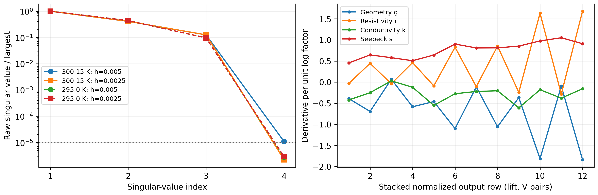
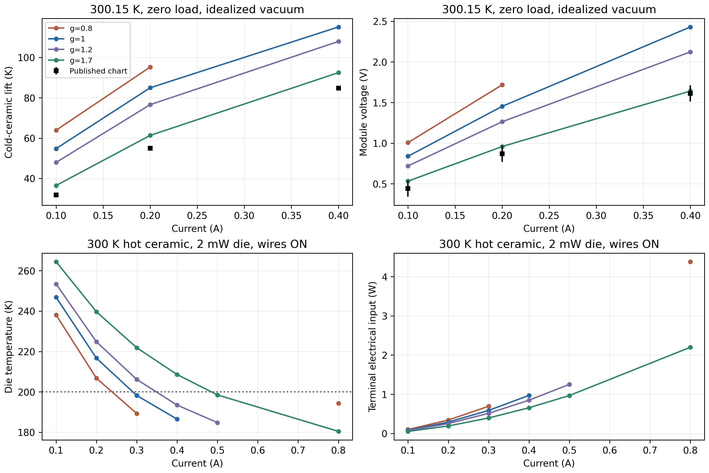
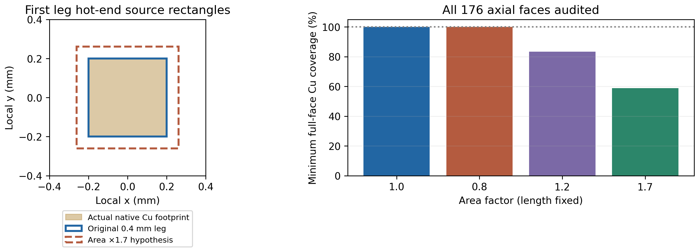

# Geometry versus material identifiability of reduced TEC transport

Internal technical record; the single public scientific report remains Rev3.

## Preregistration before comparative runs

Baseline: clean `294f53f670f39fcaf8e492651434dbb555faffe7`; new user authorization
supersedes the previous prospective no-identifiability instruction only for this
bounded study. Original nonlinear/affine/G1 algorithms, source tables, corrected
88-leg CAD/mesh/manifests, prior studies and raw release failures remain unchanged.
No OEM fitting, new 3D solver/CAD/mesh, gas/radiation or reopened plate fixture.

**Question.** Can a common effective leg geometry factor account for joint lift
and voltage disagreement, and can those outputs distinguish geometry from bulk
properties? A coherent change in both residuals is not a unique causal attribution.
The suggested `(S,rho,k)=(.89,.60,1.73)` is an unverified hypothesis, not evidence
or a target: analyze its algebra only, never optimize or execute that exact triple.

### Structural model and physical boundaries

Write `a=A/A0`, `l=L/L0`, `g=a/l`, `s=S/S0`, `r=rho/rho0`, `h=k/k0`.
All P/N temperature laws scale together by polarity with these common factors.
For normalized axial coordinate `x=z/L`, steady endpoint transport depends on
`r_eff=r/g`, `k_eff=h*g`, and `s`. Therefore the candidate exact gauge is
`(g,r,h,s) -> (c*g,c*r,h/c,s)`. Its log null direction is `(1,1,-1,0)`;
independent `a,l` add a second null direction. Check this for nonlinear Joule and
Thomson transport, not just constant R/K formulas. Common geometry leaves
`R*K` unchanged; pair `ZT` scales as `s²/(r*h)` and intrinsic power factor
`S²/rho` as `s²/r`. Intrinsic power factor is not a module conductance.

Geometry scenarios alter only copied reduced geometry, never the actual native
construction. Independently audit all 88 original boxes, axial Cu ownership/
footprint coverage, nearest interleg gap and the stack-height consequence of
length changes. Missing full native pad contact or changed axial mating is a
physical-realization failure, even if the reduced equations solve. This is not
a redesigned or manufactured cooler. Stage counts stay 28/12/4 except one
explicit 26/12/6 transport-only alternative (44 couples), with no new routing.

Module boundaries: fixed hot ceramic, gas/radiation OFF, external wires fully
removed, imposed cold load transmitted through the unchanged auxiliary attach.
Compare cold ceramic lift and module V, not loaded die T against zero-load lift.
Keep active 180–390 K, measured 40–300 K and assumed quarter-tangent >300 K;
classify source coverage from full leg extrema. Material specimens remain distinct
Zhang2025 research specimens, not a commercial matched P/N grade.

### Fixed cases, sensitivity and contacts

- Primary six module conditions: literal 300.15 K, I=.1/.2/.4 A, Qc=0/.1 W.
  Extra source-domain controls at 295 K: (.1 A,0), (.2 A,.1 W), (.4 A,.1 W).
- Central log derivatives of `(g,r,h,s)` at nominal, steps .005 and .0025,
  at all nine conditions. Normalize lift by **100 K**, V by **1 V**; no chart
  error weighting or likelihood. Report raw Jacobians/SVD/null vectors at both
  steps, nominal rank threshold `1e-5*sigma_max`, retained condition numbers,
  and step-difference Frobenius ratio (gate <=1%). Missing derivative samples
  mean NOT RUN, never filled. Report single-point versus stacked ranks.
- Also form the explicitly chain-rule constrained matrix with
  `Jg=-Jr+Jh`; its null is imposed by the derived structure, not independent
  empirical evidence. Preserve the raw matrix and its finite-difference defect.
- Global geometry g=.8/1.2/1.7, with direct reciprocal material alternatives
  `(r,h)=(1/g,g)` at each primary condition. Independent OAT r/h=.8/1.2 and
  s=.9/1.1 at the same conditions. No residual-minimizing choice among them.
- Gauge profile c=.8/1.2/1.7 at three registered module conditions; separate
  A-only versus L-only realizations and common A,L scaling at (.2 A,.1 W).
  Three current/load similarity controls use `I/g,Qc/g`, g=1.7; compare module
  outputs and correctly scaled heat/power, not auxiliary die T.
- Target controls: Th=300 K, Qdie=2 mW, original wires ON, g=.8/1/1.2/1.7,
  I=.1/.2/.3/.4/.5/.8 A. Two reciprocal-material controls at g=1.7, I=.3/.4 A.
  Preserve rejected gaps; admitted <=200 K is conditional, not an optimum or
  evidence that altered dimensions fit the native pads.
- Only two passive contact limiting placements: external series R=0/.1/.3 ohm,
  wholly thermalized to the prescribed hot reservoir (`dV=I*R`, added rejection
  `I²R`), and a cold-face thermal R=0/5/20 K/W at fixed Qc (`Tface=Tc+Qc*R`).
  These analytic controls do not change internal stage temperatures, model
  distributed pellet contacts or identify their actual placement. Extended SVD
  adds analytic columns normalized by 1 ohm and 10 K/W; zero-load data alone
  cannot observe the latter. Area-specific internal contact physics is NOT RUN.

### Evidence matching and numerical acceptance

Use original digitized 2019 27 C vacuum readings at the six primary conditions,
preserving source IDs/reading bounds and already-inspected split labels. Record
absolute/signed/relative lift and voltage residuals with equal admitted coverage.
Do not call those bounds measurement error or the old split newly blind. At
least the 50 C dry-N2 panel is screened for matching: absent matched environmental
heat paths it is **NOT COMPARABLE**, with no invented high-Thot prediction.
Historical rank-8/9 G2d fit and its old-geometry residual are context only.

Before module runs verify independent constant-property g/R/K/energy identities
at zero/positive/reverse current, and actual nonlinear measured-domain P/N
profile equivalence. Gates: equivalent accepted module Tc/Tdie/stage temperatures
within 1e-6 K, V within 1e-7 V, endpoint heat/work within 1e-8 W; source stage
energy <1e-9 W and package node/global <1e-8 W unchanged. A/L individual-field
densities may differ and must not be equated to total powers. Baseline replay
must match frozen material-study points within 1e-6 K / 1e-7 V.

Use the existing offline pinned image, <=4 CPU/8 GiB (below the 12 GiB cap).
Register all unique cases/references and input hashes before any solve. Per
package timeout **8 s**, combined reduced execution **600 s**, no retries or
adaptive extra scenarios; unattempted cases are NOT RUN. Stop comparisons on
independent-control or invariant failure; retain failures and diagnose without
tuning physics. Focused plus applicable opt-in regression exclude new CAD/mesh/
Elmer runtime tests; archive/master and legacy checks remain mandatory. Evaluate
Rev3 inclusion only after results; any update requires full deterministic build,
all-page visual QA and preserved predecessor bytes. No further science is implied.

## Results

**Joint disagreement can decrease under the registered effective-geometry
hypothesis; geometry is not uniquely identified.** At literal 300.15 K,
0.2 A, zero cold load, g=1.7 gives lift **61.339405 K** and module **0.957962 V**,
versus digitized 54.967287 K / 0.869116 V. Signed model-minus-source residuals
are **+6.372118 K (+11.59%) / +0.088846 V (+10.22%)**: still overcooling and
overvoltage. Nominal g=1 residuals are +29.990715 K / +0.583231 V. No parameter
was optimized; a pure reciprocal rho/k hypothesis gives the same transport.
This improves two observables within an idealized model without identifying
real dimensions, a measured grade, contact placement or missing package paths.

### Execution, coverage and preserved defects

All **269 unique registered package solves** were attempted once: **260 accepted,
9 rejected, 0 NOT RUN**. Recorded per-case solve durations sum to **104.731 s**;
that is aggregate measured package time, not a separately captured whole-process
wall time. The 600 s process budget and 8 s per-point limits were not exhausted.
71 admitted cases stay within measured material coverage; 189 use the assumed
continuation. All comparative 300.15 K points are continuation-dependent.
Rejected residual/bound candidates and optimizer diagnostics remain in `cases.json`.

One registered source condition, **0.1 A / 0.1 W**, has no exact digitized chart
reading. It remains a solved sensitivity control but is **NOT COMPARABLE** to the
source; no reading is interpolated. The original postprocessor failed on that
lookup after all solves. Its exact producer/log are retained; `analysis_recovery.json`
verifies identical raw-case bytes before/after postprocessing-only recovery.
The later figure provenance exporter also stopped on relative-path handling;
its producer/defect record are retained. Neither repair changed scenarios,
physics, raw results or the preregistration. No solves were repeated.

### Global non-identifiability follows from the nonlinear equations

For one signed leg current i=+/-I, set x=z/L, g=A/L (dimensional here), and F=Aq:

```text
F = i*S(T)*T - g*k(T)*dT/dx                         [W]
dF/dx = i*[i*rho(T)/g + S(T)*dT/dx]                [W]
dv/dx = i*rho(T)/g + S(T)*dT/dx                    [V]
```

Only g*k, rho/g and S appear, including the temperature derivatives responsible
for Thomson heat. In multiplier coordinates, effective laws are r/g and k*g.
For **every** boundary temperature/current/load within domain, the exact gauge
`(g,r,k,s)->(c*g,c*r,k/c,s)` leaves them unchanged. It preserves normalized leg
profiles, all stage endpoint powers, voltages and package balances, including
unchanged external wires. Thus steady curves cannot globally separate these
bulk/geometry factors even with perfect observations. This does not prove that
all remaining combinations are globally identifiable, or that more elaborate
unknown temperature-law shapes/contacts can be identified.

35 admitted paired checks pass; one geometry/material pair is NOT RUN for
comparison because both g=.8, 0.4 A/zero-load points reject. Maximum paired
ceramic/die difference is **9.23e-10 K**, voltage **8.86e-12 V**, and stage heat
**2.90e-12 W**. These include independent area/length realizations, finite gauge
profiles, current/load similarity and two wire-ON controls. For uniform geometry
factor g, the module also satisfies `Tc(g,I,Q)=Tc(1,I/g,Q/g)`, equal module V,
and heat/input powers scaled by g. The auxiliary die attach need not share that
scaled-load die temperature. All five matching frozen nominal source-study
replays reproduce Tc and V exactly in the pinned environment.

A and L separately remain unidentifiable in this isolated steady description.
Under A->cA and L->cL, current density and spatial gradients scale by 1/c,
heat-flux density by 1/c and volumetric Joule/Thomson terms by 1/c², while total
powers and normalized profiles are invariant. These are different physical
fields/geometries, not a claim that the native 3D construction is unchanged.
Known area-specific contacts, spreading or independent dimensions could break
that extra ambiguity; they are not measured here.

Common geometry preserves R*K and ideal pair ZT; it changes the current/load
scale. Intrinsic material power factor S²/rho is unchanged by a geometric change.
The unverified suggested (.89,.60,1.73) triple has R*K multiplier 1.038 and
ZT multiplier **0.763102**, versus unity for pure geometry. It decomposes into
a geometry-like factor 1.698038, common bulk factor 1.018823 and Seebeck factor
.89. Near-unit rho*k does not erase the consequential Seebeck change. That
triple and the subsequently suggested fitted fourth triple were **NOT RUN**.
Neither a higher hypothetical ZT nor its uncertainty proves universal physical
impossibility or availability of a manufactured grade.

### Numerical sensitivity, rank and contact limits

Raw output rows alternate lift/100 K and V/1 V, with derivatives per log factor
ordered g,r,k,s. This normalization defines the condition numbers; it is not a
Fisher likelihood, measurement covariance or empirical confidence interval.

| Th (K) | Log step | Raw singular values | Raw rank at 1e-5 relative |
| ---: | ---: | --- | ---: |
| 300.15 | .005 | 4.733125, 1.943249, .594098, 5.18915e-5 | 4 |
| 300.15 | .0025 | 4.733123, 1.943067, .594094, 1.05019e-5 | 3 |
| 295 | .005 | 3.246991, 1.420875, .313658, 9.11532e-6 | 3 |
| 295 | .0025 | 3.246971, 1.420918, .313658, 9.46456e-6 | 3 |

Frobenius step differences are **5.23e-5 / 2.26e-5** at 300.15/295 K, passing
1%. The coarse primary fourth singular value lies just above the registered
threshold; raw numerical rank is not stable there and is **not** proof of four
identifiable parameters. Finite differences, solver tolerances and piecewise
knot crossings leave a small null defect; the 295 K fourth singular value does
not shrink monotonically. The fine-step weakest right vector has cosine
>0.99999999997 with `(1,1,-1,0)/sqrt(3)`. Chain-rule construction imposes that
null exactly and has rank 3; its zero is a structural consequence, not another
independent experiment. Retained fine-step condition numbers are 7.967/10.352.
Each individual two-output operating condition has numerical rank 2.

The two explicitly external contact columns give local extended rank 5 of 6
at the fine step; the structural gauge remains. At 300.15 K extended singular
values are 4.773481, 1.951466, .595435, .047927, .004996, 9.53549e-6.
An external warm series resistance .1/.3 ohm adds +.02/+.06 V at .2 A and
+.004/+.012 W of hot-reservoir rejection. Positive resistance there worsens the
already positive voltage residual. A cold-face R=5/20 K/W raises the external
face by .5/2 K at .1 W, but has no zero-load effect and does not change module
voltage in this limiting placement. The auxiliary die is not that external
surface. Work/heat and nonnegative thermal-contact entropy checks pass.
Unknown internal pellet contacts and Joule allocation remain **NOT RUN**;
these two limits are not a calibrated universal contact model.



### Source comparison and target context

Four common admitted source conditions per observable permit equal-coverage
scores across all four g hypotheses (five exact conditions are available before
one g=.8 rejection). These are descriptive errors on already viewed data:

| g | Lift MAE (K) | Voltage MAE (V) |
| ---: | ---: | ---: |
| .8 | 28.005614 | .882719 |
| 1 | 22.555441 | .595096 |
| 1.2 | 17.508984 | .395384 |
| 1.7 | 7.392649 | .080646 |

Every signed residual on that common subset is positive. Both electrical and
cooling behavior shift coherently, but no fit, fresh blind holdout, current
optimum or grade/geometry identification follows. Strict measured-only 300.15 K
comparison is outside the 300 K source endpoint. The independent 50 C dry-N2
panel is **NOT COMPARABLE / NOT RUN** because environment/pressure/heat exchange
are not matched, despite active-law temperatures potentially extending there.
Published 2.9-ohm AC resistance is not DC V/I or the P/N-only isothermal resistance;
its proximity to any scenario value cannot select g. Qmax/DeltaTmax are NOT RUN.

The 26/12/6 transport-only alternative changes lift by -1.311765 K at .2 A/zero
load but +8.808684 K at .2 A/.1 W, with voltage shifts -.052796/-.047271 V.
Stage allocation therefore has a load-dependent signature different from a
single common geometry factor, but two contrasts do not identify actual counts
or validate an alternate conductor route. Internal stage temperatures/budgets
are retained for each result; these are not new 3D fields.

At 300 K hot ceramic, 2 mW die, wires ON and exchange/nonlocal leakage OFF,
the **lowest-current sampled admitted** <=200 K points are:

| g | I (A) | Tdie (K) | Terminal input (W) |
| ---: | ---: | ---: | ---: |
| .8 | .3 | 189.282350 | .693604 |
| 1 | .3 | 198.215733 | .588295 |
| 1.2 | .4 | 193.460642 | .848127 |
| 1.7 | .5 | 198.492346 | .967238 |

These are neither exact 200 K points nor continuous/current/power optima.
At g=1.7, .8 A gives 180.429804 K and 2.198620 W under different conditions;
it cannot validate a separately fitted 200 K power claim. Failed intervals
stay gaps. Finite heat-sink resistance/power at a matched target is a **next
proposed question only**, not executed or authorized automatically.



### Native geometry realizability is a separate failed gate

The original manifest contains 88 legs and 176 axial full-footprint Cu contacts.
For area ×1.7, width grows from .400 to **.521536 mm**; minimum interleg gap
shrinks from 150 to **28.464 micrometres**. No leg-leg collision occurs in this
box screen, but **all 176 axial faces lose full native Cu footprint coverage**;
the minimum covered fraction is **58.8235%**. Area ×1.2 also fails all 176 full-face
checks. Thus the effective transport hypothesis is not a qualified modification
of the frozen assembly. Partial-contact overhang may require different current/
thermal spreading, not necessarily a universally impossible manufactured design.

Realizing g=1.7 by L/1.7 instead breaks native axial mating and, if other layers
stay fixed and the stack is repacked, reduces height from 3.8 to **2.758235 mm**,
outside the independent candidate 3.8 +/- .15 mm envelope. It cannot be slipped
into the existing CAD while retaining all interfaces. Unknown OEM internals
could differ from this inferred construction; no inverse dimension measurement
has been made. Original geometry, not a changed CAD, remains the baseline.



### Verification and exact continuation boundary

Independent constant-property zero/reverse-current, nonlinear P/N profile,
reciprocal/Thomson-law and passive-contact controls pass. Maximum accepted global
energy error is **1.34e-11 W**, stage error **1.35e-12 W**. Baseline/source hashes
and original acceptance gates remain unchanged. Focused tests passed **94/94**;
the final applicable opt-in suite passed **429** with **12 runtime CAD/mesh/Elmer
cases deselected**, and focused report checks passed **37**. Archive/master
integrity and both legacy demonstrations pass; exact commands, logs and identities
are in [verification.json](../data/tec_identifiability_20261101/verification.json).
Source traces: the corrected 216-body `geometry_complete_checkpoint_20261030`
manifest/wire routes, corrected Zhang v2r1 tables, unchanged nonlinear/package
modules, original 2019 chart registry and historical G2d records. Exact hashes,
registration and executed producer are retained in the new evidence directory.

```bash
./fem/run.sh timeout --kill-after=5s 620s python -m tecooledmct.tec_identifiability --out outputs/identifiability-replay
./fem/run.sh python -m tecooledmct.tec_identifiability_figures --data outputs/identifiability-replay
./fem/run.sh pytest -q tests/test_tec_identifiability.py tests/test_nonlinear_tec.py tests/test_graded_tec.py tests/test_integrated_reference.py
```

The first execution's source-point lookup and figure provenance defects are
preserved; the current producer handles them without new scenarios. No new
native-gas/solid solve, empirical validation or relaxation of original cold/bath/
gas failures occurs. Existing gas forensics prove P1 normal-flux jumps explain
its 32.6274% raw imbalance, without making reactions a qualified raw prediction.
**Next proposed evidence:** independent stage dimensions and same-grade transport/
contact characterization to break the gauge; finite-sink matched-target power
is a separate prospective engineering control. No next scientific experiment
is authorized by completing this milestone. The substantive structural result
is integrated concisely into the **same 36-page Rev3**: exact proof/raw-rank caveat
and a conditional signed-residual/native-realization panel. Every page was
rendered and visually inspected; PDF, 46 figure files and 36 renders reproduce
exactly across independent builds, with all 44 predecessor figures unchanged.
Exact prior 34-page PDF/provenance are sealed separately, alongside earlier
28-/15-page and Rev2 evidence. A nearly blank overflow page in the first build
was rejected and corrected by shortening prose, without changing scientific data.
