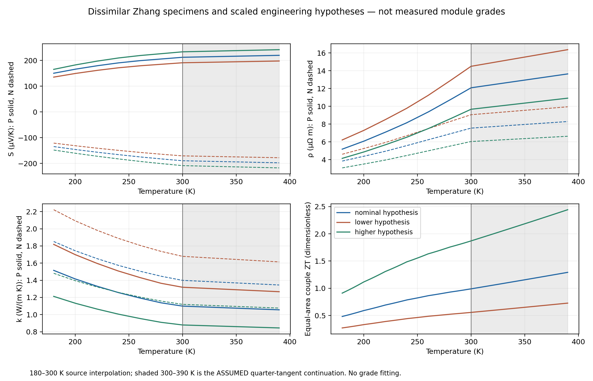
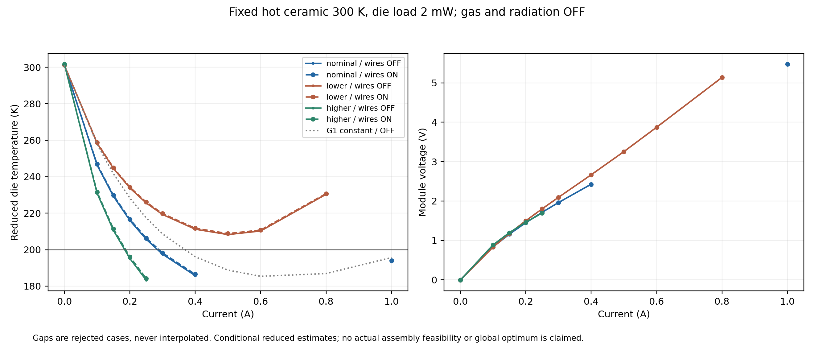
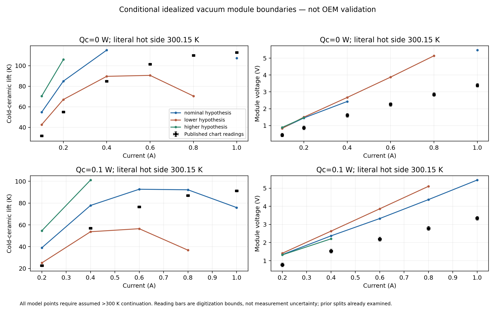

# Reduced TEC material hypotheses and datasheet plausibility

## Registration before scenario evaluation

User priority: bounded material/operating-condition insight, not OEM fitting or
the deferred radiation experiment. Preserve existing G1, affine and nonlinear
code/laws, 28/12/4 geometry, all historical fields/failures and the one Rev3.
This is an internal reduced-model record, not a new standalone report.

Source: corrected `zhang2025_he_digitized_40_300_v2r1`, DOI
10.1088/0256-307X/42/5/056304. P-HE and N-HE-1 are different measured research
specimens, not a matched commercial P/N module grade. Use unchanged
`zhang2025_nonlinear`, 32 axial intervals, active 180–390 K. Properties below
300 K are source interpolations; above 300 K use the existing **ASSUMED quarter
terminal-tangent** law. All local leg extrema, not only junctions, determine
whether continuation was used. No silent extrapolation or clipping of results.

Fixed triples `(S scale, rho scale, k scale)`:

| Hypothesis | Triple | Equal-area couple ZT / nominal |
| --- | --- | ---: |
| Nominal research analog | (1, 1, 1) | 1 |
| Lower-performance engineering hypothesis | (0.9, 1.2, 1.2) | 0.5625 |
| Higher-performance engineering hypothesis | (1.1, 0.8, 0.8) | 1.890625 |

These reuse the already declared engineering ranges, retaining complete
temperature-law shapes and positivity. Their covariance/manufacturability is
unknown; they are not experimental grades or confidence intervals. No scale,
geometry, current grid or acceptance choice is selected from OEM residuals.
Characterize both polarities and the equal-area couple at source/assumed T,
with sigma=1/rho and Thomson=T*dS/dT of the actual scaled piecewise law.
Interior knots use right derivatives, 300 K the measured left derivative,
above 300 K the quarter slope, 390 K its left limit.

**Fixed operating grids:** currents 0/0.1/0.15/0.2/0.25/0.3/0.4/0.5/0.6/0.8/1 A.
At Thot=300 K and die load 2 mW run all three triples with (a) all external
Cu/Au wires OFF, (b) actual reduced Cu/Au wire paths ON; no gas/radiation in
either control. R_sink=0 fixes the hot ceramic, preserving the finite die attach.
Wire OFF removes the external wire list, not just its conductance scale, so
no hidden wire resistance/Joule heat remains. No CAD changes are made.
Also run G1 on the wire-OFF grid; 24 hot/load controls (three triples,
Thot=290/310 K, load=0/5 mW, I=0.15/0.4 A, wires OFF); and 12 registered
one-factor endpoints at nominal Thot=300 K, I=0.25 A, load=2 mW: S/rho/k
ranges above, Thot=290/310 K, load=0/5 mW and attach k=0.5/3 W/(m K).
The wire-ON/OFF pair at the same nominal point is an additional paired contrast.

**Datasheet:** use all existing 27 C vacuum scalar readings and all unique
I/Qc conditions, all three triples, literal Thot=300.15 K, external wires and
side exchange OFF. Report cooler cold-ceramic lift and **module** V, never
detector temperature against zero-load lift. Auxiliary die attach is allowed
only after verifying its invariance for these prescribed-load, exchange-OFF
module balances. Six nominal zero-load current controls use 300 K separately
to quantify the 0.15 K reference offset; they are not exact chart matches.
Engineering-law comparisons have matched stated hot/current/load/environment,
but unidentified module internals/grade and unspecified vacuum parasitics
remain limitations. Strict measured-law comparison at 300.15 K is
**NOT COMPARABLE**, beyond 300 K; dry-N2 panels and package-detector points are
also NOT COMPARABLE. Preserve calibration/holdout labels, already examined;
no new blindness, fit or OEM validation. Historical G2d residuals belong to old
geometry/materials, with rank-8/9 identifiability, not current residual evidence.

**Observables/gates:** retain full successful stage/path budgets and failed
candidate/optimizer/domain diagnostics; count accepted/rejected/NOT RUN cases.
Use existing node/global 1e-8 and stage 1e-9 W gates, unchanged leg residuals
and source/sign/positivity guards. Qc is net heat absorbed at the cold ceramic;
die COP is imposed die load / terminal input, cooler COP is Qc / module input,
only when input is positive. A target demonstration requires an actual admitted
Thot=300 K, load=2 mW case with Tdie<=200 K; discrete minima are not global
optima, and rejections do not prove physical infeasibility. Report measured-only
and assumed-continuation coverage separately. Qmax/DeltaTmax are NOT RUN.

**Verification/bounds:** analytic constant/zero/negative controls; scaled P/N
comparison against independent bounded BVP at two measured-domain stage points
(stage 0: 295/250 K, 0.15 A; stage 2: 260/210 K, 0.3 A), all triples; attach
invariance; source-knot/300/390 K semantics; frozen baseline snapshots/hashes.
No new FEM/CAD/gas/radiation jobs. Per reduced solve 8 s; total scenario budget
600 s, remaining cases NOT RUN on exhaustion; no retries or adaptive tuning.
Use existing pinned wrapper <=4 CPUs/8 GiB. Existing runtime mesh/Elmer smoke
tests are excluded under the no-new-3D instruction; remaining opt-in regression,
archive/master integrity and legacy checks still run. Optional nonlocal-shunt
comparison is NOT RUN: its 7.277% side-port gate remains failed.

## Results

**Conditional reduced target: demonstrated; actual reference assembly: unresolved.**
At fixed hot ceramic 300 K and imposed die heat 2 mW, the nominal research analog
admits **186.484 K at 0.4 A with the archived 1D wires ON**, with all leg
temperatures within 186.368–300 K. The higher hypothesis also admits <200 K;
the lower hypothesis does not demonstrate it on this grid. These are neither
commercial grade identification nor full-device predictions: radiation/gas,
nonlocal Cu/alumina leakage, ceramic spreading and real contacts are absent.
Do not add the old nonlocal fixture's 8.413 K shift to these different-law results.

### Equations, property interpretation and sources

The unchanged bounded nonlinear stage solves, hot to cold,

`q=S(T) T J-k(T) dT/dz; dq/dz=J[rho(T)J+S(T)dT/dz]`,

with q in W/m², J in A/m², S in V/K, rho in ohm m and k in W/(m K).
Signed P/N currents are opposite; stage aggregation checks `Qh-Qc=I V` using
both computed endpoint fluxes. At each isothermal junction, stage Qc balances
the next stage's Qh plus explicit loads. For equal-area/equal-length P/N legs,

`ZT_pair=(S_P-S_N)^2 T / [(rho_P+rho_N)(k_P+k_N)]`,
`s_pair=(sqrt(1+ZT_pair)-1)/[(S_P-S_N)T]` [1/V].

This is a local idealized **pair** indicator, not the overall cascade ZT or COP.
Raw characterization, sigma, Thomson coefficients and compatibility values are
in `properties.json`; 40–180 K characterization never expands the active solver
below 180 K. Multipliers preserve law shapes, not an experimentally established
joint covariance or manufacturing process. Internal Cu electrical/spreading
effects and buried routes remain omitted by the existing stage approximation.

| Hypothesis | ZT_pair at 200 / 300 K | Isothermal P/N-only series R at 300 K (ohm) |
| --- | --- | ---: |
| Nominal | 0.589830 / 0.989093 | 5.195424 |
| Lower | 0.331779 / 0.556365 | 6.234509 |
| Higher | 1.115147 / 1.870003 | 4.156340 |

These R values use the frozen stage dimensions; they exclude metallization and
external leads. The published 2.9 ohm **ACR** is a different documented reference,
not V/I at finite lift and not a fitted target here. In nominal source material
at 300 K, P/N S=+212.463/−189.575 µV/K, rho=12.0806/7.54328 µΩ m and
k=1.09901/1.39923 W/(m K).

Primary material source: [Zhang et al.](https://doi.org/10.1088/0256-307X/42/5/056304),
corrected v2r1 profile SHA256
`32ebdb297168674f3240c4140e5f2ea8fa9d0527ff933d35b92d33d2eda4ef8b`.
The source P-HE and N-HE-1 triple-property curves are same-specimen **within**
polarity, not a matched P/N cooler grade. The corrected negative N axis is
retained. Original marker/source/reading bounds remain in the untouched registry.



### Operating coverage, stage lifts and target qualification

All **181 registered cases** were attempted in **81.72 s**: 141 admitted,
40 rejected, zero budget omissions/timeouts. Of 130 admitted nonlinear cases,
56 remain entirely inside measured coverage; 74 use the assumed continuation.
The other 11 are G1 controls, not measured-law cases.

| Family | Admitted | Rejected | NOT RUN |
| --- | ---: | ---: | ---: |
| 300 K / 2 mW material and wire grid | 46 | 20 | 0 |
| Constant G1 / wire-OFF grid | 11 | 0 | 0 |
| 290/310 K, 0/5 mW controls | 20 | 4 | 0 |
| One-factor endpoints | 12 | 0 | 0 |
| Literal 300.15 K OEM module conditions | 46 | 14 | 0 |
| Separate 300 K reference controls | 4 | 2 | 0 |
| Attach invariance controls | 2 | 0 | 0 |

Best **admitted sampled** wire-ON points (not optimized continuous extrema):

| Hypothesis | I (A) | Tdie (K) | Stage lifts hot→cold (K) | Qc_cold (mW) | Terminal V / input W | Die / cooler COP |
| --- | ---: | ---: | --- | ---: | --- | --- |
| Nominal | 0.4 | 186.483952 | 53.8598 / 35.9534 / 23.8190 | 3.871307 | 2.426999 / 0.970800 | 0.002060 / 0.003990 |
| Lower | 0.5 | 208.803662 | 31.4421 / 33.1428 / 26.7166 | 3.503367 | 3.255623 / 1.627812 | 0.001229 / 0.002153 |
| Higher | 0.25 | 184.228669 | 60.4404 / 34.4925 / 20.9557 | 3.908485 | 1.694506 / 0.423627 | 0.004721 / 0.009231 |

Nominal/higher rows above use measured-domain leg temperatures; the lower row
has a 302.867 K internal Joule peak and is continuation-dependent. Wire-OFF
sample minima are 185.751699, 208.255190 and 183.302382 K, respectively. The
cold-side Qc with Au wires ON exceeds the **2 mW imposed die heat**, because it
also removes Au parasitic heat; cooler COP uses module input, die COP terminal
input. At zero electrical power COP is undefined, not infinite.

Forty failures retain the original last candidates, optimizer status/message,
active bounds/residuals and transport diagnostics when available. Seven fail
the leg residual/domain gate; 33 fail package residual/bound acceptance. A
rejected interval is not a physical infeasibility proof: the existing 180 K
active floor and nonlinear initialization limit admitted coverage. In particular,
nominal 0.5/0.6/0.8 A cases fail while 1 A can be admitted on a warmer branch;
do not bridge those gaps or claim a global optimum. Qmax/DeltaTmax remain NOT RUN.



At the fixed nominal 0.25 A, 300 K, 2 mW wire-OFF baseline (205.722029 K),
the registered one-factor endpoint spans rank as:

| Input range | Tdie endpoint span (K) |
| --- | ---: |
| k scale 0.8–1.2 | 23.348849 |
| S scale 0.9–1.1 | 14.172527 |
| Hot ceramic 290–310 K | 9.084846 |
| rho scale 0.8–1.2 | 4.959973 |
| Imposed die heat 0–5 mW | 2.219005 |
| Attach k 0.5–3 W/(m K) | 0.100000 |

The matched wire-ON contrast adds 0.684866 K at that same point. The ranges
differ in width/units: transport secants per percentage point are about
0.709 K for S, 0.584 K for k and 0.124 K for rho, not local derivatives or
statistical importance. These controlled effects support material/routing
evidence collection, not selecting a grade from favorable output.

### Datasheet plausibility: matched known conditions, unresolved equivalence

Source: [TEC Microsystems 3MC04-044-05, 2019](https://www.tec-microsystems.com/Download/Datasheets/Thermoelectric%20Coolers/MC04%20Series/3MC04-044-05_Datasheet_2019.pdf),
original PDF SHA256 `1cc1075ed76a959b6a21cd24bde1704f72ab22529e77695a00e9b1af86a55492`.
Existing 160 scalar readings, load/color/axis registry and prior split are
unchanged. All were already examined; neither calibration nor holdout labels
create fresh blindness. No fitting occurs, and the historical rank-8/9
identifiability issue still prevents unique grade/geometry identification.

| Comparison | Disposition |
| --- | --- |
| Literal 27 C vacuum, same I/Qc, cold ceramic lift and module DC V | Conditional boundary-matched panel; engineering continuation required |
| Strict measured-only law at 300.15 K | **NOT COMPARABLE**, source ends at 300 K |
| 300 K reference versus literal 27 C | Control only, not exact OEM match |
| Dry-N2 panels | **NOT COMPARABLE**, their exchange environment is not modeled |
| Package Tdie at 2 mW versus module-only zero load | **NOT COMPARABLE**, different boundary/load/observable |
| Rejected model points | **NOT COMPARABLE**, no invented prediction |

Idealized module-side exchange is zero; real vacuum radiative parasitics,
pressure, contacts, internal geometry and grade are unspecified. Matching the
stated hot/current/load/environment and observable does not establish full
device equivalence or OEM validation. Auxiliary attach variation changes die
temperature while cold-ceramic span is only 9.69e-11 K and module V span
2.79e-13 V, verifying its invariance for this prescribed-load panel.

Nominal zero-load examples, model minus digitized reading:

| I (A) | Model lift (K) | Signed lift difference K / relative | Model module V | Signed voltage difference V / relative |
| --- | ---: | --- | ---: | --- |
| 0.1 | 54.766336 | +22.912596 / +71.93% | 0.838326 | +0.397457 / +90.15% |
| 0.2 | 84.958002 | +29.990715 / +54.56% | 1.452347 | +0.583231 / +67.11% |
| 0.4 | 115.126627 | +30.306308 / +35.73% | 2.429671 | +0.818257 / +50.78% |
| 1.0 | 107.393771 | −5.430630 / −4.81% | 5.477118 | +2.084690 / +61.45% |

Absolute/relative errors for every admitted field/load are in
`oem_comparison.json`. Counts per observable differ (nominal 18, lower 15,
higher 13); compare descriptive MAE on their **10 common admitted conditions**:

| Hypothesis | Lift MAE K / mean absolute relative | Voltage MAE V / mean absolute relative |
| --- | --- | --- |
| Nominal | 17.135582 / 56.89% | 1.058845 / 64.34% |
| Lower | 32.798000 / 112.16% | 1.427139 / 81.85% |
| Higher | 32.446121 / 88.70% | 0.718885 / 50.63% |

This is a substantial simultaneous lift/voltage mismatch, not evidence that a
favorable 200 K detector scenario identifies a commercial grade. The literal
0.15 K hot-reference change affects nominal zero-load lift by only 0.0505–0.1059 K
and V by 0.786–2.034 mV on four admitted paired controls; two others reject.
At 0.2 A its +0.074942 K / +1.294 mV change cannot account for the +29.991 K /
+0.583 V discrepancy. Old G2d +10.887 K/+0.205696 V belongs to old geometry and
materials and is **not** a current validation residual. No property was tuned.



### Verification, reproduction and next boundary

Six scaled same-grid independent measured-domain BVP checks pass: maximum Qc
discrepancy 2.18e-13 W and voltage discrepancy 1.01e-13 V. Across admitted package
cases, maximum global energy residual is 5.32e-11 W and stage error 2.90e-12 W,
within unchanged gates. **91 focused / 403 applicable opt-in tests pass**, with
12 runtime CAD/mesh/Elmer cases excluded. These cover constant analytic,
zero/reverse-current controls, reciprocal/Thomson/source-knot/continuation laws,
material domain guards, attach invariance, original baseline tests and rejects.
The first launch's syntax failure occurred before any evaluation; its source/log
are preserved under `implementation_check`, with no change to registered physics.

```bash
./fem/run.sh timeout --kill-after=5s 660s python -m tecooledmct.tec_material_plausibility --out outputs/material-replay
./fem/run.sh python -m tecooledmct.tec_material_plausibility_figures --data outputs/material-replay
./fem/run.sh pytest -q tests/test_tec_material_plausibility.py tests/test_graded_tec.py tests/test_nonlinear_tec.py tests/test_integrated_reference.py
```

Use absent directories; `registration.json` freezes exact scenarios/source hashes
before computation. `cases.json` retains all successful budgets and failed
diagnostics; CSV is admitted samples only. Figures derive from these records,
preserve failed gaps and were visually checked for labels/legends/margins.
`verification.json` records applicable regression, archive/master and legacy
checks separately from physical accuracy; runtime 3D/CAD/mesh smokes are excluded.

**Next scientific need:** independently supported grade/geometry/contact and
nonlocal-path evidence, followed by a separately registered coupled comparison;
not fitting these multipliers to previously seen OEM charts. The optional
nonlocal scenario is NOT RUN and its 7.277% side-port failure remains. No new
3D field, measured grade, gas/radiation result or full-reference-device 200 K
claim is established. Rev3 stays byte-identical: these useful reduced design
hypotheses still lack the physical equivalence needed for a device conclusion.
