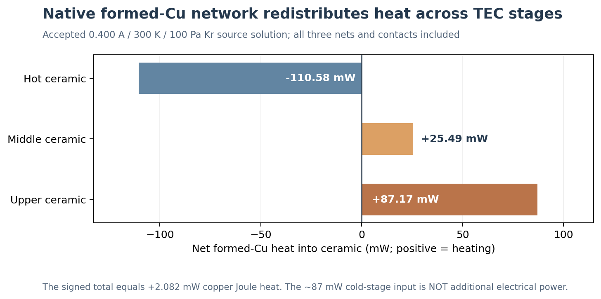
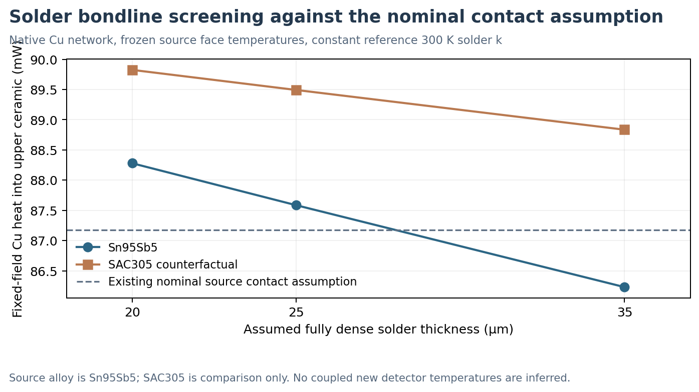

# V3.12 — Copper interstage joints and TO mounting: source-grounded engineering screen

**9 November 2026 | Read-only physical assessment, new fixed-field conductor calculations | No new PDE solves**

## Engineering decision

**Prioritize geometrically faithful copper-foil, plating, and ceramic interface analysis, then mounting fidelity; do not optimize by postulating a poorly joined solder foot.** The source 29/11/4-couple cooler has a substantial conductive interstage bypass. At the accepted 0.400 A, 300 K, 100 Pa krypton, fixed 2.000 mW detector-load operating point, the 3-net formed copper bridge sends **+87.173 mW to the upper ceramic**, receives **110.578 mW from the hot ceramic**, and sends **25.487 mW into the middle ceramic**. These signed heat rates sum to **+2.082 mW**, exactly the copper's modeled Joule generation. They are redistribution through a continuous network, **not three separate additive parasitic electrical loads**. At that same operating point, all four modeled krypton gas branches total **+3.420 mW**, gray radiation **+0.563 mW**, and power leads contribute **−9.925 mW** summed across two separate hot-ceramic faces. These components terminate at different physical nodes; one must not add them as if they all heat the cold ceramic.

## Source CAD and accepted boundary condition

- Cooler: **29/11/4 P/N thermocouples, 88 nonlinear legs**, four source-positioned spatial ceramic FEMs totaling 11,791 tetrahedra.
- Foil: formed source tabs **58, 80, and stepped three-foot return 88**, all modeled as an electrical series path and a separate conservative thermal multiport. Each foil cross-section is **0.300 × 0.030 mm = 0.0090 mm²**, and each landing contact area is **0.060 mm²**.
- Reduced thermal solver: Cu bulk conductivity (k_{Cu}=385\ \mathrm{W/(m K)}); thermal contact areal resistance (r''_c=10^{-6}\ \mathrm{m^2 K/W}); electrical contact area resistivity (10^{-11}\ \Omega\,\mathrm{m^2}). These are **assumed model values**, not qualified manufactured specifications.
- Nominal accepted full system: **Tdie = 218.900024 K**, **T(top ceramic) = 218.806728 K**, TEC input **0.595668 W** and TEC voltage **1.489170 V**. Electrical contribution from the copper foil is **2.0824 mW**, from the two supply leads **0.7372 mW**, and from the separately represented thermoelectric solder/electrical interfaces **4.5672 mW**. These are not necessarily deposited at the same physical location.
- Net contributions to upper ceramic: tab80 **+41.058 mW**, tab88 **+46.116 mW**. Tab58 transfers heat from hot to middle; the three-foot tab88 also exchanges heat with the middle ceramic. The tab88 intermediate contact is **not** collapsible into a two-terminal resistor without changing the physics.

### Signed thermal ledger at nominal conditions

| Source component | Signed heat into named ceramic/node | Interpretation |
| --- | ---: | --- |
| Formed Cu into hot ceramic | −110.578 mW | Heat leaves hot ceramic through bridges |
| Formed Cu into middle ceramic | +25.487 mW | Net bypass plus intermediate 3-foot landing |
| Formed Cu into upper ceramic | +87.173 mW | Cold-stage thermal penalty from metallic interconnects |
| **Signed sum of three copper plate heats** | **+2.082 mW** | Equals modeled copper Joule heating |
| TEC lead to original hot ceramic face 8 | −11.873 mW | Copper supply lead exports heat to package pin |
| TEC lead to original hot ceramic face 36 | +1.948 mW | Separate return lead imports heat |
| Cavity krypton gas into four modeled branches | +3.420 mW | **Effective 3 mm gap**, not fully resolved cavity |
| Gray radiation into four modeled branches | +0.563 mW | Assumed emissivities and warm enclosure |
| Detector specified heat | +2.000 mW | External load at the detector, not TEC electrical power |

All source numbers above were read from previously accepted full-system results. The new V3.12 script reconstructs the nominal Cu multiport from archived **native face temperatures**, checks the archived values to numerical equality, and evaluates six contact-only perturbations at those same frozen temperatures. A complete electrical and stage energy audit had already accepted the nominal and extreme V3.5 full-system runs; V3.12 does **not** independently reconverge them.

## Interpreting an assumed joint thermal resistance physically

For a flat, fully wetted, homogeneous bond of thickness (t), bulk thermal conductivity (k_s), and connected area (A_c):

\[
 r''_{bulk}=\frac{t}{k_s},\qquad R_{th,foot}=\frac{t}{k_s A_c},\qquad
 r''_{effective}=\frac{t}{k_s}+r''_{interface,1}+r''_{interface,2}+r''_{spreading}+\cdots.
\]

The additional terms are **not quantified** by this study and need not be simple local series resistances if heat spreads in plated sheets. The V3.4 network lumps these effects into an effective joint parameter. For the source-identified **Sn95Sb5** alloy, Indium Corporation reports **28 W/(m K) at 300 K** for Indalloy 133. This is a manufacturer bulk material value, **not** a low-temperature, void-free, as-soldered measurement on this source design. Its nominal model (r''_c=10^{-6}\,\mathrm{m^2K/W}) is equivalent to **28 µm** of ideal Sn95Sb5 bondline, well within a *hypothesized* 20–35 µm joining range used for this study. It follows that the nominal magnitude is physically recognizable, but its effective value and actual joint quality are **not validated**.

The earlier deliberately extreme model (10^{-4}\,\mathrm{m^2K/W}) is equivalent to **2,800 µm** of this bulk solder, more than 80 times the 35 µm screen maximum. It must not be interpreted as a common intact solder thickness. The extreme accepted full-system run cooled from **218.900 to 212.624 K**, but this is **not** a validated manufacturable solution. A damaged/nonwetting/high-electrical-resistance interface could behave differently, fail thermal cycling, or violate electrical continuity.

Indium also reports **61 W/(m K)** for SAC305 (Sn96.5Ag3Cu0.5) bulk solder. This is a deliberately **counterfactual alloy comparison**, not a substitute source-material claim.

**Primary bulk-property sources:** [Indium Corporation, Solder Thermal Interface Materials, Indalloy 133 Sn95Sb5 (28 W/mK at 300 K)](https://scp.indium.com/download-files/solder_thermal_interface_materials_98049_r1.pdf); [Indium Corporation, Indalloy 256 SAC305 preforms (61 W/mK)](https://documents.indium.com/qdynamo/download.php?docid=5418). Source package alloy naming is synthetic geometry provenance, not an OEM alloy certificate.

## Fixed-face solder thickness experiment (new, no FEM)

All points retain the source native-face temperature distribution and the exact original Cu-foil geometry and electrical laws. Only the **bulk-equivalent contact areal thermal resistance** changes. This is an interface-mechanism screen, not a new predicted detector temperature or a probabilistic manufacturing distribution.

| Hypothetical solder | (t\) (µm) | (r''_{bulk}\) (10⁻⁶ m²K/W) | One-foot (R_{th}\) (K/W) | Fixed-face upper Cu heat (mW) | Δ vs current nominal (mW) |
| --- | ---: | ---: | ---: | ---: | ---: |
| Sn95Sb5 | 20 | 0.714 | 11.905 | 88.280 | +1.106 |
| Sn95Sb5 | 25 | 0.893 | 14.881 | 87.585 | +0.411 |
| Sn95Sb5 | 35 | 1.250 | 20.833 | 86.230 | −0.944 |
| SAC305, **counterfactual** | 20 | 0.328 | 5.464 | 89.825 | +2.651 |
| SAC305, **counterfactual** | 25 | 0.410 | 6.831 | 89.492 | +2.319 |
| SAC305, **counterfactual** | 35 | 0.574 | 9.563 | 88.835 | +1.662 |

**Result:** the 20–35 µm Sn95Sb5 ideal-bondline screen spans approximately **2.050 mW** of upper-copper heat under frozen stage temperatures; it does not establish a corresponding detector-temperature span. The effect is much smaller than a hypothetical 100-fold rise in contact resistivity. Consequently, next-stage engineering should resolve the actual Cu bridge shape, lateral metallization/ceramic spreading and electrical-versus-thermal coupling, rather than immediately prescribing exotic interfacial thermal isolation.

### Relative magnitude of foil and joint thermal resistances

At nominal foil temperature and geometry, net58 has a modeled foil conductance **0.002087 W/K**, equivalent to **479.3 K/W** for its contacted segment. Its two nominal thermal joints are approximately **16.67 K/W each**. This means reducing solder thickness within the plausible screening range changes only a minority of the total net58 axial thermal resistance, *at fixed face temperatures*. The longer three-foot net88 needs two different foil segment resistances and three separate landing conductances, and should retain that explicit multiport structure.

## TO mounting: independently accepted nonlinear results, not the same fixed-load sweep

The following full-system V3.8 results use a separate **provisional temperature-dependent detector Joule load** chosen to coincide with the original 2.000 mW reference at the nominal operating state. Away from that state it is not identical to the fixed-2 mW V3.5/V3.11 loads. The table must **not** be used as a simultaneous multi-variable sweep with the fixed-face solder cases.

| Additional external mount (R_{th}\) | TEC current (A) | Detector T (K) | TEC input (W) | Comparison |
| --- | ---: | ---: | ---: | --- |
| 0 K/W | 0.4000 | 218.900 | 0.595668 | Base case (existing external (R=4.8334\) K/W retained) |
| +5 K/W | 0.4000 | 220.393 | 0.604935 | **+1.493 K** at fixed current |
| +10 K/W | 0.4000 | 221.856 | 0.613656 | **+2.956 K** at fixed current |
| +5 K/W | 0.4153 | 218.893 | 0.648375 | Near target T, **+8.85%** input |
| +10 K/W | 0.4332 | 218.869 | 0.712481 | Near target T, **+19.61%** input |

The finite-difference slope of detector temperature with respect to **added external** mounting resistance over 0–10 K/W at fixed 0.400 A is approximately **0.296 K per (K/W)**, conditional on this source boundary and detector-load law. It is a finite experimental-model difference, **not** a universal or measured derivative.

## Ranked next decisions (not statistically ranked uncertainties)

1. **Interstage foil and landing spatial fidelity** — high direct leverage and unresolved 3D spreading/current crowding; first study a small source-correct local coupon with identical 2/3-terminal boundary conditions. Pass independent heat and electrical conservation before coupling it globally.
2. **External TO mounting/contact** — separate existing 4.8334 K/W model from installation-dependent increments; characterize feasible thermal contact area, interface stack and clamp/load boundary. Large matched-temperature power penalty has already been demonstrated.
3. **Actual solder/plating evidence** — verify whether the nominal 20–35 µm assumption and Sn95Sb5 source designation reflect intended fabrication; model voids, incomplete wetting and metal-sheet spreading explicitly. The nominal 28 µm bulk equivalence is *not* proof of a good joint.
4. **Geometry-informed gas exposure** — rank after the first direct metal/mount study, but advance in parallel when CAD extraction is cheap. Narrow pellet gaps are absent from the 3 mm effective-gap model.
5. **Pellet-height/cross-section controls** — only after interface losses are bounded, first as an axial mechanism screen and then geometry-consistent variants.

These priorities reflect **engineering model-form risk and existing conditional sensitivity**, not a comparison of equal statistical parameter uncertainty. No allowable electrical current density, solder fatigue tolerance, measured joint quality, or commercial part identity is asserted.

## Reproduction and validation boundary

- Source: `scripts/v3_12_contact_mounting_assessment.py`, a no-PDE calculation requiring only saved JSON and source geometry files; output `data/v3_12_contact_mounting_assessment_20261109/assessment.json` contains all numeric results, original source/audit SHA-256 values, and generated plot hashes.
- Existing accepted evidence: `data/v3_5_power_lead_and_copper_sensitivity_20261108/`, `data/v3_8_rev3_transport_and_sink_20261109/`, and `data/v3_11_rev3_backfill_source_20261109/`.
- Nominal V3.5 Cu thermal multiport is **re-evaluated** from saved original ceramic-face temperatures and agrees with the full accepted Cu network to below (10^{-12}\) W. The original energy audit checks full source Cu, leads and stage balances. Every new contact-screen condition is a **static fixed-field** calculation, conserving its own copper Joule heat to solver tolerance.
- Not solved: actual spatial 3D solder/foil/plating PDE, temperature-dependent solder bulk conduction below 300 K, imperfect contact/wetting and possible electrical/thermal correlation, measured heatsinking or stable maximum current, detector electrical/optical physics, or a manufacturable optimum.

**Next quantitative gate:** A small coupon-scale copper/land/metallization multiport with explicit electrical resistance and heat spreading, tested against the current reduced model at identical physical port temperatures and currents. Only then vary the assembled cooler if the discrepancy exceeds a pre-registered engineering significance threshold.
