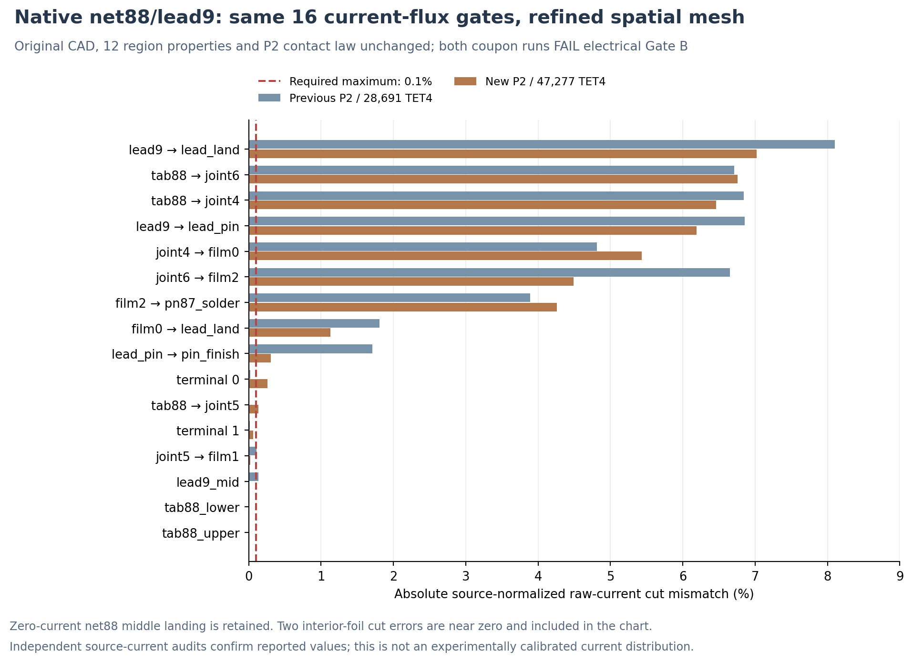

# V3.14 — Bounded original-CAD net88/lead9 P2 contact-perimeter resolution test

**Research date:** 9 November 2026 (US Eastern); the VPS execution may carry 10 November UTC timestamps. **Source baseline:** commit `a936db4`. **Final verdict: ELECTRICAL GATE B FAIL/STOP. Thermal Gate C and coupled Joule Gate D NOT RUN.**

## Engineering decision

Finer spatial resolution of the same 12-region source-CAD metal/solder coupon reduced the **worst** raw contact-gradient current mismatch from **8.0993% to 7.0193%**, but this remains **70.19 times** the unchanged original **0.1%** acceptance limit. **Eleven of 16** original registered current-cut witnesses still fail, and the minimum solved electric potential remains outside the declared bound. Accordingly, the result is **not** a qualified 3D current-crowding, electrothermal-contact, or 3D copper-foil heat leakage model. Existing V3.13 reduced-port heat flow remains conditional; no fresh fully coupled TEC temperature follows.

## Original physical source and one-shot protocol

The same immutable native-CAD **net88 return / lead9** subassembly, not a generic copper bar or full TEC, comprises the formed foil; the three actual **Bi57Sn43** foil feet; source multi-layer metal landings; lead9, lead solder and pin finish; and the distinct P87 SnSb cut. It has **12 material regions, 11 physical finite electrical contact interfaces**, and the registered original source/return mathematical cuts at P87 and the pin9 head. The middle foil landing remains a true **thermal** contact and an electric dead-end, with its zero-current expected fraction preserved. Material law: original nominal 300 K hypotheses, anisotropic metal-film tensors, and common hypothetical electrical area resistivity **1×10⁻¹¹ Ω·m²**. This is not measured/OEM contact qualification.

The preregistered resolution change is only the existing source BREP mesher's maximum element-size parameter from **0.045 mm to 0.035 mm**. Gmsh was run on the identical original source BREP (SHA-256 `3c4afc09544c108a8d17fd28f1288953384469dbcc03ad19bae7fdb01aa590e2`), with the source's **105** physical face definitions and 12-region ownership re-registered. No material substitution, contact-law alteration, mesh-fit geometry displacement, different electrodes or relaxation of the acceptance gate. The mesh is linear-geometric TET4, potential P2 (10-node quadratic shape field) with separately numbered material-side contact traces.

One physical P2 matrix was assembled and solved on the new mesh under the existing **4 CPU / 8 GiB**, 180-second hard timeout. The old Docker image tag was missing; the existing prebuilt `tecooledmct-fem:26.2.1-recovered-20261105` image was reused without rebuild. An incomplete administrative preregistration schema initially stopped **before matrix assembly or solving**, and was corrected with exact preflight hashes and original acceptance limits (the producer source hash and all numerical inputs were unchanged). All failed prestart logs are retained. No adaptive retry, second mesh, second electrical solve, thermal solve or Joule solution was run.

## Numerical comparison and all mandatory limits

| Quantity | Original P2 fine mesh | Prospective single finer P2 mesh | Gate or interpretation |
|---|---:|---:|---|
| Original-CAD source tetrahedra | 28,691 | **47,277** | Same 12 physical regions |
| Geometric nodes | 9,272 | **14,215** | Remeshed from same BREP |
| P2 scalar DOFs | 58,993 | **92,495** | 89,853 free new DOFs |
| Original CAD intermaterial TRI3 | 1,574 | **2,178** | All 11 interfaces registered |
| Original-current-cuts passing | 5 of 16 | **5 of 16** | **16 required** |
| Worst raw current cut error | **8.099302%** | **7.019321%** | ≤ **0.100%** — FAIL |
| Minimum potential | −9.1495×10⁻⁷ V | **−5.5552×10⁻⁷ V** | ≥ −1×10⁻⁸ V — FAIL |
| Unit-voltage input current | 33.842252 A | **33.863582 A** | Artificial unit-voltage numerical test, not a device-rated current |
| Candidate electrical R | 0.029548861 Ω | **0.029530249 Ω** | 0.0630% decrease; not enough to validate contact flux |
| Relative FEM algebraic residual | 1.09×10⁻¹¹ | **9.89×10⁻¹¹** | ≤1×10⁻⁸ — PASS |
| Relative IV minus bulk+contact loss | 6.34×10⁻⁹ | **1.43×10⁻¹⁰** | ≤0.005 — PASS |
| New solve wall time | 8.51 s | **18.73 s** | New solver matrix 2,152,789 nonzeros |
| New process peak RSS | 451 MiB | **796 MiB** | Below capped 8 GiB |
| Mesh volume versus registered CAD | −1.6488% | **−0.9892%** | Geometry is still approximate despite improved volume agreement |

The worst raw mismatch improved by **13.33% relative** from its previous value, not by 13.33 percentage points. **Nine** individual cut errors improved while **seven** worsened; the new mesh is not a uniformly converged spatial-field sequence. In particular the previously registered P2 lead9→lead_land mismatch decreased 8.0993→7.0193%, lead9→lead_pin 6.8529→6.1887%, and joint6→film2 6.6495→4.4918%. Conversely the source tab88→joint6 mismatch rose 6.7129→6.7573%, and joint4→film0 increased 4.8123→5.4336%. These differences must not be sold as a converged 3D foil conductance tensor.

### Raw-cut limits are more important than a good energy identity

The P2 scalar potential is continuous within each region but has an allowed jump across finite-contact interfaces. That field has weak-form interfacial conservation and very good integrated electric power closure, but **the one-sided gradients of its elementwise potential still disagree with the contact-law current** on the native physical faces. Replacing those gradients with weak reaction currents, recovered gradients or an independently equilibrated mixed flux would change the observable, and would **not pass the original raw-field gate**. The 0.1% threshold remains unchanged. The original full P1 failure, previous P2 failure and new h035 STOP results are all separately preserved.

## Independent saved-field verification

`scripts/v3_14_candidate_independent_readback.py` independently reconstructs **both one-sided raw P2 normal-current flux integrals** and the finite-contact-law current for all **2,178 original-CAD mesh contact triangles**. It independently regenerates the tetrahedral face incidence, P2 region-separated corner/edge DOFs and physical face ownership. It uses the saved candidate P2 vector but does **not** assemble or solve another PDE. Its largest difference from the producer's raw/contact interface currents is **4.5113×10⁻¹³ relative to the new unit-voltage drive current**, including the two electric terminal cuts. The three internal plane-intersection cuts are checked by the original candidate producer and were **not independently recomputed** by that auditor. This verification supports the accuracy of the **reported failure**, not the physical validity of the current field.

The explicit original/candidate cut ledger, solver and mesh digests are retained in `data/v3_14_native_net88_perimeter_resolution_20261109/refinement_comparison.json`; independent saved-field receipt, original mesh registration, the preregistered one-shot contract, and failed administrative bootstrap are archived in the same study directory.

## What remains actionable

The mesh-size reduction improves the total coupon resistance slightly but the near-contact raw gradients remain far from release. Earlier source-native radial analysis found that the adjoining lead9 contact sides and their perimeter bands dominate the original worst discrepancies. Future changes should therefore target the **contact-perimeter field formulation**, edge-singularity/finite-junction geometry, and local independent resolution *using a separately registered method*, rather than repeatedly sweeping a generic global mesh size. The original 0.1% criterion may be physically stringent for raw P2 gradients near contact rims, but any reconsideration requires a separately justified error norm and **must never retroactively convert these failed tests into a PASS**.

**No additional FEM solve is authorized by this result.** In the interim, use the existing reduced network only with its source-derived provenance and realistic parameter limitations, and continue geometry-informed cavity and pellet *planning* without claiming that detailed 3D metal/spreading physics has been qualified. The present document preserves the project's two parallel truths: the integrated reduced electrothermal TEC/TO model is usable for **conditional** engineering sensitivity, while the standalone source-native fully spatial electrical coupon does **not** satisfy its original detailed field-accuracy gate.
