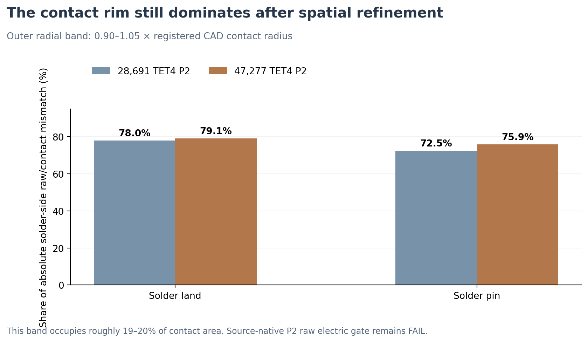

# V3.15 — Source-native lead9 contact-perimeter field diagnosis

**10 November 2026 | Saved-field/no-PDE investigation | Electrical Gate B remains FAIL/STOP**

## Engineering conclusion

At both circular lead9/solder interfaces, the radial outer ~20% of source registered contact area continues to dominate the **solder-side** absolute discrepancy between the one-sided P2 element-gradient current and the exact finite-contact-law current. This behavior **persists after the V3.14 spatial mesh increase from 28,691 to 47,277 native tetrahedra**. It therefore cannot reasonably be treated as a global sparse-solver residual or simply cured by a generic mesh-size reduction. However, these conditional results cannot distinguish a genuine contact-edge field singularity, geometric facet approximation, discontinuous-material interface representation, or other finite-element numerical errors; they cannot establish experimental contact physics.

| Native contact interface | Earlier P2 rim area | Earlier P2 rim share of solder-side absolute mismatch | Finer P2 rim area | Finer P2 rim share of solder-side absolute mismatch |
| --- | ---: | ---: | ---: | ---: |
| lead9 → BiSn lead land | 20.42% | **78.01%** | 19.70% | **79.11%** |
| lead9 → InSn pin joint | 19.23% | **72.47%** | 20.37% | **75.94%** |

The outer ring is defined by **0.90 ≤ triangle-centroid radius / registered CAD radius < 1.05**. These bins are derived from the saved source TRI3 centroid positions. They are *not* exact clipped annular surface integrals, which should be distinguished when assessing discretization errors near the physical circumference.

The new P2 candidate's actual current-cut error decreases **8.0993% → 7.0193%** at the solder land and **6.8529% → 6.1887%** at the pin joint. In the new field, the **solder-side signed bias** from the contact-law current is +2.37699 A (land) and −2.09571 A (pin), under the synthetic unit-voltage coupon excitation. The corresponding lead9-side signed biases are −0.80487 A and +0.49880 A. These A-scale currents are a mathematical 1 V probe of a low-impedance test coupon, **not the three-stage cooler operating current or rated current**.

## Frozen-field rim-removal counterfactual

A deliberately *optimistic and unphysical* diagnostic sets the existing **outer rim's signed raw-minus-contact-law current bias to zero** at both material sides, while preserving the entire interior signed bias and original denominator. The remaining worst of the two signed-side current discrepancies would be:

| Contact | Earlier P2 (counterfactual no-rim error) | Finer P2 (counterfactual no-rim error) | Original allowed maximum |
| --- | ---: | ---: | ---: |
| Lead9 → lead land | 3.136% | **2.123%** | 0.100% |
| Lead9 → pin joint | 1.862% | **1.304%** | 0.100% |

**Interpretation:** The existing saved fields would *still fail* their original raw-gradient current gate even if all the defined rim bias disappeared without affecting the interior field. This is not a theorem or convergence bound for a newly solved electromagnetic/electrothermal PDE, since a new field would redistribute current everywhere. It is an engineering stop on a simplistic **frozen-field rim-only fix**.

## Mesh/field accounting and source protections

- Both original and refined P2 inputs use the **same native physical 12-region coupon**, original P87/pin9 mathematical electrode cuts, unchanged nominal conductivity tensors (including anisotropic plated films), contact areal electrical resistivity (10^{-11}\,\Omega\,\mathrm{m^2}), and the eleven real finite-contact interface owners.
- New input electric field is the **saved V3.14 92,495-DOF P2 potential**, not an additional PDE solve. Source-native 47,277 TET4, 180 TRI3 lead-land and 176 TRI3 lead-pin physical-contact facets are used. Adjacent minimum tetrahedral quality median increases from ~0.463→0.573 (land) and ~0.499→0.581 (pin), but that is descriptive mesh geometry and not proof of face-current convergence.
- Both face-side currents are recomputed from (-\boldsymbol\sigma\nabla V\) at the centroid (exact integral of linear P2 gradient on each flat TRI3). Contact-law current is independently obtained from the P2 face potential jump (\int_A (V_1-V_2)/r''_e\,dA\). For each native triangle the original finite-contact current density is a weak-interface quantity, not a substitute for the two one-sided raw-gradient measurements.
- The separately archived independent V3.14 saved-field auditor already verifies complete 2,178-interface-triangle current integrals to a relative discrepancy of ~(4.51\times10^{-13}). The present detailed diagnostic re-reproduces the original contact-law, gradient and raw cut totals at the two specific limiting faces.
- The original P1, prior P2 and V3.14 h035 P2 failed current gates remain immutable; the 0.100% acceptance and the voltage-boundedness gate remain unchanged. **No new FEM solve, thermal Gate C, Joule Gate D, new commercial design claim, or global TEC temperature prediction.**

## Next scientific method decision

Another uniform mesh shrink is poorly justified. A subsequent **separately preregistered** numerical method should instead establish the original source-contact geometry and physics in a small independently checkable local interface setting, with explicit resolution of both contact-edge and interior field, and independent raw one-sided current integrations for all preexisting source cuts. Suitable methods to evaluate on paper before implementation include interface-fitted adaptive meshing with a reliable estimator, hp refinement around conductivity/contact transitions, and a conservative mixed/flux field as an *additional diagnostic* (never a substitute for the failed original raw-P2 metric). An edge regularization/finite-radius physical geometry change would require actual fabrication justification rather than simply changing the CAD until the gate passes.

No new numerical solve is justified solely by the V3.15 readback. The accepted integrated hybrid TEC/TO thermal results remain useful for explicitly **conditional** sensitivity experiments while local 3D copper-interface physical qualification remains unresolved.

## Reproduction

- Saved-field detailed auditor: `scripts/v3_15_lead9_contact_perimeter_readback.py` (no PDE).
- Comparison and original two-epoch radial plot: `scripts/v3_15_lead9_perimeter_comparison.py` (no PDE).
- Saved receipts: `data/v3_14_native_net88_perimeter_resolution_20261109/v315_perimeter_readback.json` and `data/v3_15_lead9_perimeter_20261110/comparison.json`, with exact source and figure SHA-256 digests.
- Source numerical inputs remain immutable, and all previous complete reader-first and cumulative editions are preserved.
