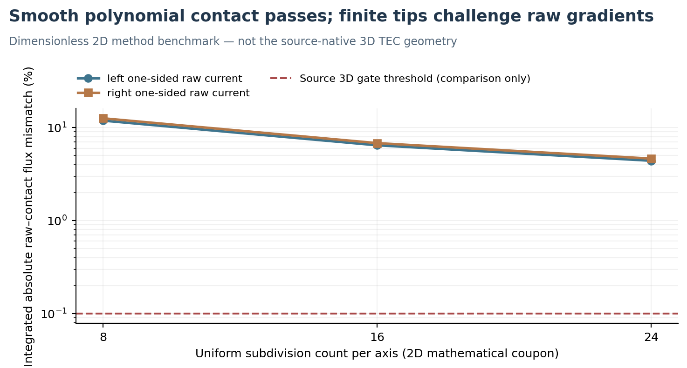

# V3.16 — Independent two-material finite-contact P2 benchmark

**10 November 2026 | Reproducible small mathematical FEM benchmark | Source 3D net88 electrical Gate B remains FAIL/STOP**

## Purpose and conclusion

The V3.14 source-native P2 coupon reduced worst raw current-cut disagreement from 8.099% to 7.019% after geometric refinement, yet failed 11 of 16 cuts against its immutable 0.1% requirement. V3.15 showed that the outer ~20% of lead9 solder-contact area accounts for about 72–79% of the solder-side gross discrepancy. The immediate technical question is whether the **P2 weak finite-interface law itself** is intrinsically unable to satisfy raw one-sided current and contact-law agreement, or whether abrupt contact termination and limited local regularity are responsible.

**V3.16 result:** In an entirely separate **two-dimensional, dimensionless, manufactured-solution coupon**, a standard symmetric P2 potential formulation with separate interface traces and exact quadratic-contact mass integration reproduces an exact smooth-interface solution with one-sided raw-gradient/contact current errors of ~10⁻¹⁵. When the same manufactured forcing and conductivity data are subjected to a **finite contact patch ending at two abrupt tips** (so the smooth polynomial no longer solves the changed interface conditions), the analogous raw one-sided/contact flux discrepancies are **~12.6%, 6.81%, and 4.64%** over three predefined mesh sizes. The patch results are *not* comparisons to a known exact sharp-tip solution, and therefore are not empirical physical validation, mathematical error estimates, or a proof that contact singularities cause the source 3D discrepancy.

The benchmark demonstrates (i) the core weak-contact assembly can reproduce a smooth exactly representable current field, and (ii) convergence of the raw one-sided traces at abruptly terminated contact regions warrants a distinct numerical verification strategy. **It does not qualify the actual source 12-region net88/lead9 model.** Original electrical Gate B is still FAIL/STOP; thermal C and coupled Joule D remain NOT RUN.

## Manufactured two-domain problem

On the two separate regions \(\Omega_-=(-1,0)\times(0,1)\) and \(\Omega_+=(0,1)\times(0,1)\), solve \(\nabla\cdot(\sigma\nabla V)=0\) with nondimensional conductivities \(\sigma_-=1\), \(\sigma_+=3\), interface resistivity \(r_c=0.2\), and prescribed normal current \(Q(y)=1+0.35(y-0.5)\). The exact solutions for the **entire-height smooth contact** are

\[
V_-(x,y)=-\frac{Q(y)x}{\sigma_-}+0.2y+\frac{r_cQ(y)}2,\quad
V_+(x,y)=-\frac{Q(y)x}{\sigma_+}+0.2y-\frac{r_cQ(y)}2.
\]

They are bilinear, hence exactly representable by the piecewise quadratic basis, with all three interface observables

\[ -\sigma_-\partial_xV_- = -\sigma_+\partial_xV_+ = (V_--V_+)/r_c=Q(y).\]

At \(x=-1\) and \(x=+1\), apply the respective exact Dirichlet traces. Along horizontal boundaries \(y=0,1\), impose exact outward \(\boldsymbol{n}\cdot\sigma\nabla V\) as the natural Neumann source. The interface term uses the **symmetric, positive** quadratic line mass \(\int_\Gamma r_c^{-1} (V_--V_+) (w_--w_+)\,d\Gamma\) and distinct trace DOFs. Independent raw gradients are computed from the separate neighboring triangular P2 fields at interface Gaussian points, not from weak reactions. Bulk and contact Joule power are separately integrated, and a global work identity is tested to 10⁻¹⁰ relative.

### Smooth exact-solution verification

| Mesh subdivisions per axis | 2D P2 scalar DOFs | Left raw/contact absolute relative error | Right raw/contact absolute relative error |
|---|---:|---:|---:|
| 8 | 578 | 1.18×10⁻¹⁵ | 6.27×10⁻¹⁶ |
| 16 | 2,178 | 3.26×10⁻¹⁵ | 1.64×10⁻¹⁵ |

The maximum nodal difference from the exact manufactured potential is also below 10⁻⁸; this result holds because the source polynomial is exactly in the finite-element approximation space, not because these mesh sizes universally guarantee contact-gradient accuracy.

## Controlled finite-contact-tip stress case

Maintain the same bulk conductivities and external boundary loads, but change the finite-contact support to \(\Gamma_c=\{x=0,\ 0.25\leq y\leq0.75\}\). The remaining central vertical boundary is **insulated on both material sides**. These conditions produce two genuine contact terminations and necessarily change the solution away from the exact smooth polynomial above. This is an informative **stress case with no independently known exact sharp-tip solution**.

| Subdivisions per axis | 2D P2 DOFs | Left raw/contact integrated absolute error | Right raw/contact integrated absolute error |
|---|---:|---:|---:|
| 8 | 578 | 11.87% | 12.58% |
| 16 | 2,178 | 6.44% | 6.81% |
| 24 | 4,802 | 4.39% | 4.64% |

These percentages use an **integrated absolute face-current density discrepancy** divided by the corresponding integral of the contact-law current magnitude. They are not the same norm as the source 3D V3.14 **signed registered cut error**, so the dashed 0.1% requirement in the figure is marked comparison-only, not a passed or failed V3.16 production qualification. As shown, sharp tips degrade raw trace agreement despite extremely small algebraic and Joule-power residuals. Additional methods such as geometry-fitted local grading, a flux-conforming formulation, or an independently evaluated mixed-field estimator may help, but cannot be declared superior without their own manufactured references and complete-source raw-flux testing.

## Engineering consequences and bounded next gate

1. **Do not replace the production raw-current gate with interface reaction currents.** The smooth benchmark confirms that raw equality is recoverable under a suitably regular exactly representable field. A weak-contact reaction is a distinct observable.
2. **Distinguish the geometry of a real finite contact edge from a numerical singularity.** The actual solder-edge radius, wetting contour, nonuniform metallization, and microscopic material conductivity are not measured. No artificial radius should be chosen merely to pass a numerical acceptance gate.
3. **Test a new formulation locally before promoting it.** A separately preregistered source-native trial would need independent raw one-sided current flux on *all 16 original cuts*, voltage boundedness, power closure, and a credible physical source mesh. It should not reinterpret the existing failed P1/P2 trials as successful.
4. **Keep TEC design research moving without false qualification.** The current 29/11/4-stage hybrid nonlinear TEC/TO model retains useful conditional operating/pellet/gas/mount sensitivity capability, while the detailed source-native 3D copper/metal contact PDE remains unqualified. New detector temperature values should not be inferred from this small benchmark.

## Reproducibility

- Source: `scripts/v3_16_contact_method_benchmark.py`, using fixed dimensionless coefficients and five predefined cases. Deterministic runtime `tecooledmct-fem:26.2.1-recovered-20261105`; Python, NumPy, SciPy and Matplotlib; no internet access or unbounded meshing.
- Result: `data/v3_16_contact_method_benchmark_20261110/benchmark_results.json`. Includes all matrix residuals, energy identities, raw interface currents, figure SHA-256, and the explicit distinction between manufactured exact and unqualified patch stress solutions.
- Prior source: `docs/V3_14_NATIVE_NET88_P2_REFINEMENT_20261109.md`, `docs/V3_15_LEAD9_CONTACT_PERIMETER_FIELD_DIAGNOSIS_20261110.md` and their immutable numerical archives.
- Original TEC operating points, material assumptions and source BREP remain **unchanged**. No 3D source PDE or TEC thermal solve was run here.
