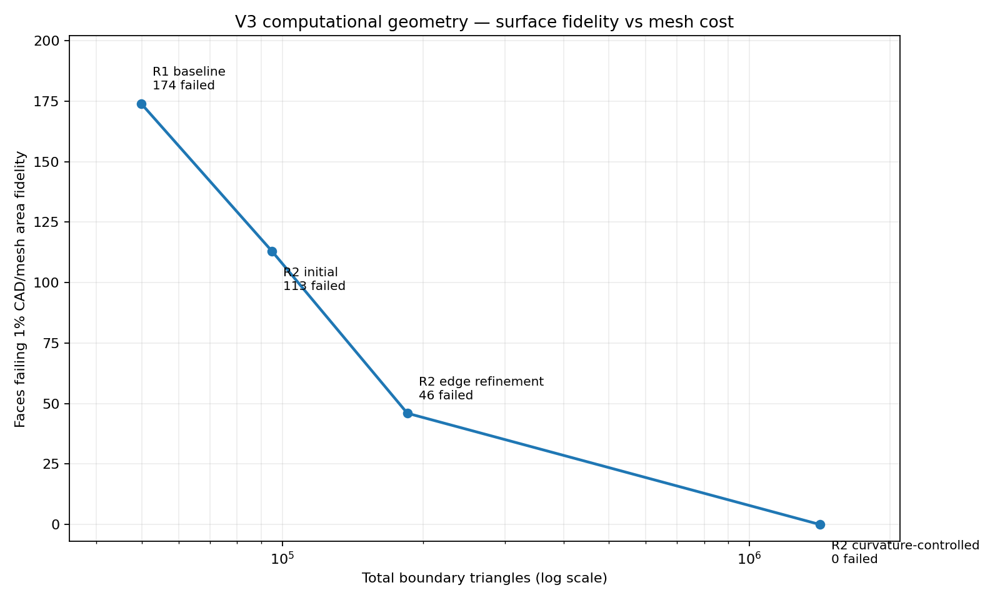

# V3 R2 analysis-only geometry — source-preserving thin-feature reductions

## Disposition

**R2 DERIVED CAD PASS; independently verified local lead/pin 3D mesh PASS; complete 2D CAD-area mesh PASS; complete 3D volume mesh NOT RUN / NOT QUALIFIED.** All material and interface constitutive coefficients are UNSET. The R2 derived model must not be presented as a validated coupled multiphysics device or as changed manufacturing CAD.

The baseline is the approved computational source at **5c16da8**, itself derived from the immutable 824-solid physical **V3 R1 STEP**. Original physical design, 38-page canonical Rev3, all historical numerical STOP/FAIL gates, earlier rejected trials and issue #2 remain unchanged. Only independent analysis-derived geometry was created, with no PDE solves, manufacturer calibration, or numerical-forensics investigation.

## What changed, and why

| Original physical component | Separate R2 analytical representation | Equivalence / outstanding law |
| --- | --- | --- |
| Two 15 µm polyimide annular jackets around Cu TEC leads | Remove volumetric annulus; keep original Cu centerline, radius, path, and finite solder joints. Map insulation contact to two-sided boundary/shell model | Source jacket volumes and inner-face areas retained. Radial thermal conductance, electrical insulation and external-radius radiative/gas corrections **UNSET**; four stripped-end partial surface masks require proper quadrature |
| Four pin Ni (2 µm) / Au (1.5 µm) tip finishes | Preserve combined physical cylindrical pin envelope, replacing original pin + coatings with one piecewise axial-material computational cylinder | Each reconstructed pin adds exactly π(0.38 mm)²×0.0035 mm; pin shaft remains original Kovar, top 3.5 µm carry explicit Ni/Au constitutive/finite contact laws **UNSET**, never homogeneous Kovar |
| 88 original P/N legs, four alumina ceramics, 176 SnSb joints, patterned composite conductors, formed tabs, hot mounting and detector bonds | Retained explicit solids, contacts and routes | Every source-domain volume, intended finite contact, material and net topology checked. Original 98 condensed metal laminates remain composite and cannot receive silent homogeneous Cu/Au/Ni transport laws |
| Enclosed cap/header/window gas | Native enclosed cavity regenerated by OCC subtraction from the new occupied solids | Synthetic sealed closure, not evidence of hermetic joining; gas law and pressure **UNSET** |

The first R2 experiment was rejected when affine stretching of the imported pin distorted its cross-section; it was replaced with an exact cylinder reconstructed from the frozen pin source dimensions. The next attempt left unowned OCC construction faces after fragmentation; 60 **orphan (zero-volume-owner) faces** were removed without deleting a single material volume. These rejected outputs remain on the VPS; only the separately audited conformal R2 BREP is released.

## Source, interface and geometric integrity

| Independent check | Measured result / gate |
| --- | ---: |
| Actual R2 conformal 3D domains | **428** |
| Actual unique BREP faces | **2,422** |
| Gas–solid / solid–solid / exterior faces | **1,832 / 547 / 43** |
| Original source solids mapped to volume or explicitly reduced shell | **824 / 824** |
| Source-declared positive-area finite contacts | **378 / 378** |
| Source contact-area errors exceeding 10⁻⁶ relative | **0** |
| Cross-net shorts / direct TEC–detector shorts | **0 / 0** |
| Thermoelectric stage leg counts (hot to cold) | **58 / 22 / 8** |
| Native connected gas regions | **1** |
| R2 gas volume | **1,231.707223196 mm³** |
| Original R1 gas volume | 1,231.630061168 mm³ |
| Gas-volume difference | +0.077162028 mm³, matching exactly the two removed polymer jacket volumes at CAD precision |

The new cavity is *not* being interpreted as a real altered sealed package; removing jackets changes the computational void envelope. **Critically, the replacement cavity has gained 0.077162028 mm³ of region actually occupied by polymer in the physical source. A future full gas/solid PDE may not solve gas conduction in this displaced region *and* impose a separate equivalent polyimide shell resistance as if they were independent parallel paths.** The virtual offset, gas-side control surface, and excluded/displaced volume must be handled conservatively and independently verified; no R2 gas or dielectric energy budget is qualified. The source polymer displacement and its gas-side heat-transfer/radiation area remain explicit unqualified shell-law inputs. The source-to-analysis-to-surface registry is machine-readable and includes each face's two distinct oriented owners where applicable, CAD area, material/stage role, external terminal and physical-law status. Unique bottom pin terminals are 1/7/8/9; 5/6 remain non-electrically connected candidates. Four shell end faces require partial-area boundary quadrature, not an average insulating/metal condition imposed over an entire shared face.

## Actual meshing evidence

The previous R1 global surface candidate generated 49,863 triangles and failed the 1% face-area gate on **174** distinct faces. The R2 CAD itself reduces 10 small 3D coating domains, reduces face partitioning and preserves original contacts. Gmsh 4.13.1 produced three independent **R2 surface candidates** (all real meshes, no PDE):

| Computational surface candidate | Triangles | Faces failing 1% CAD/triangle area | Gate |
| --- | ---: | ---: | --- |
| R2 initial mesh | 94,986 | 113 / 2,422 | FAIL |
| R2 edge-only refinement | 185,182 | 46 / 2,422 | FAIL |
| **R2 curvature-controlled** | **1,416,664** | **0 / 2,422** | **PASS for 2D CAD-area fidelity** |

The successful 2D candidate has **701,952 nodes** and **maximum absolute face-area discrepancy 0.509281%**. It is preserved as a compressed native MSH (the decompressed mesh hash is separately recorded). The mesh is **not an accepted global 3D volume mesh**. Its high surface density would impose substantial 3D memory and refinement costs on the constrained 4-CPU/8-GiB FEM worker; no global tetrahedral convergence or solver capability is claimed. A smaller surface mesh that violates the exact face area gate must not be used to produce a nominal full-device prediction.

For the repaired lead/pin path, a real independently generated **4-domain local 3D mesh** has **38,496 tetrahedra and 13,963 nodes**, with CAD/mesh volume errors in the **0.321–0.537%** range. This is a geometric meshing feasibility control, not current density, a TE solution, an electrical contact transport test or local convergence qualification. The four 3D domains are the original lead1, two finite lead joints, and the source-backed effective pin1. All physical and thermal coefficients remain unassigned.

## Release guards and limits

**Geometric gate PASS:** full source-to-analysis and interface ownership, source contact area, intended insulation separation, original electrical graph and connectivity, physical source hashes, reduced-layer provenance, and a 2D surface mesh meeting the strict 1% CAD area gate.

**Unqualified:** (i) full 428-domain conformal tetrahedral generation and convergence; (ii) accurate implementation of the two nonvolumetric dielectric jackets and four partial end patches; (iii) effective anisotropic conductivities and finite film/contact laws; (iv) temperature-dependent TE material parameters, valid pressure/molecular gas regime, radiative view factors, detector response and package seal; (v) the previously stopped electrical raw-current methodology and all coupled PDE performance.

The preserved work product is the separate analysis-only R2 BREP, native cavity, source-to-volume and complete face-law registry, two-sided dielectric shell projection metadata, 2D MSH plus mesh area audit, and an actually meshed local 3D lead assembly. No new physical drawing or validated temperature/current result has been produced.

The next bounded step is **adaptive face-specific 2D curvature fidelity with a practical global tetrahedron budget, plus explicit partial shell-subface operators**. A full 3D mesh may only be attempted after reducing global surface-element cost while preserving every face-area/contact/insulation gate. Reopening original electrical-discretization forensics is not authorized by this geometry release.
