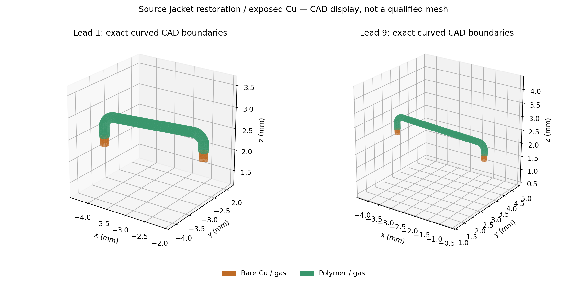
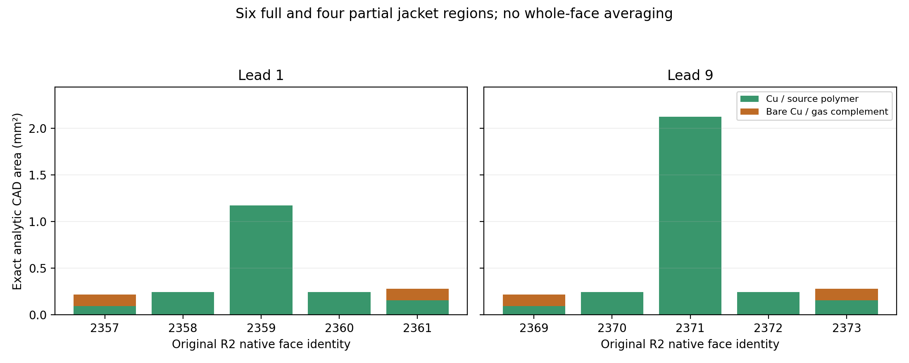

# R3 source-conservative global mesh experiment

Baseline4955177acb6eea8bbf8a9e03d2065a8ab8dbc003; existing sim:0.0 only.
This separate R3 computational geometry/mesh does not replace physical R1,
accepted R2, any historical field or the canonical38-page Rev3. No PDE, material
fit, electrical-discretization forensics or performance prediction is authorized.
All laws remain UNSET; issue#2 remains OPEN.

## Preregistered design, gates and bounds

The exact two original15µm polyimide jacket solids are restored from the frozen
R1 computational BREP, without fitting or rescaling. This deliberately migrates
R2's428 domains to **430**: it resolves the gas/shell ambiguity with explicit
dielectric volume, rather than placing a shell in parallel with fictitious gas.
The native gas must shrink by exactly the original jacket sum0.077162028mm³
(absolute CAD tolerance1e-7mm³). No independent shell heat path may also be added.
Four effective pin caps retain the original explicit axial Kovar/Ni/Au regions,
with no homogeneous Kovar fallback. No new material coefficients are assigned.

CAD phase: one source-jacket restoration/native gas CSG, plus boundary-only
meridian imprints on periodic wire surfaces. Imprints partition surface
parametrizations for directional structured meshing; they must not split,
reshape, merge or change a physical source volume. Complete Boolean lineage maps
all2422 R2 face identities and original jacket faces to R3 descendants. Source
areas and378 finite-contact CAD witnesses must agree within1e-6 relative.
All824 physical source mappings,88 legs,89 internal net identities, insulation,
terminal uniqueness and electrical graph must survive. CAD/reimport has a600s
wall limit per subprocess,4CPU/8GiB; any failed physical/source invariant stops.

The ten original jacket inner-contact regions remain **six FULL and four PARTIAL
relative to R2 faces**. Every region must have actual R3 CAD subfaces with exact
covered and bare complements; no whole-face area weighting. A new independent
fresh-import audit must verify shell ownership, source area, gas exclusion,
378 contacts, zero cross-net shorts, every TEC leg essential to the series path,
and detector isolation before meshing. The physical STEP and R2 stay immutable.

Surface phase: curvature and measured face-area feedback, with shared-edge
constraints. Read the accepted R2 dense mesh as a quantitative benchmark and
derive complete per-face triangle-area/size data; all reference faces must still
pass1%. Curvature-sampled arc lengths define shared edge subdivision counts.
Opposite edges of eligible curved quadrilateral faces share counts; periodic
wire half-skins use transfinite directional grids, avoiding global isotropic
over-refinement along long straight wires. Other faces use local isotropic
sizes from curvature and measured area error. Up to **three** recorded 2D
candidates, each<=600s, refine only failed faces/incident edges toward0.4% error.
Strict acceptance: every R3 face AND every aggregated original R2 face <1%
CAD area error, positive triangles, complete physical groups and closed volume
skins. Target3–5x reduction from1,416,664 triangles is an efficiency target,
not a waived fidelity gate. Planning cap800,000 accepted surface triangles;
an over-budget or repeatedly failed candidate blocks global3D.

Only if source/shell/gas and surface gates pass: **one** full global3D tetrahedral
attempt, Delaunay algorithm1, <=900s/4CPU/8GiB and at most3,000,000 accepted tets
(target<=2million). If the mesher itself fails, at most one targeted HXT algorithm10
alternative on the same qualified boundary mesh, <=600s and the same caps; do
not relaunch merely to tune density. Any source/physical ambiguity is STOP,
not a mesher-retry condition. No PDE follows a successful mesh.

Independently verify all430 domain volumes, including tiny joints, within1%
of exact CAD; positive Jacobians, finite positive shape quality, full quality
distribution, exact shared tetra-face incidence and material/port ownership,
unique terminals and one connected gas. Preserve all attempted meshes/logs.
MSH/BREP coordinates are millimetres; standalone audit arrays/visual labels
explicitly convert to metres where SI is claimed. Unit negative controls reject
1e3/1e-3 length factors and their1e9/1e-9 volume effects. Runtime, CPU time and
peak process RSS are measured separately for each phase. No solver readiness,
manufacturability, hermeticity or OEM claim follows from geometric gates.

All preexisting untracked trial files were hashed before edits; never remove or
overwrite them. Phase source and protected-input hashes are sealed before each
new geometry/mesh stage. Verification uses focused/no-PDE regression, archive,
master, legacy demonstrations and exact-commit CI, with accepted R2 hashes checked.
The master PDF is not modified for an unqualified meshing experiment.

## Results

**Source geometry migration PASS; global mesh qualification PENDING.** A separate
fresh-import audit of the saved unimprinted geometry verifies430 domains and
2440 owned faces:1840 gas-solid,557 solid-solid,43 exterior. All824 physical
sources,378 finite-contact witnesses and2422 R2 face ancestors are mapped; the
88 legs are individually essential to the pin1-to-pin9 conductive graph, with
detector pins7/8 isolated from it. No cross-net shorts were found. These are
geometric/topological checks, not solved current or physical process acceptance.

| Quantity | R2 | R3 saved geometry |
| --- | ---: | ---: |
| Domains / native faces |428 /2422 |430 /2440 |
| Native gas volume (mm³) |1231.707223196 |1231.6300611681804 |
| Explicit source polymer volume (mm³) |0 (shell obligation) |0.07716202786800673 |
| Real jacket inner regions |6 full /4 unresolved partial |6 full /4 actual CAD partial regions |
| Original source / finite-contact witnesses |824 /378 |824 /378 |
| Composite / heterogeneous axial-cap domains |98 /4 |98 /4, all laws UNSET |

Each partial inner region has an actual bare-Cu complement0.125663706144mm²;
the covered areas are0.094719018506 and0.154880517822mm² per lead, respectively.
Every covered region is owned by copper+polymer, every bare complement by
copper+gas. Outer polymer and annular end faces are explicitly owned too. This
removes the previous parallel gas/polymer geometry ambiguity without introducing
an effective shell transfer law. Resolving15µm radial layers still burdens the
eventual volume mesh; the partial-boundary problem is not hidden by averaging.

The four effective pin domains retain the exact axial ranges −12.7–2.0mm Kovar,
2.0–2.002mm Ni and2.002–2.0035mm Au. They require a spatially heterogeneous
constitutive treatment, not a bulk-Kovar fallback. All430 domain coefficients
and2440 interface laws remain UNSET; geometry PASS does not mean solver-ready.

The accepted R2 native mesh independently reproduces1,416,664 triangles,
701,952 nodes and maximum0.509280537% CAD-area error on all2422 faces
(4.454s/353.977MiB). The bounded R3 surface stop follows below; no full3D mesh
or PDE is qualified.

### Bounded execution outcome: GLOBAL MESH STOP

The source-restored geometry passes the separate source/contact/ownership audit.
The boundary-only meridian optimization does **not** pass its ancestry gate:
the producer cannot uniquely bind every descendant after imprinting. The saved
pre-imprint BREP, with zero new Booleans/imprints in its metadata extraction, is
the only accepted R3 geometric input. No ambiguous imprinted shape is released.

The adaptive surface implementation registers4521 shared-edge constraints and20
actual four-corner curved faces. It samples principal curvature, uses the R2
measured area errors, and carries monotone face/edge feedback between completed
candidates. On the accepted unimprinted geometry its **first candidate did not
finish within600s**. The worker was terminated at600.073s (0.2s resource-poll
uncertainty), after864.31 observed CPU-seconds and504.809MiB observed peak VmHWM;
Docker enforced4 CPUs/8GiB with offline runtime. No complete surface MSH was
saved. There is consequently **no measured R3 triangle count, node count,
per-face area error, reduction factor, feature-size coverage or closed-skin
qualification**. The3–5x target was not demonstrated. Runtime, rather than the
memory cap, stopped this recorded candidate; the specific code/kernel cost
has not been profiled and is not attributed to a physical geometry defect.

| Gate / branch | Outcome | Evidence |
| --- | --- | --- |
| Original STEP/R2/Rev3 identities | PASS (publication guard below) | Protected-input SHA registry |
| Source volumes / contacts / electrical graph | PASS, geometry only | Fresh-import430-domain/2440-face registry |
| Six full/four partial jacket regions and displaced gas | PASS, exact CAD areas | Explicit polymer domains; no shell/gas parallel path |
| Meridian optimization | STOP | Unresolved post-imprint exact face descendant |
| Adaptive surface candidate0 | STOP,600s | Saved size plan; external budget receipt; exit143 |
| Surface candidates1/2 | NOT RUN | No completed candidate/area feedback; bounded stop |
| Global3D and targeted alternative | NOT RUN | Required surface gate absent |
| Domain volumes / tet Jacobians / quality / mesh gas connectivity | NOT RUN | No R3 tetrahedra |
| PDE / electrical / thermal / detector prediction | NOT RUN | Outside this authorization |
| Constitutive/interface laws, process capability, hermeticity, OEM | UNQUALIFIED | Coefficients UNSET; prior physical limits intact |

The old R2 surface/local-volume acceptance remains exactly as archived. Restoring
15µm volumetric jackets removes the physical double count but does not establish
that those annuli can be tetrahedralized within this worker budget. The old
overlapping-facet failures are neither rerun nor cleared here. No full3D attempt
was made merely to get an output after the surface stop.





These figures evaluate the actual saved native Cylinder/Torus parametrizations;
they contain no simulated field or invented analysis mesh. Annular end planes
and buried inner faces are omitted from the3D display only; their exact ownership
is present in the audit. An initial area plot clipped the tallest bar; that draft
and producer are retained, and the corrected common-axis version was inspected.

### Provenance and reproduction

Authoritative outputs under `data/v3_analysis_r3_20261103`:

- `geometry_restored/R3_conformal_mm.brep`: accepted **unimprinted** native BREP.
- `geometry_restored/geometry_receipt.json`: source fingerprints and2422 face
  migrations; its status explicitly retains the imprint STOP.
- `audit_v2/registry.json`: independent fresh-import domains, faces, normals,
  824 source mappings,378 contacts,10 jacket regions, graph and law obligations.
- `reference_replay/reference.json`: independently calculated2422 R2 mesh areas.
  Its temporary decompressed MSH is a byte-identical cache of the already archived
  R2 gzip, not a new scientific artifact or another committed mesh copy.
- `surface/surface_0/size_plan.json`, `surface_budget_receipt.json` and
  `surface_execution.json`: actual plan, measured resource stop and NOT RUN branches.
- `source_seal` and preregistration JSON: executed producer versions/input hashes.
  `geometry`, `geometry_corrected`, `geometry_completed` and `audit` retain the
  original failed receipts; the reversed-comparison audit remains distinguishable
  from the corrected version. No failed producer/criterion was retroactively fixed.

The following commands replay **read-only saved evidence**, using new output
paths; they do not regenerate the expensive surface attempt or launch3D/PDE:

```bash
./fem/run.sh python -B scripts/v3_analysis_r3_audit_v2.py \
  --geometry data/v3_analysis_r3_20261103/geometry_restored \
  --out outputs/r3-evidence-replay/cad-audit
./fem/run.sh pytest -q tests/test_v3_analysis_r3_integrity.py \
  tests/test_v3_analysis_r2_release.py
python3 -B -m reports.master.validate --current
./fem/run.sh python -B fem/archive_bath_spatial_device.py --verify
```

The fixed runtime image identity is
`sha256:a0b22cf70bbecaea2cbc8e1cf40aaef1bd620c187b73e251aee37a4fb9d28688`
(Gmsh4.13.1); Dockerfile/wrapper and original input hashes remain protected.
The surface, mesh-audit and volume producers are **registered experimental
implementations**, not a qualified pipeline: the volume path was never executed.
An initial host verification-driver import failed because the host has no NumPy;
the retained corrected driver loads only the pure integrity module and runs all
scientific checks in the pinned image. No host package was installed.

### Stop and one proposed next engineering action

A future separately authorized task should instrument a **local periodic-wire
surface mesher on the unchanged saved geometry**, establish complete descendant
identity and benchmark native Gmsh sizing against the Python callback before
another global attempt. This would distinguish provenance/size-field overhead
from unavoidable surface density with a small measured cost. It is a proposal,
not permission to rerun, relax1% faces, remove jackets or enter a PDE campaign.
The canonical38-page Rev3 stays byte-identical: this is a useful geometric
correction plus an unqualified meshability stop, not new device physics.

### Verification and publication

Focused R3/R2 checks: **44 passed**. Full pinned no-new-PDE regression:
**687 passed,11 skipped,14 third-party warnings** in64.49s; `TE_FEM_SMOKE` was
explicitly unset, so no Elmer/Gmsh runtime smoke or PDE was launched. Master
validator, full archive guard, both legacy demonstrations and original V3 source
replay pass. Exact baseline guard verifies5548 immutable tracked blobs
(3,081,148,858bytes), all23 specifically protected inputs and84 preexisting
untracked trial files. The earlier historical guard independently verifies5128
baseline blobs and824-body source replay. Commands, actual timestamps and logs
are retained in `verification_01`; software PASS does not clear the mesh STOP.

Both final CAD figures were visually reviewed; the common-axis correction avoids
clipping the2.125123mm² long lead9 region. The actual3D CAD rendering is unchanged
between the two figure versions. The canonical Rev3 SHA remains
`882209b09796acdc5e7d3aafc376f1722fce2843230233c7a76542ebcb273248`;
physical R1 STEP SHA remains
`5e46c10fb75713a9dffbc97c44a2b94ca23bee14a93df7f4c0c7c915eb761a73`.
Final source/artifact hashes are sealed in `release_manifest.json`. Source/evidence
commit[062d643](https://github.com/Kajin-0/TE_Cooled_MCT/commit/062d6439365398a5d880796d23f76bfefe7e4a14)
is published with[exact-commit CI PASS](https://github.com/Kajin-0/TE_Cooled_MCT/actions/runs/41602077530).
Receipt-only successors require their own exact CI before handoff; this does not
qualify a new surface/volume mesh or change any numerical/physical STOP.

### Prospective CAD bookkeeping correction, 2026-11-03T07:30:17Z

The first CAD attempt STOPPED in25.445s/764.547MiB at source-face lineage2222.
Its source/log/receipt remain unchanged. Independent fresh import confirms this
is the untouched exterior header face, area12.039566471031677mm². The next
**one bounded source-identical corrective attempt** addresses OCC provenance
maps returning standalone coincident faces rather than actual owned boundaries.
Only unique matching area/centroid/bbox fingerprints can rebind them, with full
diagnostics and the unchanged1e-6 area gates; no volume/contact/shape adjustment.
This is a prospective implementation correction, not retroactive acceptance of
the failed attempt. If source identities remain ambiguous, STOP; no further CAD
retry. The separate v2 producer is sealed before execution, same600s/4CPU/8GiB.

The diagnostic correction confirmed a more specific OCCT behavior: unchanged
header faces receive **empty** ancestry vectors, although the saved430-domain
BREP independently contains their exact original area/centroid/owners. No third
gas CSG is permitted or needed. A separate saved-BREP completion binds unchanged
faces by unique source fingerprints, and the four source partial faces by exact
covered/bare CAD regions plus conserved area and first moments. It then performs
the originally planned single meridian imprint, with the same source invariants.
Both failed producer versions stay frozen. This is metadata recovery from an
existing BREP, not physical geometry tuning or a waived source-contact gate.

### 2026-11-03T07:47:34Z — Imprint STOP and saved-geometry audit

The single planned meridian imprint did not establish unique descendants for
every unchanged face (`Ambiguous exact source face []`); it STOPPED in18.038s,
621.449MiB. Its receipt/source are preserved. **No further Boolean or imprint
attempt is authorized in this checkpoint.** The earlier, unimprinted430-domain
BREP was saved before that operation. A read-only metadata extraction and a
separate fresh-import source audit may qualify that exact saved geometry, with
all original area/volume/contact gates unchanged. This performs zero new CAD
operations. If it passes, the already bounded three surface candidates may use
that geometry directly; directional quadrilaterals apply only where actual
four-corner faces exist. The failed meridian optimization is not silently claimed
as implemented, and the3–5x efficiency target remains a target. Any source audit
failure ends meshing; no further CAD correction or new geometry is attempted.
