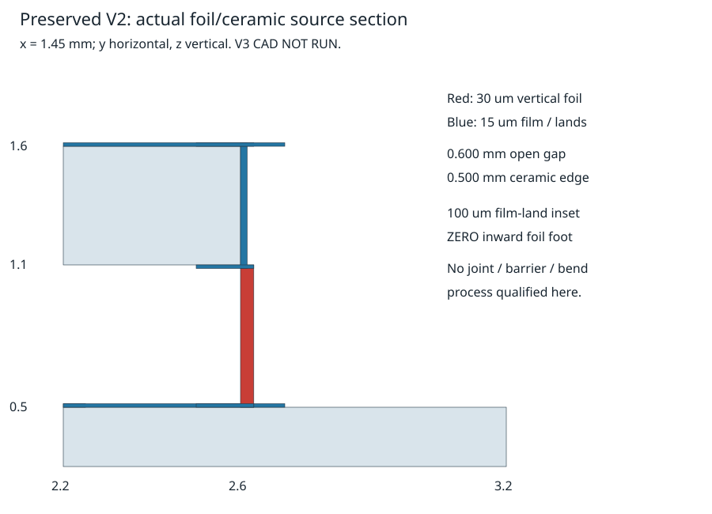
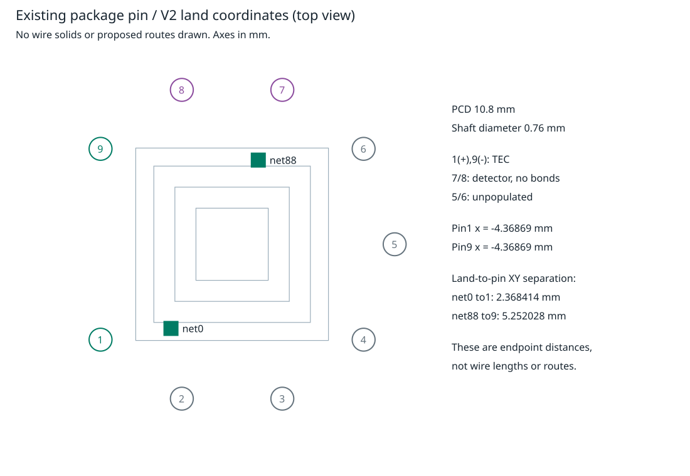

# V3 physical assembly — source/process gate

Baseline: clean main `720284dfe0939cb57fc11ee4a8fec292cd0e05ab`.
Observed authorization/start: 2026-11-02T07:07:50Z. This prospectively permits
narrow separate assembly engineering; the independent V2 STOP remains evidence.
This is an internal manufacturing/geometry record, not a new scientific report.

## Preregistration — before new source outcomes or design calculations

1. Preserve all V1/V2 code, STEP, core 88-leg/176-contact/89-net geometry,
   polarity, source registries, original fields/failures and the exact 38-page
   Rev3. Snapshot source/registry/report hashes and the initial chronology prefix.
   No editing an old design or adopting manufacturer performance as geometry.
2. Source hierarchy: inspected exact-product drawing/process specification;
   inspected manufacturer process/join/reliability document; applicable independent
   fabrication publication; family construction precedent; explicitly conditional
   engineering alternative. Pictures support architecture, not hidden dimensions.
   Record original bytes/hash where retrievable, page/figure/revision/product,
   actual inspection, failures and contradictions. VIGO and TEC Microsystems
   remain independent product specifications, not one observed assembly.
3. Maximum scope: one separately versioned V3 assembly only if the source gate
   supports a complete critical current/mechanical path. Keep the accepted V2
   core unless a required change is independently demonstrated. At most two
   source-supported joint/mount architecture alternatives; no new alloy, film
   process, joint size, bend radius, component tolerance or current allowance
   may be called documented without an applicable source. Unknowns stay UNKNOWN.
4. Require a real foil foot/interlayer/metallization cross-section and assembly
   method, electrical insulation, accessible joining sequence and compatible
   process temperatures. Establish what the proposed process actually supports
   on Al2O3 faces/edges, including adhesion/barrier/wetting/strain/inspection.
   A connected ideal Cu union or a borrowed Au face-pattern rule does not pass.
5. Mount gate: define an actual solid/compatible hot-ceramic→Kovar joining stack,
   datum, surface finish and interface. The old 50um gap is not an attach;
   document thermal expansion/reflow constraints rather than assigning a new
   zero-resistance bond. Wire gate: actual net0→pin1(+), net88→pin9(-), detector
   pads→pins7/8, with actual land/shaft contacts, polarity and no shorts; 5/6 may
   be explicitly unpopulated, then NOT DEVICE-COMPLETE. Do not invent die-pad
   metallurgy or bonds to an unidentified surface. No new thermal prediction.
6. Tolerance gate: preserve 3.8±0.15mm module, source 30um flatness/50um
   parallelism; independently budget layers, solder collapse, pattern and leg
   placement. Retain 20um nominal one-axis full-pad margin,110um pad setback,
   140um unrelated-metal gap and actual cap/header/pin/window datums. Propagate
   declared intervals by interval/worst-case arithmetic, not RSS confidence or
   guessed supplier tolerances. Unknown constituent limits STOP physical
   acceptance; any conditional stress interval is a design requirement, not
   measured capability. Audit join access, collision, support and insulation.
7. STOP before CAD if no defensible critical joint/mount/die-bond process or
   nominal complete-path geometry can be specified without fabricating source
   facts. Deliver explicit missing constraints and two conditional alternatives;
   no unqualified new solid or fictitious V3 STEP. If the source gate passes,
   implement new source/STEP only: independent actual contact graph, 176 full
   contacts, original 89 internal nets, full package endpoints, collision/contact
   ownership and assembly access; negative controls remove contacts/short nets.
8. Conditional CAD: one fresh mm writer, export before any import; separate SI
   reader and analytic 1mm cube. Relative volume error<=1e-7, bbox<=2.1e-7m;
   explicit 1e-3/1e3 length and 1e-9/1e9 volume errors reject. Preserve output
   on any failure. No mesh/PDE/electrothermal/fit/sink/gas/radiation work.
9. Resource bounds: existing verified image only, no installation/build;
   <=4CPU/8GiB (12GiB absolute user ceiling). Source acquisition<=24 files,
   <=30s/file,<=20MiB/file/100MiB total; bounded source-screen<=1200s.
   Source/dimension checks<=120s each. Conditional CAD<=600 solids, writer<=180s,
   reader<=120s, one attempt each; no retry/design campaign. Regression uses
   the established same12 runtime exclusions; archive/master and both legacy
   demos run. These software checks cannot pass physical process gates.
10. Freeze/commit/push verified builder evidence and exact CI before the one
    separate serial read-only auditor, with no inherited builder chat and writes
    paused on its immutable target. Preserve the exact verdict/limits. If CAD
    STOPs, review the source-gate/constraint checkpoint explicitly, not nonexistent
    V3 geometry; V3 CAD qualification stays NOT RUN. No self-clearance, issue#2
    remains OPEN, no further experiment follows automatically.

## Results / recovery

**STOP before V3 CAD; source/constraint checkpoint only.** The pinned image
is intact (`a0b22cf…`); this is an evidence gate, not a runtime/usage blocker.
No V3 solid, STEP, SI import, mesh, current/heat solve or performance result
exists. Original V2 and its independently reviewed nominal topology stay intact.
The conditional writer/reader gates were **NOT RUN**, not silently passed.

## Inspected process evidence and selected conditional choices

The [source catalogue](../data/tec_assembly_v3_20261102/source_catalog.json)
links14 source records, fresh raw-byte identities, reused exact-product documents
and named visual witnesses. Fourteen bounded new transfers total2,539,979bytes
(2.4223MiB);
raw documents/photos remain ignored cache, not redistributed. Original TEC2019
pp1/4, VIGO Rev9 p1 and Kryotherm printed22 were re-viewed. Fresh Coherent2022
pp13/14 and Kyocera cross-section/side-metal/thick-Cu images were inspected,
alongside RMT mounting Fig2. These are process/architecture precedents, not
proof of the proposed part's hidden geometry or empirical agreement.

| Source and inspected location | Applicable evidence | Limit / design decision |
| --- | --- | --- |
| [Kyocera thin-film technology](https://global.kyocera.com/prdct/semicon/technology_strengths/detail/thinfilm_technology.html), side metallization / thick-Cu / composition | Side metal and subsequent Cu plating are offered; Ti/TiW/Cu/Ni/Au is a listed family | The pictured section is **Ti/Pt/Au on AlN**, not our Al2O3/Cu stack. Vendor explicitly requires material-combination confirmation; no foil-foot/process dimensions supplied |
| [TTS metallization](https://tts-co.eu/en/products-services/thin-film-metallization/), layer tables | Adhesion/barrier/conductor stack; listed Ti/Cu/Ni/Au, standard Cu0.1–5um;250°C stabilization | Does not establish retained15um Cu. Listed155°C **operation** is not evidence of230°C assembly-reflow compatibility; no universal incompatibility is asserted |
| [Coherent2022 guide](https://www.coherent.com/content/dam/coherent/site/en/resources/datasheet/materials/related-resources/thermoelectrics/thermoelectric-cooling-systems-design-guide-br.pdf), pp13–15 | Metallized ceramic needed for solder mounting; low-temperature mounting/header-wire process and cleaning/inspection | Generic guide, not a finished bondline or miniature foil-joint drawing; rigid mounting/thermal cycling needs separate qualification |
| [RMT recommendations](https://www.rmt-tec.com/support/recommendations-for-use/), Fig2/Table2/CTE discussion | In52/Sn48 melting117°C; Kovar is a suggested mount material | **Selected conditional mounting-alloy family only**; composition percentage basis, exact finish, peak/dwell, bondline and reliability need confirmation. Table's Au80/Sn5 entry is inconsistent and unused |
| [RMT options](https://www.rmttec.com/support/thermoelectric-module-options/), surfaces/terminals/thermistor | Optional pre-tinning, wire pads/posts and thermistor are possible | Not proof of this die's pad metallurgy, layout or thermistor assembly |
| [Ferrotec installation](https://thermal.ferrotec.com/technology/thermoelectric-reference-guide/thermalref06/) and [reliability](https://thermal.ferrotec.com/technology/thermoelectric-reference-guide/thermalref10/) | Solderable finish, CTE and compliant mounting/cycling constraints | No transferrable1A thin-film rating or lifecycle; no borrowed lifetime claim |
| [TWI ribbon bonding](https://www.twi-global.com/technical-knowledge/faqs/faq-what-are-the-benefits-of-ribbon-bonding), investigation examples | Al–1%Si30×8um ribbon bonded to Cu on alumina | Different material/scale; Cu example is on PCB. Does not qualify200×30um Cu to the assumed TEC film |
| [SCHOTT GTMS](https://www.schott.com/en-ca/expertise/technology-and-processing/glass-to-metal-sealing), manufacturing | Separately manufactured/inspected feedthroughs supplied for integration | Use a prequalified sealed header before fragile TEC/die joining; no VIGO seal glass or seal-firing cycle inferred |

The first conditional architecture remains **A: patterned face/edge metal with
actual formed Cu feet joined to solderable lands**. Required section:
Al2O3 → qualified adhesion/barrier/Cu/finish → solder/interlayer → formed foil
foot → finite-radius compliant gap → upper joint/edge track. Each arrow is a
real physical interface. Foot length, radius, foil temper, layer thickness,
wetting/fillet and final joint tolerances are **UNKNOWN**, not chosen from a
picture. Deposited side metal alone does not solve foil-to-film joining.

**B: short formed tab between separate face pads**, avoiding sidewall-film
dependence, is a distinct conditional alternative supported by Kryotherm's actual
tab photographs/three-stage drawings and TEC2019 family connectors. It still
needs a dimensioned tab/foot/tool envelope and full return path. Neither
alternative is selected as an accepted CAD baseline or manufactured process.
No long V1 posts, vias, source-grade substitution or new current allowance is added.

The [21-interface choice/BOM supplement](../data/tec_assembly_v3_20261102/assembly_choices.json)
references the **unchanged corrected96-record registry** by ID/hash. It separates
documented family choices from UNKNOWN geometric/process intervals and includes
closure owner, interface/CAD/physics status. IA-08 radians, inferred contour
certainty and analyst seal attribution were independently checked in code.

## Concrete assembly blockers and conservative dimensions

1. **Foil joint:** all four V2 foils remain vertical boxes with no inward foot.
   A100um film-land inset supplies no formed-foot/barrier/joint specification.
   No retrieved process establishes the exact retained15um-film/30um-foil joint;
   custom plating could be feasible, but requires an actual process drawing.
2. **Hot mount:** V2's underside is bare Al2O3; all internal Cu starts at or
   above0.5mm. A50um solder solid filling the old gap would still lack its
   required underside metallization/finish. Header gold/Kovar identity does
   not determine barrier, wetting or finished bondline. No air-gap heat path
   or ideal solder contact is assigned.
3. **Die/thermistor:** V2 has a bulk MCT box and attach, no electrical pad or
   carrier stack. Drawing Au bonds directly to it would invent contacts.
   Actual7/8 bonding waits for a defined synthetic die/contact construction
   supported by applicable evidence. Pins5/6 are explicitly **UNPOPULATED**;
   no resistance/thermistor solid is fabricated, so **NOT DEVICE-COMPLETE**.
4. **Process order/access:** using117°C joints for both bridges and later mount
   gives no temperature interval that reflows the mount while guaranteeing
   the earlier same-alloy joints stay solid. A verified common reflow fixture,
   local temperature control or separately qualified hierarchy is needed.
   A generic low-temperature solder recipe does not close this constraint.
5. **Tolerances:** assembled-height/flatness/parallelism source callouts cannot
   establish independent leg, film, solder collapse, registration or bondline
   tolerances. The source-backed synthetic architecture is not rejected merely
   for lacking proprietary OEM internals; this particular **complete assembly
   specification is missing consequential physical interfaces and bounds**.

| Existing geometry / independently computed constraint | Result | Interpretation |
| --- | ---: | --- |
| Nominal module stack |4×0.5+3×0.5+6×0.015+6×0.035=3.8mm | Core unchanged; no allowance silently inserted for new layers |
| Worst-case layer budget |4u_c+3u_l+6u_m+6u_s≤150um | Individual bounds UNKNOWN; physical tolerance closure STOP |
| Full-pad one-axis margin |20um | Relative displacement stress10/20/25um leaves10/0/−5um, respectively; test offsets are **not supplier tolerances** |
|110um setback /140um gap versus100um Au-face analogy |10um edge-error budget /20um per-net equal edge-error budget | Does not qualify Cu edge-wrap process; no statistical uncertainty inferred |
| Pin1 / pin9 top-view XY |(−4.368692,−3.174040) / (−4.368692,+3.174040)mm | Independent36°→0.62831853rad reflection;0.76mm shaft,10.8mm PCD |
| Net0→1 / net88→9 planar endpoint separation |2.368414 /5.252028mm | Lower-bound endpoint distances, not wire lengths, routes or existing contacts |
| Three-quarter post wrap on0.76mm shaft with0.2mm wire |2.261947mm centerline arc | Conditional application of a published header convention, not new wire CAD or joint acceptance |
| Existing nominal roof clearance |4.070mm | Worst case UNKNOWN until mount/die/attach/roof intervals and datums close; do not double-count flatness/height tolerances |

Source-only producer and [actual computed JSON](../data/tec_assembly_v3_20261102/final_constraints/constraints.json)
use no CAD or scientific-solver imports. Tiny roundoff at the theoretical zero
registration margin is retained rather than clamped. No new R/J/P/G, heat
partition, current rating or detector temperature is calculated.

These are exact **existing source-coordinate projections**, not new V3 STEP
snapshots, manufactured imagery or solved fields. Both were rendered/inspected;
the initial pin-label overlap was corrected in a new output, preserving the
earlier projection. No2–3 V3 CAD screenshots exist because the CAD gate stopped.

## Assembly sequence and closure package

This is a dependency-controlled sequence, **not an executable qualified recipe**:

1. Obtain/inspect an already sealed, electrically isolated nine-pin header;
   verify numbering/view, finishes and flatness. Glass-seal fabrication is not
   deferred until after sensitive internal assembly; no firing temperature is
   guessed. Keep actual pin connections distinguishable from external leads.
2. Define the Al2O3-compatible multilayer/edge process and finished face lands,
   then fabricate separately; perform isolation/adhesion/continuity checks before
   loading legs. Stabilization or other hot substrate processing precedes BiTe.
3. Place original P/N/solder stack with measured registration/collapse controls;
   inspect all176 contacts,89 isolated nets and polarity. Source SnSb≈230°C
   assembly solder is retained, not an unprovided reflow profile.
4. Install actual formed feet and compliant connectors in an accessible fixture;
   qualify joint surfaces, wetting, contact and strain. **HOLD**: geometry/tool
   access and process hierarchy are unspecified; no automatic next operation.
5. Mount the finished hot ceramic to the solderable Kovar/header stack with
   controlled datum/bondline and protected prior joints. Join correctly mapped
   Cu leads to1/9 with access and strain relief. **HOLD** until mount stack and
   short/clearance tolerance witness exist; do not model ideal contacts.
6. Install the independently specified detector carrier/attach/pads and actual
   isolated7/8 bonds, using a process that preserves earlier joints. **HOLD**:
   die interface unknown. Populate/calibrate5/6 only if a thermistor is later
   specified; current proposed scope leaves it absent.
7. Inspect complete current path, unlike-net insulation, accessible joints,
   stress/clearances and enclosure sealing compatibility. Cap installation
   remains conditional; no gas/vacuum/seal or optical qualification follows.

Minimum closure request (proposed acquisition, not a message sent): one applicable
supplier/process cross-section for retained-scale plated Al2O3 and formed Cu
foot/joint, including foil temper/radius, thicknesses and final bounds; compatible
reflow/fixture sequence; a finished hot mount stack; detector pad/carrier/bond
drawing; constituent/placement tolerances sufficient for the inequalities above.
These may describe a deliberately synthetic design, not TEC2019 OEM internals.
Only after that evidence and fresh authorization should a separate V3 be authored
and independently audited. No coupon/physics follows automatically.

## Verification and recovery

Builder QA PASS: **46 focused / 502 applicable tests**, same12 runtime CAD/mesh/
Elmer tests excluded. Full archive/master and both legacy demos PASS;
79 registered immutable identities and64 local links checked. The source-only
constraints and both final SVGs reproduce exactly in a new directory; earlier
iterations and exact SHA-matched producer snapshots are preserved, including
the initial blank-line recovery rejection. [Commands/logs](../data/tec_assembly_v3_20261102/verification/checks.json),
[integrity](../data/tec_assembly_v3_20261102/verification/integrity.json) and
[reproduction](../data/tec_assembly_v3_20261102/verification/reproduction.json)
are software/provenance evidence, not assembly acceptance.
Independent review is PENDING an immutable committed **source-gate** checkpoint;
it cannot review nonexistent V3 geometry. Issue#2 stays OPEN.
Preserve the original bath1%/cold5%, native gas32.6274%, side-port7.277% and
V1 loaded25.111K failures. The sole38-page Rev3 is unchanged: a stopped assembly
specification supplies no new accepted device result for the public report.
