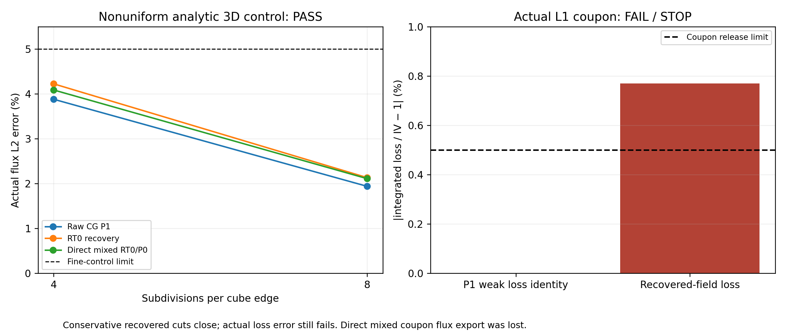
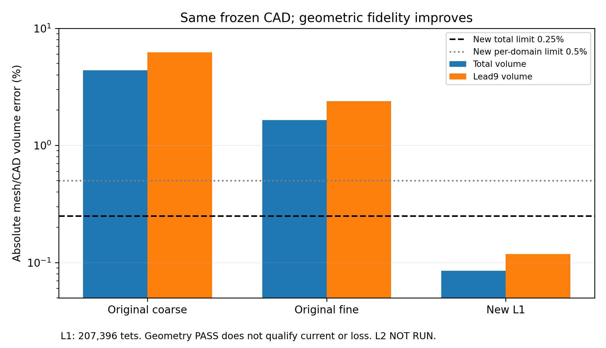

# Local V3 electrical conservative-discretization experiment

Baseline: clean main `5317bf1061c0bd34fe24dfcb6fca2f1ffb947e07`.
This is a separate internal numerical study, not a change to the source-informed
physical candidate, an OEM validation or a public report. Thermal C and coupled
D remain NOT RUN / NOT AUTHORIZED regardless of this experiment's outcome.

## Prospective registration (before every new numerical control)

The new authorization permits only saved-field reproduction, electrical method
controls, at most two better numerical meshes of the unchanged coupon, and
conditional electrical comparison. Stop at the first failed gate; no retries,
coefficient fitting, physical geometry changes or downstream physics.
All original P1 failures remain exact, including 85.6255% raw mismatch, voltage
undershoot and geometric deficits. Source/STEP/fields/38-page Rev3 are immutable.
Issue #2 remains OPEN. Prior independent reviews remain valid historical evidence.

### Complete input and implementation seal

Before controls, `registration.json` records actual UTC, the complete operator,
control/mesh/driver/test source hashes and byte snapshots, this preregistration,
the original geometry/105-face/port registry, frozen material/contact definitions,
both old meshes/fields/results and their independent saved-field reproduction.
`sealed()` checks all hashes before every numerical phase. No code or coefficient
amendment is allowed silently: an error ends this attempt with its actual failure.
Only a future explicitly registered successor could correct a numerical defect.

Pinned `tecooledmct-fem:26.2.1`, image
`sha256:a0b22cf70bbecaea2cbc8e1cf40aaef1bd620c187b73e251aee37a4fb9d28688`,
must match its existing qualified Elmer binary hashes. No installation/substitute.
Each phase uses <=4 CPUs / 8 GiB and a hard 900 s subprocess timeout; no thermal
operator, new P/N solve, full package, gas, fitting or sink calculation. At most
250,000 tets may be accepted/exported/solved per new mesh. A generated over-cap
mesh is a recorded budget failure and stops without a physical solution.

### Unchanged physical model and exact ports

The source 824-solid STEP is unchanged. The extracted 31 inputs / 12 bulk domains /
11 material interfaces / 105 physical faces remain the exact coupon BREP.
The positive 1 V internal terminal is SnSb87/P87; pin9 Ni/omitted-shaft cut is
0 V. Other exterior electrical faces are insulated. It is net88/lead9 only,
not pin1, all 89 nets, P/N resistance or full TEC terminal resistance.
All retained physical material/contact coefficients come verbatim from the prior
NOM definition: finite solder/metal r_e''=1e-11 Ωm², Ti/TiW/Cu/Ni/Au 15 µm
anisotropic laminate with 75/50 nm adhesion/barrier layers and 1e-14 Ωm² internal
plated excess per pair; pin Ni/Au is its original 3.5 µm equivalent. No real
thermal input is changed or used to compute a thermal result. Material laws are
the original selected constant-300 K hypotheses, not measured plated transport.

### Three electrical representations

1. **Raw CG P1:** original finite-contact operator, separate regional voltage
   traces, original element gradients. Preserve its actual raw cuts and original
   <=0.1% cut / -1e-8 V boundedness requirements; no recovery can pass that gate.
2. **Equilibrated RT0-compatible recovery:** one globally oriented integrated
   normal current F_f [A] per triangular face; local basis
   phi_i(x)=(x-v_i)/(3 volume). Shared faces give normal continuity. Minimize the
   resistivity-weighted distance to the raw P1 current and the finite-contact
   voltage-jump distance, subject to each tetrahedron's signed face sum=0,
   insulated boundary flux=0 and, for two-terminal cases, the **P1 weak input
   current fixed as a constraint**. This is not independent terminal-current proof.
   The recovered field must separately match analytical flux and irreversible loss.
3. **Direct mixed RT0/P0:** independently solve for F and cell-mean V, driven
   by specified terminal potentials rather than P1 current. With D the signed
   cell/face incidence and M the bulk resistivity plus contact matrix:
   M F - D^T V = -b, D F=0. Contact diagonal is r_e''/A_f [Ω]. No CG solution or
   current enters this solve. This is an independent discretization relative to
   CG, but shares RT0 basis/mass implementation with recovery, not independent
   software certification. Analytical quadrature checks remain necessary.

The local mass integrates phi_i^T rho phi_j exactly from tetrahedral moments.
A separate four-point degree-two volume quadrature evaluates actual bulk loss;
contact loss is Σr_e'' F²/A. Contact traces are reconstructed from local mixed
constitutive equations. Current is positive INTO the coupon at the positive
terminal; globally stored boundary F is outward, so I=-ΣF_source. All field values
and geometry arrays are SI except explicitly millimetre BREP/MSH files.

Method definitions were checked against the primary
[DOLFINx mixed-Poisson formulation](https://docs.fenicsproject.org/dolfinx/main/python/demos/demo_mixed-poisson.html)
and [DefElement RT definition](https://defelement.org/elements/raviart-thomas.html),
retrieved 2026-11-02. No DOLFINx/Basix package or alternative runtime is used.
Our affine tetrahedral basis and finite-contact extension are implemented here.

### Preregistered controls and accuracy gates

Seven uniform controls each use independent structured n=2 and n=4 subdivisions:
Cu bar; Cu/BiSn series and parallel; effective laminate normal and sheet;
explicit five-layer normal and sheet with n subdivisions through each layer.
Use the original property numbers and NOM interface parameters; no fitted values.
Independent exact series/parallel formulas determine R, J, and normal-interface
voltage jump. Each raw P1/recovered/mixed relative R and flux L2 error <=1e-7;
IV versus independently quadrature-integrated loss <=1e-7. Mixed contact-law
defect <=1e-7 V and analytic jump error <=1e-7 where nonzero. Cell balance <=1e-9
of maximum face current. Mixed cell potentials stay within [0,1] +/-1e-8.

One nonuniform **3D manufactured harmonic control** uses a 1 mm cube at n=4/8:
V=x/L+0.2[(y/L)²-(z/L)²], constant original Cu conductivity. All walls have
this specified smooth Dirichlet value; it is not the coupon's two-terminal BC.
Compare the actual three-component analytical J at degree-two quadrature points,
not a conservation surrogate. Finest flux L2 error <=5% and coarse/fine error
ratio >=1.5 for all three methods. Mixed cell potential must lie within the
actual prescribed range [-0.2,1.2] +/-1e-8. This benchmark's distinct physical
boundary range does not relax the coupon's original [0,1] bound.
Recovery uses interpolated CG wall data here; direct mixed uses exact quadratic
face means. Their related RT0 spaces must not be described as independent proof
solely because conservation agrees. No universal accuracy follows from these tests.

Negative controls reject zero/negative/nonfinite contact resistance, negative
conductivity and missing terminals. Existing source ownership, duplicate/missing
faces, pin cuts and 1e3/1e-3 unit negative controls remain regression requirements.
Every case result is saved before checking its gate; first failure STOPS geometry.

### Conditional geometry and actual coupon comparison

Only after all method controls PASS: two separately generated meshes of the
unchanged BREP, h_max=35/25 µm, curvature sampling64/80 and minimum circle
points128/160. No CAD rescaling, source merging, new contact or different layer.
Positive tets, exact face/port ownership and source/bbox identities must pass.
Each mesh must satisfy total volume error <=0.25% and **every** retained domain
<=0.5%; the stricter all-domain interpretation avoids dropping a small joint.
MSH stays mm and NPZ becomes m explicitly. Any fidelity/cap/time failure stops
before that mesh's electrical solve. No adaptive geometry or unbounded retries.

For an eligible mesh, compute original raw P1, recovery and direct mixed on the
same physical coefficients/BCs. Retain all 11 interfaces, both terminals, three
original interior planes and dead-end C1; zero-current branches use the original
drive-current floor. Conservative cut/terminal mismatch <=0.1%, cell balance
<=1e-9, IV versus bulk/contact loss <=0.5%; mixed V stays [0,1] +/-1e-8.
The **strict combined release also retains the raw P1 cut/boundedness gate**;
alternative conservation cannot replace it. A raw or alternative failure stops
the attempt; remaining level/refinement is NOT RUN, not extrapolated.
Across two eligible passing levels, alternative terminal R changes <=1% and
every interface loss at 0.4 A changes <=2%, denominator floor1e-7 W. Report all
interfaces, including minor and dead-end entries. No near-zero cherry-picking.
I=0/0.1/0.4 A and 1 A STRESS are exact linear scalings, not a current rating.
No thermal partition or full-device resistance/temperature is inferred.

## Execution result

**STOP after the first actual coupon.** Method controls and geometric fidelity
passed; electrical release did not. The producer also has a known output-label
defect. Its sealed code, raw artifacts and exception are preserved rather than
patched or rerun. L2, R/loss refinement and all thermal physics are NOT RUN.
This is a verified partial numerical experiment, not a qualified interconnect.

The exact original preregistration is preserved in `preregistration.md.source`.
At **23:32:22.040577Z**, before any new control, 132 input/source identities and
byte snapshots were sealed in [registration.json](../data/v3_conservative_flux_20261102/registration.json).
This prospectively closes the earlier implementation-sealing gap for this attempt;
it does not revise V3ET-04's historical finding. All operator, control, producer,
driver and initial test sources still match that seal. Later saved-field audit,
figures and verification are separate read-only postprocessing, not changes to it.

### Reproduction of the original failure — no new solve

[Saved-field reproduction](../data/v3_conservative_flux_20261102/original_reproduction.json)
uses cofactor gradients, triangle contact quadrature and bulk work on both old
meshes. It reproduces all eleven original interface integrals within 2.413e-15
of drive current, confirming the 34.046304527 A / 4.893986089 A / −36.328539848 A
contact/one-sided witness at unit voltage. Independently integrated work gives
the original 0.315802858% R refinement; loss closure is 9.9187e-13 relative,
minimum V −7.35136e-7, total volume deficit1.648813% and lead9 deficit2.382322%.
No original output, threshold or physical coefficient changed.

### Method controls: PASS within their mathematical scope

All sixteen cases, including both grids, completed in **2.925 s** externally
(2.039 s control campaign). Five invalid-contact/conductivity/terminal controls
were rejected. Uniform analytical controls passed the 1e-7 gates; the largest
uniform flux L2 error was **3.4330e-10**, on the explicit nanolayer normal case.
The explicit 75/50 nm layers and the original effective laminate were both tested;
uniform-case roundoff is not a physical material uncertainty or convergence order.
Normal contact voltage jumps, passive loss and bounded mixed cell means passed
their registered tests. This is not empirical plated-film/joint validation.

| Nonuniform harmonic flux L2 error | n=4, 384 tets | n=8, 3,072 tets | Error reduction |
| --- | ---: | ---: | ---: |
| Raw CG P1 | 3.880753% | 1.940376% | 2.0000 |
| Equilibrated RT0 recovery | 4.224419% | 2.134151% | 1.9794 |
| Direct mixed RT0/P0 | 4.087687% | 2.111668% | 1.9358 |

All finest errors are below5%, with ratios above1.5. Recovery does not outperform
raw P1 in this control: exact normal continuity is not equivalent to lower L2
error. The mixed solve is independent of the P1 input current, but both RT0
paths share basis/mass code and related variational spaces. Agreement alone is
not an independent software proof. No third-party RT0 implementation was run.



### First unchanged-CAD mesh: fidelity PASS

The preregistered L1 mesh completed in20.214 s: **65,004 mesh nodes / 207,396
positive tets**, minimum volume3.0984e-18 m³. The Gmsh log's324,397 total elements
also counts lower-dimensional entities; it is not the tetrahedron count.
The original source faces/domains are retained and independently reimported.
P1 assembly subsequently checked complete actual mesh-face ownership before
electrical solution. The STEP and coupon BREP were never regenerated or altered.

| Mesh/CAD volume deficit | Original fine | New L1 | New gate |
| --- | ---: | ---: | ---: |
| Total | 1.648813% | **0.084875%** | <=0.25% PASS |
| Lead9 | 2.382322% | **0.118348%** | <=0.5% PASS |
| Tab88 | 0.012335% | 0.014252% | <=0.5% PASS |

Every retained domain meets0.5%; joint/film volumes are also reported without
discarding small entries. These are numerical representations of the same CAD,
not changed physical parts. Small geometric volume error does not establish
resolved contact spreading, current crowding or electrical accuracy.



### Actual coupon: numerical FAIL and producer STOP

The phase named `geometry` includes its conditional coupon solve. It exited
after **155.138 s**, well below900 s, with a recorded `KeyError: 'mixed'`.
In `v3_flux_study.coupon`, the interior-cut loop reuses the outer method variable
`name`; its last value becomes `lead9`. Both method exports consequently target
the same name. The last recovered flux overwrites the mixed flux and appears
under `lead9_q` / `lead9_J` and a misleading `lead9_0p4A.vtu` filename. These
artifacts cover the **whole coupon**, not only the lead. Mixed cell potentials
remain but their paired flux does not. The return then requests the absent
`results['mixed']`. This is a builder implementation defect, not a solver gate
PASS or a physical failure of RT0. Its original source/log/artifacts are intact.

The direct-mixed **coupon comparison is NOT QUALIFIED / export NOT RETAINED**.
Do not infer or reconstruct it as if it were independently observed. No rerun,
rescue solve, relabelling of original files or sealed-source correction occurred.
The source guard and STOP controller prevent any automatic second level.

Other retained numerical observables already fail the registered release:

| Observable at unit excitation | Retained result | Gate / status |
| --- | ---: | --- |
| New raw P1 R [Ω] | 0.02940722964 | Diagnostic only; not full TEC R |
| New raw P1 worst cut error | **81.241662%** | <=0.1% FAIL |
| New raw P1 minimum V [V] | **−4.282997e-7** | >=−1e-8 FAIL |
| New raw P1 weak loss mismatch | 2.2649e-13 relative | PASS; not raw flux |
| Recovered input current [A] | 34.0052433426 | Fixed from P1; not independent R |
| Recovered worst interface mismatch | 4.8059e-15 relative | Conservative constraint only |
| Recovered terminal mismatch | 4.5969e-15 relative | Conservative constraint only |
| Recovered interior-cut mismatch | <=1.795e-13 relative | All3 original cuts retained |
| Recovered integrated bulk loss [W] | 32.1364261101 | Independent saved-array quadrature |
| Recovered integrated contact loss [W] | 2.1303697967 | All11 physical interfaces retained |
| Recovered loss / IV mismatch | **0.769154%** | <=0.5% FAIL |
| New L1/L2 R and local-loss refinement | NOT RUN | L2 stopped; no substitute comparator |

Thus geometric fidelity and normal-current continuity can pass while the actual
field/loss test fails. No post-hoc correction or acceptance criterion replaces
the original raw P1 failure. The new combined release would still fail even
without the producer exception; this observation does not excuse the lost data.
The geometry and discretization changes are simultaneous, so their individual
causal contributions are not identified by this one mesh.

### Independent saved-array audit after STOP

The separate [postprocessing source](../tecooledmct/v3_flux_saved_audit.py) was
hashed before its execution. It solves nothing: it rebuilds P1 gradients by
cofactors, RT0 cell/face fields from oriented face currents, resistivity tensors
from frozen definitions and losses with independent volume/triangle quadrature.
[Its result](../data/v3_conservative_flux_20261102/saved_audit.json) confirms:

- P1 current reconstruction difference1.1781e-13 relative;
- recovered current reconstruction difference5.9043e-15 relative;
- maximum all-element face-normal integration defect3.2649e-17 of input current;
- independently reproduced loss mismatch0.0076915363179273 relative.

This verifies the failed **retained recovery** data, not the missing mixed flux.
Recovery explicitly fixes P1 current: reporting1/I again is not an independent
resistance estimate. The constitutive energy test is essential. Neither raw nor
recovered fields establish allowed current, thermal dissipation destinations,
metal temperature, full TEC resistance or detector temperature. One-ampere
scaling is STRESS ONLY. C/D, any thermal G/qJ, material fit and performance are
NOT RUN. The 38-page master remains byte-identical because this is an unqualified
numerical diagnostic, not a qualified device result.

## Reproduction, quarantine and minimum next correction

The source seal, all sixteen controls, negative controls, mesh/fields/logs,
exception/STOP record, saved audit and figure producers are versioned under
[this evidence directory](../data/v3_conservative_flux_20261102). Original failures
remain under their earlier paths. The exact image/source inputs are in the
registration and the older binary qualification; no runtime rebuild occurred.

Safe verification (no physical campaign):

```bash
./fem/run.sh pytest -q tests/test_v3_conservative_flux.py tests/test_v3_flux_stopped_results.py
python3 -B scripts/verify_v3_flux.py outputs/fresh-v3-flux-qa
```

`run_v3_flux_registered.py` is the **frozen failed producer**, not a resume command.
Do not modify its sealed modules or rerun it. The only proposed next correction
is a separately authorized, separately versioned producer that preserves distinct
method outputs and independently addresses raw/constitutive accuracy. New mesh
levels, coefficient changes and thermal phases are not authorized by this STOP.
No scientific conclusion may be based on the overwritten mixed field. A new
numerical attempt would need the same complete pre-control seal and gates.

Release software checks in
[verification_release](../data/v3_conservative_flux_20261102/verification_release/checks.json)
pass **120 focused / 576 applicable tests**, with the same12 historical runtime
CAD/mesh/Elmer exclusions. Original archive and current-master validators, both
legacy demonstrations and the 5,128-original-blob guard pass. The new guard
preserves all132 sealed input/source identities and all **5,401 protected baseline
blobs / 2,964,729,219 bytes** from5317bf1; only current contract/README/chronology/
attributes are mutable exceptions. Both new quantitative figures were visually
inspected. No PDF rebuild or additional numerical experiment occurred.
These checks validate preservation and reporting of a **stopped experimental
prototype**; they do not certify its writer or grant electrical qualification.
