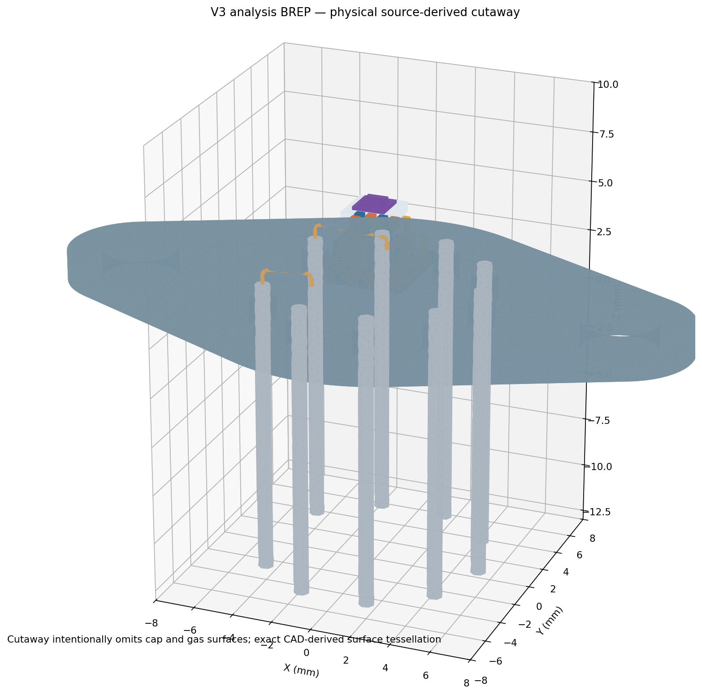
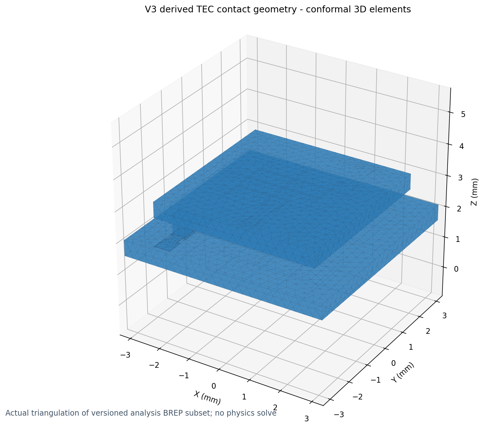
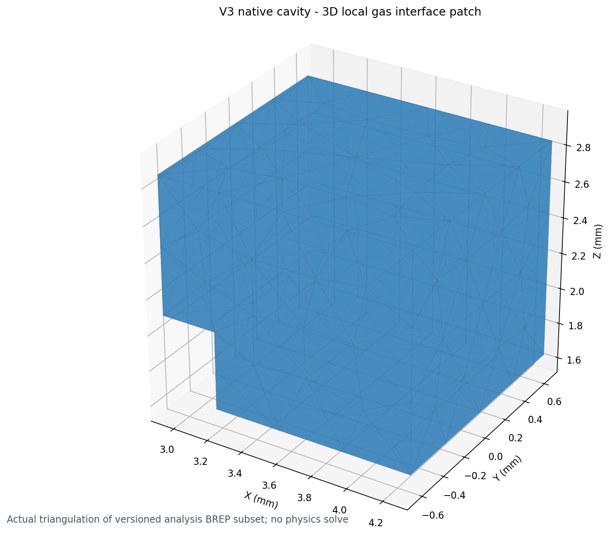

# V3 derived multiphysics geometry — engineering release record

## Scope and disposition

**Derived analysis geometry: GEOMETRIC ACCEPTANCE for the current synthetic, sealed-closure representation.** Full V3 multiphysics mesh convergence, material/interface parameter qualification, current density, thermal-port conductance, gas conductivity, radiation view factors, detector response and device temperatures remain **NOT RUN / NOT QUALIFIED**.

Frozen input: clean baseline `3875e1b`, original V3 R1 **824-solid STEP**, [physical assembly record](SYNTHETIC_V3_ASSEMBLY_CAD_20261102.md) and independent R1 conditional manufacturing review. The canonical 38-page Rev3, all original Gate B failures and issue #2 remain unchanged. No physical redesign, new manufacturer assertion, PDE, fitting, TEC prediction or numerical forensics.

This milestone actually generated two occupied-domain analysis BREPs, a gas-subtracted assembly and a **conformal** STEP-derived multiphysics BREP. It also created the native enclosed cavity, verified every face's owners, and meshed two bounded 3D subsets.

## Finished geometric artifacts

| Artifact | Role | Units |
| --- | --- | --- |
| [analysis_solids_mm.brep](../data/v3_derived_multiphysics_20261103/analysis_solids_mm.brep) | 437 analysis solid domains after source-backed laminate reductions | mm |
| [analysis_with_gas_mm.brep](../data/v3_derived_multiphysics_20261103/analysis_with_gas_mm.brep) | 437 physical analysis solids plus native boolean-subtracted gas volume | mm |
| [analysis_conformal_mm.brep](../data/v3_derived_multiphysics_20261103/analysis_conformal_mm.brep) | 438 domains with shared coincident-face topology after OCC fragmentation | mm |
| [design_plan.json](../data/v3_derived_multiphysics_20261103/design_plan.json) | SHA256 source provenance; 98 exact laminate reduction groups; explicit non-equivalence limitations | original mm |
| [conformal_audit.json](../data/v3_derived_multiphysics_20261103/conformal_audit.json) | Original→derived OCC volume lineage and volume preservation, all face adjacency | mm |
| [face_ownership.json](../data/v3_derived_multiphysics_20261103/face_ownership.json) | Full source materials and stage identity, 2,456 face owners/area/sign, sources and ports, 378 contacts | SI metadata |

**Effective-composite material identity (fail-closed):** 98 condensed domains are explicitly tagged `COMPOSITE_MULTILAYER`, never treated as Cu, Au, or Ni bulk merely because that original retained source body carries such a name. Each records `retained_source_material`, all original `source_materials`, an ordered `layer_stack` and `constitutive_assignment=REQUIRES_EFFECTIVE_TENSOR_AND_INTERFACE_LAW`. An independent negative test rejects restoration of a homogeneous `Cu` label. The source-name mapping and actual BREP geometry remain unchanged. No effective material tensor or interfacial law has yet been supplied; downstream solvers must block if unresolved.

**The parent 824-solid STEP remains untouched.** Each retained volume is traceable to source names and actual independently imported STEP IDs; every removed thin layer maps to a retained composite domain with original material identity and thickness. The analysis BREP is a new computational representation, not a replacement OEM drawing.

## Domain reduction and equivalence

| Domain family | Representation | Rationale and validation boundary |
| --- | --- | --- |
| 88 P/N thermoelectric legs, four alumina ceramics | Explicit finite 3D solids | Retains topology, distinct materials and all physical dimensions |
| 176 original SnSb axial joints, seven formed tab solder feet, TEC header/lead joins | Explicit finite 3D contacts | Preserves actual face areas and joints; no zero-resistance assumption |
| Patterned Ti(75 nm)/TiW(50 nm)/Cu(13.625 µm)/Ni(1 µm)/Au(0.25 µm) stack | Exact original **15 µm composite conductor footprint** as one volume | 98 reduction groups overall; original layer table retained. Requires effective tensor and finite interface law in future physics; not a pure Cu material |
| Outer underside/cold ceramic finishes | Full **actual 6.1 mm / 2.1 mm** composite coating footprints, 2 µm thick | Prevents coating-footprint distortion; material stacks retained |
| Header Ni/Au finish | Full 6.1 mm footprint, 2.25 µm composite film | Kept separate from 80 µm InSn mount; avoids smearing solder and finish |
| Detector contact pad finishes | Composite original Au/Ni/Au footprint and thickness | Ohmic response remains an unqualified material/contact law |
| Short formed Cu tabs, physical Cu leads, detector Au bonds and insulation | Explicit curved geometry | No fabricated long copper posts or shortcut wires |
| Native cavity gas | OCC cylinder minus all occupied 437 solids, then conformal fragmentation | Geometry-only; gas pressure/accommodation, radiation and seal leak rate unknown |

The conductivity of a composite with layer thicknesses \(t_i\) is a **future** effective constitutive law, not a fitted measured coefficient:

\[
\sigma_{\parallel} = \frac{\sum_i t_i\sigma_i}{\sum_i t_i},
\qquad
\rho_{\perp}\,(\sum_i t_i)=\sum_i\rho_i t_i+\sum_j r''_{e,j}.
\]

For the thermal analogue, use in-plane layer sums and through-thickness series \(\sum_i t_i/k_i+\sum_j R''_{T,j}\), with contact resistance **once**, not also included in bulk film properties. An analytical arithmetic control verifies parallel-sheet and normal-series identities using **synthetic** coefficients only. 3D crowding and thermal equivalence remain unqualified.

## Gas-volume and source-solid integrity

The sealed **synthetic closure** uses the actual cap-bore reference circle (radius 7.1 mm), from \(z=1.50\) mm to \(9.65\) mm, capped by the physical header and cap/window faces. This is a geometric enclosure idealization, **not evidence of welded/hermetic fabrication**.

| Measure | Actual result |
| --- | ---: |
| Original bore enclosure volume | 1,290.696638 mm³ |
| Excluded occupied volume | 59.066577 mm³ |
| Remaining native gas | **1,231.630061 mm³** |
| Connected gas components | **1** |
| Final analysis domains | **438** |
| Max original-to-conformal domain relative volume error | **3.015×10⁻⁷** |
| Nonmanifold faces / gas exterior holes | **0 / 0** |

All gas volume must be disjoint from the 437 occupied solids; the exact OCC boolean subtraction and later global fragmentation preserve source-domain volumes within 1×10⁻⁶ relative. The gas occupies a **real topological 3D solid** with complete gas-solid face pairing, not a void symbol or an inferred fill factor.

## Complete face and interface ownership

| Face class | Unique conformal faces |
| --- | ---: |
| Gas–solid | **1,848** |
| Solid–solid | **565** |
| Exterior (header, nine feedthroughs/pins, cap, window) | **43** |
| **Total** | **2,456** |

Every conformal surface has exactly **one or two distinct adjacent volumes**, and all dual-owner faces have opposite oriented outward normals. There are no unassigned, duplicated or >2-owner faces.

All **378 explicit source contact witnesses** map to real positive-area shared faces, with each mapped contact area agreeing with its source witness to within 1e-6 relative (the observed discrepancies are near floating-point precision). A deliberate 1% area perturbation is rejected by the geometry integrity test. The source topology remains **88 alternating P/N legs, 176 axial contacts, 89 internal TEC nets, 44 couples**, with actual lead assignments TEC pin 1/net0, TEC pin 9/net88, detector pins 7/8, and pins 5/6 explicitly vacant. No unintended unlike-net conductive solid adjacency or direct detector-to-TEC contact was detected. These are geometric/electrical graph checks, **not resistance measurements**.

The registry assigns each face a primary thermal interface category, an electrical boundary classification, structural conditions, distinct gas/radiation/optical flags and stage involvement where a ceramic or P/N leg is present. All unqualified laws are explicitly marked, not given silent default contact values. External pin terminal faces are assigned exactly once.

**Important:** For a future reduced multiport stage model, ceramic stage surfaces are separately identified; applying an isothermal Dirichlet port to an entire ceramic in the *full* coupled device is a model choice requiring validation, not an automatic consequence of face tagging. Radiation and gas conduction may act on the same physical gas-adjacent surface but are different terms, not duplicate ownership.

## Actual limited meshability evidence

Two small, independently generated 3D tetrahedral meshes were produced from the **final** conformal analysis BREP, with real physical groups. No PDE was solved.

| Fixture | Domains | Tetrahedra | Nodes | CAD/mesh volume |
| --- | --- | ---: | ---: | --- |
| [TEC contact slice](../data/v3_derived_multiphysics_20261103/meshes/local_tec.msh) | 2 ceramics, 1 N leg, 2 solder joints, 2 composite patterned nets | 12,113 | 3,756 | Within 2.7×10⁻⁹ relative for every tested domain |
| [Native gas/ceramic patch](../data/v3_derived_multiphysics_20261103/meshes/local_gas.msh) | Actual OCC cavity intersected with a bounded local test box | 341 | 129 | Zero geometric volume discrepancy at recorded precision |

The TEC leg had 86 tetrahedra and its two solder joints 47/42; **these counts prove mesh generation, not resolution for physical flux, stress or fatigue**. The gas patch only establishes local meshing of the actual cavity near a ceramic edge, not whole-cavity mesh quality or full seal-surface quality.

A broader initial clipped gas patch produced *invalid overlapping boundary facets* and is retained in the development chronology as a failed meshability attempt. A smaller revised fixture passed. This is **not** evidence that every future cavity mesh is guaranteed to work.

**3D overview and exact BREP surface-mesh illustrations:**

The cutaway omits gas and cap surfaces to expose the actual retained TEC/lead/detector solids. It is an OCC-tessellated cutaway of **111 actual analysis domains**, not a photographic device or computed temperature field. The two detailed mesh figures below are from the actual generated local tetrahedral fixtures.

## Remaining qualification boundaries

1. **Full-model meshability is not yet proven.** Thin 2 µm finishes, multiple micron-scale interfaces, contacts and 438 volumes will require targeted meshing, quality controls and representation-specific convergence. All volume-based face ownership must survive any subsequent mesher.
2. **No physics coefficients have been fitted.** Local temperature-dependent material laws, interface thermal/electrical resistivities, emissivity, gas molecular accommodation and stress models are future inputs with provenance/uncertainty ranges.
3. **No qualified gas pressure, thermal bypass or radiative view factor exists.** Hermetic closure is a declared synthetic assumption; external package welding and window-retention mechanics remain separate physical uncertainties.
4. **No reliable V3 electrical current field exists.** Historical Gate B original P1 cut mismatch **81.241662% FAIL** and recovered-loss/P1 mismatch **0.769154% FAIL** remain explicitly unchanged. Thermal C/D are NOT RUN. The new geometry does not waive those gates.
5. **The manufacturing-tolerance concerns remain physical.** Original V3 R1 upper-height reserve is 6 µm; nominal formed-tab bending strain proxy is 20%; cap sealing, solder sequence, 1 A capability and long Au bond loops remain conditional. No tab or package dimensions were revised.

## Engineering release conclusion

**Geometry source correspondence, physical electrical graph, native gas/solid occupied-volume exclusion, connected gas, sealed idealized closure and complete conformal face ownership: PASS.**

**Local 3D meshability: PASS for the two stated fixtures only.**

**Global mesh, thin-layer constitutive equivalence, engineering material performance, coupled thermoelectric/gas/radiative/detector simulation: NOT QUALIFIED.**

Future work can now focus on a global analysis mesh and model laws from this separate physical-to-analysis platform without reopening the frozen V3 R1 geometry. No further electrical-discretization investigation is part of this milestone.
