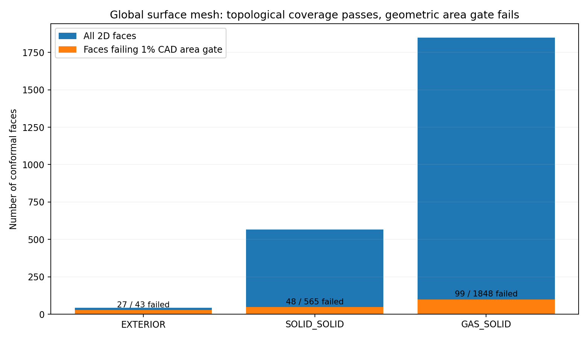

# V3 complete-model meshability and material-law gate — STOP with verified geometric evidence

## Objective and protected baseline

Continuation of the derived computational geometry delivered at **9468b36**. This is a **geometry and model-law requirements** milestone, not an electrical-discretization experiment, an OEM comparison or a solved 3D device. The frozen 824-solid V3 R1 STEP, source layers, canonical 38-page Rev3 and all historical electrical/gas numerical failures remain unchanged. Historical issue #2 remains open. The `sim:0.0` Codex process remained untouched and usage-limited. No PDE solves or physical redesign were launched.

**Disposition: STOP for the full conformal 3D volume mesh.** Every domain/face group can be registered and meshed in 2D, but this surface candidate fails direct CAD/triangle area fidelity. The 3D Gmsh mesher rejects overlapping boundary facets. The prior two *local* 3D meshes continue to pass within their limited scope. Do not use the saved global surface triangulation or a hypothetical full-volume mesh as a numerical baseline.

## Result matrix (frozen gates)

| Acceptance check | Actual measured result | Disposition |
| --- | ---: | --- |
| OCC source/analysis matching | 438 volume groups, all assigned | PASS |
| Complete conformal boundary groups | 2,456 / 2,456 | PASS |
| Globally meshed 2D faces | 2,456 / 2,456 | PASS coverage only |
| Surface candidate elements | 49,863 linear triangles, 23,301 nodes | GENERATED, unqualified |
| Source-face CAD/mesh area (relative tolerance 1%) | 174 / 2,456 faces exceed tolerance | **FAIL** |
| Maximum face area discrepancy | 3.36505 relative (+336.505% area excess) | **FAIL** |
| Exterior / solid-solid / gas-solid area failures | 27 / 48 / 99 | **FAIL** |
| Full conformal 3D tetrahedral mesh | 0 completed | **STOP** |
| All-domain explicit material-law requirements | 438 / 438, no anonymous fallback | PASS requirements only |
| Boundary-law requirements | 2,456 / 2,456, all values UNSET | PASS requirements only |
| TE/gas/structural/electrical/optical numerical qualification | NOT RUN | NOT QUALIFIED |

The full 2D mesh is an actual Gmsh `.msh` file with each CAD face preserved as its own physical group; the 438 domain groups are also registered. A separate independent MSH reader computes planar triangle area for every surface and compares against the OCC face-area registry in SI units. It detects all 174 failures and retains the full per-face source/domain identifiers in the machine audit. The gross errors are not merely an overall discretization-statistic difference.

Representative rejected faces: 2302, 2314, 2326 and 2255 are pin Au-finish/gas boundaries with original CAD area 0.00358142 mm² each and mesh area 0.015633 mm² each. Curved detector bond surfaces (2420/2431) have approx. 95.46% lower triangulated than CAD area, and lead-insulation face 2395 is approx. 87.89% lower. This candidate's coverage cannot be used as evidence of correct integrated heat/gas/radiation boundary areas.



## Bounded full-3D meshing attempts and hard STOP

The first independent attempt began from the same frozen conformal BREP after verifying all volume and surface physical identities, with no material fields or PDE. Gmsh 4.13.1 generated 49,845 surface triangles and rejected the 3D boundary reconstruction at face **2395**, the shared physical interface of `TEC_lead1` and `lead1_insulation`. Two facets had a 0.0286011° dihedral angle against the default 0.1° overlap criterion; the native diagnostic identifies their vertex IDs. A second, separately archived single trial changed only `Mesh.AngleToleranceFacetOverlap` to **0.01°**. The 2D mesh had 49,859 triangles, but 3D reconstruction again failed on face 2395, now with identical triangle node triplets, not just a small-angle pair.

The tolerance trial **did not resolve the defect**. No third 3D strategy, repeated refinement or alternate geometry modification was launched. Earlier surface-pilot initial code setup was rejected for using a string in a numeric Gmsh option, corrected prospectively in source; it was not a physics result. Original rejected trial directories remain on the VPS unmodified; the separate machine gate records the exact Gmsh messages and identities.

The face 2395 CAD-interface location and ownership are given in [`mesh_gate.json`](../data/v3_global_mesh_gate_20261103/mesh_gate.json); it has source CAD area **1.17395920698 mm²** and a geometry-specific overlap failure. The upstream physical lead/insulation CAD remains frozen. An explicit future representation change could split or replace the problematic microscopic interface in a **new analysis-only version**, but requires independent geometric equivalence and full contact/isolation/area checks, not a silent tolerance change.

## No-fallback material and interface law contract

[`physics_law_requirements.json`](../data/v3_global_mesh_gate_20261103/physics_law_requirements.json) enumerates requirements for each of 438 volumes and every boundary class; every constitutive assignment is **UNSET**, with `solver_ready=false`. In particular:

- **98 composites:** original layer stacks and anisotropic parallel/normal electrical/thermal laws, interlayer contacts, and thin-layer equivalence must be supplied, with no default homogeneous Cu/Au/Ni assignment.
- **88 thermoelectric P/N legs:** temperature-dependent electrical conductivity, thermal conductivity, Seebeck coefficient, Thomson consistency and mechanical properties, with source-grade uncertainty and the three stage indices.
- **202 solder/contact domains** (176 SnSb, 23 SnBi, 3 InSn): temperature-dependent bulk properties and explicit finite electrical and thermal contact laws; no doubled interface resistance.
- **One native gas:** composition, pressure, temperature-dependent transport, applicable Knudsen/Rayleigh regime, interfacial accommodation and gas-versus-radiation physical separation.
- **565 solid-solid, 1,848 gas-solid, 43 exterior faces:** distinct continuity/insulation, finite contact, thermal, mechanical, radiation and optical source decisions. Source face owner tags and explicit conditional classifications are preserved; no numeric boundary loads or coefficients are invented.

A formal material property release will require independently selected, provenance-tagged coefficients and consistency tests. A geometrically valid mesh alone would not qualify original failed electrical transport or OEM performance.

## Archive and reproducibility

All code, tests, the versioned mesh candidate, complete face-area diagnostics, law requirement registry, one plot and the two failed 3D meshing diagnostics are recorded with cryptographic input identities. The candidate mesh file is explicitly labeled **unqualified**. Execute a no-solve audit of the saved bytes using:

```bash
./fem/run.sh python scripts/v3_global_mesh_audit.py \
  --mesh data/v3_global_mesh_gate_20261103/unqualified_global_surface.msh \
  --registry data/v3_derived_multiphysics_20261103/face_ownership.json \
  --out outputs/v3-global-gate-replay
./fem/run.sh python -m pytest -q tests/test_v3_global_mesh_audit.py \
  tests/test_v3_physics_law_requirements.py tests/test_v3_global_mesh_recorded_gate.py
```

Do **not** promote the 2D mesh to FEM. The next *geometric* milestone, if authorized, is a constrained lead-insulation/pin-finish/bond-loop analysis-only topology simplification with exact physical-source traceability and independent face-area/contact/insulation validation, followed by a single budgeted full 3D meshability attempt. Current V3 R1 CAD shall not be changed; electrical PDE forensics remain outside this scope.
