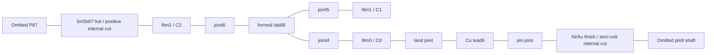
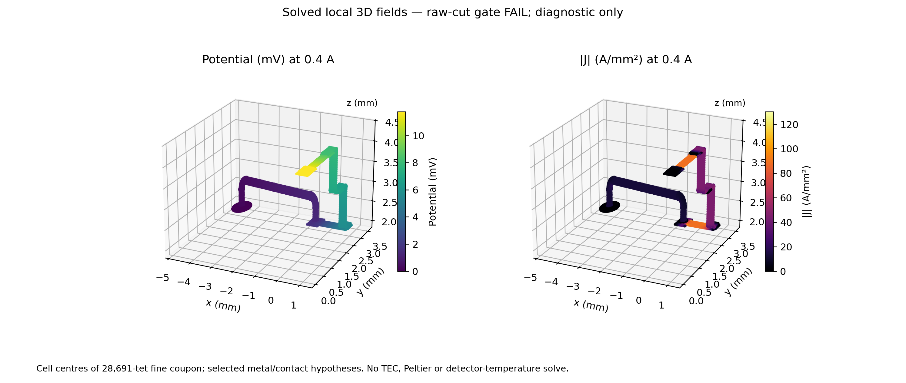
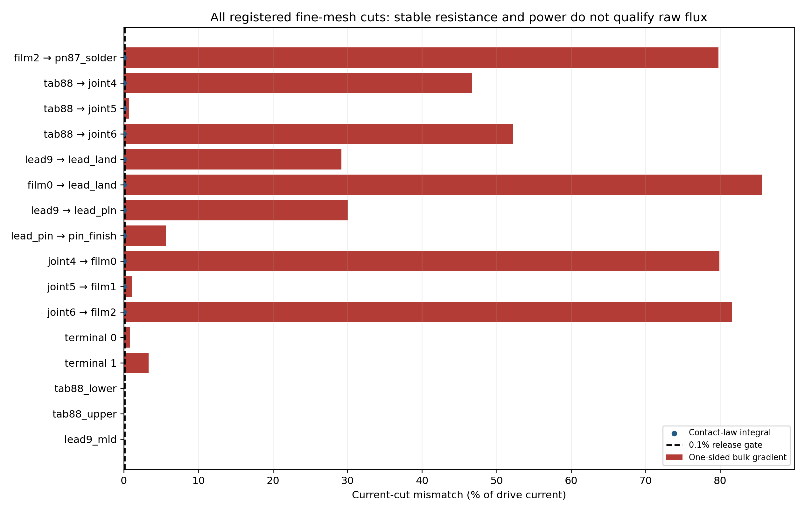

# V3 R1 local interconnect electrothermal characterization

Baseline: clean main149574728521ce36518057d92e4f06f2bc9ef6ad; observed task
begin2026-11-02T21:35:11Z. New authorization applies only to the gates below.
Original sources/STEP/fields/38-page Rev3 and every historical failure are immutable.
This is an internal scientific record, not another public report.

## Preregistration before fixture solves

**Scope:** one actual net88 return-to-pin9-head coupon, not the full TEC circuit.
Extract from the accepted824-solid STEP: formed_tab88; foot joints4/5/6 including
both side fillets; all five metal layers at net88 planes0.500/1.600/2.700;
TEC_lead9; its BiSn land joint and InSn pin joint; pin9 Ni/Au cap; solder87_hot.
P/N legs,other88nets,pin shaft/header/cap/window anddetector bonds are omitted.
A names/volume/bbox/face registry must identify every retained physical input.
Neither all88legs nor pin1 is in this coupon; R_coupon is NEVER full TEC R.
No old V1 posts, V2 routing, fitted properties or old heat inputs are reused.

Actual electrical terminals: positive potential at solder87_hot/omitted-P87
interface; reference0V at bottom of pin9Ni/omitted-Kovar-pin interface.
These are named INTERNAL cuts,not exterior instrument terminals. All other
external electrical faces are insulating. Each real metal/solder interface has
an explicitly assigned finite electrical area resistance,not an inferred perfect
contact merely because STEP faces touch. Same-phase fillets and solder block
are fused as one solder domain. The three-foot return andmiddle thermal port
remain intact; no locally fitted shunt or assumed50:50 partition.

Thermal ports,positive Q OUT of coupon to reservoir: ceramic0/1/2 at actual
film undersides; PIN9_HEAD at the actual pin-cut; PN87_HOT at the P/N cut.
Ceramic3,HEADER,PIN1,detector7/8 andambient have no represented contact and
are explicitly absent/adiabatic,with zero rows/columns in an extended port map.
They are not silently set to300K or assigned invented conductance. Every
remaining external face is explicitly insulated. C uses independent active-port
unit columns about Tref=300K; linear fixed-k G is conditional on these boundaries.

**Thin layers:** retain actual15um film envelope, but replace resolved Ti75nm/
TiW50nm/Cu13.625um/Ni1um/Au0.25um by an explicitly anisotropic laminate:
σ_parallel=Σ(t_i/ρ_i)/t, σ_normal=t/Σ(ρ_i t_i), and equivalent parallel/series k.
Pin Ni2um/Au1.5um is treated analogously in its actual3.5um envelope.
This is a laminate approximation,not fake bulk Cu; it preserves exact uniform
normal andin-plane sheet limits,not arbitrary pointwise spreading accuracy.
A must independently compare explicit layered3D slab/sheet to analytic solutions
andhomogenized form at two grids. Actual SnSb/Bi57Sn43/In52Sn48 joints retain
separate finite3D domains andproperties; their resistance is not collapsed intoCu.

**Material definitions/scenarios:** constants only,selected at nominal300K.
KEMPER Cu-ETP primary page supplies approximate ambient soft-state conductivity
58MS/m andk385W/(mK); this is BULK family evidence,not measured plated Cu.
UseρCu=1/(58e6)Ωm. Other entries below are explicit engineering hypotheses:

| Material | ρ [Ωm] | k [W/(mK)] | Qualification |
| --- | ---: | ---: | --- |
| Cu foil/lead |1/(58e6)|385|ambient bulk-family analogue|
| Ni |7e-8|90|selected300K hypothesis|
| Au |2.44e-8|317|selected300K hypothesis|
| Ti |4.2e-7|22|selected300K hypothesis|
| TiW |1e-6|10|unknown thin-film transport,selected hypothesis|
| Bi57Sn43 |4e-7|20|selected hypothesis;material identity from RMT Table2|
| In52Sn48 |1.5e-7|30|selected hypothesis;not measured joint|
| SnSb |1.7e-7|45|selected hypothesis;not measured joint|

LOW/NOM/HIGH scenario labels refer to added loss,not measured grades:
thin-Cu resistivity multipliers1/2/4 andk multipliers1/0.5/0.25;
each metal/solder interface r_e''=1e-12/1e-11/1e-10Ωm²;
thermal interface r_t''=1e-8/1e-7/1e-6m²K/W. All are positive finite area
resistances,kept separately by named contact. No fitted curve or statistical CI.
Constant transport is a chosen local290–330K model domain,not a measured range.
Temperature dependence andthin-film source-grade identity are NOT established;
D,if reached,is the constant-property electrothermal limiting model. Reject
out-of-domain temperatures rather than extrapolate orclamp.

**Numerics:** independent3D conformal P1 tetrahedral bulk domains,duplicated
interface DOFs andsymmetric finite-contact weak term
∫(V_L−V_R)(w_L−w_R)/r_e'' dA. Bulk solves ∇·(σ∇V)=0;
J=−σ∇V,E=−∇V,bulk loss∫J·E andinterface loss∫(ΔV)²/r_e''.
Use the pinned SciPy sparse solver for explicit finite-contact coupling;
independent actual Elmer StaticCurrentSolver analytic-bar control must agree.
Record exact solver identity rather than calling custom fields Elmer output.
No Peltier/Seebeck/reversible work exists in this passive-metal coupon.

**Gates and order:**

- A: qualify source/STEP identities,positive/exclusive domains,all physical-face
  ownership,active-port coverage,no duplicate/unknown cuts; negative controls
  remove or double-assign a port. Independent3D bar/contact/explicit-laminate
  versus analytic controls on two grids: relative electrical/thermal error≤1e-7,
  zero/uniform controls≤1e-12 normalized,positive symmetric operators.
- B: exactly TWO independently generated meshes,nominal h75/45um,each≤250000tets,
  positive elements andcomplete face ownership. NOM contact/material scenario;
  unit potential solve then actual linear0,0.1,0.4,1.0A stress and−0.4A controls.
  All serial metal-interface cuts andboth terminal cuts must agree with current
  to≤0.1%; dead-end middle-land netcurrent uses an absolute0.001×|I| floor.
  Report BOTH contact-law flux andindependent one-sided bulk-gradient flux.
  **The maximum of either cut audit is gated**,including the worst interfaces;
  no reaction-only replacement if raw gradients fail. IV versus independent
  bulk+interface loss≤0.5%; terminalR change≤1% between meshes. J maxima are
  discretization-dependent,not an allowable current-density rating.
- C only after B PASS: zero-current independent thermal unit excitations,
  finite contacts,complete G withall omitted zero channels declared. G symmetric
  to1e-9 relative,row sums≤1e-9 relative,PSD to1e-9 relative,all-port energy/raw
  closure≤1%; major port flux refinement≤2% using1uW absolute floor per1K
  excitation. Zero/uniform,analytic slab andunequal reservoir controls mandatory.
- D only after B/C PASS: local constant-property spatialJoule coupling at0.4A
  and1A stress;LOW/NOM/HIGH cases only,no fit. Thermal contact middle-plane
  source representation must first pass independent heated-layer tests; actual
  heat partition follows solved fields,not fixed terminal shares. Compare all
  port budgets withGΔT+qJ andIV losses,energy≤1%,temperature inside290–330K.
  If this physical interface-source rule is unvalidated,STOP D asNOT RUN.

**Budgets/STOP:** one extraction,no geometry retry; two registered meshes only,
no adaptive/refinement campaign. Each executable phase≤900s including its mesh/
solve/postprocess;4CPU/8GiB wrapper (12GiB hard ceiling),≤250ktets permesh.
Source-code development/read time is separate from capped numerical phase runs.
A failure stops B/C/D; B failure stops C/D; C failure stops D. Preserve outputs
andfailed original criteria. No full824-solid coupled TEC/die solve,gas/radiation,
calibration,hardware test,OEM claim ornew detector-temperature claim.

Freeze source/protocol/material/interface/input hashes before phaseA runs.
After verified subset:focused/full applicable regression withsame12 expensive
runtime exclusions,archive/master/legacy andoriginal5128-blob guard;commit/push
andexact CI. Consider serial independent read-only review ofimmutable checkpoint,
not a second builder. Canonical38-page Rev3 stays byte-identical for this bounded
coupon milestone. No follow-on campaign automatically.

### Pre-execution sign correction

Before any numerical solve,GateA definition review corrects the thermal port
sign: **Qpositive fromPORT INTO coupon** gives PSD G;outflowtoceramic is−Q.
The originalOUT wording inregistration remains forensic evidence andis
superseded bythe timestamped sign amendment. Row sums/symmetry/PSD andall
other gates stay unchanged. No comparative result has been evaluated.

## Outcome and interpretation

**A PASS for source/port definitions and analytic numerical controls; B FAIL /
STOP; C and D NOT RUN.** The electrical coupon has not qualified a local current
distribution, thermal bypass operator, Joule heat partition, current rating or
full-module resistance. No new detector temperature was calculated. The original
824-solid STEP, all earlier numerical failures and the 38-page Rev3 remain exact.

The scope and criteria above were registered in
[registration.json](../data/v3_interconnect_et_20261102/registration.json).
That original text and the timestamped sign amendment are preserved, including
the superseded OUT sign. The correct future thermal convention is **Q positive
from a port into the coupon**, giving a positive-semidefinite G. The detailed
[coefficient manifest](../data/v3_interconnect_et_20261102/operator_definitions.json)
was sealed after the analytic controls and before B; the corresponding numbers
were already in the control source and were not changed to improve a result.
This timing distinction limits any claim that every implementation detail was
formally frozen before the first control. Executed-source snapshots are retained.

### Actual source-to-domain and port mapping

One extraction from the frozen millimetre STEP imported all 824 solids, checked
native volume/bounding-box identities, and retained exactly 31 source solids.
It produced 12 disjoint bulk domains, 11 specified material interfaces and 105
owned physical faces in 72.747 s. The three ceramic-level lands and both return
segments remain present; the middle land is an electrical dead-end branch, not
an omitted thermal contact. This is not the full pin1–TEC–pin9 circuit.

| Source solids in the accepted STEP | Coupon domain / physical role |
| --- | --- |
| `formed_tab88` | `tab88`, genuine multilevel Cu return |
| `tab_joint4/5/6` and their two side fillets each | `joint4/5/6`, separate Bi57Sn43 domains |
| Five metal layers of `net88_plane0.500/1.600/2.700` | `film0/1/2`, anisotropic 15 µm envelopes |
| `TEC_lead9`, `lead9_land_joint`, `lead9_pin_joint` | `lead9`, `lead_land`, `lead_pin` |
| `pin9_Ni`, `pin9_Au` | `pin_finish`, 3.5 µm anisotropic envelope |
| `solder87_hot` | `pn87_solder`, internal P87 attachment cut |

The [extraction registry](../data/v3_interconnect_et_20261102/geometry/geometry.json)
records native STEP volume/face tags, each retained source name, domain volume,
all face areas, owners and boundary assignments. Each mesh has its own reimported
face registry; CAD tags are not assumed stable across export/import. Every
external or intermaterial mesh face is independently matched to its owners.
Unknown, removed, duplicated and swapped-terminal controls fail closed.



| Defined thermal port | Physical face and area [m²] | Electrical boundary |
| --- | --- | --- |
| C0 | `film0` underside, 6.7225e-7 | Insulated |
| C1 | `film1` underside, 1.2000e-7 | Insulated |
| C2 | `film2` underside, 6.4000e-7 | Insulated |
| PIN9_HEAD | Bottom of Ni finish, 4.536459792e-7 | Reference 0 V |
| PN87_HOT | Top SnSb face at omitted P87, 1.6000e-7 | Unit-potential excitation |

C3, header, pin1, detector7/8 and ambient have no represented contact: these are
explicit absent/adiabatic channels, not reservoirs assigned an invented 300 K
temperature. All other exterior faces are insulated. No thermal coupon solution
or G matrix was produced. Outside pin and P/N impedances are omitted at the cuts;
neither the reported voltage nor resistance is a complete TEC terminal quantity.

### Material assumptions and independent controls

The [fresh primary-source metadata](../data/v3_interconnect_et_20261102/material_source.json)
identifies [KEMPER Cu-ETP](https://www.kemper-group.com/en-en/rolled-products/alloys/cu-etp/)
as an ambient bulk-family analogue. It is not a measurement of this foil, plated
film, barrier, solder or interface. All other transport coefficients and every
interface resistance are selected engineering hypotheses. The chosen 290–330 K
constant-law interval is a model restriction, not a measured source domain.
Neither Zhang P/N laws nor their above-300 K continuation participate here.

For layer thicknesses t_i and total t, the effective tensor uses
σ∥ = Σ(t_i/ρ_i)/t and σ⊥ = t/[Σ(ρ_i t_i)+Σr_e,layer'']; k has the analogous
parallel sum and normal series resistance. Plated internal boundaries have
LOW/NOM/HIGH excess r_e'' = 0/1e-14/1e-13 Ωm² and
r_t'' = 1e-9/1e-8/1e-7 m²K/W **per internal layer boundary**, in addition to
the separate solder/metal contacts registered above. Finite-contact coupling
permits voltage jumps and integrates ∫(ΔV)²/r_e'' independently of bulk losses.
No thermal or electrical resistance is silently replaced by a fictitious Cu block.
The laminate is justified for uniform normal and tangential limits; it is not
proven to reproduce lateral contact spreading or through-thickness crowding.

Eight controls cover two modes (electrical/thermal), two independent grids and
two directions. Explicit five-layer 3D P1 domains with finite contacts and the
anisotropic 3D substitute both agree with independent slab/sheet formulas:
maximum relative error **8.5853e-11**, versus the 1e-7 control limit.
Uniform-field reconstruction is exactly zero within stored floating-point output.
These are mathematical controls, not physical material validation.

One actual Elmer StaticCurrentSolve uniform-bar control used 96 tets / 45 nodes;
maximum affine-potential error was **5.7732e-15 V** and analytic resistance
1.724137931e-4 Ω. Its SIF, mesh, log and VTU are retained. The first reader looked
in the wrong output directory and stopped; the existing successful VTU was then
found recursively and audited **without rerunning the solver**. That reader STOP
and first producer are preserved. The candidate coupon fields below are from
the separate SciPy sparse-LU P1 finite-contact implementation, not Elmer output.

### B: two meshes, failed current-flux qualification

Exactly two independently generated Gmsh meshes and two unit-potential solves
completed in **8.6993 s**, including mesh generation and field output. Each had
positive tetrahedral volumes and complete boundary/interface ownership. Both
were below the 250,000-tet ceiling. The release mesh was the finer one; every
coarse result and all failed cuts were retained.

| Observable / gate | Coarse h = 75 µm | Fine h = 45 µm | Interpretation |
| --- | ---: | ---: | --- |
| Mesh nodes / tetrahedra | 3,910 / 10,819 | 9,272 / 28,691 | Separate interface traces add DOFs; fine has 10,329 |
| Discrete R_coupon [Ω] | 0.02927900650 | 0.02937176336 | **UNQUALIFIED** local resistance |
| Resistance relative change | — | 0.315803% | PASS ≤1%, insufficient alone |
| Worst raw-cut mismatch | 145.215995% | **85.625500%** | **FAIL ≤0.1%** |
| IV minus bulk/interface loss, relative | 5.536e-13 | 9.919e-13 | PASS ≤0.5%, weak energy identity only |
| Minimum unit-excitation potential [V] | −5.0461e-7 | −7.3514e-7 | Fine **FAIL** −1e-8 boundedness floor |
| Total mesh volume relative to CAD | −4.38349% | −1.64881% | Curved boundaries under-resolved |
| Lead9 mesh volume relative to CAD | −6.23787% | −2.38232% | Material geometry error remains |

All 11 material interfaces, both terminals and three interior plane cuts were
examined. The following relative errors are normalized by drive-current magnitude,
including dead-end branches. For each interface the maximum of the contact-law
and both one-sided bulk-gradient errors is used. A signed current on one side
must oppose its outward current on the other side.

| Fine cut | Maximum mismatch [%] |
| --- | ---: |
| film2 → pn87_solder | 79.755567 |
| tab88 → joint4 / joint5 / joint6 | 46.725648 / 0.643517 / 52.206067 |
| lead9 → lead_land / lead_pin | 29.172708 / 30.015402 |
| film0 → lead_land | **85.625500** |
| lead_pin → pin_finish | 5.610145 |
| joint4 → film0 | 79.876664 |
| joint5 → film1 | 1.097099 |
| joint6 → film2 | 81.557353 |
| Positive / reference terminal | 0.836320 / 3.322308 |
| tab88 lower / upper plane | 0.0000203 / 0.0000175 |
| lead9 middle plane | 0.061289 |

At the worst interface, unit drive gives I = 34.046304527 A. The finite-contact
integral is 34.046304527 A, while the outward bulk-gradient current on film0 is
only 4.893986089 A; the opposite side gives −36.328539848 A. Thus excellent
algebraic/contact closure is not agreement of the resolved bulk current flux.
No worst interface was excluded or replaced by conservative reactions.



Actual fine-mesh fields at 0.4 A, shown at cell centres. These are **diagnostic
and unqualified**, not a current-density allowance. The largest discrete |J|
is 1.302e8 A/m² at this current and is mesh-dependent. No thermal field exists.



### Linear controls and losses: diagnostic quantities only

The 0, 0.1, 0.4, 1.0 and −0.4 A states are exact linear scalings of each single
unit-potential solution, not five additional nonlinear solves. I = 0 produces
zero potential, J and loss; current reversal changes V and J signs and preserves
I²R. One ampere is a **stress label only**, not a rating or reliability result.

| Current [A] | Fine discrete V [V] | Fine irreversible input [W] |
| --- | ---: | ---: |
| 0 | 0 | 0 |
| 0.1 | 0.00293717634 | 0.000293717634 |
| 0.4 | 0.01174870535 | 0.00469948214 |
| 1.0 stress | 0.02937176336 | 0.02937176336 |
| −0.4 | −0.01174870535 | 0.00469948214 |

At 0.4 A, discrete bulk losses are Cu 1.447856 mW, BiSn 0.094871 mW,
anisotropic face laminate 2.829508 mW, InSn 0.017706 mW, pin finish 0.000417 mW,
SnSb 0.013006 mW; separate interfaces contribute 0.296119 mW. They sum to
4.699482 mW. Because this is a passive metal model with zero Seebeck source,
IV equals irreversible loss; this identity is not transferable to a full TEC
without accounting for reversible thermoelectric work. None of these unqualified
losses is a predicted device heat load or a measured joint dissipation.
In particular **no 50:50 heat split** or port-resolved Joule fraction is inferred.

### Independent existing-field audit and limits of attribution

A second implementation reconstructs tetrahedral P1 gradients with cross-product
cofactors rather than the solver's affine-matrix inverse; it also rebuilds
conductivity tensors from the saved coefficient definitions. Independent face
incidence, outward normals, triangle quadrature of contact loss and volume
J·E reproduce the stored results without resolving the PDE:

| Fine-field audit | Result |
| --- | ---: |
| Relative J reconstruction difference | 4.1934e-14 |
| Largest of 11 interface-cut reconstruction differences / drive I | 2.4123e-15 |
| Wrong outward normals | 0 |
| Independent loss mismatch / IV | 9.9187e-13 |
| Constant-potential reconstructed gradient | 0 |

This second cut audit covers all 11 material interfaces; the two terminal and
three interior plane-cut values remain those of the registered operator, not
separately recomputed observables in this audit. No sign or face-extraction
discrepancy was found within that independent scope. A continuous P1
potential is not a pointwise flux-conforming field; finite-contact natural flux
and one-sided element gradients need not agree at this resolution. Thin films,
contact spreading and curved high-aspect cells are unresolved: fine maximum
edge/inradius proxies are about 122 (film0), 203 (lead9) and 87 (pin finish),
and curved-lead volume error remains 2.38%. These facts establish insufficient
qualification; they do **not** isolate one exclusive cause or establish a
converged physical resistance. The laminate controls do not validate this
nonuniform spreading geometry. No recovered-flux correction was substituted.

**C and D, temperature-dependent conductor laws and LOW/HIGH field sensitivity
are NOT RUN.** There is no validated G, thermal bypass magnitude, qJ vector,
temperature rise or uncertainty ranking. Material/contact uncertainties remain
unmeasured and cannot be ranked from the failed nominal mesh. No new full TEC,
gas, radiation, sink, fit or detector result follows. All historical raw bath,
cold, gas and side-port failures remain open; issue#2 remains OPEN.

One **proposed, not authorized or executed** follow-up is a separately registered
flux-resolving discretization test of this unchanged coupon, with explicit
through-thickness/spreading resolution and curved-volume checks (or a separately
validated thin-sheet formulation). Retain the same raw cut gate, coefficients
and boundaries; do not fit contact/material values to improve closure. The
current task stops after field audit, regression, integrity and publication.

## Reproduction and verification

The original scripts, mesh files, SIF and logs are versioned in
[the evidence directory](../data/v3_interconnect_et_20261102). The exact pinned
image and Elmer binary identities are in `runtime.json`. `geometry.json` maps
source STEP to coupon; per-mesh `registry.json` maps physical faces and materials;
NPZ/VTU carry SI coordinates and fields; the Gmsh `coupon.msh` and BREP retain
millimetre coordinates. Never pass those raw millimetre meshes to an SI solver.
The explicit factor 1e-3 is checked against each actual MSH/NPZ bounding span;
1e-3/1e3 incorrect length factors imply 1e-9/1e9 volume factors and are rejected.
The unaltered `registration.json`, sign amendment,
executed-source snapshots, first reader STOP, both mesh/field results and every
failed criterion are retained. `post_reviewed` adjusts typography; `post_final`
also suppresses contact-law markers on terminal/interior cuts where that
quantity does not exist (the earlier plotting default incorrectly showed zero).
All earlier plots/audits remain preserved. Both final figures were
visually inspected. No thermal/flux plot was invented.

Verification commands (no new coupon mesh or physical solve):

```bash
./fem/run.sh pytest -q tests/test_v3_et.py
python3 -B scripts/verify_v3_et.py outputs/new-v3-et-verification
./fem/run.sh python -B -m tecooledmct.v3_et_post \
  --B data/v3_interconnect_et_20261102/B --out outputs/new-v3-et-field-audit
```

The second command runs focused/applicable regression with the same 12 historical
runtime cases excluded, archive/master integrity, both legacy demonstrations,
the original 5,128-blob source guard and a new all-blob guard against 1495747.
It refuses to overwrite its output directory. The third command reads saved
fields and makes plots only. Numerical campaign entry points `extract`, `mesh`
and `B` are retained for reproducibility, **not instructions to resume after STOP**.
The unchanged Rev3 is not rebuilt: a failed local discretization diagnostic is
not qualified device science for the public master.

Release software/integrity checks in
[verification_release](../data/v3_interconnect_et_20261102/verification_release/checks.json)
pass: **113 focused / 569 applicable tests**, the same **12 historical runtime
exclusions**, archive and current-master guards, both legacy demonstrations,
81 registered V3 inputs / 5,128 original baseline blobs and all **5,288** protected
1495747 blobs (2,954,738,429 bytes). Seventeen new coupon tests include independent
two-material/contact series formulas and passive-matrix symmetry/PSD/uniform
controls. The earlier additional test had omitted required material labels in
its synthetic metadata; its two failures and original test source are retained
under `verification_final`. Only test metadata was corrected; no solver, field,
law or acceptance threshold changed. Earlier successful runs also remain recorded.

These software checks verify a reproducible **failed numerical experiment**.
They do not pass B, authorize C/D or supersede the physical-design review.
The final plots have no fictitious zero contact-law markers on noncontact cuts.
Local documentation links and append-only chronology were checked separately.
