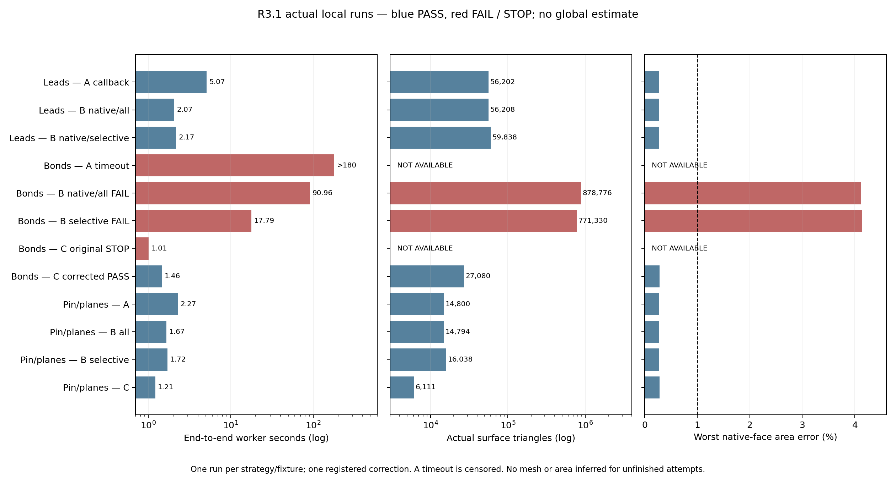
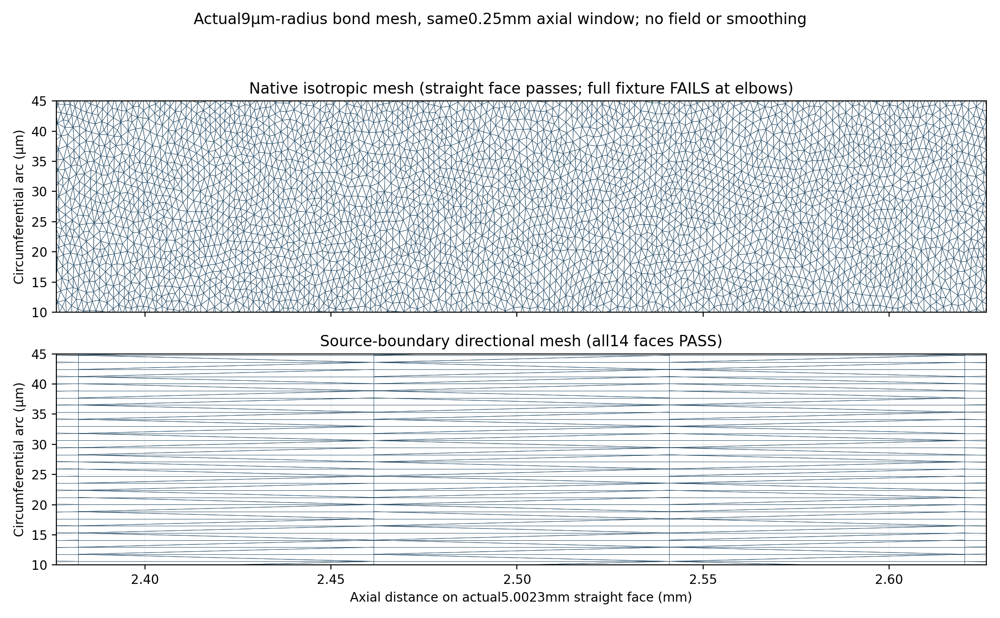

# R3.1 local native-surface meshing benchmark

Baseline `b009f36ba8ba4f90de5e19e1aadb93327e8b4f6e`; implementation in the
existing sim:0.0 only. This is a separately versioned local numerical geometry
experiment, not a new global mesh or physical model. Original R3/R2 artifacts,
824-solid physical STEP,38-page Rev3 and historical failures remain immutable;
issue#2 remains OPEN. The full user work order is retained with the data.

## Prospective registration — before meshing

The read-only inventory selects54 actual R3 native faces in three fixed fixtures:
32 Cu-lead/jacket faces,14 detector-bond faces,8 pin/ceramic/contact faces. The
first fixture contains all four partial Cu/polymer patches and their real bare
Cu/gas complements; all outer polymer surfaces and annular ends are included.
The bond fixture includes the9µm-radius, approximately5mm long straight wire
surfaces and toroidal elbows. The final fixture includes pin1's three native
cylindrical sections and terminal, two perforated ceramic planes, a0.16mm²
P/solder contact and a0.06mm² finite tab joint. Exact tags, owners, R2 ancestors,
areas, boundary multiplicities, curve lengths and curvature are in `inventory.json`.
Selection precedes all new mesh outcomes; no synthetic replacement geometry.

Each strategy/fixture runs once, sequentially, <=180s including setup/validation,
4CPU/8GiB in the unchanged pinned image. Maximum12 normal runs plus **one total**
targeted corrective replay (<=180s) for a demonstrated implementation defect,
never geometry/size/accuracy tuning. An external parent kills a worker at180s and
preserves censored progress/resource evidence. No uncontrolled retries. Total
normal worker budget2160s, replay180s. The following fixed comparisons apply:

| Strategy | Sizing | Explicit curve constraints | Purpose |
| --- | --- | --- | --- |
| A_callback_all | Original R3 Python callback, instrumented | All4521 R3 shared-edge counts /20 curved quad constraints | Reproduce local behavior and count callback cost |
| B_native_all | Constant MathEval + native Restrict/Min fields, identical face sizes | Same4521 counts/quad constraints | Isolate callback versus native field at matched sizing/edges |
| B_native_selective | Same native face fields | Quad-required edges plus selected curved edges; other edges native | Assess broad transfinite constraints; counts may differ |
| C_directional | Native source UV grid on supported periodic Cylinder/Torus; native mesher on other faces | Shared source-curve grid;48 full-circle segments, axial<=80µm for wires /300µm for pins, arc<=π/24 | Separate circumferential and axial resolution without CAD imprint |

A/B_all preserve the original R3 settings and per-face sizes exactly; native
Restrict fields exclude boundaries for this controlled comparison. Selective
fields include boundaries and apply common counts on curved/quad-required edges;
differences in boundary density are reported, not called a callback-only effect.
All mesh generation is restricted to explicitly visible selected faces and their
CAD boundaries. No other native face may acquire2D elements; no3D elements may
exist. Original CAD volume/face tags and actual owners must match before every run.

For C, periodicity is determined from the saved face's UV bounds and repeated
seam edge; no OCC Boolean/imprint or fabricated descendant mapping. Shared1D
curve nodes are generated once. Source UV grid boundary points must match unique
nodes on their **explicit native boundary curves** within1e-8mm; otherwise STOP
that directional fixture without guessing. Only genuine rectangular periodic
Cylinder/Torus surfaces are seeded; ordinary planes and other faces use native
meshing. Full circumferential seam closure uses shared node IDs, not duplicate
coincident nodes. Thin finite contacts remain distinct source faces.

Acceptance requires an actual native MSH, every selected face area error strictly
<1%, nonzero positive geometric triangles, complete selected-face ownership and
exact1D/2D shared-edge incidence (including repeated seam multiplicity). Every R2
ancestor with all local descendants present receives a separately aggregated area
comparison; new outer polymer faces have no R2 analogue. The previously accepted
R2 high-density mesh is read only as a quantitative reference, never relabeled R3.
No average error may hide one failed face. No global speedup/volume claim follows.

Profiles separate import/source validation, parametrization/curvature API calls,
sizing constraints,1D meshing, source-grid construction, native2D meshing, native
artifact write and independent area/topology validation. Report wall/CPU, peak
RSS, callback counts/body time by dimension/face, triangle/node counts, edge
length/aspect distributions, feature resolution and local conformality. Native
meshing time includes callback bridge/GIL overhead; callback-body time alone does
not measure that crossing. Timed-out ratios are lower bounds, not point estimates.

The run order is A and B variants on leads, bonds, pin/planes/contacts, followed
by C on pin/planes/contacts, bonds, then leads/jackets. A method/area failure is
retained; a source-identity failure stops the campaign. C topology incompatibility
stops C rather than remapping by inference. At most the one preregistered replay
may fix a provable coding defect; failed evidence is never overwritten.

## Preservation and publication gates

Before edits, verified original R3 source/artifact SHA seals and snapshotted93
protected inputs and85 preexisting untracked files, including the R2 mesh cache.
All824 source/378 contact identities,430 source volumes, gas1231.630061168mm³,
polymer0.077162028mm³ and explicit Kovar/Ni/Au axial cap requirements are unchanged.
All laws remain UNSET; no parallel polymer shell/gas path is introduced.

New benchmark/operator sources and exact case list are sealed before execution.
Focused positive/negative geometry/lineage/area/conformity tests, applicable
no-new-PDE regression, archive/master and original frozen hash guards precede
commit/push and exact-commit CI. Actual saved meshes and measured comparison
figures are required; no fictitious fields. Rev3 stays unchanged because local
meshing performance is an internal methods result, not new device physics.

Gmsh native Restrict/MathEval fields follow the
[primary reference manual](https://gmsh.info/doc/texinfo/gmsh.html#Specifying-mesh-element-sizes).
The inspected public manual is newer than pinned4.13.1; options are exercised
in the actual pinned runtime, with no version substitution.

## Results

**Local meshing gate PASS on all54 selected native faces using qualified method
families; no global trial.** Twelve workers actually ran:8 PASS,4 FAIL/STOP,
including the one corrective replay. Original C leads/jackets is NOT RUN. The
same source430-domain/2440-face CAD and laws are unchanged; local fixture files
are separate, not a merged whole-device surface or volume discretization.

Wall times below include the worker launch/import, sizing, meshing, artifact write
and area/topology checks inside the pinned container, but exclude Docker startup.
CPU/RSS and all phase timings are machine-recorded. A timeout has no measured
triangle/area result; a failed complete mesh is never advertised as accepted.
These are single-run descriptive ratios, not statistical confidence intervals or
measurements of run-to-run variance.

| Fixture / method | Wall (s) | Triangles | Worst area (%) | Gate |
| --- | ---: | ---: | ---: | --- |
| Leads/jackets A callback/all |5.071 |56,202 |0.273817 |PASS |
| Leads/jackets B native/all |2.069 |56,208 |0.273817 |PASS |
| Leads/jackets B native/selective |2.170 |59,838 |0.273817 |PASS |
| Detector bonds A callback/all |≥180 |NOT AVAILABLE |NOT AVAILABLE |STOP budget |
| Detector bonds B native/all |90.958 |878,776 |4.117190 |FAIL |
| Detector bonds B native/selective |17.787 |771,330 |4.142453 |FAIL |
| Detector bonds C original |1.010 |NOT AVAILABLE |NOT AVAILABLE |STOP exact boundary match |
| Detector bonds C corrected |1.463 |27,080 |0.285334 |PASS |
| Pin/planes/contacts A |2.269 |14,800 |0.273817 |PASS |
| Pin/planes/contacts B native/all |1.665 |14,794 |0.273817 |PASS |
| Pin/planes/contacts B native/selective |1.715 |16,038 |0.273817 |PASS |
| Pin/planes/contacts C original |1.214 |6,111 |0.285334 |PASS |

The highest recorded worker RSS is834.984MiB, below8GiB; the corrected bond
worker uses149.152MiB and1.522CPU-s. Actual end-to-end launch costs are included:
its internal computation is0.901s, source-grid construction0.171s and subsequent
native planar meshing0.023s. Boundary UV round-trip error is at most1.962e-12mm,
with original native boundary node IDs retained. All actual meshes contain zero
tetrahedra and no2D elements on unselected faces; the full430-domain entity catalog
is retained for lineage. Native node totals and nodes actually used by local
triangles are recorded separately, since unused original0D CAD vertices remain
in the source catalog; these are not a global field's degrees of freedom. Corrected
bonds have16,265 native-file nodes but13,544 used surface nodes;2,721 are remaining
catalog vertices. Native/selective leads have29,825 used surface nodes (32,522
total), original C pin/planes have3,337 (5,894 total); `node_usage.json` preserves
the actual file counts rather than treating these separate fixtures as one mesh.

### What the experiment identifies

1. **Callback and repeated setup cost are measurable.** On the matched lead/jacket
   pair, native fields preserve virtually identical counts (56,202 vs56,208) and
   all face areas while cutting end-to-end time2.45×; native2D meshing falls
   1.960→0.568s. The callback bond run reaches6,471,592 calls before its180s stop;
   only6.293s is inside the measured size-return function. That body number
   excludes callback bridge/GIL and profiling-bookkeeping overhead; it is not a
   direct measurement of all Python cost. A is instrumented; B uses an exact
   source-hashed cached R3 size plan. The local contrast supports removing this
   boundary-crossing path, but cannot apportion the original global600s exactly.
2. **The number4521 alone is not the bottleneck.** Native/all bond constraint
   setup takes0.013s (0.00788s measured sizing API calls). The important issue is
   numerical size compatibility: an original5.0023mm seam has63 intervals,
   about79.4µm each, against a1.8µm isotropic face request, a44.1× ratio. The
   toroidal seam spacing is about10.7× its face request. Native selective sizing
   frees the straight seams and changes boundary-field scope; native2D work drops
   84.016→10.327s (8.14×), though both elbow-area gates still fail. This paired
   change is not evidence that selectively removing constraints always helps:
   leads and pin controls become slightly slower, with different node counts.
3. **Directional source geometry avoids unnecessary axial refinement.** The
   corrected method retains actual circular partition knots (including4.461rad),
   duplicates only native seam identities in UV, and triangulates a directional
   interior. It passes all14 bond faces and original edges with27,080 triangles.
   The single-run end-to-end ratio versus the censored A attempt is **>123×**, a
   *local lower bound relative to an unfinished instrumented attempt*, not a
   qualified baseline speedup or global estimate. The rejected native meshes have
   28.48–32.45× more triangles; their failed areas remain visible.

There is a stronger fidelity-qualified **element-count** comparator: the archived
R2 accepted mesh has1,036,146 triangles on exactly these14 bond ancestors, versus
27,080 now (**38.26× fewer**). Both pass their original1% native-face area gate;
R2 maximum on this subset is0.506923%, new C maximum0.285334%. This subset alone
accounts for73.14% of the archived1,416,664-triangle R2 mesh. R2 per-face meshing
wall times were not archived, so no R2 runtime ratio is asserted. On the8 pin/
plane ancestors, R2's24,030 triangles compare to6,111 for original C (3.93× fewer).
For leads, the14 complete R2 ancestors compare41,074→33,232 triangles under
native/selective sizing;14 additional R3 outer-jacket faces have no R2 analogue
and are never hidden in that comparison.

**Global causal closure remains unresolved.** Only54/2440 source faces were
benchmarked; no complete trace exists for the original600s run. This investigation
identifies narrow-wire isotropic density, seam/face size mismatch, native mesher
fallback and callback overhead as real local contributors, not an exact sum
accounting for all global time. The different toroidal native undercoverage is
reproduced from saved meshes, not retrospectively corrected or blamed on extraction.
No expensive global rerun or further local optimization is launched.

### Fidelity, topology and limitations

Independent read-back opens all10 actual native MSH files without a CAD writer
or mesher, recomputes cross-product areas (the worker uses Gram determinants),
checks physical source-owner IDs, native curve/triangle incidence and seam
multiplicity, and reproduces8 accepted results plus2 completed area failures.
This is an independently implemented arithmetic/read-back check by the execution
agent, not a separate human or model-assisted physical review.
All partial jacket patches and bare complements pass under the native lead
fixture; the two original15µm polymer volumes still displace gas exactly. There
is no shell operator in parallel with gas, material substitution or copper path
through ceramic. Effective Kovar/Ni/Au axial cap metadata remains unchanged/UNSET.

Minimum actual mesh edges: native/selective lead fixture7.470µm; corrected bond
fixture1.079µm. Its48 interior circumferential divisions and80µm maximum axial
target produce maximum edge aspect73.98; this is intentional **surface**
anisotropy, not proven tetrahedral mesh quality. The native/all bond mesh reaches
aspect116.62 and includes Frontal-Delaunay→MeshAdapt fallback. Surface area and
edge conformity alone do not prove curvature-normal accuracy, high-order field
accuracy, volume error, material laws or electrothermal conservation. No PDE,
detector temperature, current rating, gas budget or OEM agreement follows.





The detail uses real saved vertices/connectivity on a0.25mm axial window of
face2387, converted through the unchanged source parametrization. It is explicitly
unwrapped and cropped, not a new mesh, smoothed field or fabricated3D illustration.
The native straight segment passes locally while its full fixture fails at elbows.
Both figures were visually inspected for labels, clipping and failure visibility.

### Reproduction and prospective algorithm

Authoritative data: `data/v3_r31_local_mesh_20261103`. The fixed `registration.json`
seals original worker/runner/inventory/validation sources and inputs before meshing;
`corrective_registration.json` separately seals the one exact-boundary correction.
The original preregistration note's bytes are preserved against its pre-run SHA.
`cases/*/resources.json` contains external timeout, child CPU/RSS and timestamps;
`worker/result.json` contains successful or rejected measured faces/profiles.
`progress.json` is partial evidence only, not final status. `mesh_archives.json`
records lossless deterministic gzip archives and native-MSH SHA identities, also
matched by independent read-back. Raw local MSH files remain preserved caches;
no original cache/trial was overwritten.

Read-only/verification commands, using the already pinned image:

```bash
./fem/run.sh pytest -q tests/test_v3_r31_mesh_integrity.py \
  tests/test_v3_analysis_r3_integrity.py
python3 -B -m reports.master.validate --current
./fem/run.sh python -B fem/archive_bath_spatial_device.py --verify
```

Re-execution of a mesh case requires a new output path and an explicit new budget;
do not overwrite or restart the sealed campaign. For method inspection, read
`scripts/v3_r31_worker.py` (original) and `v3_r31_worker_v2.py` (one correction),
the independent reader and measured summary. No original R3 producer was edited.
The worker exposes `--out`, so a separately authorized replay needs no source edit:

```bash
# Example ONLY after a new replay authorization; never an archived output path.
./fem/run.sh env OPENBLAS_NUM_THREADS=1 OMP_NUM_THREADS=4 timeout -s KILL 180 \
  python -B scripts/v3_r31_worker_v2.py --strategy C_directional \
  --fixture detector_bonds --out outputs/r31-authorized-replay/bonds
```

`prospective_global_algorithm_NOT_RUN.json` is a **dry specification**, not an
executed or qualified global pipeline. It maps all2440 original face IDs/owners
to cached native Restrict fields, using the corrected source-boundary directional
method only on the10 actually tested periodic bond patches, with shared1D curves
first and `MeshOnlyEmpty` surface filling. The remaining2386 faces lack local
benchmark evidence. It retains430 domains,824 source/378 contact identities,
all gas/jacket and pin obligations, with all laws UNSET; original strict1% gates
remain. No global runtime, element count or3D feasibility prediction is supplied.

**One proposed next action:** a separately authorized, single bounded **global
surface-only** trial of that frozen hybrid, checking all2440 native faces and
every complete R2 ancestor. It must have a newly preregistered wall/RAM/element
budget and STOP on any identity, area or topology defect. No global trial,
tetrahedralization or PDE is authorized or run by this R3.1 work order.

## Verification and publication

Focused58 tests PASS. Full applicable pinned regression: **715 passed,11 skipped**
(14 third-party dependency warnings), with `TE_FEM_SMOKE` explicitly unset.
Archive/master guards, both legacy checks and historical824-body source replay
PASS. The current baseline byte guard verifies5636 immutable tracked blobs
(3,095,430,003bytes),93 protected parent inputs and85 preexisting untracked files,
including the R2 mesh cache. All original R2/R3 data/producers,824-solid STEP,
38-page Rev3, fields and numerical FAIL/STOP gates are byte-identical. The new
MSH archives independently round-trip to the saved/read-back SHA identities.
Exact commands, times and logs are in `verification_01`; final artifact/source
hashes are sealed separately. Study
[2c47550](https://github.com/Kajin-0/TE_Cooled_MCT/commit/2c475509d6e0bd8fabcd784b48c88704ae0baaa6)
is published with[exact-commit CI PASS](https://github.com/Kajin-0/TE_Cooled_MCT/actions/runs/41662900682).
Receipt-only successors require their own exact CI before handoff; software PASS
does not qualify a global mesh or physics.

### Prospective single corrective replay — 2026-11-03T14:52:05Z

All original receipts are frozen. C passed the pin/plane/contact fixture, but
stopped the bond fixture before surface construction: its48-angle rectangular
grid could not match exact source boundary nodes on face2385 (max separation
0.000558602mm). The inspected native circular boundary is split at4.461049366rad,
not an integer multiple of2π/48; the adjacent end has another split at3π/2.
This is a demonstrated **uniform-grid implementation assumption**, not ambiguous
face lineage or permission to move native nodes. C leads/jackets remains NOT RUN.

Use the one allowed corrective replay **only on the same14 bond faces**. The
separately sealed v2 worker retains each actual native1D boundary node/ID and
its exact source-surface UV coordinates, duplicates the same seam node IDs at
the two periodic UV boundaries, and triangulates interior directional grid points
in normalized source UV using SciPy Delaunay. Source boundaries,48 interior
periodic positions,80µm axial target, all curve counts, physical geometry,
material laws and strict area/conformity gates are unchanged. This handles
different existing angular partitions without guessing/rebinding a CAD identity
or introducing a new curve. Boundary projection must round-trip within1e-8mm;
every triangle edge must still match the original source-curve node incidence.
One<=180s replay, no new native or callback run, no second correction. If it fails,
STOP that method; do not resume the unrun C lead fixture or a global mesh.
