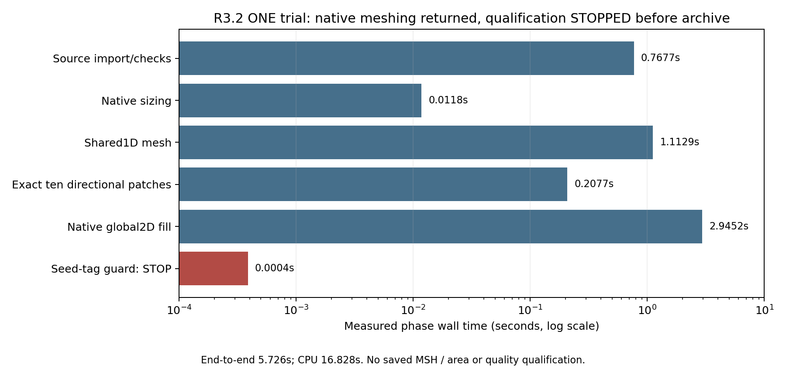

# R3.2 one global hybrid surface-only trial

Baseline `efd853cbd33a85acba5012b0b70521389ea31e0b`, existing sim:0.0 only.
The complete user work order is retained under `data/v3_r32_global_surface_20261103`.
No original geometry, field, accepted mesh, material law or38-page Rev3 changes.
Issue#2 and all historical failed release gates remain OPEN/unchanged.

## Registration before the single worker

Exactly **one** global2D mesh worker, including import, constraints,1D generation,
directional construction, native2D filling, serialization and validation, must
finish within600.0s. The parent kills at599.5s to reserve scheduling/cleanup margin;
no second worker, retry, pilot mesh, adaptive run or rerun after any failure.
Docker enforces4CPU/8GiB/offline; a parent monitors the child and stops at7.5GiB
observed RSS before the container cap when possible. Kernel OOM/timeout and phase
progress remain durable evidence. Accepted size is<=800,000 triangles. A larger
completed mesh still gets all2440 face-area checks if wall budget remains.

Frozen source:430 volumes/2440 uniquely owned native faces,824 physical source
bodies,378 finite contacts,88 essential series legs and isolated detector. Real
polymer jackets displace0.077162027868mm³ gas; six full/four partial Cu/polymer
patches and actual bare complements remain real CAD faces. Four effective pin
domains retain explicit axial Kovar/Ni/Au regions. All constitutive values UNSET.
Only source metadata and existing local MSH were read in preparation; no new mesh.

Directional faces are **exactly2385–2389 and2397–2401**, no pin or other wire face.
Use the unmodified R3.1 `seed_periodic` correction: exact source-boundary node IDs
and source UV coordinates,48 interior circumferential divisions,80µm axial target
and source turning-angle constraintsπ/24. Shared curves are discretized once.
Other2430 faces use the cached R3 h values with native MathEval/Restrict/Min,
IncludeBoundary=1, curved/quad-required constraints,20 previously registered
curved four-corner faces. Directional boundary counts override only their30
shared curves; no private seam nodes, no CAD Boolean/imprint or geometry change.
`MeshOnlyEmpty` fills native faces after the ten directional patches exist.
No `generate(3)`, PDE, material fit, detector-temperature or OEM claim.

Before meshing, verify every actual source face owner/area and volume mass against
the frozen registry; seal complete executed sources and inputs. Native surface
groups cover every2440 face and all430 volume IDs as metadata only. One globally
scheduled `generate(2)` call is allowed, preceded by one shared `generate(1)`.

## Measured gates and conventions

- Strict individual native face and all2422 complete R2 ancestor area errors
  `abs(A_mesh/A_CAD-1)<0.01`; no mean or selected-subset substitute.
- Actual positive TRI3 elements, every face/owner/physical group present, zero
  tetrahedra, no duplicate element tags or node triplets, <=800k triangles.
- Exact native curve-node incidence including repeated periodic seams. Triangle
  winding is normalized **only to the existing oriented CAD boundary**: a uniform
  opposite face is reversed, mixed/incompatible winding fails. Read-only old-MSH
  controls found28/4 positive/opposite lead faces and12/2 bond faces; source
  orientation is not inferred from desired heat/current results. All430 volume
  skins must be closed, manifold and consistently oriented with original owner
  signs. Every shared native face has opposite source-volume signs.
- Per-face and global edge lengths, longest/shortest edge aspect and shape quality
  `4*sqrt(3)*A/sum(edge²)` at min/1/5/50/95/99/max percentiles; positive values.
- At most8 deterministically spaced triangles per native face: chord centroid
  projected onto the underlying source CAD surface, unsigned normal-angle error
  `acos(abs(n_triangle·n_CAD))` and centroid distance. Signed-normal consistency
  is recorded per face. This is a **sampled underlying-surface measure**, not an
  exhaustive normal/Hausdorff bound or trim-aware distance certificate.
- Minimum edge/curvature and radial jacket-end metrics are reported; effective
  Ni/Au axial regions are law requirements, not separately meshed film volumes.
  Report actual nearest node z offsets to their datums; do not claim film-field
  resolution or3D through-thickness qualification from a surface mesh.
- Duplicate geometric triplets use1e-10mm coordinate quantization. If primary
  area/topology gates pass and time remains, attempt an exhaustive bounding-box
  hierarchy (16 triangles/leaf) for linear facet intersections. Narrow phase tests
  segment/triangle interior piercing plus coplanar positive-area overlap, with
  relative tolerance1e-10 and coplanar distance1e-9mm. Boundary-only touching is
  excluded; first measured improper intersection FAILS with native-face witnesses.
  A complete zero traversal is required for an intersection PASS; a time stop,
  skipped test or partial traversal is explicitly NOT MEASURED/NOT COMPLETE,
  never inferred intersection-free. If prior gates fail, this expensive check
  may be NOT RUN because the candidate is already rejected.

The registered requirement was to save actual MSH before validation, alongside
immediate counts and phase receipts, so a failed criterion cannot erase the
candidate. **The executed worker violated that ordering; see the STOP below.**
The planned independent fresh-file
read-back recomputes cross-product areas (worker Gram determinants), owner/group
and shared-edge/skin incidence without meshing; it is an independent arithmetic
implementation by this execution agent, not external physical certification.
Every unmeasured criterion is named. No global-surface success grants volume
meshing or physics authorization; unknown material/process/physical accuracy stays
separate. Failed candidate/gates are immutable, with no second global attempt.

## Provenance, verification and release

Pinned image `tecooledmct-fem:26.2.1`, identity
`sha256:a0b22cf70bbecaea2cbc8e1cf40aaef1bd620c187b73e251aee37a4fb9d28688`:
Gmsh4.13.1,NumPy2.1.3,SciPy1.14.1. No installation, rebuild or substitution.
Before edits,207 parent inputs and95 existing untracked/ledger files were hashed.
Original R2/R3/R3.1 artifacts/producer sources and canonical PDF remain unchanged.
Registration includes source hashes, metadata, one run slot and strict bounds.
Positive/negative nonmeshing tests precede the worker; final no-new-PDE regression,
archive/master and byte guards precede scoped publication and exact-commit CI.
Actual saved geometry/mesh figures are required if a mesh completes. This internal
technical note is not a second public report; Rev3 remains byte-identical.

## Result

**STOP. Exactly one global worker ran; no MSH or qualified surface was retained.**
The pre-run method above is separately sealed as `executed_source/preregistered_method.md`;
the result below does not amend its requirements. Native global2D generation
returned, then `face_mesh_hash` rejected a changed directional-seed identity.
That guard compared element types, numeric element IDs and node-tag connectivity
**before counts or serialization**, and the exception handler finalized Gmsh.
This avoidable implementation/evidence-retention error lost the in-memory mesh.
The exact producer remains frozen; there was no corrective mesh attempt.

| Observed quantity | Actual result |
|---|---:|
| Global worker attempts | 1 |
| End-to-end supervisor wall / CPU | 5.726083s /16.828188CPU-s |
| Child peak RSS / sampled VmHWM | 226.902344 /227.281250MiB |
| Import/source checks | 0.767712s |
| Native sizing and shared constraints | 0.011764s |
| Shared native1D generation | 1.112879s |
| Exact-ten directional construction | 0.207654s |
| ONE native global2D fill | 2.945213s |
| Guard phase before archive | 0.000387s, STOP |
| Gmsh console summary | 156,596 nodes;342,525 mixed-dimension elements |
| Audited global triangles / used surface nodes | NOT MEASURED |
| Before-fill directional triangles | 26,888 on exactly the ten registered faces |
| Timeout / memory stop / cgroup OOM | None /none /0 |

The console element total includes dimensions other than triangles and is
**not** a verified triangle count, a <=800k size PASS or a completeness proof.
Likewise the before-fill patch count does not prove those patches survived
the native fill. The process exit code0 records a handled exception; its
durable qualification status is STOP, not success.

The pinned read-only option check found `Mesh.Renumber=1`; the worker had not
overridden it. Gmsh documents automatic node/element renumbering after generation
([Gmsh reference manual, Mesh.Renumber](https://gmsh.info/doc/texinfo/gmsh.html)).
No native meshing log line names any of the ten seeded faces. A separate
deterministic API-stub control executes the exact frozen guard: changing only
element IDs trips the hash while leaving triangle connectivity unchanged.
These observations support renumbering as a plausible explanation, **not proof
that this run preserved directional geometry**. After-fill arrays were not
saved, so remeshing, ordering and other connectivity changes cannot all be
distinguished retrospectively. No geometry defect or CAD fidelity failure is
established by this exception.

| Gate / evidence | Status |
|---|---|
| Frozen CAD mass/face/owner registry;430 domains/2440 faces/824 sources/378 contacts | PASS source-only readback |
| Exact ten directional seed IDs, source/shared-boundary construction | PASS before-fill scope; after-fill preservation UNRESOLVED |
| <=600s,4CPU,8GiB; exactly one worker | PASS resource/scope receipt |
| Complete native physical-group MSH and <=800k actual triangles | STOP /NOT MEASURED |
| Each2440 CAD face area and each2422 R2 ancestor area | NOT RUN /NOT MEASURED |
| Positive/quality/aspect distributions, feature resolution, sampled normals | NOT RUN /NOT MEASURED |
| Final ownership, shared edges/seams, oriented430 skins | NOT RUN /NOT MEASURED |
| Duplicate/intersecting facets, fresh-file independent readback | NOT RUN /NOT MEASURED |
| Global tetrahedralization /PDE | NOT RUN /NOT RUN |



This measured phase chart is the only new result visualization. No native mesh
view can truthfully be supplied because no MSH survived. It does not establish
a qualified global speedup: the expensive audit/serialization phases did not run.

## Verification and exact evidence

All evidence is under `data/v3_r32_global_surface_20261103`: pre-run
`registration.json`, eleven `executed_source` snapshots, `global_run_slot.json`,
full `worker_stdout.log`, `run/result.json`, directional receipt, controller
resource receipt and post-run `failure_inspection.json`. All producer/input
hashes still match their pre-run seals. Failure tests deliberately reject the
STOP result as mesh evidence; analytic winding/skin/intersection tests validate
software controls only, not the missing global mesh.

Verified locally: **18 focused controls;733 applicable regression tests PASS,
11 runtime tests skipped**, full archive and current master integrity, both
legacy demos,5128 historical source blobs plus the comprehensive5763 baseline
blob guard,207 protected input files and95 preserved untracked/ledger identities.
Runtime CAD/Elmer smoke was not enabled. Original physical STEP, R2/R3/R3.1,
all historical failures and the exact38-page Rev3 PDF remain unchanged.
Issue#2 remains OPEN; constitutive laws remain UNSET. Software/integrity PASS
does not qualify any new global mesh or physical prediction.

Read-only reproduction after this sealed failure (never rerun the worker):

```sh
./fem/run.sh python -B -m pytest -q tests/test_v3_r32_surface_integrity.py tests/test_v3_r32_failure_record.py
python3 -B -m reports.master.validate --current
./fem/run.sh python -B fem/archive_bath_spatial_device.py --verify
```

`scripts/verify_v3_r32.py` records the exact full applicable regression and legacy
commands in `verification_01/checks.json`; its original one-time output directory
is intentionally exclusive. The release manifest seals the sources/evidence;
publication and exact-commit CI receipts belong in the operational chronology.

**One proposed next action, NOT authorized or executed:** a separately bounded
surface-only replay that saves raw counts/connectivity/MSH immediately after
native generation (also in a fail-safe exception path) and compares seeded
geometry with renumber-aware incidence/coordinates. First independently test
that retention path without global meshing. Preserve this failed worker and
all original strict gates; do not change CAD, physical laws, thresholds or
substitute a second run into this namespace. No volume mesh or PDE follows
automatically.
